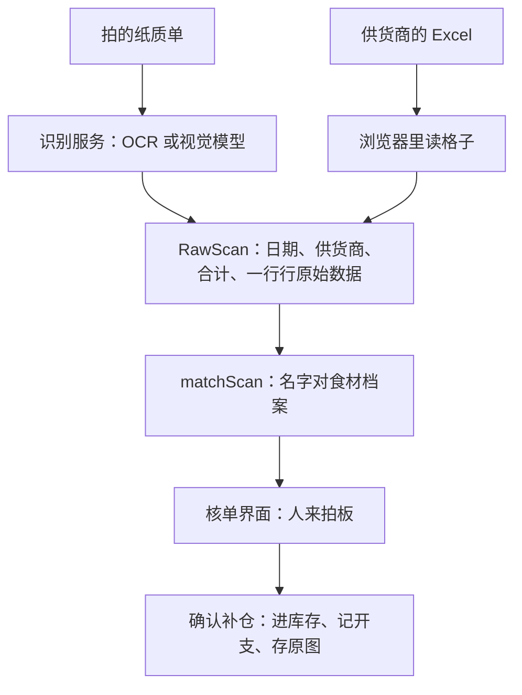
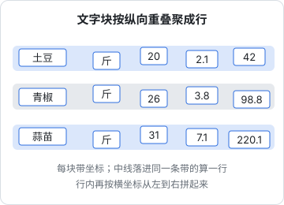

# OCR 与单据识别

上一章把照片变成了一张干净的 JPEG。这一章讲从 JPEG 到「一行行可以进库存的数据」之间发生了什么。hatch-counter 的进货单识别同时用了两种技术：腾讯云的传统 OCR 和智谱的视觉大模型。对比它们怎么处理同一张单子，能看清「版面」这件事在单据识别里有多重要；再看它为什么最终把「认字」和「归类」拆开，让模型只管前者。

prompt 怎么写、JSON 怎么宽容解析、失败怎么重试和降级，[《大模型应用工程》](../llm-app-engineering/)已经用这个案例讲过，这里只在需要时一笔带过。

## 整体结构：两条输入，一个合流点

店主补仓有两种来源：拍的纸质单子，和供货商发来的 Excel 表格。hatch-counter 的设计是让两条路**只负责「把格子里的字读出来」**，产出同一个形状的中间结果 `RawScan`，往后认名字、对档案、核对、入库全是同一套逻辑：



设计文档里写着：再加一条输入（比如 PDF 对账单），也只需要补「怎么拿到 `RawScan`」这一段。这是多模态功能最重要的架构原则：**把「感知」和「业务」隔开**。感知层可以换模型、换服务商、换输入方式，业务层不动。

`RawScan` 里每一行长这样（字段为说明而简化）：

```typescript
interface RawScanLine {
  rawName: string; // 单子上写的名字，原样
  unit: string | null; // 单子上写的单位，原样，例如「斤」「6斤7两」
  quantity: number | null;
  unitPriceCents: number | null; // 金额一律用「分」存整数
  amountCents: number | null;
}
```

注意「原样」两个字。识别层不做任何业务判断：不把「大白菜」对到档案里的哪样食材，不把「斤」换算成克。这些判断要么交给后面的确定性代码，要么交给人。

## 传统 OCR：自己从坐标里拼出版面

腾讯云 OCR 有两个接口可用，返回的东西完全不同：

| 接口 | 返回 | 适合 |
|---|---|---|
| 表格识别 V3（`RecognizeTableAccurateOCR`） | 单元格列表，每格带起止行号、列号和文字 | 有表格线的印刷单据 |
| 通用手写体识别（`GeneralHandwritingOCR`） | 文字块列表，每块带文字和外框坐标 | 没有表格线的手写单 |

无论哪个，你拿到的都只是「字和位置」，**版面要自己还原**。

### 表格接口：从单元格到行

表格接口已经把行列切好了，剩下三件事：

1. **铺成网格**：按行号、列号放进一个二维结构。跨行跨列的合并单元格只认左上角；同一格被拆成多段文字时拼起来
2. **找表头**：遍历每一行，用同义词表判断每格是不是列名（「品名」「名称」「货品」都算名称列，「金额」「小计」都算金额列），认出列名最多、且至少两列的那一行就是表头
3. **认不出表头时按列数猜**：六列就当作「序号、名称、单位、数量、单价、金额」，五列去掉序号……同时给用户一条警告「核对一下列有没有错位」

```typescript
// 同义词表的一部分。注意「名称」要排在更具体的词之后，判断用 includes
const COLUMN_WORDS = [
  { col: "name", words: ["产品名称", "商品名称", "品名", "名称", "货品"] },
  { col: "qty", words: ["数量", "重量", "件数"] },
  { col: "price", words: ["单价", "价格"] },
  { col: "amount", words: ["金额", "小计", "总额"] },
] as const;
```

还有一个兜底：如果某一行只有一格有字，说明表格线没切开，这一行退回按纯文本拆。

### 手写体接口：按坐标聚成行

手写体接口只给文字块。要还原成行，hatch-counter 用了一个简单有效的办法：按纵坐标排序，每个块的**中线**落进已有某一行的上下范围，就归入那一行，否则新开一行；行内再按横坐标从左到右拼起来。



```typescript
interface Box { text: string; x: number; y: number; h: number }

function clusterRows(boxes: Box[]): string[] {
  const rows: { top: number; bottom: number; parts: Box[] }[] = [];
  for (const b of [...boxes].sort((a, c) => a.y - c.y)) {
    const mid = b.y + b.h / 2;
    const row = rows.find((r) => mid >= r.top && mid <= r.bottom);
    if (row) {
      row.parts.push(b);
      row.top = Math.min(row.top, b.y);
      row.bottom = Math.max(row.bottom, b.y + b.h);
    } else {
      rows.push({ top: b.y, bottom: b.y + b.h, parts: [b] });
    }
  }
  return rows.map((r) => r.parts.sort((a, c) => a.x - c.x).map((p) => p.text).join(" "));
}
```

拼出来的每一行是一串文字，比如「土豆 斤 20 2.1 42」。再从**末尾**往前取数字：三个数按「数量、单价、金额」，两个数按「数量、金额」，一个数只当数量；名字末尾如果是单位词就摘出来。这个规则很粗糙，单子稍微不规范就会拆错，但它是确定性的，错了也能复现、能修。

传统 OCR 这条路最大的局限在于：**它认不出「哪个数是合计」**。代码里干脆不填合计，由界面按行累加给用户看。注释写得很清楚：「传统 OCR 认不出哪个数是合计，别硬凑」。

## 视觉大模型：让它直接读表

视觉大模型能直接理解「这是一张表格」，于是版面还原这一步可以交给它。hatch-counter 前后用过两种问法，演进过程很有代表性。

### 第一种问法：直接要业务字段

最初的 prompt 告诉模型「表格列依次是：序号、产品名称、单位、数量、单价、金额」，然后让它直接输出 `{ name, unit, quantity, unitPrice, amount }` 这样的业务字段。

这对 hatch-counter 自己那份空白模板很好用，但供货商的单子五花八门：有的多一列「规格」，有的多一列「备注」，有的「数量」其实是件数而单价按斤算，有的单价含税。让模型直接吐业务字段，等于让它**同时做两件事**：认出格子里写了什么，再判断每一格在业务上是什么意思。第二件事需要只有店主才知道的信息，模型只能猜。

### 第二种问法：认字归模型，归类归模板

后来的做法是把两件事拆开。每家供货商建一份「单据模板」，记录这家单子有哪几列、每一列对应哪个业务字段（或者「不要」）。识别时只把列名讲给模型听，让它**逐行把格子原样交回来**：

```text
这家供货商的单子表格列依次是：序号、品名、规格、单位、数量、单价、金额、备注（共 8 列）。
……
- rows 里每一行的格子数量必须跟 columns 一样多，空格子写空字符串 ""，不要跳过，也不要合并相邻的格子
- columns 照抄你在图上看到的表头；图上的表头跟上面给的对不上时以图为准
```

模型返回的是 `columns: string[]` 和 `rows: string[][]`，一个纯粹的二维表。哪一列是数量、哪一列是单价，由模板按位置决定，和读 Excel 表格走的是同一套取数代码。代码注释概括了好处：

```text
认字归模型，归类归模板。好处是序号、备注、送货人这些列不用再硬塞进某个字段，
单价含不含税、数量是件数还是斤这类只有店主知道的事也由模板一次定死、不用每张单再猜。
```

这背后是一条通用原则：**让模型做它擅长的感知，把需要领域知识的判断交给确定性的配置和人**。模型擅长「看清这一格写的是 6.7」，不擅长「知道这家的 6.7 是件数」。

### 建模板：也是「读出来再让人核对」

模板本身怎么来？店主拍一张这家供货商的单子，系统用另一个 prompt 只读表头那一行，**外加表头下面第一行照抄一遍**：

```json
{"supplier":"张三蔬菜","columns":["序号","产品名称","单位","数量","单价","金额"],"firstRow":["1","土豆","斤","30","1.80","54.00"]}
```

第一行不进库存，只摆在每列底下给人对着看。设计文档里的理由是：列并错了、少读一列，第一行的字一眼就对不上号。只给列名的话，「单位」和「数量」读反了人很难看出来；底下摆着「斤」和「30」，一眼就看出来了。

这张照片同时存成模板的「实物图」，以后核对时可以翻出来看。模板不自动保存，必须人点了「保存」才算数。

### 列对齐：错位是唯一会出大事的地方

按位置取数有个致命风险：模型多读或少读了一列，整排格子错一位，数量读进了单价那一列。数字全错，而且看起来都像合理的数。

hatch-counter 加了一道保险：模型照抄回来的表头如果和模板的列名对得上一多半，就**按列名对齐**，而不是按位置：

```typescript
export function alignTableColumns(
  modelColumns: string[],
  templateColumns: string[],
  rows: string[][],
): string[][] {
  const norm = (h: string) => h.replace(/\s+/g, "").toLowerCase();
  if (modelColumns.length) {
    const at = templateColumns.map((h) => modelColumns.findIndex((m) => norm(m) === norm(h)));
    // 认得出一多半列名才敢按名字对，认出一两个多半是巧合
    if (at.filter((i) => i >= 0).length >= Math.ceil(templateColumns.length / 2)) {
      return rows.map((row) => at.map((i) => (i >= 0 ? (row[i] ?? "") : "")));
    }
  }
  return rows; // 对不上才退回按位置
}
```

列数和模板不一致时还会给一句提示：「这张单看着有 7 列，模板记的是 6 列。要是这家换了单据格式，到单据模板把列改一下」。**模型的输出和你的预期不一致时，不要默默按位置硬对，要说出来。**

## 读出来之后：用业务规则交叉校验

无论哪条路，读出来的每一行都要过一遍确定性的校验。单据有一个天然的冗余：**数量 × 单价 = 金额**。三个数里认错一个，等式就不成立。

| 情况 | 处理 |
|---|---|
| 数量 × 单价 ≠ 金额 | 不改数，标黄「核对一下」，不挡提交 |
| 数量格空着，单价和金额都有 | 用「金额 ÷ 单价」算出数量，并提示「有 N 行是算出来的」 |
| 数量写在单位格里（「6斤7两」） | 解析单位格，换算出数量 |
| 单位认不出（「板」「件装」） | 不猜，升级成「要你定的」，挡着提交直到人挑一个单位 |
| 名字对不上档案 | 不自动新建，不猜，列出候选让人选 |

单位那一条是用教训换来的。设计文档里记了一个例子：如果把认不出的单位当成「没写」，「豆腐 12 板」会被静默记成 12 克，库存差几百倍，按进价折算出的单价离谱到把成本报表直接冲穿。**模型读对了字，业务上照样可能错；能被确定性规则抓住的错，就不要指望模型自己避免。**

核单界面把所有行按「要紧的先后」分组：名字认出来但数没认出来的 → 要你定的 → 要看一眼的 → 要新建的 → 对上了的。人只需要从上往下处理，最需要注意的永远在最上面。

## 降级要按能力筛

hatch-counter 把识别服务配成一条降级链：智谱限流时退到下一家。但有一个多模态特有的细节：**不同服务商的能力不等价**。

三个识别动作里，「按模板逐行读表」和「读表头」只有视觉大模型做得了，腾讯云那两个接口吐的是文字块，认不了「表格」这件事。所以降级时要按能力筛：

```typescript
type OcrCapability = "any" | "vlm";

// 按模板读表、读表头要 "vlm"，降级时把只会出文字块的服务商筛掉
async pick(need: OcrCapability) {
  const all = await this.providers.candidates();
  return all.filter((c) => c.enabled && isReady(c) && (need === "any" || c.kind === "zhipu"));
}
```

代码注释说明了为什么不能挨个往下试：退到一个根本做不了这件事的服务商，只会把一句本来说得清的报错，换成一堆看不懂的东西。错误分类、重试和总时限的设计见[《大模型应用工程》第 9 章](../llm-app-engineering/09-errors-retries.md)。

客户端那边，只问一个接口 `GET /v1/ocr/status`，回 `{ ready, tableScan }`：拍照识别能不能用、按模板读表能不能用。不回服务商、不回模型名。链上没有视觉大模型时，界面把「按图读列」的按钮灰掉，而不是让用户点了再报错。

## 留证据：原图、原话、实际干活的那一家

识别出问题时，你需要能复现。hatch-counter 每次识别都存三样东西：

- **原图**：确认补仓时可选「原图一起存档」，存的是转正后的那张
- **模型原话**（`rawText`）：模型返回的原始文本，识别有出入时能翻出来对照，判断是模型读错了还是解析代码错了
- **实际干成的服务商**（`provider`）：降级之后不一定是排第一的那家。这个字段只给排障用，不显示给店主

这三样加起来，就是一条完整的「测试用例」：原图是输入，人工核对后的结果是标准答案，模型原话是当时的输出。第 7 章会讲怎么把它们攒成评测集。

## 本章要点

- 把「感知」和「业务」隔开：各条输入只负责产出统一的中间结构，后面的逻辑共用
- 传统 OCR 只给字和位置，版面要自己还原：表格接口铺网格、找表头；手写接口按坐标聚行
- 视觉大模型可以直接读表，但最好只让它「认字」，把「哪一列是什么」交给模板
- 建模板时读表头外加第一行，让人对着第一行核对列有没有读错
- 按位置取数的最大风险是整排错位，能按列名对齐就按列名，对不上要说出来
- 数量 × 单价 = 金额是天然的校验；认不出的单位和名字不猜，交给人
- 降级按能力筛，不要退到根本做不了这件事的服务商
- 存原图、模型原话和实际服务商，出问题能复现，也是评测集的来源
