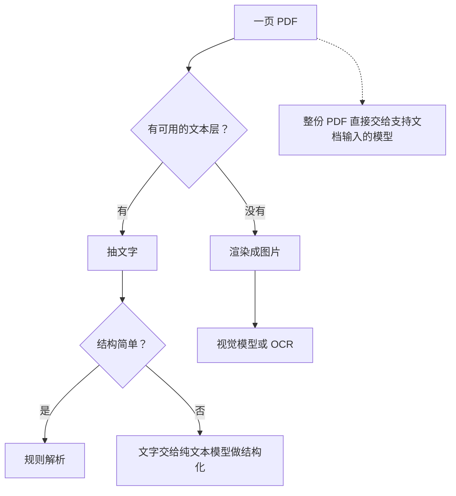
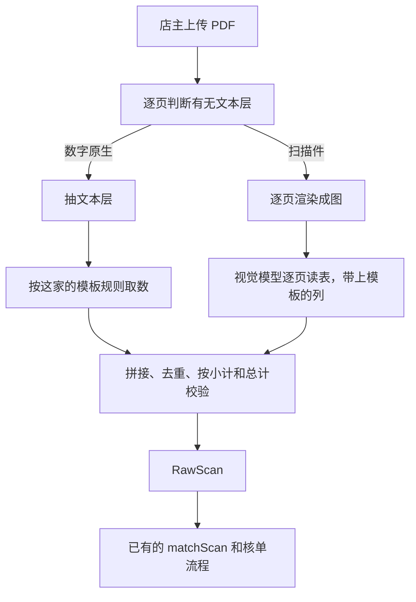

# 文档理解

进货单是一页纸、一张表。真实世界的文档要复杂得多：几十页的 PDF 对账单、两栏排版的合同、跨页的长表格、扫描件和电子版混在一起。这一章讲「文档理解」的几个核心问题：版面怎么分析、PDF 该抽文字还是转图片、多页文档怎么拆开读再拼回来，以及长图怎么切块。案例延续 hatch-counter：它的设计文档预留了「PDF 对账单」这条输入，我们按它的架构推演一遍该怎么做。

## 版面分析：先搞清楚「该按什么顺序读」

人读一页文档时，会下意识地做几件事：认出哪里是标题、哪里是正文、哪里是表格；知道两栏排版要先读左栏再读右栏；忽略页眉页脚和页码。这些合起来叫**版面分析**（layout analysis），它要回答两个问题：

| 问题 | 例子 | 处理不好的后果 |
|---|---|---|
| 区块是什么类型 | 标题、段落、表格、图片、页眉、页脚、印章 | 页码混进正文，表格被当成段落 |
| 阅读顺序是什么 | 两栏排版、侧边栏、图注 | 左右两栏的句子交错拼在一起 |

传统做法是专门的版面分析模型：先检测出各个区块的框和类型，再按规则排序，表格区块交给表格识别，文字区块交给 OCR。开源和商业的文档解析工具大多是这个流水线。

视觉大模型把这些步骤**隐式地**做了：你让它「读出这页的正文」，它会自己跳过页眉、按栏读。效果在常见版式上很好，但它不会告诉你它是怎么分的区，出错时也很难定位。所以实践中常见的是混合方案：版面简单、只要内容时直接交给大模型；需要精确结构（比如要把每个表格单独存下来、要保留原文坐标做高亮）时用专门的解析工具。

## PDF 的两种身份

拿到一个 PDF，第一件事是判断它是哪一种：

| 类型 | 怎么来的 | 里面有什么 | 怎么读 |
|---|---|---|---|
| 数字原生 | 从 Word、Excel、财务系统直接导出 | 有文本层：每个字的字符和位置都在 | 直接抽文字，又快又准，不花模型钱 |
| 扫描件 | 扫描仪、手机拍照转 PDF | 每页只是一张图 | 当图片处理：OCR 或视觉模型 |

还有混合的：扫描件经过 OCR 处理后叠了一层文本层（质量参差不齐），或者一份文件里一半是导出的、一半是扫描插页。

判断方法很简单：抽一下文本层，看能拿到多少字。命令行可以用 poppler 工具集（macOS 上 `brew install poppler`，Debian 系 `apt install poppler-utils`）：

```bash
pdfinfo statement.pdf | grep Pages        # 总页数
pdftotext -layout -f 1 -l 1 statement.pdf - | wc -m   # 第 1 页抽出多少字符
pdftoppm -r 150 -png statement.pdf out/page  # 每页渲染成 150 DPI 的 PNG
```

`-layout` 让输出尽量保持原版面的空格对齐，对表格类文档更友好。

在 Node 里用 `pdfjs-dist`（Mozilla PDF.js 的 npm 包）做同样的判断：

```typescript
import { readFile } from "node:fs/promises";
import { getDocument } from "pdfjs-dist/legacy/build/pdf.mjs";

export async function textPerPage(path: string): Promise<string[]> {
  const data = new Uint8Array(await readFile(path));
  const pdf = await getDocument({ data }).promise;
  const pages: string[] = [];
  for (let i = 1; i <= pdf.numPages; i++) {
    const page = await pdf.getPage(i);
    const content = await page.getTextContent();
    pages.push(content.items.map((it) => ("str" in it ? it.str : "")).join(" "));
  }
  return pages;
}

// 一页抽出的字少于阈值，就当它是扫描页
export const isScanned = (text: string) => text.replace(/\s/g, "").length < 20;
```

阈值按你的文档定。逐页判断比整份判断更稳，因为混合文档很常见。

## 三条路：抽文字、转图片、直接交 PDF



| 路线 | 优点 | 缺点 |
|---|---|---|
| 抽文本层 + 规则 | 免费、确定、毫秒级 | 只适用于数字原生 PDF；表格的列关系可能丢失 |
| 抽文本层 + 纯文本模型 | 比视觉便宜，能处理不规则结构 | 抽出来的文字丢了版面，模型可能分不清哪个数属于哪一列 |
| 渲染成图 + 视觉模型 | 什么 PDF 都能读，版面信息完整 | 最贵、最慢 |
| 直接交 PDF | 代码最少，模型同时能看到文字和版面 | 不是所有厂商都支持；页数和大小有上限；成本不好控制 |

最后一条在部分厂商的 API 里有原生支持。以 Anthropic 的 Messages API 为例，PDF 作为 `document` 内容块传入，文档放在提问之前：

```typescript
import Anthropic from "@anthropic-ai/sdk";
import { readFile } from "node:fs/promises";

const client = new Anthropic();
const data = (await readFile("statement.pdf")).toString("base64");

const res = await client.messages.create({
  model: "claude-opus-5-5",
  max_tokens: 16000,
  messages: [
    {
      role: "user",
      content: [
        { type: "document", source: { type: "base64", media_type: "application/pdf", data } },
        { type: "text", text: "这是一份供货商月度对账单。逐行列出每张送货单的日期、单号和金额，输出 JSON。" },
      ],
    },
  ],
});
```

它对单次请求的大小和页数有上限（当前文档写的是请求 32MB、最多 600 页，上下文较小的模型页数上限更低），会随版本调整，以官方文档为准。每一页都会按图片和文字两部分计 token，几十页的文档一次就是可观的费用。

**怎么选**：数字原生、格式固定的（比如某个财务系统导出的对账单）优先走文本层 + 规则，零成本且稳定；格式多变或扫描件走视觉模型；原型阶段、页数少、要快速验证时直接交 PDF。

## 多页文档：拆开读，再拼回来

即使模型支持一次读整份 PDF，生产环境里也常常**逐页处理**：

- **输出长度有上限**。一份 30 页的对账单，逐行输出可能超过 `max_tokens`，截断后整份 JSON 都解析不了。hatch-counter 在单张单据上就遇到过：「识别结果被截断了（单子行数太多），可以把单据分两张拍」
- **失败可以局部重试**。第 17 页读失败了，只重试第 17 页
- **能并发**。10 页并行读，总时间接近单页
- **能缓存**。按每页图片内容的哈希缓存结果，同一份文件重传不再花钱

逐页处理带来的新问题是：**页和页之间有关系**。

### 跨页表格

长表格最常见的问题是表头只在第一页。第二页开始，模型只看到一堆数字，不知道每列是什么。解决办法是**把第一页读到的表头带给后续每一页**，这和 hatch-counter 「把模板的列讲给模型听」是同一个思路：

```typescript
import pLimit from "p-limit";

interface PageResult {
  page: number;
  columns: string[];
  rows: string[][];
}

export async function readMultiPageTable(
  pages: { page: number; base64: string }[],
  readPage: (img: string, knownColumns: string[] | null) => Promise<Omit<PageResult, "page">>,
): Promise<PageResult[]> {
  // 第一页单独读，拿到表头
  const first = await readPage(pages[0].base64, null);
  const columns = first.columns;
  // 后续页并发读，每页都告诉模型「表格列依次是……，这一页可能没有表头」
  const limit = pLimit(4);
  const rest = await Promise.all(
    pages.slice(1).map((p) => limit(async () => ({ page: p.page, ...(await readPage(p.base64, columns)) }))),
  );
  return [{ page: pages[0].page, ...first }, ...rest].sort((a, b) => a.page - b.page);
}
```

并发数不要开太大，视觉接口的限流通常比文本接口更紧。

### 拼接时要处理的几件事

| 问题 | 处理 |
|---|---|
| 表头在每页重复出现 | 拼接时去掉和表头完全相同的行 |
| 一行被分页截成两半 | 让模型把页首、页尾不完整的行标出来，拼接时合并；或者渲染时给相邻页留重叠 |
| 页眉页脚、页码、「接上页」 | prompt 里要求跳过，拼接后再用规则过滤一遍 |
| 每页有小计、最后有总计 | 用来校验：各页明细之和应等于小计，小计之和应等于总计 |
| 顺序 | 并发返回的顺序不确定，按页号排序 |

最后一条校验非常值钱。多页文档的错误往往是「漏了一页的某几行」，单看每页都没问题，只有加总一对才发现。这和单据的「数量 × 单价 = 金额」是同一类东西：**文档里的冗余信息就是免费的校验**。

## 长图和大图：切块

还有一类文档不是 PDF，而是一张很长的图：手机截的长截图、收银系统打出来的长条小票、拼接起来的报表。第 1 章讲过，服务端会把超过上限的图等比缩小，长图一缩，字就小到看不清了。

办法是**切块**：沿长边切成几段，每段单独识别，再拼起来。关键是**相邻块要有重叠**，否则恰好被切线穿过的那一行会两边都读不全：

```typescript
import sharp from "sharp";

/** 把长图沿高度切成若干块，相邻块重叠 overlap 像素 */
export async function sliceTall(input: Buffer, blockHeight = 1600, overlap = 120): Promise<Buffer[]> {
  const { width = 0, height = 0 } = await sharp(input).metadata();
  const blocks: Buffer[] = [];
  for (let top = 0; top < height; top += blockHeight - overlap) {
    const h = Math.min(blockHeight, height - top);
    blocks.push(await sharp(input).extract({ left: 0, top, width, height: h }).jpeg({ quality: 85 }).toBuffer());
    if (top + h >= height) break;
  }
  return blocks;
}
```

重叠区里的行会被读两次，拼接时要去重。去重可以按「相邻两块的末尾几行和开头几行内容相同」来判断；如果行里有序号、单号这类唯一标识，按它去重最可靠。

## 推演：给 hatch-counter 加 PDF 对账单

把本章的内容串起来，推演一下 hatch-counter 如果要支持「供货商月底发来的 PDF 对账单」，该怎么做（这是按它的架构做的设想，不是现有功能）：



要点：

1. **新增的只有「怎么拿到 RawScan」这一段**，名字匹配、核单、入库全部复用。这正是第 3 章「感知和业务隔开」的回报
2. **模板继续起作用**：每家供货商的对账单格式固定，第一次读出列、让人核对，以后按模板取数
3. **校验比单张单据更重要**：一份对账单可能对应十几张送货单，漏一行就是一笔对不上的账
4. **对账单和已录入的单据比对**：对账单的价值不在于再录一遍，而在于和店里已经录过的单子逐笔对照，找出漏录和金额不一致的。这是纯业务逻辑，不需要模型

## 本章要点

- 版面分析回答两个问题：区块是什么类型、按什么顺序读；视觉大模型隐式地做了这件事，但不透明
- PDF 先分数字原生和扫描件，逐页判断；有文本层的优先抽文字，免费且确定
- 抽文字、转图片、直接交 PDF 三条路各有取舍，格式固定的用规则，多变的用视觉模型
- 多页文档逐页处理：避免输出截断，能局部重试、并发、缓存
- 跨页表格把第一页的表头带给后续页；拼接时去重表头、合并断行、按页号排序
- 小计和总计是免费的校验，多页文档最容易出的错是漏行
- 长图沿长边切块，相邻块留重叠，拼接时去重

## 动手练习

1. **判断 PDF 的身份**：安装 poppler 后，找一份从 Word 或表格软件导出的 PDF，运行 `pdftotext -layout -f 1 -l 1 export.pdf - | wc -m`；再用 `pdftoppm -r 150 -png export.pdf page` 把它渲染成图片，用 ImageMagick 拼回 PDF（`magick page-*.png scanned.pdf`），对 `scanned.pdf` 跑同一条命令。

   验证：导出的 PDF 第一页能抽出成百上千个字符；拼回的 `scanned.pdf` 抽出的字符数接近 0（只剩换页符之类）。

   参考答案：后者每一页只是一张图，没有文本层，和扫描件一样只能走 OCR 或视觉模型。用本章的 `isScanned` 逐页判断，就能把混合文档里的扫描插页挑出来。

2. **长图切块**：安装 `sharp`，生成一张 400×4000 的白图交给本章的 `sliceTall`（默认块高 1600、重叠 120），打印块数和每块高度；再用 400×1600 的图试一次。

   验证：第一次得到 3 块，高度依次为 `1600`、`1600`、`1040`；第二次只有 1 块，高 `1600`。

   参考答案：每次往下走 `1600 − 120 = 1480` 像素，相邻块之间有 120 像素重叠，被切线穿过的那一行在两块里都能完整出现一次，拼接时再按内容或序号去重。

3. **拼接多页结果**：写一个函数，输入是并发返回、顺序打乱的三页结果，每页有 `page`、`rows`（每行 `[单号, 金额]`）和 `subtotal`。第 2、3 页的第一行是重复的表头 `["单号", "金额"]`，第 3 页漏了一行金额为 120 的送货单，但它的 `subtotal` 还是按纸面写的。按本章的拼接表去重表头、按页号排序，再逐页核对明细之和与小计。

   验证：拼好的行按页号排列且不含表头行；第 3 页的明细之和比小计少 120，函数报出「第 3 页明细与小计不符」。

   参考答案：单看每一页都像是正常的表，只有用小计一对才发现漏行。文档里的小计、总计和单据的「数量 × 单价 = 金额」一样，是免费的校验。
