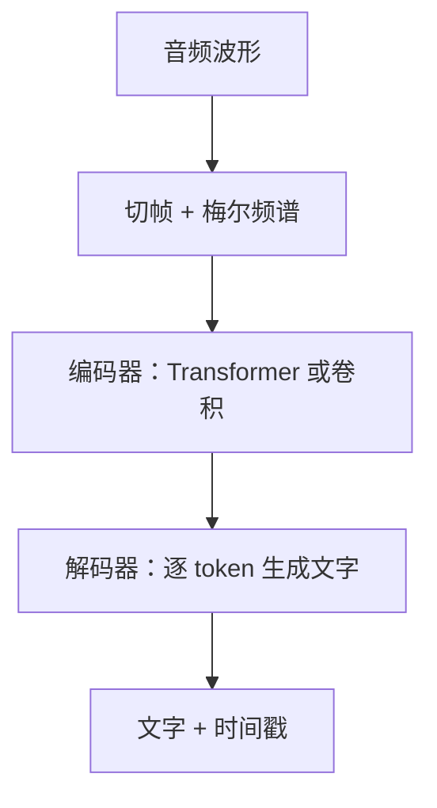
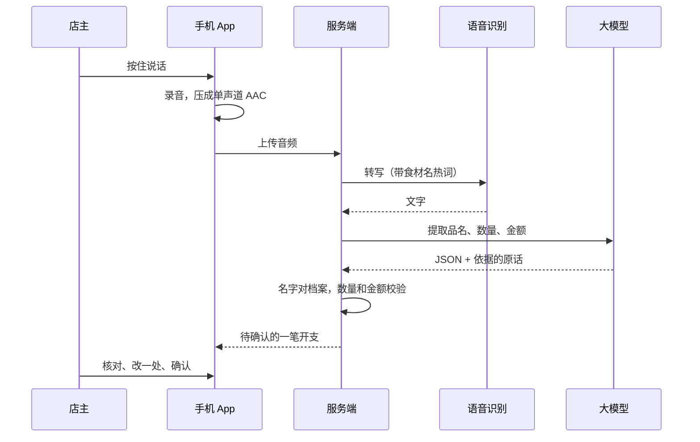
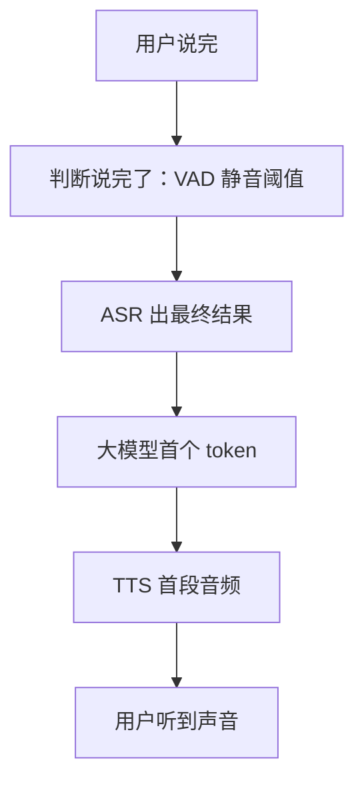

# 语音识别与合成

语音是另一种「非文字」输入，而且在某些场景下比拍照更自然：店主在后厨两手是油，说一句「刚买了三斤半五花肉，花了九十四」比打开 App 一格格填快得多。这一章讲语音识别（ASR，Automatic Speech Recognition）和语音合成（TTS，Text-to-Speech）的基本原理，以及把它们接进产品时真正难的地方：数字和单位、切分与时间戳、延迟。案例用一个设想中的「语音记一笔开支」功能（hatch-counter 目前没有这个功能，这里按它的架构推演）。

## 声音在计算机里是什么

麦克风采到的是空气压力随时间的变化，数字化之后是一串采样值：

| 参数 | 含义 | 语音识别常用值 |
|---|---|---|
| 采样率 | 每秒采多少个点 | 16 kHz（电话音质是 8 kHz，音乐是 44.1 / 48 kHz） |
| 位深 | 每个点用多少位表示 | 16 bit |
| 声道 | 单声道还是立体声 | 单声道 |

16 kHz 足够覆盖人声的主要频率。手机录出来的通常是 44.1 或 48 kHz 的 AAC（`.m4a`），送去识别前一般要转成 16 kHz 单声道。用 ffmpeg：

```bash
ffmpeg -i memo.m4a -ar 16000 -ac 1 -c:a pcm_s16le memo.wav
```

很多云端接口自己会转换，直接收 m4a、mp3；但本地模型（比如下面的 whisper.cpp）通常只收 16 kHz 的 WAV。

## 语音识别的原理

模型不直接看波形，而是先把声音变成**频谱图**：把音频切成几十毫秒一帧，对每帧做傅里叶变换，得到「这一小段时间里，每个频率有多强」。再把频率轴按人耳的感知方式压缩（梅尔刻度，低频分得细、高频分得粗），就得到**梅尔频谱**。它是一张二维图：横轴是时间，纵轴是频率，亮度是能量。

有了这张「图」，语音识别就变成了一个「看图写字」的问题，和第 1 章的视觉模型非常像：



主流的几种结构：

| 结构 | 代表 | 特点 |
|---|---|---|
| 编码器-解码器 | OpenAI 的 Whisper | 和翻译模型一样，解码器逐字生成；效果好、多语种，天然适合整段音频，不太适合低延迟流式 |
| CTC | 很多中文商用引擎的早期方案 | 每帧直接输出一个字符或空白，再合并；快，适合流式 |
| Transducer（RNN-T 类） | 各家流式识别引擎 | 边听边出字，延迟低，是实时字幕、语音输入法的常见选择 |
| 语音大模型 | 能直接听音频的多模态大模型 | 不只转写，还能理解语气、直接回答，成本更高 |

Whisper 有两个工程上要知道的特性：

- **以 30 秒为一个窗口**处理音频，更长的音频要切段
- **静音或噪音段可能「幻听」**：输出一些训练数据里常见的句子（比如视频字幕结尾的客套话）。所以送进去之前最好先切掉静音

## 识别之后才是难点

现在的语音识别引擎对普通话的转写准确率已经很高，产品里真正的难点在转写之后。

### 数字、单位和口语

「语音记一笔」的核心是数字，而口语里的数字千奇百怪：

| 用户说的 | 转写可能是 | 业务上应该是 |
|---|---|---|
| 三斤半 | 三斤半 / 3斤半 | 数量 3.5，单位斤 |
| 九十四块 | 94块 / 九十四块 | 金额 94 元 |
| 一百二 | 一百二 / 120 / 102 | 120（口语省略了「十」） |
| 两块五一斤 | 两块五一斤 / 2.5一斤 | 单价 2.5 元 / 斤 |
| 幺三九 | 139 | 电话号码里的「幺」是 1 |

把口语形式转成书面形式，在语音领域叫**逆文本标准化**（ITN，Inverse Text Normalization）。很多云端识别接口带这个选项，能把「九十四块」直接输出成「94 块」。但「一百二」这种依赖语境的写法，规则很难完全覆盖。

实践中更稳的做法是两步走：**识别引擎只管转写，结构化交给大模型**，并且让大模型输出时保留原话：

```text
你在帮一家餐馆记账。下面是店主的一句语音转写，可能有同音错字。
从中提取开支信息，只输出 JSON：
{"item": 品名, "quantity": 数量或 null, "unit": 单位或 null, "amountYuan": 金额或 null, "heard": "你依据的原话片段"}

规则：
- 口语数字转成阿拉伯数字：「一百二」是 120，「三斤半」是 3.5 斤
- 只说了单价和数量没说总价时，amountYuan 写 null，不要自己算
- 听不出来的字段写 null

转写：刚买了三斤半五花肉花了九十四
```

`heard` 字段让核对界面能把「依据的原话」和提取结果并排摆出来，用户一眼就能看出哪里听错了。这和第 3 章「存模型原话」是同一个道理。

### 同音字和领域词

「五花肉」可能被转成「五花入」，「蒜苗」可能变成「算苗」。两个办法：

1. **热词 / 提示词**：大部分识别接口支持传一组「热词」提高它们被识别出的概率；Whisper 支持一段初始提示（initial prompt），可以把这家店的食材名单放进去
2. **事后纠正**：把转写结果里的名字和食材档案做模糊匹配，给出候选让用户确认。和单据识别一样，**对不上的不猜，列出来让人选**

### 切分和时间戳

长音频（会议录音、一段几分钟的口述）要切段处理：

- 用 **VAD**（Voice Activity Detection，语音活动检测）找出有人说话的区间，在停顿处切，而不是机械地每 30 秒一刀
- 相邻段可以留一点重叠，拼接时去重，避免切在一个词中间
- 保留每段的时间戳，用户点一句文字能跳到对应的录音位置，核对效率高很多

## 在本地跑：whisper.cpp

想先在自己电脑上试，或者对隐私有要求，可以用 whisper.cpp：它是 Whisper 的 C/C++ 实现，在 Apple Silicon 上跑得很快，不需要 Python 环境。

```bash
git clone https://github.com/ggml-org/whisper.cpp
cd whisper.cpp
cmake -B build && cmake --build build -j --config Release

# 下载模型：tiny / base / small / medium / large 系列，越大越准越慢
./models/download-ggml-model.sh small

# 识别中文，输出纯文本文件 memo.wav.txt
./build/bin/whisper-cli -m models/ggml-small.bin -f memo.wav -l zh -otxt
```

命令行工具的名字和参数在不同版本间改过，以仓库 README 为准。中文识别建议至少用 small，tiny 和 base 的中文错字明显更多。

本地模型适合开发调试、内部工具和对隐私敏感的场景。要放进面向用户的产品，云端接口通常更省心：有流式、有热词、有 ITN、有方言模型，按时长计费。国内几家云厂商都提供语音识别服务，选型方法和第 1 章一样：拿自己的真实录音去测。

## 推演：语音记一笔开支

按 hatch-counter 的架构，这个功能的流程会是：



几个设计要点和单据识别一脉相承：

- **key 只在服务端**：识别和模型的 key 不进 App，App 只上传音频
- **感知和业务隔开**：识别引擎换一家，后面的提取、校验、确认界面都不动
- **最后一步永远是人确认**：语音比照片更容易出错，不能听完就直接入账
- **录音是个人信息**：要告知用途、征得同意，识别完是否保留录音要想清楚。具体合规要求以主管部门的最新规定为准

## 语音合成

TTS 是反方向：给一段文字，生成听起来自然的语音。传统流水线分三段：

| 阶段 | 做什么 | 中文的难点 |
|---|---|---|
| 文本前端 | 分词、数字和符号转读法、多音字判断、预测停顿和重音 | 「行」读 xíng 还是 háng；「2026」读「二零二六」还是「两千零二十六」；「1/2」读「二分之一」 |
| 声学模型 | 把读音序列变成梅尔频谱 | 语调自然、情感 |
| 声码器 | 把频谱变回波形 | 音质 |

现代的 TTS 大多是端到端的神经网络，音质已经很接近真人，文本前端的问题却一直都在：数字、日期、金额、英文缩写、品牌名的读法，模型经常读错。工程上的应对：

- **送进 TTS 之前自己把数字写成要读的样子**：金额「¥94.50」先转成「九十四元五角」
- **用 SSML 标注**：很多云端 TTS 支持 SSML（语音合成标记语言），可以指定某个词的读音、插入停顿、调整语速
- **固定的提示音直接预先合成好**存成音频文件，不要每次实时合成

声音克隆（用一小段录音复刻某人的声音）技术上已经很容易，但它属于深度合成，国内对此有专门的管理规定，涉及他人声音必须取得授权，生成内容需要按要求标识。做之前查清楚最新规定。

## 实时语音对话：延迟是一切

把 ASR、大模型、TTS 串起来，就是一个能对话的语音助手。这种级联方案最大的问题是**延迟叠加**：



每一段都有几百毫秒，加起来很容易超过一两秒，对话就会显得迟钝。优化手段：

- **每一段都流式**：ASR 边听边出字，大模型流式输出，TTS 按句子切分、拿到第一句就开始合成和播放
- **调 VAD 的静音阈值**：太短会在用户停顿思考时抢话，太长会让每轮都多等
- **支持打断**（barge-in）：用户开口时立即停止播放
- **端到端语音模型**：一些厂商提供直接「听音频、出音频」的实时接口，省掉中间的文字转换，延迟更低，但可控性和可观测性更差（你很难在中间插入业务校验）

对 OPC 的产品来说，大多数场景不需要实时对话。「按住说话、松开出结果、人确认」这种半双工交互，实现简单、成本可控，也更符合「数据要人拍板」的原则。

## 本章要点

- 语音识别常用 16 kHz 单声道；模型先把音频变成梅尔频谱，本质上也是「看图写字」
- Whisper 类模型适合整段转写，流式场景用 Transducer 类引擎；静音段要切掉，防止幻听
- 产品里的难点在转写之后：口语数字、单位、同音字、领域词
- 识别引擎只管转写，结构化交给大模型，并保留「依据的原话」供核对
- 长音频用 VAD 在停顿处切段，保留时间戳
- TTS 的难点在文本前端：数字、多音字、读法，送进去之前自己规范化或用 SSML
- 实时语音对话的核心是延迟，每一段都要流式；多数产品用半双工的「说完再确认」就够了
