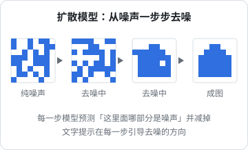
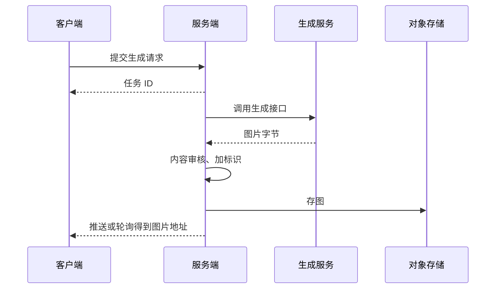

# 图像生成

前面几章都是「让模型理解图」，这一章反过来：让模型画图。对一人公司来说，图像生成最直接的价值是省掉一部分设计外包：官网插图、落地页配图、社交媒体素材、App 图标的初稿、商品图换背景。这一章讲图像生成的两条技术路线、那些参数到底在控制什么、怎么写出稳定的 prompt，以及把生成能力做进产品时要处理的工程和合规问题。

## 两条技术路线

### 扩散模型：从噪声里「雕」出图

过去几年主流的图像生成模型大多是**扩散模型**（diffusion model）。它的训练过程很巧妙：

1. 拿一张真实图片，一步步往上加随机噪声，直到变成纯噪声
2. 训练一个神经网络，让它看着「加了噪声的图」预测「加进去的噪声是什么」
3. 生成时反过来：从一张纯噪声开始，反复让网络预测噪声并减掉一部分，图像就一点点「浮现」出来



文字是怎么起作用的？每一步去噪时，网络除了看当前的图，还会看文字提示的编码（由一个文本编码器产生）。同一团噪声，提示是「一栋房子」时就往房子的方向去噪，提示是「一只猫」时就往猫的方向。

两个工程上的改进让扩散模型变得实用：

- **潜空间扩散**：不在像素上直接去噪，而是先用一个自编码器把图压缩到小得多的「潜空间」，在那里去噪，最后再解码回像素。计算量大幅下降
- **无分类器引导**（CFG，Classifier-Free Guidance）：每一步同时算「有提示」和「无提示」两个预测，然后朝「有提示」的方向多推一把。推得越多，图越贴合提示，但太多会过饱和、失真

### 自回归和原生多模态生成

另一条路线是让大模型像生成文字一样生成图片：把图片切成一个个图像 token，模型逐个预测。近年一些多模态大模型可以在同一个模型里理解和生成图片。

这条路线的优势在于**继承了语言模型的理解能力**：复杂指令遵循得更好，能在图里渲染出正确的文字，支持多轮对话式修改（「把背景换成蓝色，其他不变」）。代价通常是更慢、更贵。

两条路线在实践中常常混合使用，你作为调用方不太需要关心底层是哪种，但知道它们各自擅长什么有助于选型：

| 需求 | 更看重 |
|---|---|
| 风格化插画、氛围图、大量出图 | 扩散类模型的速度和风格多样性 |
| 图里要有准确的文字（海报、标题图） | 指令遵循和文字渲染能力强的模型 |
| 对一张图反复局部修改 | 支持对话式编辑或局部重绘的模型 |
| 自己部署、可控 | 开源扩散模型 |

## 参数在控制什么

不同服务暴露的参数不同，但常见的几个背后都对应着上面的原理：

| 参数 | 对应原理 | 实际效果 |
|---|---|---|
| 步数（steps） | 去噪迭代次数 | 太少图粗糙，太多收益递减、更慢 |
| 引导强度（guidance / CFG scale） | 朝提示方向推多少 | 低：自由发挥；高：贴合提示但可能失真 |
| 种子（seed） | 初始噪声 | 同一个种子 + 同一个提示 = 同一张图，用于复现和微调 |
| 尺寸 / 宽高比 | 潜空间的大小 | 模型通常在特定尺寸上训练，偏离太多会出现重复、畸形 |
| 负向提示（negative prompt） | CFG 里替代「无提示」的那一项 | 告诉模型「不要什么」，比如「模糊、水印、多余的手指」 |
| 参考图强度（图生图） | 从加了多少噪声的参考图开始去噪 | 低：接近原图；高：只保留大致构图 |

**种子是最被低估的参数**。找到一张满意的图之后，固定种子，只改提示里的一个词，就能做出风格一致的变体。不固定种子，每次都是从头碰运气。

## 写出稳定的 prompt

图像 prompt 和文本 prompt 的逻辑不同：它不是指令，而是**描述**。模型学的是「图片和它的描述文字」之间的对应关系，所以 prompt 越像一张真实图片的说明文字，效果越稳。

一个好用的结构：

| 部分 | 例子 |
|---|---|
| 主体 | 一碗冒着热气的红烧牛肉面 |
| 细节 | 面上有几片牛腱、葱花和香菜，汤色红亮 |
| 场景 | 放在木纹餐桌上，背景是虚化的小饭馆 |
| 风格 | 美食摄影 / 扁平插画 / 水彩 |
| 构图与镜头 | 45 度俯拍，浅景深，主体居中 |
| 光线 | 窗边自然光，暖色调 |
| 用途约束 | 横版 16:9，左侧留白放标题文字 |

几条经验：

- **具体胜过形容词**。「高质量、精美、大师级」帮助有限，「窗边自然光、浅景深」才是有效信息
- **一次只改一处**。固定种子，逐个调整，才知道是哪个词起了作用
- **要留白就明说**。做落地页配图时，「左侧三分之一留白」比事后裁剪好得多
- **图里的文字尽量少**。即使是文字渲染能力强的模型，中文长句也容易出错。标题文字最好在设计工具里后加，生成时只留位置
- **把 prompt 存下来**。和第 3 章存模型原话一样，记下 prompt、种子、模型版本和参数，好图才能复现

## OPC 能用它做什么

| 用途 | 适合程度 | 注意 |
|---|---|---|
| 官网、落地页插图 | 高 | 风格统一比单张惊艳更重要，用固定的风格描述和种子出一套 |
| 博客、社交媒体配图 | 高 | 量大，适合批量生成再挑 |
| App 图标、Logo | 只适合出草稿 | 生成的是位图，图标需要矢量和小尺寸下的清晰度，最后要人工重绘；Logo 还涉及商标检索 |
| 商品图换背景、扩图 | 高 | 用局部重绘或扩图（outpainting），保留商品本体 |
| UI 设计稿 | 低 | 生成的界面图看着像，但不能直接变成代码 |
| 书籍、文章封面 | 中 | 比如给 hatch-shelf 的书生成 `cover.png`；书名文字建议后加 |

## 做进产品：工程问题

如果要让你的用户在产品里生成图片（比如给店铺生成一张菜单海报），要处理这些问题：

### 异步和存储

生成一张图要几秒到几十秒，不要让 HTTP 请求一直挂着。标准做法是异步任务：



生成服务返回的临时链接通常有有效期，一定要**转存到自己的存储**。在 Cloudflare Workers 里存进 R2 只需几行：

```typescript
export interface Env {
  IMAGES: R2Bucket;
}

/** 生成服务的窄接口：给提示，还图片字节。每家服务商写一个适配器 */
type Generate = (prompt: string, opts: { seed?: number; aspect: "1:1" | "16:9" }) => Promise<ArrayBuffer>;

export async function generateAndStore(env: Env, generate: Generate, prompt: string, seed?: number) {
  const bytes = await generate(prompt, { seed, aspect: "16:9" });
  const key = `generated/${crypto.randomUUID()}.png`;
  await env.IMAGES.put(key, bytes, {
    httpMetadata: { contentType: "image/png" },
    // 把 prompt 和种子存进元数据，好图才能复现
    customMetadata: { prompt: prompt.slice(0, 500), seed: String(seed ?? "") },
  });
  return key;
}
```

窄接口的思路和《大模型应用工程》里讲的一样：不要试图抽象出覆盖所有厂商所有参数的通用层，上层只需要「给提示、还图片」。

### 成本和滥用

- 图像生成按张计费，单价远高于一次文本调用。给用户设配额，前端加防抖，避免连点
- 同一个 prompt 和种子的结果可以缓存
- 用户可以输入任意 prompt，就有人会尝试生成违规内容。服务商一般有自己的审核，但你仍然需要对输入和输出做检查，并保留记录

### 合规和版权

这部分变化快，只讲框架，具体以主管部门和法院的最新规定、判例为准：

- **生成内容标识**：国内已经出台针对 AI 生成合成内容的标识规定，要求在内容上添加显式标识（比如角标文字）和隐式标识（比如文件元数据）。面向公众提供生成服务的产品要按规定实现
- **生成式 AI 服务管理**：面向国内公众提供生成式 AI 服务，涉及备案、安全评估等要求。自己用来做官网配图和在产品里向用户提供生成功能，是两种不同的情况
- **版权**：AI 生成图片能否受著作权保护、归谁，各地司法实践并不统一。商用前看清服务商的使用条款
- **避免的事**：模仿在世艺术家的风格做商用、生成真人肖像、生成他人商标和品牌元素

## 本章要点

- 扩散模型从噪声出发，每一步预测并去掉噪声，文字提示引导去噪方向；潜空间和 CFG 让它变得实用
- 原生多模态生成继承了语言模型的理解能力，指令遵循、文字渲染、对话式编辑更强
- 步数、引导强度、种子、尺寸、负向提示都能对应到原理上；固定种子是做一致变体的关键
- 图像 prompt 是描述不是指令：主体、细节、场景、风格、构图、光线、用途约束
- 图里的文字尽量后加；图标和 Logo 只用生成结果做草稿
- 做进产品要异步、转存到自己的存储、控成本、做审核，并按规定加生成内容标识
