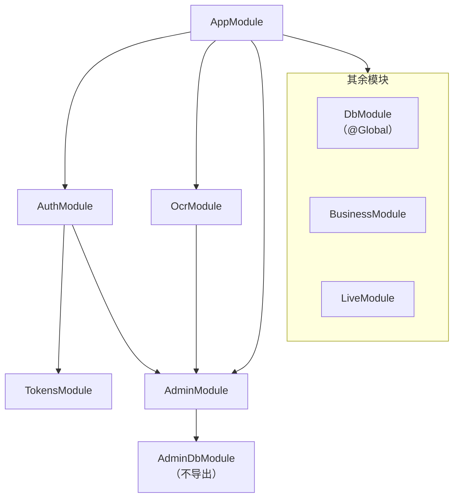

# 依赖注入与模块

NestJS 的第一印象往往是「装饰器好多」。但装饰器只是表皮，Nest 真正提供的是两样东西：一个**依赖注入容器**，和一套**请求处理管线**。这一章讲前者：对象是谁创建的、谁能拿到谁、模块边界怎么用来挡住不该发生的依赖。把这一层想清楚，后面的守卫、拦截器、配置、测试都只是在它上面搭东西。

## 这本书讲什么、怎么读

> [!WARNING]
> 全书按 NestJS 12 写（hatch-counter 用 `@nestjs/core` ^12.0.1；12.0.0 于 2026-08-27 发布到 npm）。书中标注「NestJS 12 新增 / 调整」的 API 和默认值，按 2026 年 11 月的 NestJS v12.0.0 发布说明、官方迁移指南（Migration guide）和对应文档页面逐条核对过；hatch-counter 只用到其中一部分，其余没在真实项目里跑过。后续小版本可能有变化，以 NestJS 官方文档为准。

这本书面向已经用 NestJS 写过接口、但还说不清「它为什么这么设计」的 TypeScript 全栈开发者。不讲 `nest new` 和 CRUD 入门，讲的是一个服务端从「跑起来」到「放心交给真实用户」之间那些决定：

| 章 | 解决的问题 |
|---|---|
| 1 依赖注入与模块 | 对象谁来建、模块边界怎么当成防线 |
| 2 请求生命周期 | 一个请求依次经过哪几层，顺序为什么重要 |
| 3 守卫、拦截器与管道 | 三种扩展点各写什么，怎么写才不漏 |
| 4 校验与 DTO | 入参怎么校验，zod 与 Standard Schema |
| 5 JWT 与权限模型 | 令牌怎么发、怎么轮换，权限默认拒绝 |
| 6 错误处理与错误文案 | 异常怎么收口，报错文案为什么在服务端写 |
| 7 配置与环境变量 | 启动即校验，哪些配置不该放环境变量 |
| 8 长连接 | SSE 和 WebSocket 怎么选，推送怎么做到不丢 |
| 9 测试 | 真库、真进程的 e2e，用测试守住约定 |
| 10 数据访问与事务 | repository 要不要、事务怎么跨 service 传、事务里的错误在哪接 |

全书的 API 按 **NestJS 12** 写（2026 年 8 月发布的大版本，官方包改成了 ESM 发布，路由参数原生支持 Standard Schema 校验）。版本差异大的地方会单独标出来。

贯穿全书的案例是 hatch-counter 的 `apps/api`：一个给中小餐饮门店用的多租户管理服务端，NestJS 12 + PostgreSQL + Drizzle，十来家店、一个人维护。它的代码注释和文档里记了大量「这里为什么这么写」，正好拿来当教材。读法建议：第 1–3 章按顺序读，它们是骨架；后面几章可以按手上的问题跳着读。

## 为什么需要依赖注入

先看不用容器时代码长什么样：

```ts
// 每个类自己 new 它的依赖
class ExpensesService {
  private db = new DbService(postgres(process.env.APP_DATABASE_URL!));
  private storage = new StorageService(createStorage());
}
```

问题马上出现：

- **谁持有连接池？** 每个 service 都 `new` 一个 `DbService`，就是每个 service 一个连接池，十个 service 就是十个池
- **测试怎么换？** 想在测试里换一个假的存储，得改源码或者猴子补丁
- **生命周期谁管？** 进程退出时谁去关连接？

依赖注入（DI）把「创建对象」这件事从业务类里拿走，交给一个容器：类只**声明**自己需要什么，容器负责按需创建、缓存、注入和销毁。

```ts
@Injectable()
export class ExpensesService {
  constructor(
    private readonly dbs: DbService,
    private readonly storage: StorageService,
  ) {}
}
```

容器默认把每个 provider 建成**单例**：整个应用只有一个 `DbService`，也就只有一个连接池。

## 容器怎么知道要注入什么

构造函数里写的是类型 `DbService`，但 TypeScript 的类型在编译后就没了，运行时的 Nest 是怎么知道的？

答案是 TypeScript 的 `emitDecoratorMetadata`。打开它之后，编译器会给每个带装饰器的类额外输出一行元数据：

```ts
// tsc 编译后大致多出这样一行
__metadata("design:paramtypes", [DbService, StorageService])
```

Nest 启动时读 `design:paramtypes`，就知道该按什么顺序注入哪几个 provider。所以 `tsconfig.json` 里这两项缺一不可：

```json
{
  "compilerOptions": {
    "experimentalDecorators": true,
    "emitDecoratorMetadata": true
  }
}
```

这里有一个 hatch-counter 真实踩过的坑：**服务端不能用 tsx 跑**。tsx 底下是 esbuild，而 esbuild 不输出 `emitDecoratorMetadata`，`design:paramtypes` 直接是 `undefined`，启动就报：

```text
Nest can't resolve dependencies of the ExpensesService (?, ?).
```

所以它的开发命令是 `tsc --watch` 加 `node --watch dist/main.js`，e2e 测试也是起一个真进程跑编译产物（见[第 9 章](09-testing.md)）。tsx 只用来跑迁移、种子这类不碰依赖注入的脚本。如果想要更快的编译，SWC 和 Oxc 都能输出装饰器元数据，Nest CLI 支持 `--builder swc`。NestJS 12 的 ESM 项目模板用 Vitest 4 + Vite 8 跑测试，模板里没有另装 SWC 插件：Vite 8 内置的 Oxc 转换看到 tsconfig 里的 `emitDecoratorMetadata` 就会输出元数据。Vite 的迁移说明也提醒了它的局限：Oxc 不做完整的类型推断，构造参数的类型如果只能靠类型推断才知道是什么（比如用 `import type` 引入的类），元数据可能退化成 `Object`，注入就会失败。

## Provider 的四种写法

`@Injectable()` 类是最常见的 provider，但容器能管理的不止类：

| 写法 | 用途 | 例子 |
|---|---|---|
| `useClass` | 注入一个类的实例（默认形式） | `{ provide: APP_GUARD, useClass: AuthGuard }` |
| `useValue` | 注入一个现成的值 | 测试里塞一个假对象 |
| `useFactory` | 用函数现算，可以是 async、可以注入别的 provider | 建连接池 |
| `useExisting` | 给已有 provider 起别名 | 一个实现对外暴露两个 token |

当被注入的东西不是类（比如一个 postgres.js 的 `Sql` 实例），就需要一个**令牌**（token）来标识它。hatch-counter 的数据库模块：

```ts
export const DB_SQL = Symbol("DB_SQL");

@Global()
@Module({
  providers: [
    {
      provide: DB_SQL,
      useFactory: () => {
        const cfg = loadConfig();
        return postgres(cfg.APP_DATABASE_URL, { max: 10 });
      },
    },
    DbService,
  ],
  exports: [DbService, DB_SQL],
})
export class DbModule {}

@Injectable()
export class DbService implements OnModuleDestroy {
  constructor(@Inject(DB_SQL) private readonly client: postgres.Sql) {}

  async onModuleDestroy(): Promise<void> {
    await this.client.end(); // 进程退出时关池
  }
}
```

用 `Symbol` 而不是字符串做令牌，是为了避免两个模块不小心用了同一个名字。`@Inject(DB_SQL)` 显式指定令牌，因为 `postgres.Sql` 只是一个类型，没有运行时的类可供 `design:paramtypes` 引用。

## 作用域：单例、请求级、瞬态

Nest 的 provider 有三种作用域：

| 作用域 | 实例数 | 代价 |
|---|---|---|
| `DEFAULT`（单例） | 全应用一个 | 无 |
| `REQUEST` | 每个请求一个 | 依赖它的整条链都变成请求级，每个请求重建一串对象 |
| `TRANSIENT` | 每个注入点一个 | 少见 |

很多人第一次需要「当前请求是谁」时会伸手去拿 `Scope.REQUEST`。问题是请求级会**向上传染**：一个请求级的 provider 被单例注入，那个单例也得变成请求级。

hatch-counter 用了另一条路：**AsyncLocalStorage**。「谁在改」这件事要写进数据库的变更流水，所有业务写都要用到它。它没有让一百来个 service 方法各收一个 `caller` 参数，也没有把 service 变成请求级，而是在一个全局拦截器里把调用者装进 `AsyncLocalStorage`，`DbService.withStore()` 开事务时再取出来：

```ts
export const actorStore = new AsyncLocalStorage<Actor>();

@Injectable()
export class ActorInterceptor implements NestInterceptor {
  intercept(ctx: ExecutionContext, next: CallHandler): Observable<unknown> {
    const actor = actorOf(ctx.switchToHttp().getRequest<Request>());
    // 处理函数在订阅时才跑，所以 run 要包在订阅外面
    return new Observable((sub) => actorStore.run(actor, () => next.handle().subscribe(sub)));
  }
}
```

所有 service 依旧是单例，「当前请求的上下文」走的是 Node 的异步上下文。注释里给出的理由很实在：漏传一处参数，那一处的改动就成了「系统改的」，而且不报错。为什么必须包在订阅外面，[第 2 章](02-request-lifecycle.md)讲拦截器时再展开。

## 模块：封装与边界

Nest 的模块不只是「把文件分组」。它是一个**可见性边界**：一个 provider 只有被所在模块 `exports`、并且被使用方 `imports`，才能被注入。



几条值得学的做法：

**用 `@Global()` 要克制。** `DbModule` 是全局的，因为几乎每个业务模块都要读写租户数据。但后台专用的 `AdminDbModule` **故意不是全局的**。它的注释说得清楚：业务模块拿不到后台连接，不是靠自觉，而是靠模块边界。业务代码里写 `constructor(private a: AdminDbService)`，启动时就直接报「can't resolve dependencies」，不用等到线上才发现。

**导出清单就是接口。** `AdminModule` 只导出三个配置服务给认证模块和识别模块用，`AdminDbService` 一直不导出。文档里写了一句很好的检查问题：往导出名单里加东西之前，先问「要的是配置，还是那条连接」。

**避免循环依赖，而不是用 `forwardRef` 掩盖它。** `OcrModule` 为了读识别服务的配置 import 了 `AdminModule`。后台还有几个「测试识别服务」的端点，如果挂在 `AdminController` 里，`AdminModule` 就得反过来 import `OcrModule`，成了环。hatch-counter 的做法是把这几个端点挂在 `ocr/ocr-admin.controller.ts`，归 `OcrModule` 管。`forwardRef()` 能让环跑起来，但环本身说明边界画错了，它会让启动顺序、测试替换都变得难以推理。

### 动态模块

`JwtModule.registerAsync()` 这类返回模块的静态方法叫**动态模块**：模块的 provider 取决于传入的配置。

```ts
@Module({
  imports: [
    JwtModule.registerAsync({
      useFactory: () => {
        const cfg = loadConfig();
        return { secret: cfg.JWT_SECRET, signOptions: { expiresIn: cfg.ACCESS_TOKEN_TTL } };
      },
    }),
  ],
  providers: [TokensService],
  exports: [TokensService],
})
export class TokensModule {}
```

hatch-counter 把令牌签发单独拆成 `TokensModule`，由 `AuthModule` 再导出。这样要验票的其他模块只依赖签发能力，不会把整个认证模块（及其对后台配置的依赖）拉进来。

## 生命周期钩子

provider 可以实现这些接口，在应用启动和关闭时做事：

| 钩子 | 时机 | 典型用途 |
|---|---|---|
| `onModuleInit` | 模块的依赖都解析完 | 起定时器、建监听连接 |
| `onApplicationBootstrap` | 所有模块初始化完、开始监听前 | 预热缓存 |
| `onModuleDestroy` | 收到关闭信号后 | 关连接池、清定时器 |
| `beforeApplicationShutdown` / `onApplicationShutdown` | 关闭后段 | 等连接全部断开 |

关闭类钩子要在 `main.ts` 里调用 `app.enableShutdownHooks()` 才会响应 `SIGTERM`。这在 Docker 部署里很关键：`docker stop` 发的就是 `SIGTERM`，不监听的话容器会等到超时被 `SIGKILL`，连接池不会好好关，正在写的长连接也会被硬掐。

hatch-counter 的推送中枢 `LiveHub` 是一个典型例子：

```ts
@Injectable()
export class LiveHub implements OnModuleInit, OnModuleDestroy {
  onModuleInit(): void {
    this.heartbeat = setInterval(() => this.ping(), HEARTBEAT_MS);
    this.heartbeat.unref(); // 不让这个定时器拖住进程退出
    void this.listen();     // 不 await：监听连不上不阻止整个服务端启动
  }

  async onModuleDestroy(): Promise<void> {
    this.stopped = true;
    if (this.heartbeat) clearInterval(this.heartbeat);
    // 断开所有推送客户端，关掉监听连接
  }
}
```

注意 `void this.listen()`：`onModuleInit` 可以返回 Promise，Nest 会等它。但推送是锦上添花，数据库的监听连接暂时连不上时，业务接口应该照常可用，所以这里故意不等。

**NestJS 12 的变化**：生命周期钩子（`onModuleInit`、`onApplicationBootstrap` 和关闭类钩子）改为按组件在模块树中的层级依次调用，provider 或模块之间有依赖时，顺序可能和 v11 不同（按 v12 发布说明和迁移指南，官方没有给出更细的排序规则）。如果你的代码依赖「A 模块的 `onModuleInit` 一定在 B 之前」，升级时要复查。更稳妥的原则是不依赖跨模块的钩子顺序：真有先后关系，就用依赖注入把它表达出来（B 注入 A，A 自然先初始化）。

## NestJS 12 与 ESM

> [!WARNING]
> 本节按 2026 年 11 月的 NestJS v12.0.0 发布说明、官方迁移指南和 `@nestjs/schematics` 12.0.12 的项目模板整理。CLI 的默认项可能随小版本调整，以 NestJS 官方迁移指南和 `@nestjs/cli` 的发布说明为准。

NestJS 12 的所有核心包都改成以 ESM 发布。运行应用要求 Node.js 20.19+ 或 22.12+（不支持 21.x），原因是这两个版本的 `require(esm)` 已经稳定，CommonJS 项目可以直接 `require` 这些 ESM 包。跑 `nest new`、`nest generate`、`nest upgrade` 这些 CLI 命令的要求更高：22.22.3+、24.15+ 或 26+。CLI 的 schematics 12 还把 TypeScript 6 列为对等依赖，升级时要一起升。

hatch-counter 的服务端仍是 CommonJS（`"module": "commonjs"`），升到 12 之后照常运行。新项目 `nest new` 会问你选 ESM 还是 CommonJS：

| | CommonJS | ESM |
|---|---|---|
| 现有项目迁移成本 | 无 | `package.json` 加 `"type": "module"`、tsconfig 改 `nodenext`，相对导入补 `.js` 扩展名，`__dirname` 换成 `import.meta.dirname` |
| 默认测试框架 | Jest | Vitest |
| 默认 lint | oxlint | oxlint |
| 顶层 await | 不支持 | 支持 |

CommonJS 不等于完全无感，迁移指南点名了两处：

- **Jest 加载 ESM 包**：`nest upgrade` 会把 Jest 升到 30，但 Jest 要在 Node.js 24.9+ 上才能加载只有 ESM 的 v12 包，更早的 Node 会报 `ERR_REQUIRE_ASYNC_MODULE`。CommonJS 项目继续用 Jest，就得把跑测试的 Node 升上去，或者换 Vitest（hatch-counter 测试用的是起子进程跑编译产物，见[第 9 章](09-testing.md)，不受影响）
- **AWS Lambda**：它的 Node 运行时上跑 CommonJS 应用，要设 `NODE_OPTIONS=--experimental-require-module`

官方提供 `nest upgrade --dry-run` 预览升级改动。它把所有 `@nestjs/*` 包一起升到 12、TypeScript 升到 6，并做一些机械替换（webpack 配置、GraphQL 订阅、NATS 包、`@nestjs/config` 的校验选项），**不会**帮你把项目改成 ESM，也不会换测试框架。

还有一条容易漏的破坏性变更：子类自己声明了构造函数时，不再继承父类构造参数上的 `@Optional()`，v11 里注入不到会得到 `undefined`，v12 直接抛 `UnknownDependenciesException`。修法是在子类构造函数里重新标一遍 `@Optional()`。按迁移指南的说法，12.0.x 里连「子类没有自己的构造函数」这种情况也丢了标记，12.1 起恢复成和 v11 一样。

## 本章要点

- 依赖注入把「创建对象」交给容器，类只声明依赖；provider 默认是单例
- Nest 靠 `emitDecoratorMetadata` 产生的 `design:paramtypes` 识别构造参数，**esbuild / tsx 不输出它**，所以服务端要用 tsc、SWC 这类能输出元数据的编译器
- 非类的依赖用 `Symbol` 令牌加 `@Inject()` 注入；`useFactory` 适合建连接池这类资源
- 需要「当前请求」上下文时，优先考虑 AsyncLocalStorage，而不是会向上传染的 `Scope.REQUEST`
- 模块是可见性边界：`@Global()` 要克制，导出清单就是接口，用「注入不到就启动失败」来挡住越界依赖
- 出现循环依赖先改边界，`forwardRef` 只是掩盖
- 生命周期钩子配合 `enableShutdownHooks()` 才能在容器里优雅退出；NestJS 12 调整了钩子调用顺序，别依赖跨模块的先后
