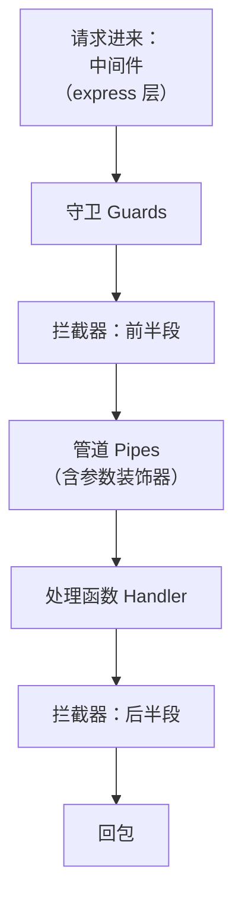
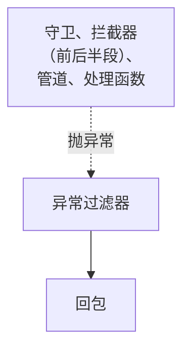
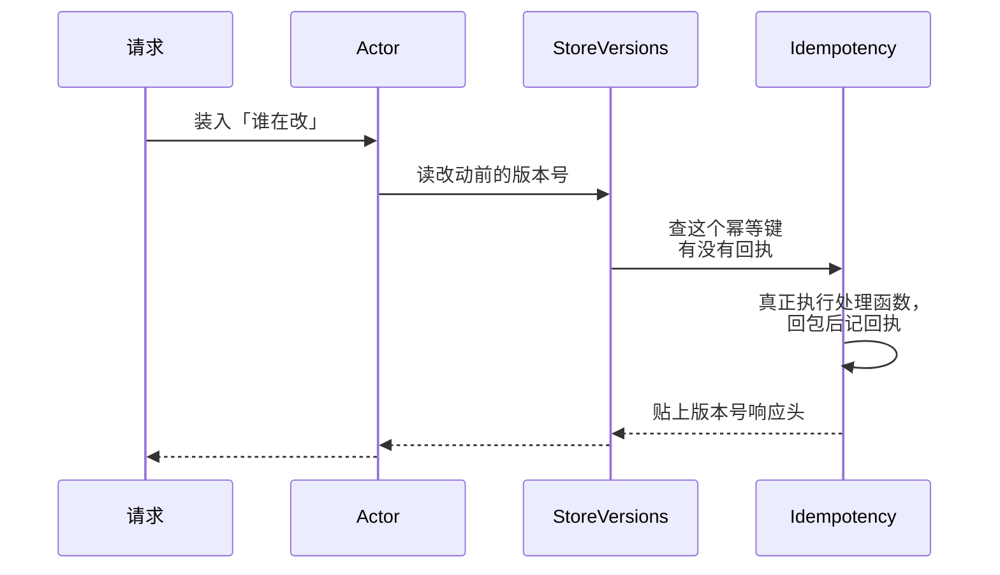

# 请求生命周期

一个 HTTP 请求进了 Nest 应用，到回包离开，中间会依次经过中间件、守卫、拦截器、管道、处理函数、异常过滤器。每一层能看到的东西不同、能做的事也不同，**放错层的代码往往能跑，但会在某个边角漏掉**。这一章把这条管线按顺序走一遍，讲清每层的职责和顺序规则，再看 hatch-counter 是怎么把七八件横切的事分到各层去的。

## 全景：七个站



中间件之后的任何一站抛异常，都会转到第七站异常过滤器，由它回包：



| 站 | 能拿到什么 | 适合做什么 | 不适合做什么 |
|---|---|---|---|
| 中间件 | 原始 `req` / `res`，还不知道会命中哪个路由 | 解析请求体、日志、限流、CORS | 需要知道「这是哪个处理函数」的判断 |
| 守卫 | `ExecutionContext`：处理函数、控制器类、元数据 | 认证、授权、版本闸门 | 改写回包 |
| 拦截器 | 同上，外加回包的 Observable | 计时、贴响应头、缓存、幂等 | 判断能不能进（那是守卫的事） |
| 管道 | 单个参数的值和元信息 | 校验、类型转换 | 跨参数的业务规则 |
| 异常过滤器 | 抛出的异常和响应对象 | 把异常翻译成统一的回包 | 业务逻辑 |

记住两条：**守卫只回答「能不能进」，拦截器包住处理函数的前后**。守卫返回 `false` 或抛异常，后面所有站都不会跑。

## 中间件：在路由之前

中间件跑在 Nest 的路由匹配之前，本质上就是 express（或 Fastify）的中间件。它看不到「这个请求会进哪个处理函数」，所以不能读 `@Public()` 这类元数据。

hatch-counter 在 `main.ts` 里挂了几个 express 层的东西，各有理由：

```ts
// 请求体上限：express 默认只有 100KB
app.useBodyParser("json", { limit: "12mb" });

// 撞上限时说人话。这是 express 的错误中间件，不是 Nest 的过滤器
app.use((err: Error & { type?: string }, _req: Request, res: Response, next: NextFunction) => {
  if (err?.type !== "entity.too.large") return next(err);
  res.status(413).json({ error: "这次传的东西太大了……", code: "payload_too_large" });
});
```

为什么 413 要单挂一个 express 错误中间件？因为**解析请求体发生在路由之前**，那里抛出的错根本到不了 Nest 的异常过滤器。不单独处理的话，客户端收到的是 express 默认的一页 HTML。这是「放错层就漏」的一个典型：你在全局过滤器里写得再周全，也接不住比它更早的那一层抛出的错。

另一个例子是开发环境的模拟网络延迟：

```ts
if (cfg.DEV_LATENCY_MS > 0) {
  app.use((_req: Request, _res: Response, next: NextFunction) => {
    setTimeout(next, cfg.DEV_LATENCY_MS);
  });
}
```

本机的客户端和服务端之间没有网络，点一下就出结果，「转圈有没有转起来」「连点两下会不会提交两次」这些问题在本机根本演不出来。值为 0 时连中间件都不挂，生产环境在配置加载时就把它归零了（见[第 7 章](07-config-env.md)）。

Nest 也有自己的中间件写法（实现 `NestMiddleware`，在模块的 `configure()` 里用 `consumer.apply().forRoutes()` 挂载），好处是可以注入 provider、按路由挂。对于全局、无依赖的东西，直接 `app.use()` 更简单。

## 守卫：按注册顺序依次判断

守卫可以挂在三个层级：全局、控制器类、单个处理函数。执行顺序是**全局 → 控制器 → 处理函数**，同一层级内按注册顺序。

注册全局守卫有两种方式：

```ts
// 方式一：main.ts 里，不在 DI 容器内，守卫没法注入别的 provider
app.useGlobalGuards(new SomeGuard());

// 方式二：任意模块的 providers 里，守卫由容器创建，可以注入依赖
@Module({
  providers: [{ provide: APP_GUARD, useClass: AuthGuard }],
})
export class AuthModule {}
```

需要注入 `Reflector`、`TokensService` 的守卫只能用方式二。hatch-counter 在 `AuthModule` 里注册了三个全局守卫，顺序是刻意排的：

```ts
providers: [
  { provide: APP_GUARD, useClass: ClientVersionGuard }, // 1. 客户端版本够不够
  { provide: APP_GUARD, useClass: AuthGuard },          // 2. 登录没有、是谁
  { provide: APP_GUARD, useClass: PermGuard },          // 3. 这个人能不能用这个功能
],
```

- **`PermGuard` 必须在 `AuthGuard` 后面**：它要读 `AuthGuard` 挂上去的 `req.caller`。两行调换，所有端点都拿不到调用者，一律 401
- **版本闸门排在鉴权前面**：一台很旧的客户端，令牌多半也过期了。如果先判登录，它听到的是「登录已过期」，于是去重登、再被拒、再重登，永远听不到真正该听的那句「请升级」

这类顺序依赖最好像这样写进注释，并用一条 e2e 测试守住（hatch-counter 有 `client-version.e2e.test.ts`）。

## 拦截器：洋葱模型

拦截器包在处理函数外面，像洋葱一样一层套一层。全局拦截器按注册先后**由外到里**套：先注册的在最外层，它的前半段最先跑、后半段最后跑。



图中三个参与者依次是 `ActorInterceptor`、`StoreVersionsInterceptor`、`IdempotencyInterceptor`；处理函数在最里层，由 `IdempotencyInterceptor` 包着。

hatch-counter 的三个全局拦截器分别注册在三个模块里，它们的套叠顺序由**模块在 `AppModule.imports` 里的排列**决定：

```ts
@Module({
  // IdempotencyModule 排在 LiveModule 后面：幂等那层要套在版本号那层里面
  imports: [DbModule, /* ... */ LiveModule, IdempotencyModule],
})
export class AppModule {}
```

- `ActorInterceptor` 在 `DbModule` 里，`DbModule` 排第一，所以它在最外层，里面每一层开的事务都认得出是谁
- 幂等层套在版本号层里面：当幂等层直接回放上一次的回包、处理函数不再执行时，外面的版本号层照样给回包贴上「写完之后每块是第几版」

这种「靠 import 顺序决定行为」的写法很脆弱，所以每处都留了注释。如果你的拦截器之间有顺序依赖，至少要做到这一点。

### 为什么 AsyncLocalStorage 要包在订阅外面

拦截器的 `intercept()` 返回一个 Observable。关键在于：**`next.handle()` 被调用时，处理函数还没有执行**，它只是返回一个「冷」的 Observable，订阅时才真正跑。

```ts
// 错：run() 结束时处理函数还没开始跑，上下文已经退出了
return actorStore.run(actor, () => next.handle());

// 对：在订阅那一刻进入上下文，处理函数在里面执行
return new Observable((sub) =>
  actorStore.run(actor, () => next.handle().subscribe(sub)),
);
```

第一种写法不报错，只是处理函数里 `actorStore.getStore()` 拿到 `undefined`，所有改动都被记成「系统改的」。这又是一个改坏了不报错的地方。

## 管道和参数装饰器

管道作用在**单个参数**上：`@Body()`、`@Query()`、`@Param()` 取出原始值后，交给管道校验和转换，结果才传给处理函数。校验不过就抛异常，处理函数不会执行。详细写法见[第 4 章](04-validation-dto.md)。

自定义参数装饰器（`createParamDecorator`）也在这个阶段求值，它跑在守卫之后，所以能读到守卫挂在 `req` 上的东西。hatch-counter 的 `@StoreId()` 就利用了这一点：

```ts
export const StoreId = createParamDecorator(
  (_: unknown, ctx: ExecutionContext): string =>
    requireStore(ctx.switchToHttp().getRequest<Request>()).storeId,
);

@Get()
list(@StoreId() storeId: string) { /* ... */ }
```

`requireStore()` 顺手判断门店是否停用、到期。为什么这件事放在参数装饰器里而不是全局守卫里，[第 5 章](05-jwt-permissions.md)会讲。

## 处理函数与回包

处理函数返回什么，Nest 就序列化成 JSON 回给客户端（返回 Promise 或 Observable 也行）。几条默认规则：

| 情况 | 默认状态码 |
|---|---|
| `GET` / `PUT` / `PATCH` / `DELETE` 正常返回 | 200 |
| `POST` 正常返回 | 201 |
| 用 `@HttpCode(204)` 标注 | 按标注 |

hatch-counter 的幂等拦截器踩过一个坑：在拦截器里读 `res.statusCode` 永远是 200，因为 Nest 是在回包那一刻才按 `@HttpCode()` 和 HTTP 方法定状态码的。所以它记回执时自己读 `HTTP_CODE_METADATA` 元数据、按同一条规则算出状态码。

**一旦在参数里用了 `@Res()`，Nest 就不再替你发回包**，拦截器的后半段也拿不到返回值，你得自己 `res.json()` 或 `res.end()`。这适合 SSE、文件流这类要直接控制回包的场景（hatch-counter 的推送端点就是这样，见[第 8 章](08-realtime.md)），普通接口别用。确实只想设个响应头，用 `@Res({ passthrough: true })`，Nest 会照常处理返回值。

## 异常过滤器：最后一道收口

任何一站抛出的异常都会落到异常过滤器。Nest 自带一个默认过滤器，把 `HttpException` 翻译成 `{ statusCode, message }`，其余异常一律 500。

hatch-counter 用一个 `@Catch()`（不带参数，接住所有异常）的全局过滤器替换了它：已知的业务错误回中文文案和机器码，未知异常回一句「服务端出了点问题」，真实原因只进日志。完整设计见[第 6 章](06-errors.md)。

```ts
app.useGlobalFilters(new AppExceptionFilter(app.get(OpsService)));
```

这里用的是 `useGlobalFilters` 而不是 `APP_FILTER`，过滤器需要的 `OpsService` 通过 `app.get()` 从容器里手动取出来传进去，效果一样。

## 一张清单：横切的事放哪一层

把 hatch-counter 里的横切关注点按层归类，可以当作自己项目的参考：

| 关注点 | 放在 | 理由 |
|---|---|---|
| 请求体大小、413 文案 | express 中间件 | 发生在路由之前 |
| 模拟延迟 | express 中间件 | 与路由无关 |
| 客户端版本闸门 | 全局守卫（第一个） | 要先于登录判断 |
| 登录、调用者身份 | 全局守卫 | 默认拒绝，`@Public()` 放行 |
| 页面权限 | 全局守卫（在登录后） | 依赖调用者身份 |
| 门店停用 / 到期 | 参数装饰器 `@StoreId()` | 只拦业务接口，不拦登录 |
| 「谁在改」上下文 | 全局拦截器（最外层） | 要包住处理函数的整个执行 |
| 版本号响应头 | 全局拦截器 | 要在执行前后各读一次 |
| 写接口幂等 | 全局拦截器（在版本号内） | 要能跳过处理函数并回放回包 |
| 入参校验 | 管道 | 作用在单个参数 |
| 统一错误回包 | 全局异常过滤器 | 最后一道收口 |

## 本章要点

- 一个请求依次经过：中间件 → 守卫 → 拦截器前半 → 管道 → 处理函数 → 拦截器后半；任一站抛异常都交给异常过滤器
- 中间件在路由之前，看不到元数据，它抛的错也到不了 Nest 的过滤器，要在 express 层自己处理
- 全局守卫用 `APP_GUARD` 注册才能注入依赖，**注册顺序就是执行顺序**，有依赖关系的守卫顺序要写注释、加测试
- 全局拦截器按注册顺序由外到里套叠，跨模块注册时顺序由 `imports` 排列决定
- `next.handle()` 返回冷 Observable，AsyncLocalStorage 之类的上下文要包在订阅外面
- 用了 `@Res()` 就要自己发回包；只想设响应头用 `passthrough: true`
