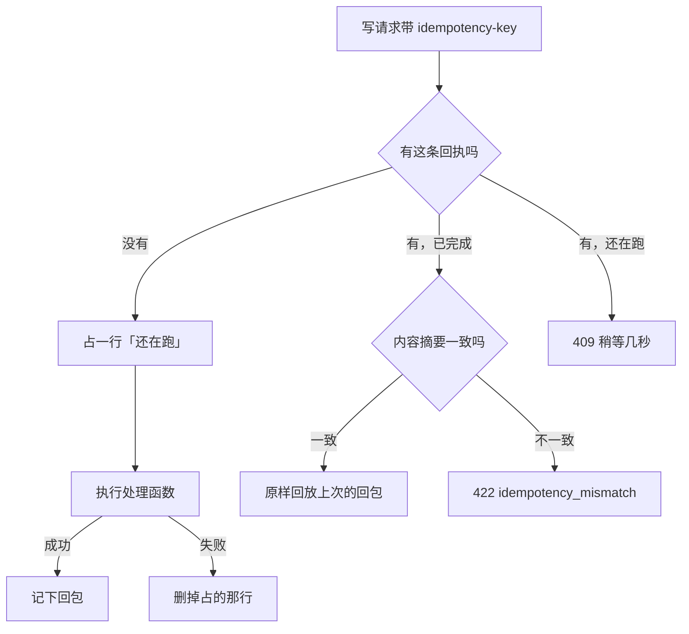

# 守卫、拦截器与管道

上一章讲了请求管线的顺序，这一章动手写。守卫、拦截器、管道是 Nest 最常用的三个扩展点，写法都不难，难的是写得「不会漏」：新加一个端点时忘了标装饰器，它会不会裸奔？一次写请求被重复提交，会不会记成两笔？这一章用 hatch-counter 的真实实现来讲每种扩展点的标准写法，以及让它们默认安全的设计。

## 守卫：默认拒绝

### 最小的守卫

守卫实现 `CanActivate`，返回 `true` 放行，返回 `false` 或抛异常拒绝：

```ts
import { type CanActivate, type ExecutionContext, Injectable } from "@nestjs/common";
import type { Request } from "express";

@Injectable()
export class ApiKeyGuard implements CanActivate {
  canActivate(ctx: ExecutionContext): boolean {
    const req = ctx.switchToHttp().getRequest<Request>();
    return req.headers["x-api-key"] === process.env.INTERNAL_KEY;
  }
}
```

返回 `false` 时 Nest 回一个通用的 403 `Forbidden resource`。要给用户一句能看懂的话，就自己抛带文案的异常（见[第 6 章](06-errors.md)）。

`ExecutionContext` 是守卫的关键参数，它知道当前请求要进哪个处理函数（`getHandler()`）、属于哪个控制器（`getClass()`），以及是 HTTP、WebSocket 还是微服务（`getType()`）。

### 用元数据给端点打标记

守卫需要知道「这个端点要不要登录」「需要什么权限」，这些信息用装饰器写在端点上，守卫通过 `Reflector` 读取：

```ts
import { SetMetadata } from "@nestjs/common";

export const PUBLIC = "auth:public";
export const Public = () => SetMetadata(PUBLIC, true);
```

读取时用 `getAllAndOverride`，它按顺序查处理函数和类，**处理函数上的优先**：

```ts
const targets = [ctx.getHandler(), ctx.getClass()];
if (this.reflector.getAllAndOverride<boolean>(PUBLIC, targets)) return true;
```

| 方法 | 行为 | 适用 |
|---|---|---|
| `get(key, target)` | 只查一个目标 | 只在方法上标的情况 |
| `getAllAndOverride(key, targets)` | 返回第一个有值的 | 方法覆盖类上的设置 |
| `getAllAndMerge(key, targets)` | 合并成数组或对象 | 角色列表叠加 |

Nest 还提供 `Reflector.createDecorator<T>()`，一次性生成类型安全的装饰器和读取键，NestJS 12 的 CLI 生成 decorator 时默认就用它：

```ts
export const Roles = Reflector.createDecorator<string[]>();

// 使用
@Roles(["owner"])
// 读取
const roles = this.reflector.get(Roles, ctx.getHandler());
```

### 默认要登录，公开的显式标

这是全书最重要的一条安全设计原则。对比两种写法：

| | 默认公开，要保护的加 `@Auth()` | 默认要登录，公开的加 `@Public()` |
|---|---|---|
| 漏标一个装饰器的后果 | 这个端点裸奔，任何人都能调 | 这个端点要登录，用户报「登录不了」 |
| 发现方式 | 出事才发现 | 开发时立刻发现 |

hatch-counter 的 `AuthGuard` 是全局守卫，默认每个端点都要登录：

```ts
@Injectable()
export class AuthGuard implements CanActivate {
  constructor(
    private readonly reflector: Reflector,
    private readonly tokens: TokensService,
    private readonly auth: AuthService,
  ) {}

  async canActivate(ctx: ExecutionContext): Promise<boolean> {
    const targets = [ctx.getHandler(), ctx.getClass()];
    if (this.reflector.getAllAndOverride<boolean>(PUBLIC, targets)) return true;
    // 后台路由归 AdminGuard 管，两个全局守卫靠这个标记分工
    if (this.reflector.getAllAndOverride<boolean>(ADMIN_ROUTE, targets)) return true;

    const req = ctx.switchToHttp().getRequest<Request>();
    const header = req.headers.authorization;
    if (!header?.startsWith("Bearer ")) throw new AuthError("没登录");

    const claims = await this.tokens.verifyAccess(header.slice(7));
    const { stores, deviceOk } = await this.auth.callerOf(claims.sub, claims.did);
    if (!deviceOk) throw new AuthError("这台设备已经退出登录了，重新登录一下", "device_revoked");

    req.caller = { accountId: claims.sub, deviceId: claims.did, stores, /* ... */ };
    return true;
  }
}
```

守卫把认出来的调用者挂在 `req.caller` 上，后面的守卫、拦截器、参数装饰器都从这里取。给 express 的 `Request` 类型补一个字段，用 TypeScript 的模块扩充：

```ts
declare module "express" {
  interface Request {
    caller?: Caller;
  }
}
```

权限守卫 `PermGuard` 用了同样的思路，只是更进一步：**没标 `@Perm()` 的端点只有店主能进**。漏标的后果是「店长说他用不了」，而不是「员工看见了工资」。错也要往安全那边错。权限模型的细节见[第 5 章](05-jwt-permissions.md)。

### 守卫只在 HTTP 吗

全局守卫对 WebSocket 网关和微服务处理器同样生效。如果你的守卫只认 HTTP，开头先判类型：

```ts
if (ctx.getType() !== "http") return true;
```

hatch-counter 的几个全局拦截器开头都有这一行。

## 拦截器：包住处理函数

### 基本结构

拦截器实现 `NestInterceptor`，`next.handle()` 代表「处理函数及其内层」，返回一个 Observable，你可以在它前后加逻辑，或者用 RxJS 操作符改造结果：

```ts
import { type CallHandler, type ExecutionContext, Injectable, Logger, type NestInterceptor } from "@nestjs/common";
import type { Request } from "express";
import { type Observable, tap } from "rxjs";

@Injectable()
export class TimingInterceptor implements NestInterceptor {
  private readonly logger = new Logger("Timing");

  intercept(ctx: ExecutionContext, next: CallHandler): Observable<unknown> {
    const started = Date.now();
    const req = ctx.switchToHttp().getRequest<Request>();
    return next.handle().pipe(
      tap(() => this.logger.log(`${req.method} ${req.url} ${Date.now() - started}ms`)),
    );
  }
}
```

常用的几种改造：

| 目的 | 操作符 | 示例 |
|---|---|---|
| 记日志、计时 | `tap` | 上面 |
| 改写返回值 | `map` | `map((data) => ({ data }))` 包一层信封 |
| 超时 | `timeout` | `timeout(5000)` 超时抛错 |
| 把错误换个说法 | `catchError` | 把某类异常翻译成业务错误 |
| 跳过处理函数 | 直接返回 `of(value)` | 缓存命中、幂等回放 |

### 在执行前后各做一次异步工作

hatch-counter 的版本号拦截器要在处理函数**执行前**读一次「这家店每块数据是第几版」，执行后（如果是写请求）再读一次，然后贴在响应头上。前后都是异步的数据库查询，用 `defer` + `switchMap` + `mergeMap` 串起来：

```ts
intercept(ctx: ExecutionContext, next: CallHandler): Observable<unknown> {
  const res = ctx.switchToHttp().getResponse<Response>();
  const storeId = ctx.switchToHttp().getRequest<Request>().caller?.store?.id;
  if (!storeId) return next.handle();

  return defer(() => this.versions.readOrNull(storeId)).pipe(
    switchMap((before) =>
      next.handle().pipe(
        mergeMap(async (body) => {
          if (before) res.setHeader("x-store-versions", formatVersions(before));
          const after = await this.versions.readOrNull(storeId);
          if (after) res.setHeader("x-store-versions-after", formatVersions(after));
          return body;
        }),
      ),
    ),
  );
}
```

为什么「执行前」那次一定要在处理函数之前读？因为客户端拿这个版本号判断缓存新旧：读在前，之后任何人提交的改动版本号一定比它大，推送一到这份就会被判旧。读在后的话，处理函数执行期间别人提交的改动可能被漏掉。宁可多刷一次，不可漏刷。

还有一个细节：读版本号失败用的是 `readOrNull`，**读失败不让请求失败**，只是这一份不带响应头。横切逻辑出错不应该拖垮主业务。

### 幂等拦截器：能跳过处理函数的那种

网络不稳时，用户点「记一笔」转圈、超时、再点一次，服务端可能已经执行过第一次了，只是回包丢在半路。按钮置灰只挡得住手抖，挡不住这种情况。hatch-counter 的解法是写请求带一个 `idempotency-key` 请求头，服务端按「门店 + 设备 + key」记回执：



几个容易写错的决定，都写在它的注释和文档里：

- **失败的不记**：处理函数抛错时把占位行删掉，业务事务已经回滚，下次重试应该真跑一遍
- **占行、记回执各是一个短事务，和业务事务分开**：塞进业务事务的话，业务回滚时「还在跑」那行也没了，并发的第二次会以为没人在跑
- **同一个 key 换了内容再来，一律拒绝**：不能拿上一份回包冒充，那等于把别的一笔的回执当成这一笔
- **没带这个头的请求照常执行**：登录、续票这些不归它管，老客户端也不受影响

幂等这件事在[《软件架构与系统设计》](../system-design/)里还会从系统角度再讲一遍，这里关注的是：它天然属于拦截器，因为只有拦截器既能在执行前决定「跳过」，又能在执行后拿到回包。

## 管道：转换与校验

### 内置管道

Nest 自带几个管道，处理路径参数和查询参数时很顺手：

```ts
@Get(":id")
get(@Param("id", ParseUUIDPipe) id: string) { /* ... */ }

@Get()
list(
  @Query("page", new DefaultValuePipe(1), ParseIntPipe) page: number,
) { /* ... */ }
```

| 管道 | 作用 |
|---|---|
| `ParseIntPipe` / `ParseFloatPipe` | 字符串转数字，转不了回 400 |
| `ParseBoolPipe` | `"true"` / `"false"` 转布尔 |
| `ParseUUIDPipe` | 校验 UUID 格式 |
| `ParseEnumPipe` | 校验枚举值 |
| `DefaultValuePipe` | 没给时填默认值 |
| `ValidationPipe` | 配合 class-validator 校验 DTO |
| `StandardSchemaValidationPipe` | NestJS 12 新增，校验 zod 等 Standard Schema |

### 自定义管道

管道实现 `PipeTransform`，返回转换后的值，校验不过就抛异常：

```ts
import { type ArgumentMetadata, HttpStatus, type PipeTransform } from "@nestjs/common";
import type { ZodType } from "zod";

export class ZodPipe<T> implements PipeTransform<unknown, T> {
  constructor(private readonly schema: ZodType<T>) {}

  transform(value: unknown, _metadata: ArgumentMetadata): T {
    const parsed = this.schema.safeParse(value);
    if (parsed.success) return parsed.data;
    throw new AppError(zodMessage(parsed.error), HttpStatus.BAD_REQUEST, "invalid_input");
  }
}
```

这是 hatch-counter 的 `ZodPipe`，全仓库的请求体和查询参数都走它。NestJS 12 把 `ArgumentMetadata` 改成了泛型、细化了 `transform` 的签名，自定义管道升级时如果编译器报错，按提示调整类型即可。下一章专门讲校验。

## 参数装饰器：把重复的取值收起来

很多端点开头都是同一段：从 `req` 里取调用者、取门店、判断能不能用。`createParamDecorator` 把它收成一个装饰器：

```ts
export const StoreCtx = createParamDecorator((_: unknown, ctx: ExecutionContext) =>
  requireStore(ctx.switchToHttp().getRequest<Request>()),
);

@Post()
create(@StoreCtx() { caller, storeId }: StoreContext, @Body(zBody(Create)) body: CreateInput) {
  return this.expenses.create(storeId, caller.accountId, body);
}
```

参数装饰器在守卫之后求值，能读到 `req.caller`；它抛的异常同样走异常过滤器。和全局守卫相比，它的好处是**在端点签名上一眼看得出这个接口要门店**。

## 选哪个扩展点

| 问题 | 用 |
|---|---|
| 这个请求能不能进？ | 守卫 |
| 要在处理函数前后做事、改回包、贴头、跳过执行？ | 拦截器 |
| 某个参数的格式对不对、要不要转换？ | 管道 |
| 处理函数要从请求里取一个算好的值？ | 参数装饰器 |
| 跟路由无关、要在最早阶段做？ | 中间件 |
| 异常怎么回给客户端？ | 异常过滤器 |

## 本章要点

- 守卫返回布尔或抛异常；用 `Reflector.getAllAndOverride` 读端点和类上的元数据，方法上的优先
- **默认拒绝**：全局守卫默认要登录、默认只有最高权限能进，公开和放宽都要显式标注，漏标的代价是「用不了」而不是「裸奔」
- 守卫把调用者挂在 `req` 上，用模块扩充给 `Request` 补类型
- 拦截器用 RxJS 包住处理函数，可以在前后做异步工作，也可以直接返回值跳过执行（缓存、幂等）
- 横切逻辑出错不应拖垮主请求：读不到就降级，别抛
- 管道作用在单个参数上，内置的 `Parse*Pipe` 处理简单转换，复杂校验用 schema 管道
- 参数装饰器把重复取值收起来，并让「这个接口需要什么」写在签名上
