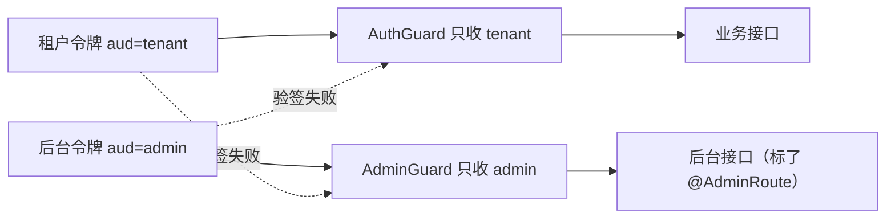
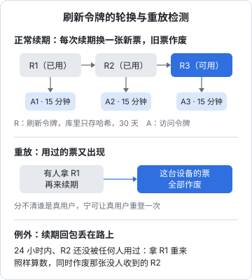
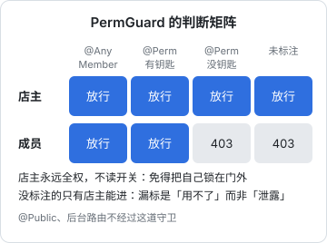

# JWT 与权限模型

认证回答「你是谁」，授权回答「你能做什么」。JWT 是 Node 后端最常见的认证载体，但「签一个 token 发出去」只是起点：token 里放什么、活多久、怎么续、被偷了怎么办、两类用户的 token 怎么分开，每个问题答错都是安全事故。这一章以 hatch-counter 的令牌和权限设计为主线，讲一套适合小团队、可以照着落地的方案。

## JWT 速览

JWT 是三段 Base64URL 用点连起来：头部、载荷、签名。服务端用密钥对前两段签名，之后只要验签通过，就信任载荷里的内容，**不用查库**。

```text
eyJhbGciOiJIUzI1NiJ9.eyJzdWIiOiJhY2MtMSIsImRpZCI6ImRldi0xIiwiYXVkIjoidGVuYW50In0.<签名>
```

这个「不用查库」既是优点也是陷阱：

| 特性 | 好处 | 代价 |
|---|---|---|
| 无状态验证 | 快，不依赖存储 | 签出去就收不回来，直到过期 |
| 载荷可读 | 客户端能看到过期时间 | 载荷只是编码不是加密，别放敏感信息 |
| 载荷可携带权限 | 少查一次库 | 权限变了，旧 token 照样有效 |

所以成熟的方案几乎都是**短命的访问令牌 + 长命的刷新令牌**：访问令牌活几分钟，泄露了损失有限；刷新令牌存在服务端可以撤销，用来换新的访问令牌。

## 在 Nest 里签发和验证

`@nestjs/jwt` 是对 jsonwebtoken 的薄封装：

```ts
@Module({
  imports: [
    JwtModule.registerAsync({
      useFactory: () => ({
        secret: loadConfig().JWT_SECRET,
        signOptions: { expiresIn: loadConfig().ACCESS_TOKEN_TTL }, // 如 "15m"
      }),
    }),
  ],
  providers: [TokensService],
  exports: [TokensService],
})
export class TokensModule {}
```

```ts
export const TENANT_AUDIENCE = "tenant";

export interface AccessClaims {
  sub: string; // 账号 id
  did: string; // 设备 id
  exp?: number;
}

@Injectable()
export class TokensService {
  constructor(private readonly jwt: JwtService) {}

  signAccess(claims: AccessClaims): Promise<string> {
    return this.jwt.signAsync(claims, { audience: TENANT_AUDIENCE });
  }

  async verifyAccess(token: string): Promise<AccessClaims> {
    try {
      return await this.jwt.verifyAsync<AccessClaims>(token, { audience: TENANT_AUDIENCE });
    } catch {
      throw new AuthError("登录已过期，重新登录一下", "token_expired");
    }
  }
}
```

验证失败的原因很多（过期、签名不对、格式错），对客户端来说处置都一样：去续期或重新登录。所以统一抛一个带机器码的 401。

## token 里放什么：越少越好

hatch-counter 的访问令牌里**只有账号和设备**两样，门店和权限都不放：

- **门店不进令牌**：一个账号可能管好几家店，当前操作哪家由请求头 `x-store-id` 指定，守卫每次请求现查成员表。换店、被移出门店、门店停用都当场生效，不用等旧令牌过期
- **权限不进令牌**：店主改了店员的权限，下一个请求就按新权限判断，不用让店员重新登录
- **设备撤销也每次查**：后台把一台设备踢下线后，它手里的访问令牌本来还能再用十五分钟。守卫每次顺手查设备是否被撤，踢下线立即生效

代价是每个请求多一次查询。对十来家店的规模，这次查询的开销远小于「权限改了要等 15 分钟才生效」带来的困惑和客服成本。如果你的规模大到在意这次查询，再考虑加缓存，而不是把权限塞进令牌。

## 用 audience 隔开两类用户

hatch-counter 有两类用户：门店的店主和店员（租户），以及内部管理后台的员工。两边用**同一个** `JWT_SECRET` 签名，能把两种令牌分开的只有 JWT 的 `aud`（受众）字段：租户令牌是 `tenant`，后台员工是 `admin`，验签时各自只认自己的。

如果不校验 `aud` 会怎样？后台员工的令牌能通过租户守卫，而它的 `sub` 是后台员工表的 id，被当成账号 id 去查，轻则读到一堆空，重则撞上某个同 id 的账号。



两个全局守卫靠控制器类上的 `@AdminRoute()` 分工：`AuthGuard` 见到它就让开，`AdminGuard` 只管它。文档里专门强调：**这条得一开始就隔死**，等两边都有一堆端点了再补 `aud` 校验，必定漏一个，而漏掉的那个就是越权本身。更稳妥的做法是两边用不同的密钥，hatch-counter 选择了 `aud` 加测试守护（`admin.e2e.test.ts` 验证两种令牌互不相认）。

## 刷新令牌：轮换与重放检测



hatch-counter 的刷新流程有四个要点。

**一、库里只存哈希。** 刷新令牌是一串随机字节，服务端存它的 SHA-256。数据库泄露时，攻击者拿到的哈希没法直接拿来续期。

**二、每次续期都换新票（轮换）。** 旧票标成「用过」，同时发一张新票。正常情况下，每张刷新令牌只用一次。

**三、用过的票又被拿来续，就作废整台设备。** 一张已经用过的票再次出现，说明有两方持有同一张票，其中一方很可能是窃取者。服务端无法分辨谁是真用户，干脆让这台设备的所有票全部作废，宁可让真用户重新登录一次。

**四、回包丢失的宽限。** 规则三有个误伤场景：客户端发起续期，服务端已经轮换，但回包丢在路上，客户端手里还是旧票，下次再续就撞上「重放」被踢下线。hatch-counter 加了一个宽限：24 小时内、旧票底下那张新票**还没被任何人用过**，拿旧票照样算数，同时把那张没人收到的新票作废。24 小时是按「收银台正赶上打烊关机，下一次续期就是第二天早上」定的。

还有一个工程细节：**作废旧票、发新票、记设备三步在一个事务里**。分开写的话中间出一次错，旧票已经用掉、新票没交到客户端手里，下次续期就撞上重放，用户看到一句「为安全起见请重新登录」。

简化后的写法（真实代码还要处理宽限分支和设备记录）：

```ts
const ttlMs = cfg.REFRESH_TOKEN_TTL_DAYS * 24 * 60 * 60 * 1000;
const refreshToken = await db.transaction(async (tx) => {
  await tx.update(refreshTokens).set({ usedAt: new Date() }).where(eq(refreshTokens.id, row.id));
  const fresh = randomBytes(32).toString("base64url");
  await tx.insert(refreshTokens).values({
    tokenHash: hashToken(fresh),
    accountId: row.accountId,
    deviceId: row.deviceId,
    rotatedFrom: row.id,
    expiresAt: new Date(Date.now() + ttlMs),
  });
  return fresh;
});
```

## 令牌放在客户端哪里

| 客户端 | 访问令牌 | 刷新令牌 |
|---|---|---|
| 浏览器 | 页面内存，刷新页面就没了 | httpOnly cookie，页面脚本读不到 |
| 移动端 | 内存 | 系统安全存储（Keychain / Keystore） |

浏览器端的选择理由：网页端的令牌和页面上跑的所有脚本住在一起，一旦出现 XSS，`localStorage` 里的东西会被一锅端。hatch-counter 网页端的刷新令牌只放在 cookie 里，属性是 `HttpOnly; SameSite=Strict; Path=/v1/auth`，生产环境加 `Secure`：

- `HttpOnly`：脚本读不到
- `SameSite=Strict`：跨站请求不带它，挡住 CSRF
- `Path=/v1/auth`：只有续期和退出这两个接口会带上它，其余请求根本不发送

访问令牌照旧用 `Authorization: Bearer` 头，只在页面内存里，页面刷新后靠 cookie 马上续一张。在 Nest 里写 cookie 用 `@Res({ passthrough: true })` 拿到响应对象，`res.cookie(name, value, options)` 即可。

## 权限模型：角色加按页开关

认证之后是授权。hatch-counter 的模型很朴素：

- 每个人在每家店有一个**角色**：店主 `owner` 或成员
- 成员有一组**按页面的开关**，每页三档：不开放、能看、能改

服务端用两个装饰器标注端点：

```ts
export const Perm = (keys: PermKey | PermKey[], level: PermLevel) =>
  SetMetadata(PERM_META, { keys: Array.isArray(keys) ? keys : [keys], level });

export const AnyMember = () => SetMetadata(ANY_MEMBER, true);
```

```ts
@Controller("v1/expenses")
@Perm("expenses", "view")          // 类上：整组接口至少要能看
export class ExpensesController {
  @Get()
  list() { /* ... */ }

  @Perm("expenses", "edit")        // 方法上覆盖：写接口要能改
  @Post()
  create() { /* ... */ }
}
```

`PermGuard` 的判断顺序就是安全策略本身：



```ts
canActivate(ctx: ExecutionContext): boolean {
  // ……公开端点、后台端点先让开
  const store = req.caller?.store;
  if (!store) return true;                     // 还没门店：交给 requireStore 说更准的话
  if (store.role === "owner") return true;     // 1. 店主永远全权
  if (this.reflector.getAllAndOverride(ANY_MEMBER, targets)) return true; // 2. 跟权限无关的端点
  const rule = this.reflector.getAllAndOverride<PermRule>(PERM_META, targets);
  if (!rule) throw new ForbiddenError("这个功能只有店主能用", "perm_denied"); // 3. 没标的只有店主
  if (!rule.keys.some((k) => permAllows(store.permissions, k, rule.level))) {
    throw new ForbiddenError(denyMessage(rule), "perm_denied");
  }
  return true;
}
```

每条规则背后都有理由：

- **店主永远全权，不读开关**：否则一个手滑就能把自己锁在门外，而这家店再没有第二个人改得动权限
- **没标 `@Perm` 的只有店主进得去**：默认拒绝，漏标的后果是「店长说他用不了」，不是「员工看见了工资」
- **`@Perm` 可以给一组钥匙，任一把够了就放行**：库存页也要读食材档案，两种权限任一都应该能读
- **还没挑到门店时让开**：把「还没开通」说成「你没权限」，客服要多解释一轮

有些判断装饰器做不了，比如开支分类和菜品分类共用一张表，「能不能改」要看这次请求改的是哪一种。这类情况在处理函数里调用 `requirePerm(req, keys, level)` 按运行时参数现判。

**界面上藏按钮只是为了好看，真正拦住的是服务端**。只靠界面的话，换个客户端版本或者会用开发者工具的人，就能看到这家店的盈亏和每个人的工资。

## 停用和到期：拦在业务接口，不拦登录

门店欠费停用了，该在哪一步拦？直觉是登录时拦。hatch-counter 的选择相反：**登录照样成功，拦在业务接口上**。

```ts
export function requireStore(req: Request): StoreContext {
  const store = req.caller?.store;
  if (!store) throw new AppError("这个账号还没有门店，请联系客服开通", undefined, "no_store");
  if (store.status === "suspended") throw new ForbiddenError("这家门店已停用，请联系客服", "store_suspended");
  if (store.expiresAt && store.expiresAt.getTime() < Date.now()) {
    throw new ForbiddenError("这家门店的服务已到期，请联系客服续期", "store_expired");
  }
  return { caller: req.caller!, storeId: store.id };
}
```

两个理由：只在登录时判的话，已经拿到令牌的客户端能一直用到令牌过期；更重要的是，做成「登录失败」，店主会以为系统坏了，客服要排查半天才发现是欠费。登录成功后在业务接口上收到一句明确的「已到期，请联系客服续期」，问题一眼就清楚。

它做成参数装饰器 `@StoreId()` 而不是全局守卫，是因为「我是谁」「切到哪家店」这几个接口在停用后也得能用，标在接口上一眼看得出哪些需要门店。

## 最后一道防线：数据库

以上都是应用层的判断。hatch-counter 的多租户隔离最终靠的是 PostgreSQL 的行级安全（RLS）：业务查询一条都不写 `where store_id = ?`，全部在设置了门店上下文的事务里跑，数据库自己过滤。漏写一个 where 的后果是「A 店看见了 B 店的账」，而 RLS 漏不了。这部分属于数据库设计，在[《数据库原理与实战》](../database-practice/)里展开。

## 本章要点

- 短命访问令牌 + 可撤销的长命刷新令牌，是 JWT 方案的标准组合
- 令牌里放得越少越好：门店、权限、设备状态每次请求现查，变更当场生效
- 两类用户的令牌用 `aud`（或不同密钥）隔开，验签时校验，并且从第一天就做
- 刷新令牌只存哈希、每次轮换；用过的票再出现就作废整台设备；为回包丢失留有限的宽限；轮换要在一个事务里
- 浏览器端刷新令牌放 `HttpOnly; SameSite=Strict` 且限定 `Path` 的 cookie，访问令牌只在内存
- 权限守卫默认拒绝：最高角色永远放行，无关权限的端点显式标注，没标的只有最高角色能进
- 停用、到期拦在业务接口上而不是登录时，让用户看到准确的原因
