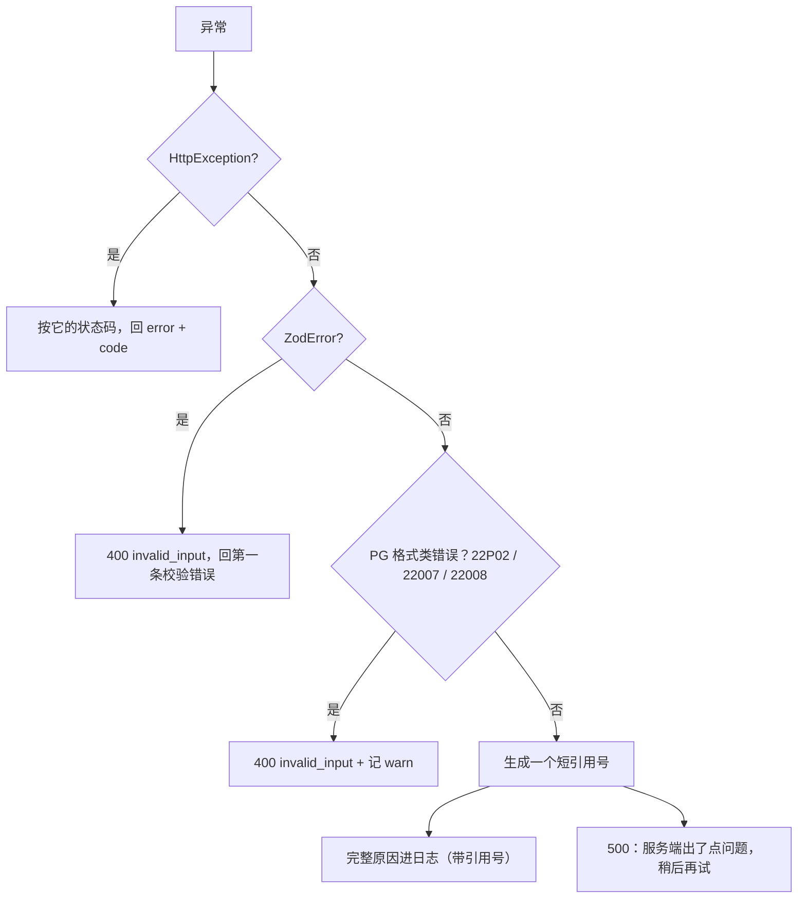

# 错误处理与错误文案

服务端的错误有两个读者：用户和开发者。用户需要一句看得懂、知道下一步怎么办的话；开发者需要完整的堆栈、SQL 和上下文。**最常见的失败是把两者搞混**：把堆栈回给用户（泄露表名甚至连接串），或者只给开发者留一句「Internal error」。这一章讲 Nest 的异常层怎么工作，怎么用一个全局过滤器把所有异常收口，以及 hatch-counter 那条「报错文案在服务端写」的规矩为什么站得住。

## Nest 的异常层

> [!WARNING]
> `HttpExceptionOptions` 的 `errorCode` 选项和它的序列化格式按 NestJS 12 发布说明整理，以 NestJS 官方文档的 Exception filters 页面为准。

Nest 内置一个异常过滤器，处理所有没被接住的异常：

| 抛出的东西 | 默认回包 |
|---|---|
| `HttpException` 及其子类 | 按它的状态码和消息，如 `{ statusCode: 404, message: "Not Found" }` |
| 其他任何异常 | `{ statusCode: 500, message: "Internal server error" }` |

内置的子类覆盖了常用状态码：`BadRequestException`（400）、`UnauthorizedException`（401）、`ForbiddenException`（403）、`NotFoundException`（404）、`ConflictException`（409）、`UnprocessableEntityException`（422）等。

```ts
throw new NotFoundException("这笔开支不存在");
// → 404 { "statusCode": 404, "message": "这笔开支不存在", "error": "Not Found" }
```

NestJS 12 给 `HttpExceptionOptions` 加了 `errorCode` 选项，会序列化进回包，方便客户端按机器码分支处理。这正是下面自定义错误类要解决的问题，新项目可以直接用它。

## 先定回包契约

在写任何异常类之前，先定下错误回包长什么样。hatch-counter 的契约只有两个字段：

```json
{ "error": "这家门店的服务已到期，请联系客服续期", "code": "store_expired" }
```

- `error`：一句给人看的中文，客户端**原样展示**
- `code`：给程序看的机器码，客户端要区别处置时**认它，不认文案**

为什么要分开？因为文案会改。今天写「门店已到期」，明天产品觉得应该加上「请联系客服续期」，如果客户端在判断 `message.includes("到期")`，一改就坏。

## 自定义错误类

```ts
import { HttpException, HttpStatus } from "@nestjs/common";

/** 会原样给用户看的错误：消息本身必须是中文人话，说清后果 */
export class AppError extends HttpException {
  constructor(
    message: string,
    status: HttpStatus = HttpStatus.BAD_REQUEST,
    readonly code?: string,
  ) {
    super({ message, code }, status);
  }
}

export class AuthError extends AppError {
  constructor(message: string, code?: string) {
    super(message, HttpStatus.UNAUTHORIZED, code);
  }
}

/** 登录了但不该干这件事。和 AuthError 分开：前端处置完全不同 */
export class ForbiddenError extends AppError {
  constructor(message: string, code?: string) {
    super(message, HttpStatus.FORBIDDEN, code);
  }
}

export class RateLimitError extends AppError {
  constructor(message: string) {
    super(message, HttpStatus.TOO_MANY_REQUESTS, "rate_limited");
  }
}
```

继承 `HttpException` 的好处是：即使哪天全局过滤器没挂上，Nest 的默认过滤器也能正确处理状态码。

### 401 和 403 不能混

| 状态码 | 含义 | 客户端处置 |
|---|---|---|
| 401 | 没登录，或令牌无效 | 先试着续期，续不上跳登录页 |
| 403 | 登录了，但不允许做这件事 | 显示原因，跳登录页也没用 |

把「没权限」回成 401，客户端会去续期、续成功、再请求、又是 401，陷入循环。hatch-counter 里门店停用、到期、权限不足都是 403，只有令牌和设备问题是 401。

## 全局过滤器：所有异常的收口

`@Catch()` 不带参数就接住所有异常。hatch-counter 的 `AppExceptionFilter` 按四类处理：



核心代码：

```ts
@Catch()
export class AppExceptionFilter implements ExceptionFilter {
  private readonly logger = new Logger("Http");

  catch(err: unknown, host: ArgumentsHost): void {
    const res = host.switchToHttp().getResponse<Response>();
    const reply = (status: number, error: string, code?: string) =>
      res.status(status).json({ error, code });

    if (err instanceof HttpException) {
      const body = err.getResponse();
      const payload = typeof body === "string" ? { message: body } : (body as Record<string, unknown>);
      const message = typeof payload.message === "string" ? payload.message : "请求有问题";
      return reply(err.getStatus(), message, typeof payload.code === "string" ? payload.code : undefined);
    }

    if (err instanceof ZodError) {
      return reply(400, zodMessage(err), "invalid_input");
    }

    const bad = BAD_INPUT[pgErrorCode(err) ?? ""];
    if (bad) {
      this.logger.warn(err instanceof Error ? withCauses(err) : String(err));
      return reply(400, bad, "invalid_input");
    }

    const ref = randomBytes(4).toString("hex");
    this.logger.error(`[${ref}] ${err instanceof Error ? withCauses(err) : String(err)}`);
    reply(500, "服务端出了点问题，稍后再试");
  }
}
```

逐条看设计理由。

**未知异常绝不回原因。** 堆栈里常带着表名、SQL 片段，甚至在连接失败时带着整条连接串。用户看到这些没有任何帮助，攻击者却能拿来摸清你的结构。

**生成一个引用号。** 500 时生成一串短随机码，同时写进日志和后台的错误事件。后台看到「这家店 10:02 撞了一次 500」，拿引用号到容器日志里一搜就找到是哪一次。需要的话也可以把它回给客户端，让用户截图报障时带上。

**`ZodError` 兜底。** 入参本来都走校验管道（抛的是 `AppError`），但总有哪处代码直接调了 `.parse()`。`ZodError` 不是 `HttpException`，不接住的话填错一个日子就成了 500，用户以为系统坏了。

**数据库的格式错误归为 400。** URL 里的 id 不是 UUID、日期是 2 月 30 日，这类格式没在入口拦住、一路带进 SQL 才炸的，错在请求而不在服务端。按 PostgreSQL 的 SQLSTATE 认出来（`22P02` 无效文本表示、`22007` 无效日期时间格式、`22008` 日期时间溢出），回 400，同时记一条 warn，提醒自己回头在入口补一句更准的校验。

### 打印完整的 cause 链

用 Drizzle 这类 ORM 时，抛出来的那层错误往往只有「Failed query: <SQL> params: …」，PostgreSQL 真正说了什么（哪一列不存在、撞了哪条约束）挂在 `cause` 上。只打 `stack` 的话，日志里有整条 SQL，偏偏没有失败原因：

```ts
function withCauses(err: Error): string {
  const lines = [err.stack ?? String(err)];
  let cur = err.cause;
  for (let depth = 0; cur && depth < 5; depth++) {
    lines.push(`[cause] ${String(cur)}`);
    cur = cur instanceof Error ? cur.cause : undefined;
  }
  return lines.join("\n");
}
```

### 按 SQLSTATE 认约束冲突，不按消息

想把「名字重复」翻译成一句人话，判断依据应该是错误码 `23505`（唯一约束冲突），而不是错误消息里有没有 `duplicate key`。原因有两个：ORM 把驱动的错包了一层，码藏在 `cause` 上；消息跟着数据库服务器的 `lc_messages` 走，换个 locale 就成了中文。

```ts
export function pgErrorCode(err: unknown): string | undefined {
  let cur: unknown = err;
  for (let i = 0; cur && i < 5; i++) {
    const code = (cur as { code?: unknown }).code;
    if (typeof code === "string" && /^[0-9A-Z]{5}$/.test(code)) return code;
    cur = (cur as { cause?: unknown }).cause;
  }
  return undefined;
}

export const isUniqueViolation = (err: unknown) => pgErrorCode(err) === "23505";
```

另一个事务里的坑：PostgreSQL 一条语句出错，整个事务就作废了，后面每条都报 `current transaction is aborted`。想在事务里接住约束冲突再接着写，得先开 savepoint。

## 过滤器管不到的地方

上一章提过：请求体解析发生在路由之前，超过大小上限时 express 抛的错到不了 Nest 的过滤器。hatch-counter 为此在 `main.ts` 里单独挂了一个 express 错误中间件，回 413 加一句人话。凡是在 Nest 管线之外抛错的地方（express 中间件、启动阶段、定时任务、SSE 写流时），都要单独考虑。

## 报错文案在服务端写

这是 hatch-counter 最有特色的一条规矩：**给用户看的报错在服务端写，那句中文原样穿过客户端给用户看，客户端不重写一遍**。

常见的反面做法是服务端回 `{ code: "store_expired" }`，客户端维护一张「code → 文案」的表。问题在于：

- 网页端、移动端、管理后台各维护一份，改一处就对不上
- 服务端加一个新 code，所有客户端都要发版才能显示好的文案，没发版的只能显示「未知错误」
- 服务端最清楚出错时的上下文（是哪一页、缺看还是缺改、在哪里能改）

服务端写文案之后，客户端只在**需要不同处置**时才看 `code`：比如 `token_expired` 触发续期、`client_too_old` 弹出整屏升级提示，其余一律直接展示 `error`。

## 怎么写一句好的报错

hatch-counter 的代码里有大量范例，提炼成几条原则：

| 原则 | 差 | 好 |
|---|---|---|
| 说清后果和下一步 | 无权限 | 你只能查看开支记账，改不了。要改请让店主在「员工管理 → 成员权限」里放开 |
| 用读者的词 | 请求体过大（413） | 这次传的东西太大了。图片重拍一张，或者把报表拆成两次导 |
| 不暴露内部实现 | 智谱-备用号（429） | 识别服务现在都很忙 |
| 区分「是谁的事」 | 识别失败 | 换张更清楚的照片（照片的问题），或「都很忙」（服务的问题） |
| 用词准确 | 识别还没给你开通 | 单据识别暂未开放 |

最后一条值得多说一句。「开通」在这个产品里是按门店办理的动作，客服真能给你办；而识别服务是全平台共用的，没有按门店的开关。写成「还没给你开通」，店主会来问「那给我开一下」，客服还得先解释一遍没有这回事。**一个词选错，就多一轮客服对话**，这是一人公司最贵的成本之一。

「无权限」三个字也是同理：店员以为系统坏了，打电话给客服，而客服也改不了。说清是哪一页、缺看还是缺改、找谁去开，问题当场就解决了。

## 错误码清单

给错误码建一张清单，放在文档里，是客户端和服务端之间的契约：

| code | 状态码 | 场景 | 客户端处置 |
|---|---|---|---|
| `token_expired` | 401 | 访问令牌过期或无效 | 续期后重试 |
| `refresh_reused` | 401 | 刷新令牌被重放 | 回登录页 |
| `device_revoked` | 401 | 设备被踢下线 | 回登录页 |
| `store_suspended` / `store_expired` | 403 | 门店停用 / 到期 | 展示文案 |
| `perm_denied` | 403 | 权限不足 | 展示文案 |
| `invalid_input` | 400 | 入参不对 | 展示文案 |
| `idempotency_mismatch` | 422 | 同一幂等键换了内容 | 这是客户端 bug |
| `payload_too_large` | 413 | 请求体超限 | 展示文案 |
| `rate_limited` | 429 | 限流 | 展示文案，稍后再试 |

## 本章要点

- 错误有两个读者：用户要一句能行动的人话，开发者要完整上下文，两者分开给
- 先定回包契约：`error` 给人看、`code` 给程序分支；客户端认 code 不认文案
- 自定义错误类继承 `HttpException`；NestJS 12 的 `errorCode` 选项提供了原生的机器码支持
- 401 和 403 处置不同，不能混用
- 用 `@Catch()` 全局过滤器收口：已知错误回文案，校验和格式类错误回 400，未知异常回通用 500 并带引用号记日志
- 日志要打完整的 `cause` 链；约束冲突按 SQLSTATE 认，不按消息文本
- Nest 管线之外抛的错（请求体解析、定时任务、长连接）要单独处理
- 报错文案在服务端写一份，说清后果、下一步、是谁的事，用读者的词
