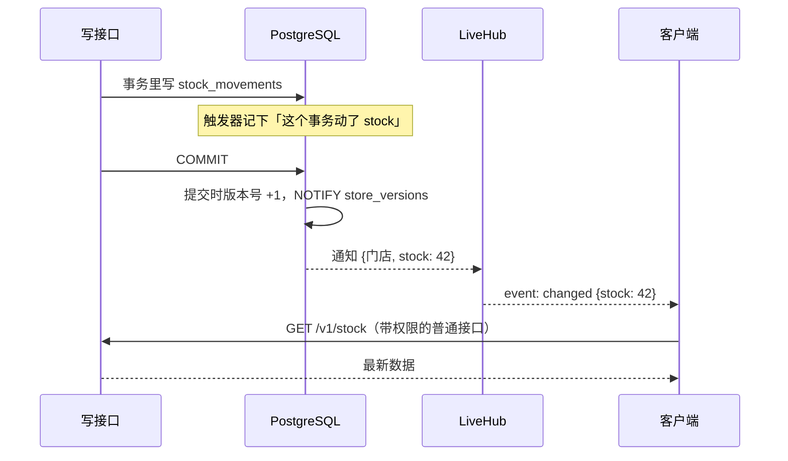
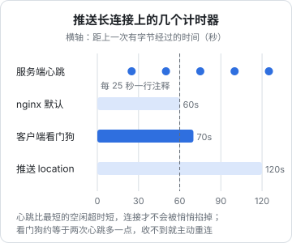

# 长连接（SSE / WebSocket）

「别人改了数据，我这边自动刷新」是管理类应用里很快就会被提出的需求。实现它要一条服务端能主动往下推的通道，于是就有了长连接。长连接的难点不在「连上」，而在**断了之后**：中间的代理悄悄掐线、令牌过期、服务端重启、断开期间漏掉的消息怎么补。这一章先比较几种方案，再完整拆解 hatch-counter 的推送设计：只推版本号、断了不补发、心跳和超时怎么配。

## 三种方案

| | 轮询 | SSE | WebSocket |
|---|---|---|---|
| 方向 | 客户端问 | 服务端单向推 | 双向 |
| 协议 | 普通 HTTP | 普通 HTTP 回包，`text/event-stream` | HTTP 升级成独立协议 |
| 经过 nginx | 无需特殊配置 | 关缓冲、调读超时 | 要转发 `Upgrade` 头 |
| 鉴权、限流、维护开关 | 和其他请求一样 | 和其他请求一样 | 要在握手时单独处理 |
| 浏览器断线重连 | 不需要 | `EventSource` 自带（但不能带自定义头） | 自己写 |
| 适合 | 低频、简单 | 通知、进度、版本推送 | 聊天、协同编辑、游戏 |

hatch-counter 选了 SSE，文档里的理由是：只要往下推、不要双向；它就是一个普通的 HTTP 回包，鉴权、版本守卫、维护开关都跟别的请求一样过。WebSocket 的握手要单独做一遍鉴权，nginx 要单独配升级，这些成本只有在真需要双向通信时才值得付。

## SSE 协议本身

SSE 的回包是一段不结束的文本流，每条消息由若干 `字段: 值` 行组成，空行表示一条消息结束：

```text
event: snapshot
data: {"epoch":"k3f9","versions":{"stock":41,"sales":17}}

event: changed
data: {"versions":{"stock":42}}

: ping

```

- `event:` 事件名，客户端按名字分发
- `data:` 载荷，通常是一行 JSON
- 以冒号开头的行是注释，客户端忽略，常用作心跳
- 还有 `id:` 和 `retry:`，用于断线续传和重连间隔

## Nest 的 @Sse() 装饰器

Nest 原生支持 SSE：处理函数返回一个 Observable，每发出一个值就推一条消息。

```ts
import { Controller, type MessageEvent, Sse } from "@nestjs/common";
import { interval, map, type Observable } from "rxjs";

@Controller("v1")
export class ProgressController {
  @Sse("progress")
  progress(): Observable<MessageEvent> {
    return interval(1000).pipe(map((n) => ({ type: "tick", data: { n } })));
  }
}
```

响应头、序列化、客户端断开时取消订阅，Nest 都替你做了。对于「订阅某个事件源、有就推」的场景，这是最省事的写法。

## 为什么 hatch-counter 不用 @Sse()

hatch-counter 的推送端点用的是 `@Res()` 手写回包：

```ts
@Get("events")
@AnyMember()
@NoVersions()
async events(
  @Req() req: Request,
  @StoreCtx() { caller, storeId }: StoreContext,
  @Res() res: Response,
): Promise<void> {
  res.status(200);
  res.setHeader("Content-Type", "text/event-stream; charset=utf-8");
  res.setHeader("Cache-Control", "no-cache, no-transform");
  res.setHeader("Connection", "keep-alive");
  res.setHeader("X-Accel-Buffering", "no"); // 告诉 nginx 别攒包
  res.flushHeaders();

  const client = this.hub.attach(storeId, res, caller.tokenExpiresAt);
  req.on("close", () => client.detach());
  try {
    const snapshot = { epoch: this.versions.epoch, versions: await this.versions.read(storeId) };
    client.start(snapshot);
  } catch {
    client.detach(); // 快照都读不出来就别留一条什么都不说的连接
  }
}
```

原因是它需要精确控制几件事：**先挂上、再读快照**的顺序；服务端主动断开前发一条说明原因的 `bye`；按令牌到期时间定时断开。这些用 Observable 也能表达，但会比直接写 `res` 绕得多。另外，用 `@Res()` 意味着全局拦截器的后半段拿不到返回值，所以它标了 `@NoVersions()` 让版本号拦截器跳过。

注意它仍然是一个普通的 Nest 端点：全局守卫照样跑（要登录、要过版本闸门），`@StoreCtx()` 照样判断门店是否停用。这就是选 SSE 的红利。

## 推什么：版本号，不是数据

这是整个设计里最重要的决定。hatch-counter 把一家店的数据分成八块（菜品、库存、销量、开支、员工、工资、配置、权限），每块一个单调递增的版本号。推送只推「哪几块换了版」，**一行业务数据都不带**：



为什么不直接推数据？

- **权限**：推数据就得按每个连接的权限剪裁。版本号不含任何数据，所有成员收到同一份，数据照旧走带权限检查的接口取
- **口径**：页面上很多数是服务端现算的（库存是流水重放出来的、开支要按月摊）。推行级变更过去，客户端就得再算一遍，那是第二份业务口径
- **不用补发**：这一点最关键，下面单独讲

### 断了不补发

推事件的系统，断线重连时要回答「我漏了哪几条」，于是需要事件序号、服务端缓存最近的事件、客户端带上「从第几条接着推」。推版本号就不需要：**重连时拿一份新快照，跟自己记着的比，不一样的块整块作废重取**。合盖睡一晚、断网半小时、服务端重启，都走这同一条路。

快照和后续变更之间有一个竞态：先读快照再挂上连接，中间那一下提交的变更会丢。所以顺序是**先挂上、再读快照**，期间到的变更先攒在队列里，快照发出去之后再补：

```ts
attach(storeId: string, res: Response, tokenExpiresAt: number | null) {
  const client: LiveClient = { storeId, res, queue: [], expiry: null, closed: false };
  this.addClient(storeId, client);
  return {
    start: (snapshot: LiveSnapshot) => {
      if (client.closed) return;
      this.send(client, "snapshot", snapshot);
      const queued = client.queue ?? [];
      client.queue = null; // 之后的变更直接发
      for (const v of queued) this.send(client, "changed", { versions: v });
    },
    detach: () => this.end(client, null),
  };
}
```

### 用 PostgreSQL 的 LISTEN / NOTIFY 当消息总线

版本号由数据库触发器在**事务提交那一刻**递增，并发出 `NOTIFY store_versions`。`NOTIFY` 是事务性的：回滚的事务不会发通知，推出去的一定是真写成了的。业务代码一行都不用写，漏不掉。

服务端用一条**单独的连接**执行 `LISTEN`，不占业务连接池：它整天挂着不还，占池里的就等于池子永远少一条。这条监听连接如果断过（数据库重启、网络闪断），断开期间的通知就丢了，而且无从知道丢了哪几条。处理方式和客户端一样简单粗暴：重新监听上的那一刻，让所有客户端断开重连、各拿一份新快照。

这个设计还有一个顺带的好处：将来开多个服务端实例时，每个实例各自 `LISTEN`，都能收到所有通知，不需要额外引入 Redis 之类的消息中间件。

## 心跳与超时：一条长连接上的几个计时器

长连接最隐蔽的故障是**两头都以为还连着，中间已经被掐了**。nginx 的读超时、家用路由器的 NAT 表都会清理一段时间没有字节经过的连接，而且不通知任何一方。



| 计时器 | 值 | 定这个值的理由 |
|---|---|---|
| 服务端心跳 | 25 秒 | 比链路上最短的那个超时（nginx 默认 60 秒）短一截 |
| nginx 读超时（推送专用 location） | 120 秒 | 给心跳留足余量 |
| 客户端看门狗 | 70 秒 | 收不到任何字节就当连接已死，大约是两次心跳多一点的余量 |
| 令牌到期前主动断开 | 提前 5 秒 | 让客户端先续一张令牌再连，而不是先挨一次 401 |

心跳就是一行 SSE 注释：

```ts
private ping(): void {
  for (const set of this.clients.values()) {
    for (const c of set) if (!c.closed) c.res.write(": ping\n\n");
  }
}
```

定时器记得 `unref()`，不然它会拖住进程，`SIGTERM` 后迟迟退不掉。

## 服务端主动断开，并说明原因

hatch-counter 的服务端会在三种情况下主动断开，断开前发一条 `bye` 事件说明原因：

| `bye.reason` | 触发 | 客户端应该 |
|---|---|---|
| `token` | 访问令牌快到期 | 续一张令牌再连 |
| `access` | 这家店的成员、权限或门店状态变了 | 刷新会话，重连（重新过守卫） |
| `resync` | 服务端的监听连接断过 | 立即重连拿新快照 |

`access` 这一条很巧妙：长连接一旦建立，守卫就不会再跑了。被移出门店的人、门店被停用，如果不断开，他还能一直收到推送。断开后让客户端重连，重连时守卫重新判断，进不去的就连不回来了。为了让客户端先收到「权限变了」这条通知，断开延迟了 200 毫秒。

## 穿过 nginx

nginx 默认会把上游回包攒满一个缓冲区才往下发，推送就成了「攒够几 KB 才到一次」。两处都要关：

```nginx
location /v1/events {
    proxy_pass http://api;
    proxy_http_version 1.1;
    proxy_set_header Connection "";
    proxy_buffering off;
    proxy_read_timeout 120s;
}
```

服务端回包同时带 `X-Accel-Buffering: no`。两处都写是怕哪天只改了一处。更多 nginx 配置见《Nginx 与反向代理》。

## 客户端：为什么不用 EventSource

浏览器的 `EventSource` 自带重连，但**不能设置自定义请求头**，带不了 `Authorization`。把令牌放进 URL 查询参数又会让它出现在 nginx 访问日志里。hatch-counter 网页端用 `fetch` 读流：

```ts
const res = await fetch("/v1/events", {
  headers: { authorization: `Bearer ${token}`, "x-store-id": storeId },
  signal: controller.signal,
});
const reader = res.body!.pipeThrough(new TextDecoderStream()).getReader();
let buf = "";
for (;;) {
  const { value, done } = await reader.read();
  if (done) break;
  buf += value;
  let i: number;
  while ((i = buf.indexOf("\n\n")) >= 0) {
    handleMessage(buf.slice(0, i)); // 解析 event: / data: 行
    buf = buf.slice(i + 2);
  }
}
```

重连自己写：1、2、4、8、15、30 秒指数退避，**加一点随机抖动**，避免服务端一重启所有客户端在同一秒涌回来；连上一次就从头计数。另外监听页面可见性和网络恢复事件，合盖醒来当场重连，不等看门狗。

## 什么时候需要 WebSocket

真需要双向、低延迟的通信（聊天、协同编辑、实时游戏），就用 WebSocket。Nest 用网关（gateway）来写：

```bash
pnpm add @nestjs/websockets @nestjs/platform-ws ws
```

```ts
import {
  ConnectedSocket, MessageBody, type OnGatewayConnection, type OnGatewayDisconnect,
  SubscribeMessage, WebSocketGateway,
} from "@nestjs/websockets";
import type { WebSocket } from "ws";

@WebSocketGateway({ path: "/v1/ws" })
export class ChatGateway implements OnGatewayConnection, OnGatewayDisconnect {
  handleConnection(client: WebSocket) {
    // 握手时鉴权：从子协议或首条消息里取令牌，验不过就 client.close()
  }

  handleDisconnect(client: WebSocket) {
    // 清理订阅
  }

  @SubscribeMessage("say")
  say(@MessageBody() text: string, @ConnectedSocket() client: WebSocket) {
    return { event: "said", data: text };
  }
}
```

```ts
// main.ts
import { WsAdapter } from "@nestjs/platform-ws";
app.useWebSocketAdapter(new WsAdapter(app));
```

Nest 也提供基于 socket.io 的适配器（`@nestjs/platform-socket.io`），自带房间、自动重连和降级，但客户端也必须用 socket.io 的库。NestJS 12 起 `handleDisconnect` 能拿到断开原因，网关也支持请求级作用域；守卫、管道（包括 `@MessageBody({ schema })` 校验）同样能用在网关上。WebSocket 的鉴权、重连、心跳、断线补偿这些问题，一个都不比 SSE 少，只是要自己多处理一层协议。

## 本章要点

- 只需服务端单向推时优先 SSE：它是普通 HTTP 回包，鉴权、守卫、限流都复用现成的
- Nest 的 `@Sse()` 返回 Observable 最省事；需要精细控制顺序和断开时，用 `@Res()` 手写
- **推版本号不推数据**：不用按权限剪裁、不产生第二份口径，断线后拿新快照对比即可，不需要补发
- 先挂上连接再读快照，期间的变更排队补发，避免竞态
- PostgreSQL 的 `LISTEN/NOTIFY` 是事务性的，适合做小规模的消息总线；监听用独立连接，断过就让所有客户端重连
- 心跳要短于链路上最短的空闲超时，客户端要有看门狗；令牌到期、权限变化时服务端主动断开并说明原因
- nginx 要关缓冲、调读超时；浏览器端用 `fetch` 读流以带上鉴权头，重连要指数退避加抖动
