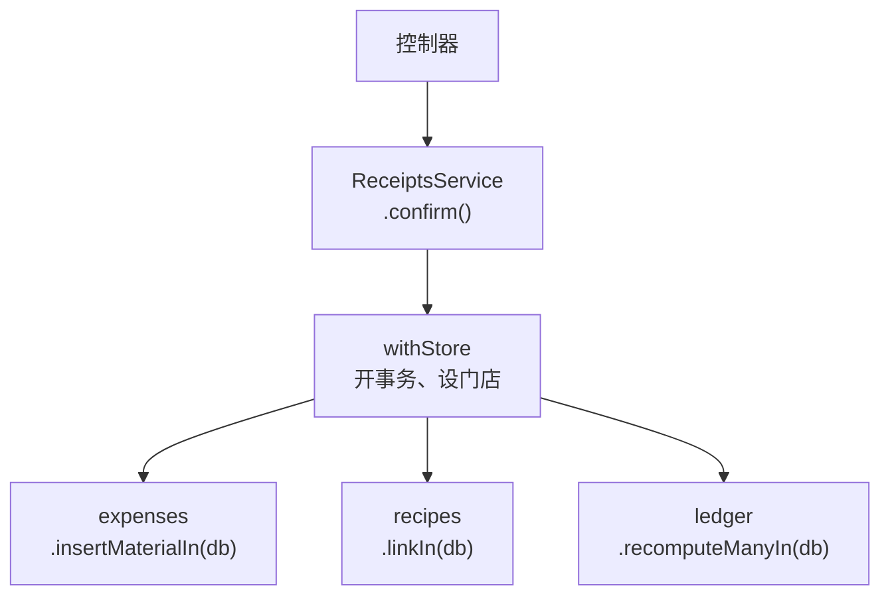

# 数据访问与事务

前面九章大多停在请求进来之后、碰到数据库之前。这一章往下走一层：service 怎么拿到数据库、要不要再包一层 repository、一个操作牵涉三个 service 时事务怎么传过去、事务里出了错该在哪一层接住。这些问题 Nest 本身不回答，它的依赖注入容器只管「把对象交给你」，不管「这些对象是不是在同一个事务里」。答错的后果往往不是报错，而是一半写进去了、一半没写进去。

本章用 Drizzle 和 postgres.js 举例，案例仍是 hatch-counter 的 `apps/api`。数据库那一侧的原理（隔离级别、锁、MVCC）在[《数据库原理与实战》](../database-practice/04-transactions.md)里，这里只讲应用代码怎么组织。

> [!WARNING]
> 本章的 Drizzle API（`db.transaction()` 的配置项、嵌套事务走 savepoint、`tx.rollback()` 抛 `TransactionRollbackError`、驱动错误包成 `DrizzleQueryError`）按 drizzle-orm 0.45.2 的源码整理，截至 2026-11。Drizzle v1 还在候选版阶段，事务 API 目前没有看到大的改动，但关系查询等部分有破坏性变更；以 Drizzle 官方文档（orm.drizzle.team）和 releases 说明为准。

## 先划边界：谁能碰连接

讨论 repository 之前，先定一条更底层的规矩：**整个应用只有一个地方持有连接池**。hatch-counter 里这个地方是 `DbService`（[第 1 章](01-di-modules.md)的 `DbModule`），它把 postgres.js 的连接交给 Drizzle，再对外只提供一个入口：

```ts
@Injectable()
export class DbService {
  readonly db: Db; // 只给少数不涉及租户数据的地方用

  /** 在某家门店的上下文里跑一段。租户数据的读写一律经过这里 */
  withStore<T>(storeId: string, fn: (tx: Db) => Promise<T>): Promise<T> {
    const a = actorStore.getStore() ?? JOB_ACTOR;
    return this.db.transaction(async (tx) => {
      await tx.execute(sql`
        select set_config('app.store_id', ${storeId}, true),
               set_config('app.actor_account', ${a.account ?? ""}, true)
      `);
      return fn(tx);
    });
  }
}
```

`set_config(..., true)` 等同于 `SET LOCAL`，只在这个事务里有效。这一点决定了后面所有设计：行级安全靠 `app.store_id` 过滤，而它**只活在事务里**。不在 `withStore` 的事务里查租户表，结果不是报错，而是一行都看不到；反过来，如果写成不带 `local` 的 `SET`，设置会留在池化的连接上，被下一个请求捡到，那就是跨租户泄露本身。所以「事务」在这个项目里不只是原子性的单位，还是租户上下文的边界。

`BusinessModule` 的注释把它说成了一条硬规矩：每个 service 都只经 `withStore()` 读写，少写一次不是「查不到数据」，而是可能「查到别人家的」，所以没有第二条路。

## 要不要 repository 层

Java 和 .NET 背景的人进 Nest，第一反应往往是每张表配一个 repository 类。常见的三种组织方式：

| 做法 | 长什么样 | 适合 |
|---|---|---|
| service 直接用 Drizzle | service 里写 `db.select().from(schema.expenses)` | 查询大多是一次性的、和业务规则写在一起更好读 |
| 每张表一个 repository | `ExpensesRepository.findByMonth()`，service 只调它 | 同一类查询被很多 service 复用；或者真要换存储 |
| 通用 `BaseRepository<T>` | 一个泛型类提供 `findById` / `save` | 很少值得：Drizzle 的查询构造器已经是这一层 |

hatch-counter 选了第一种，service 直接写 Drizzle 查询，不另建 repository 类。理由可以这样理解：TypeORM 那类 ORM 的 repository 封装了实体管理和变更跟踪，包一层有实际意义；Drizzle 本身就是贴着 SQL 的薄封装，再包一层 `findByMonth()`，多数时候只是把 `select ... where` 改了个名字，还把「这条查询用了哪个索引」藏得更深（索引怎么建见[《数据库原理与实战》](../database-practice/02-indexes.md)）。

repository 层真正想解决的两件事，用别的方式也拿到了：

- **收口「怎么连库」**：由 `DbService.withStore()` 统一做，所有租户读写都从这一个口子进
- **复用查询**：放在拥有那张表的 service 上，写成接收事务的方法（下一节的 `xxxIn`），别的 service 注入它来调用

判断该不该加 repository，问一句：「这一层能挡住什么错？」如果答案只是「看起来更分层」，就不必加。

## 事务怎么跨 service 传递

一个请求常常要动好几块数据。hatch-counter 确认一张进货单时，要写进货单的明细行、给食材记库存流水、顺手记一笔原料开支、必要时把新食材挂到菜谱上，这些分属 `ReceiptsService`、`StockLedgerService`、`ExpensesService`、`RecipesService`。它们必须在**同一个事务**里：明细写进去了、开支没记上，账就对不上了。

### 显式传参：`xxxIn(db)`

hatch-counter 的约定是两种方法分开：

- **公开方法**（控制器调的）负责开事务：`this.dbs.withStore(storeId, async (db) => { ... })`
- **以 `In` 结尾的方法**只接收一个已经开好的事务，自己不开：`insertMaterialIn(db, ...)`、`listIn(db, ...)`、`recomputeManyIn(db, ...)`

```ts
@Injectable()
export class ReceiptsService {
  constructor(
    private readonly dbs: DbService,
    private readonly expenses: ExpensesService,
    private readonly recipes: RecipesService,
    private readonly ledger: StockLedgerService,
  ) {}

  confirm(storeId: string, id: string, input: ConfirmInput) {
    return this.dbs.withStore(storeId, async (db) => {
      // ……写明细行、记库存流水……
      await this.recipes.linkIn(db, storeId, ingredientId, line.linkItemIds);
      const expense = await this.expenses.insertMaterialIn(db, storeId, { /* ... */ });
      await this.ledger.recomputeManyIn(db, ingredientIds);
      return { expense };
    });
  }
}

@Injectable()
export class CategoriesService {
  list(storeId: string, scope: CategoryScope) {
    return this.dbs.withStore(storeId, (db) => this.listIn(db, scope));
  }

  /** 在调用方的事务里查。别的 service 要用分类，调这个 */
  listIn(db: Db, scope: CategoryScope) { /* ... */ }
}
```



这个约定在 `business/` 下有一百来个 `xxxIn` 方法，规矩简单到可以靠命名检查：**`In` 方法里不准出现 `withStore`，公开方法不准接收 `db` 参数**。后台那一侧也是同样的写法，比如提交复核时把事务传给审计：`this.audit.record(db, actor, ip, {...})`，复核单和它的审计记录要么都在，要么都不在。

代价是每个方法多一个参数，调用链深的时候要一层层往下传。好处是事务边界**写在代码里、看得见、类型检查管得着**：`Db` 是一个具体类型，忘了传编译就不过。

### 隐式传递：AsyncLocalStorage

另一条路是把当前事务放进 `AsyncLocalStorage`，和[第 1 章](01-di-modules.md)装「谁在改」是同一个机制。社区有现成的实现：`nestjs-cls` 的 `@nestjs-cls/transactional` 插件，配合 Drizzle 适配器 `@nestjs-cls/transactional-adapter-drizzle-orm`，在方法上标 `@Transactional()`，方法里注入的 `TransactionHost` 拿到的 `tx` 就是当前事务，没有事务时是普通连接。

| | 显式传参 | AsyncLocalStorage |
|---|---|---|
| 方法签名 | 每个方法多一个 `db` | 干净 |
| 事务边界在哪 | 看 `withStore` 在哪调 | 看装饰器标在哪 |
| 忘了会怎样 | 编译不过 | 悄悄跑在事务外，不报错 |
| 定时任务、脚本里调用 | 自己开事务传进去 | 要先确认上下文已经建立 |

hatch-counter 两种机制都用了，但分工很清楚：「谁在改」这种**漏了只是记录不准**的上下文放进 AsyncLocalStorage；事务这种**漏了就是一半写入或者跨租户**的边界，坚持显式传。这和全书反复出现的原则一致：越是「错了不报错」的东西，越要让它在编译期或启动期暴露。

### 最常见的坑：在事务里用了事务外的连接

两种写法都会遇到同一类 bug：回调里拿错了连接。

```ts
return this.dbs.withStore(storeId, async (db) => {
  await db.insert(schema.categories).values({ storeId, name, scope });
  // 错：list() 是公开方法，会再开一个事务、拿池里另一条连接
  const all = await this.categories.list(storeId, scope);
  // 对：在同一个事务里查
  const same = await this.categories.listIn(db, scope);
});
```

调错的那一行有三个后果：

1. **看不到自己刚写的东西**。另一条连接上的事务看不到这个事务还没提交的插入，`all` 里没有刚建的那条
2. **不受这个事务的回滚约束**。如果它写了数据，外面回滚了，它的写入还在
3. **连接池可能卡死**。hatch-counter 的池是 10 条。十个请求同时走到这一行，每个都占着一条连接、又在等第二条，池里没有空闲的，谁也走不下去。这种卡死在开发机上几乎复现不出来，要等并发上来才出现

所以「公开方法不准在 `In` 方法里调用」不只是风格要求。另一个检查办法是在测试里把连接池调到 1：任何在事务里再借一条连接的代码都会直接挂住，测试超时就能发现。

## 事务里的错误

### 抛异常就是回滚

Drizzle 的 `db.transaction()` 在回调抛出异常时回滚，再把同一个异常原样抛给调用方。所以在事务里做业务校验，直接抛[第 6 章](06-errors.md)的业务错误类就好：

```ts
return this.dbs.withStore(storeId, async (db) => {
  const [cur] = await db.select().from(schema.categories).where(eq(schema.categories.id, id));
  if (!cur) throw new AppError("分类不存在");                // 回滚，过滤器回 400
  if (cur.scope !== "expense") throw new AppError("只有开支分类才有大类");
  // ……
});
```

Drizzle 还提供 `tx.rollback()`，它的实现就是抛一个 `TransactionRollbackError`，这个异常同样会一路抛出 `transaction()`。没人接的话，全局过滤器把它当成未知异常回 500。所以想「回滚并告诉用户为什么」，抛自己的业务错误比调 `tx.rollback()` 更合适：回滚和文案一步到位。

### 一条语句错了，整个事务就废了

PostgreSQL 的事务里只要一条语句出错，这个事务就进入中止状态，后面每条语句都报 `current transaction is aborted, commands ignored until end of transaction block`（SQLSTATE `25P02`），直到回滚。这直接决定了 `catch` 写在哪：

```ts
// 可以：接住、翻译、立刻再抛出去，事务随之回滚
try {
  await db.update(schema.categories).set({ name }).where(eq(schema.categories.id, id));
} catch (err) {
  if (isUniqueViolation(err)) throw new AppError("已存在同名分类");
  throw err;
}

// 不行：接住之后还想在同一个事务里接着写
try {
  await db.insert(schema.tags).values({ storeId, name });
} catch (err) {
  if (!isUniqueViolation(err)) throw err;
}
await db.insert(schema.itemTags).values({ itemId, tagName: name }); // 25P02
```

`isUniqueViolation` 按 SQLSTATE 认错误，理由见[第 6 章](06-errors.md#按-sqlstate-认约束冲突不按消息)：Drizzle 0.45 把驱动的错包成 `DrizzleQueryError`，错误码在 `cause` 上。

真要「冲突了就算了、接着写」，有两种做法：

- **让 SQL 自己不出错**：`insert ... on conflict do nothing`，Drizzle 里是 `.onConflictDoNothing()`。能这样写就这样写
- **用保存点**：Drizzle 在事务里再调 `tx.transaction()`，用 postgres.js 时会变成 `SAVEPOINT`，里面出错只回滚到保存点，外层事务还能继续

```ts
await this.dbs.withStore(storeId, async (db) => {
  try {
    await db.transaction(async (sp) => {   // SAVEPOINT
      await sp.insert(schema.tags).values({ storeId, name });
    });
  } catch (err) {
    if (!isUniqueViolation(err)) throw err; // 只回滚到保存点
  }
  await db.insert(schema.itemTags).values({ itemId, tagName: name }); // 照常执行
});
```

同样的道理也适用于 `finally`。hatch-counter 的 `DbService.asSystem()` 要在一段写之前把「谁在改」切成系统、写完再切回来，它的注释特意写了为什么**不包 `finally`**：中间那段抛了，整个事务就要回滚，这时在 `finally` 里再发一条 `set_config`，只会得到一个 `25P02`，把真正的错误盖掉。事务里的清理语句只在成功路径上执行，失败路径交给回滚。

### 在事务外面翻译错误

另一种写法是把翻译放在 `transaction()` 外面，用 `.catch` 接整个事务的失败：

```ts
return this.dbs
  .withStore(storeId, async (db) => {
    // ……恢复回收站里的一组行，可能撞上同名……
  })
  .catch((err: unknown) => {
    if (isUniqueViolation(err)) throw new AppError("已经有一个同名的了，先把那个改个名");
    throw err;
  });
```

这是 hatch-counter 回收站「恢复」的写法：恢复会写好几张表，哪一张撞上唯一约束都是同一句话，在外面统一翻译比在每条语句旁边都 `try` 一遍清楚。到这里事务已经回滚完毕，不存在 `25P02` 的问题。

### 整个事务重来

有些失败重试一次就会好：两个人同一刻各开一张单，按「当天最大号 + 1」取号撞了唯一约束；可串行化隔离级别下的序列化失败（`40001`）；死锁（`40P01`）。重试的单位必须是**整个事务**，不是出错的那条语句，因为事务已经废了：

```ts
/** 取号撞了就整个事务重来一次。只重来一次：连撞两次不是并发，是别的地方坏了 */
export async function retryOnNoClash<T>(run: () => Promise<T>): Promise<T> {
  try {
    return await run();
  } catch (err) {
    if (!isUniqueViolation(err)) throw err;
    return run();
  }
}

// 调用处：把整个 transaction() 包进去
await retryOnNoClash(() => this.adb.db.transaction(async (tx) => { /* 取号、插入 */ }));
```

能整个重来的前提是**事务回调里没有副作用**：重来一次不会多发一条短信、多扣一次第三方的钱。这就引出下一节。序列化失败和死锁的重试要不要加、重试几次、退避多久，见[《数据库原理与实战》](../database-practice/04-transactions.md#重试用了高隔离级别就必须写)。

## 提交之后再做的事

事务里只放数据库操作。发短信、推消息、调第三方接口，都放在事务提交**之后**：

```ts
const row = await this.adb.db.transaction(async (tx) => {
  const [r] = await tx.insert(schema.adminApprovals).values({ /* ... */ }).returning();
  await this.audit.record(tx, actor, ip, { action: "approval.submit", /* ... */ });
  return r;
});

await this.notify(row, "submitted"); // 推到企业微信群；推不出去只记一行 warn，不拦复核本身
```

放在事务里有两个问题：

- **事务被外部调用拖长**。第三方接口慢几秒，这个事务就开几秒，期间持有的行锁挡住别人，连接也一直占着，长事务的其他代价见[《数据库原理与实战》](../database-practice/05-mvcc.md#死元组与-vacuum)
- **回滚收不回副作用**。消息已经发出去了，事务却因为后面一条语句失败回滚了，用户收到一条关于「不存在的单子」的通知

提交之后再做，反过来的风险是「提交了、通知没发出去」。要看这件事能不能丢：复核提醒丢了，打开后台还能看到，所以只记 warn；不能丢的（比如要同步给另一个系统的账），就在**同一个事务里**往一张待发表写一行，提交后由后台任务去发、发成功再标记，这就是常说的 outbox 模式。hatch-counter 的实时推送走的是另一条路：数据库触发器在提交那一刻 `NOTIFY`，`NOTIFY` 本身是事务性的，回滚的事务不会发出通知（见[第 8 章](08-realtime.md)）。

## 隔离级别和只读事务

Drizzle 的 `transaction()` 第二个参数可以指定隔离级别和访问模式：

```ts
await db.transaction(
  async (tx) => { /* ... */ },
  { isolationLevel: "repeatable read", accessMode: "read only" },
);
```

PostgreSQL 默认是读已提交：事务里的每条语句各拿一个新快照。对写操作来说，多数并发问题用条件更新、`FOR UPDATE` 或唯一约束就能挡住，不必提高隔离级别（几种修法的对比见[《数据库原理与实战》](../database-practice/04-transactions.md#丢失更新读出来算好写回去)）。

一个容易忽略的场景是**报表**。一张经营报表在一个事务里发好几条查询：先算总收入，再按菜品拆分。读已提交下，两条查询之间如果有人录了一笔销售，总数和拆分加起来就对不上。这类「多条查询要看同一个时刻」的读，可以用 `repeatable read` 加 `read only`：所有查询共享事务开始时的快照，只读事务也不会和写事务发生序列化冲突。代价是快照持有期间 VACUUM 清理不了这之后产生的死元组，所以报表事务也要短。

hatch-counter 的 `withStore()` 没有传这个参数，全部用默认的读已提交；如果要给报表单独开快照，就得给 `withStore()` 加一个可选的事务配置，而不是在 service 里绕过它另开事务。

## 本章要点

- 整个应用只有一个地方持有连接池；用 `SET LOCAL` 设租户上下文时，事务就是租户隔离的边界
- Drizzle 已经是薄封装，不必为每张表再包 repository；需要复用的查询写成接收事务的方法，放在拥有那张表的 service 上
- 事务跨 service 传递：公开方法开事务，`xxxIn(db)` 方法只接收事务不开事务；显式传参让「忘了」变成编译错误
- AsyncLocalStorage 也能传事务（`@nestjs-cls/transactional`），签名干净，但忘了标装饰器不会报错
- 事务回调里绝不调用会自己开事务的公开方法：看不到未提交的写、不受回滚约束、还可能把连接池卡死
- 事务里抛业务异常就是回滚；一条语句出错整个事务作废，想接着写要用 `on conflict` 或保存点
- 并发冲突重试的单位是整个事务，前提是回调里没有副作用；短信、推送、第三方调用放在提交之后，不能丢的用 outbox
- 多条查询要看同一时刻的报表，用 `repeatable read` + `read only`

## 动手练习

1. **一条语句出错，整个事务作废**：在 PostgreSQL 容器的 `psql` 里执行 `create table tags (name text primary key);`，然后 `BEGIN; insert into tags values ('a'); insert into tags values ('a'); insert into tags values ('b');`，最后 `ROLLBACK;`。再试一遍，这次把第二条插入包在 `SAVEPOINT s1;` 和 `ROLLBACK TO SAVEPOINT s1;` 之间，并以 `COMMIT;` 结尾。

   验证：第一遍第三条插入报 `current transaction is aborted, commands ignored until end of transaction block`；第二遍提交后 `select * from tags;` 有 `a` 和 `b` 两行。

   参考答案：事务进入中止状态后只能回滚。想接住冲突接着写，要么用保存点，要么写 `on conflict do nothing` 让语句本身不出错。

2. **SET 和 SET LOCAL**：用 postgres.js 建一个 `max: 1` 的连接池（保证两次用的是同一条连接），在 `.mjs` 里运行：

   ```js
   import postgres from "postgres";
   const sql = postgres("postgres://postgres:pw@localhost:5432/postgres", { max: 1 });
   await sql.begin((tx) => tx`select set_config('app.store_id', 'A', false)`);
   const [r] = await sql`select current_setting('app.store_id', true) as v`;
   console.log(JSON.stringify(r.v));
   await sql.end();
   ```

   把 `false` 改成 `true` 再运行一次。

   验证：`false` 时事务结束后仍打印 `"A"`；`true` 时拿不到 `A`（观察打印的是空串还是 `null`）。

   参考答案：第三个参数为 `true` 等同于 `SET LOCAL`，只在当前事务内有效；为 `false` 时设置留在池化的连接上，被下一个请求捡到，就是跨租户泄露。

3. **事务里借第二条连接，池子卡死**：还是 `max: 1` 的池，运行下面这段；然后把注释那一行的 `sql` 换成 `tx` 再运行。

   ```js
   const timeout = new Promise((_, reject) => setTimeout(() => reject(new Error("超时")), 3000));
   const work = sql.begin(async (tx) => {
     await tx`select 1`;
     await sql`select 2`; // 事务外的连接
   });
   await Promise.race([work, timeout]).then(() => console.log("完成"), (e) => console.log(e.message));
   process.exit();
   ```

   验证：用 `sql` 时 3 秒后打印 `超时`；换成 `tx` 后立刻打印 `完成`。

   参考答案：唯一的连接被事务占着，事务又在等第二条连接，谁都走不下去。这正是本章说的测试办法：把池调到 1，任何在事务里再借连接的代码都会挂住。

## 接下来读什么

这本书讲的是 NestJS 这一层。往下一层，hatch-counter 的很多关键设计（行级安全、触发器维护的版本号、迁移、事务与隔离级别）都在数据库里，接着读[《数据库原理与实战》](../database-practice/)。往上一层，幂等、缓存、实时推送、多租户这些跨越整个系统的问题，在[《软件架构与系统设计》](../system-design/)里有完整的讨论。认证和权限只是安全的一部分，[《应用安全》](../app-security/)会补上 OWASP Top 10、密钥管理和供应链安全，并给出一份可以逐项对照的自查清单。
