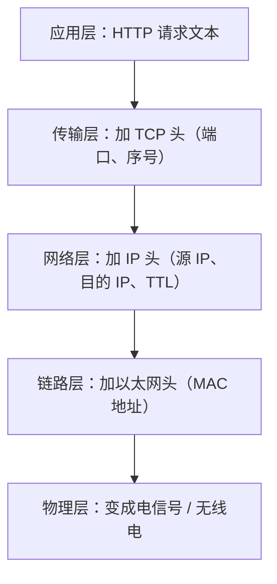
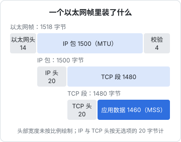
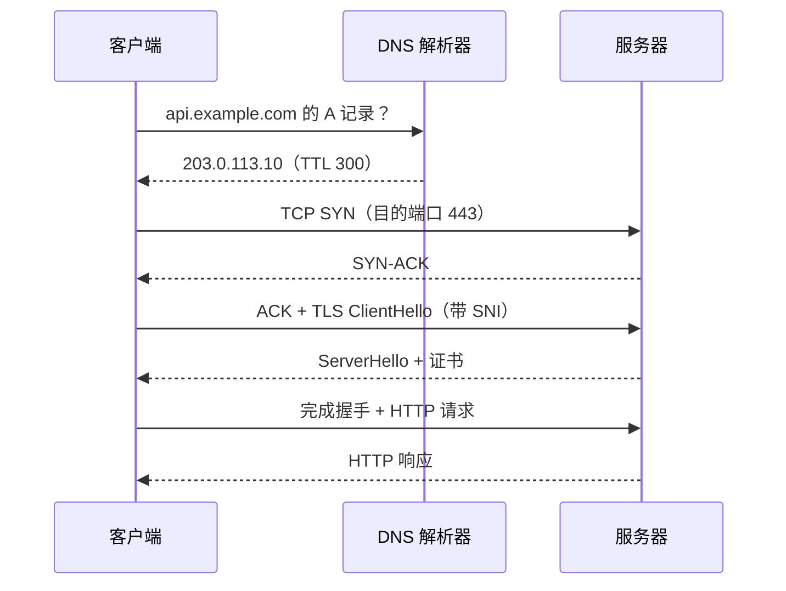

# 分层模型

## 这本书讲什么

这是一本写给「自己运维服务」的开发者的网络书。你会写 NestJS 接口、会用 Docker Compose 起服务、会配 nginx，但线上一出现「访问不了」「偶尔超时」「证书报错」「本地好好的上线就不行」，就只能挨个试、重启、搜报错。这本书要解决的就是这种状态：**知道一个请求从浏览器到你的进程中间经过了哪些环节，每个环节会怎么坏，用什么命令能看到它坏在哪**。

全书九章：

| 章 | 内容 | 解决的典型问题 |
|---|---|---|
| 1 分层模型 | 一个请求被拆成哪几层，排障从哪一层查起 | 「网络不通」到底是哪儿不通 |
| 2 TCP 与 UDP | 握手、重传、拥塞控制、连接状态 | 连接超时、连接被重置、TIME_WAIT 堆积 |
| 3 DNS 全链路 | 递归解析、缓存、TTL、记录类型 | 改了解析不生效、只有部分用户访问不了 |
| 4 HTTP 演进 | 1.1 → 2 → 3 各自解决了什么 | 为什么开了 HTTP/2 反而慢、SSE 卡住 |
| 5 TLS 与证书 | 握手、证书链、自动续期 | 证书过期、链不完整、SNI 配错 |
| 6 CDN | 缓存、回源、缓存键 | 更新了文件用户还是旧的、回源打爆 |
| 7 NAT、防火墙与端口 | 地址转换、安全组、Docker 端口 | 端口明明监听了外面就是连不上 |
| 8 局域网与 mDNS | 子网、ARP、多播、`.local` | 手机和电脑在同一个 Wi-Fi 却互相找不到 |
| 9 排障 | dig / curl / mtr / tcpdump 实战 | 把前八章变成一套固定的排查流程 |

**适合谁**：会写后端和前端、会用命令行、手上有一台 VPS 或打算有一台的开发者。不需要网络基础，但不会从「什么是 IP 地址」讲起。

**怎么读**：第 1 章建立地图，必读。第 2–6 章沿着一次 HTTPS 请求的顺序展开，建议按顺序读。第 7、8 章偏场景，遇到问题时再读也可以。第 9 章是速查，读完全书后放在手边，出事时照着查。

书里的命令以 macOS（本机）和 Ubuntu（服务器）为准，Linux 上的发行版差异会单独说明。

## 为什么要分层

一个 `fetch('https://api.example.com/v1/orders')` 要做的事情非常多：查到域名对应的 IP，找到通往那个 IP 的路，把数据切成小块发出去，丢了要重发，内容要加密，最后还要按 HTTP 的格式解释请求和响应。如果这些全写在一个程序里，任何一处变化（比如从 Wi-Fi 换到 5G）都得改全部代码。

分层的思路是：**每一层只解决一类问题，只依赖下一层提供的服务，只对上一层暴露简单的接口**。于是：

- 写 HTTP 的人不用关心数据走的是光纤还是 Wi-Fi
- 换成 IPv6，TCP 和 HTTP 不用改
- TLS 可以插在 TCP 和 HTTP 中间，两边都几乎不用动

对排障者来说，分层还有一个更实际的好处：**每一层坏了，症状不一样，用的工具也不一样**。只要先判断坏在哪一层，问题就缩小了一大半。

## TCP/IP 四层与 OSI 七层

教科书里常见两套模型。OSI 七层是理论参考，TCP/IP 四层是互联网实际的样子。工作中两套说法混用，比如「四层负载均衡」「七层负载均衡」用的是 OSI 的编号。

| OSI 层 | TCP/IP 层 | 解决的问题 | 地址 / 标识 | 典型协议 |
|---|---|---|---|---|
| 7 应用层 | 应用层 | 数据是什么意思 | URL、域名 | HTTP、DNS、SSH |
| 6 表示层 | 应用层 | 编码、加密 | — | TLS（大致归在这里） |
| 5 会话层 | 应用层 | 会话管理 | — | — |
| 4 传输层 | 传输层 | 进程到进程，可靠或不可靠 | 端口号 | TCP、UDP、QUIC |
| 3 网络层 | 网络层 | 主机到主机，跨网络路由 | IP 地址 | IPv4、IPv6、ICMP |
| 2 数据链路层 | 链路层 | 同一网段内一跳 | MAC 地址 | 以太网、Wi-Fi、ARP |
| 1 物理层 | 链路层 | 比特怎么传 | — | 网线、光纤、无线电 |

记住一句话就够用：**链路层负责一跳，网络层负责跨网到达主机，传输层负责送到主机上的哪个进程，应用层负责内容**。

「四层负载均衡」只看 IP 和端口转发 TCP 连接，不解析内容；「七层负载均衡」（nginx 反代就是）会读 HTTP 请求，能按路径、Host、Header 分流。前者快、通用，后者灵活但要终止 TLS。

## 封装：每一层加一个头

发送数据时，从上往下，每一层在上层交下来的数据前面加上自己的头部；接收时从下往上逐层剥掉。



每一跳路由器只剥到网络层：看目的 IP，决定下一跳往哪发，换一个新的链路层头再发出去。**IP 头在一路上基本不变（TTL 每跳减 1），链路层头每一跳都换**。这就是为什么 MAC 地址只在局域网内有意义。

一个以太网帧能装的数据有上限，叫 **MTU**（Maximum Transmission Unit），以太网通常是 1500 字节。扣掉 IP 头和 TCP 头，留给应用数据的部分叫 **MSS**（Maximum Segment Size）：



为什么要关心这几个数字？因为 MTU 不匹配是一类非常隐蔽的故障：走 VPN、PPPoE 拨号、隧道时，每多一层封装就多一个头，可用 MTU 变小。如果中间设备又挡掉了用于探测 MTU 的 ICMP 消息，就会出现「**小请求正常，大响应卡死**」：SSH 能登录，但 `cat` 一个大文件就卡住；网页 HTML 能出来，图片加载不完。第 7 章会讲怎么验证。

## 一次 HTTPS 请求经过了什么

把一次 `curl https://api.example.com/v1/health` 按时间顺序展开，就是全书的主线：



每一步对应一章：

1. **DNS**（第 3 章）：域名 → IP。这一步失败，报错是 `Could not resolve host` / `ENOTFOUND`
2. **路由**（第 1、7 章）：数据包能不能到达那个 IP。失败表现为超时
3. **TCP 握手**（第 2 章）：对方端口有没有进程在听、防火墙放不放行。失败表现为 `Connection refused`（有回应但端口没开）或超时（包被丢了）
4. **TLS 握手**（第 5 章）：证书对不对、协议能不能谈拢。失败表现为证书错误、`handshake failure`
5. **HTTP**（第 4 章）：请求格式、状态码、反向代理。失败表现为 4xx / 5xx

`curl -v` 的输出恰好按这个顺序打印，第 9 章会教你逐行读它。

## 每一层的「地址」各管什么

开发者最容易混淆的是这几种标识：

| 标识 | 例子 | 范围 | 谁分配 | 会不会变 |
|---|---|---|---|---|
| 域名 | `api.example.com` | 全球 | 你在注册商买、自己配解析 | 你决定 |
| IP 地址 | `203.0.113.10` | 全球（公网）或局域网（私网） | 云厂商 / 路由器 DHCP | 重建机器、换 Wi-Fi 会变 |
| 端口 | `443`、`3000` | 一台主机内 | 程序 `listen` 时决定 | 你决定 |
| MAC 地址 | `a4:83:e7:...` | 一个局域网 | 网卡出厂（手机常随机化） | 手机的「私有地址」会变 |

一个 TCP 连接由**四元组**唯一确定：源 IP、源端口、目的 IP、目的端口。服务端只监听一个端口（比如 443），能同时服务成千上万个客户端，是因为每个客户端的源 IP + 源端口不同。

还有一个常见坑：**监听地址**。`server.listen(3000, '127.0.0.1')` 只接受本机连接，`0.0.0.0` 接受所有网卡上的连接。服务在容器或服务器上「本机 curl 通、外面连不上」，第一件事就是看它监听的是哪个地址：

```bash
# Linux
ss -tlnp

# macOS
lsof -iTCP -sTCP:LISTEN -n -P
```

`127.0.0.1:3000` 说明只听本机，`0.0.0.0:3000` 或 `*:3000` 说明听所有地址，`[::]:3000` 是 IPv6 的全部地址（Linux 上通常也同时接受 IPv4）。

## 按层排障的思路

出问题时，从下往上一层层排除，每一层用一个最简单的命令验证：

| 层 | 问题 | 验证命令 | 成功的样子 |
|---|---|---|---|
| DNS | 域名解析得对吗 | `dig +short api.example.com` | 返回你预期的 IP |
| 网络层 | IP 能到达吗 | `ping`、`mtr` | 有回应（注意：很多云主机默认禁 ping） |
| 传输层 | 端口开着吗 | `nc -vz api.example.com 443` | `succeeded` / `open` |
| TLS | 证书和握手正常吗 | `openssl s_client -connect host:443 -servername host` | `Verify return code: 0 (ok)` |
| 应用层 | HTTP 返回对吗 | `curl -sv https://host/health` | 预期的状态码和内容 |

这个顺序的好处是：**下层不通，上层一定不通；下层通了，就不用再怀疑它**。很多时候人们在应用层折腾半天（改 nginx 配置、改 CORS），最后发现是 DNS 还指着旧服务器。

反过来也有捷径：如果 `curl -v` 已经打印出了 HTTP 状态码，说明 DNS、路由、TCP、TLS 全部正常，直接看应用层。

## 本章要点

- 网络分层让每层只解决一类问题；排障时**先判断坏在哪一层**，问题就缩小了一大半
- 链路层管一跳（MAC），网络层管到达主机（IP），传输层管到进程（端口），应用层管内容
- 「四层」和「七层」负载均衡的区别：只转发连接，还是解析 HTTP 内容
- 以太网 MTU 通常 1500，TCP MSS 通常 1460；多一层封装可用 MTU 就变小，「小包通大包卡」要想到 MTU
- 一次 HTTPS 请求依次经过 DNS → 路由 → TCP → TLS → HTTP，每一步的报错长得不一样
- 服务「本机通外面不通」，先用 `ss -tlnp` 看监听地址是不是 `127.0.0.1`
