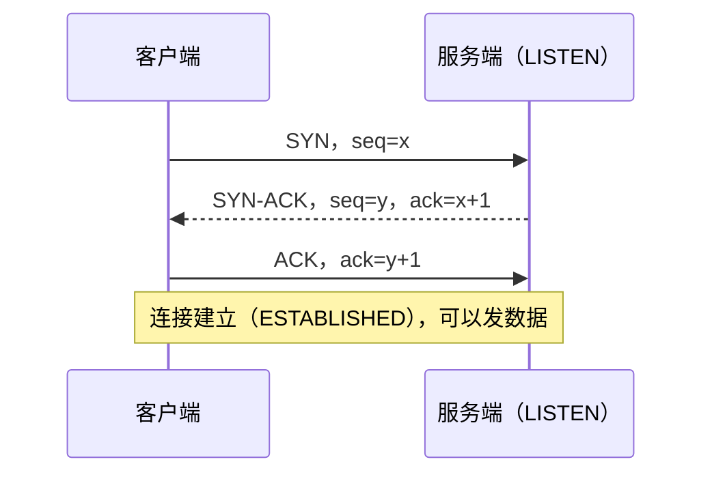
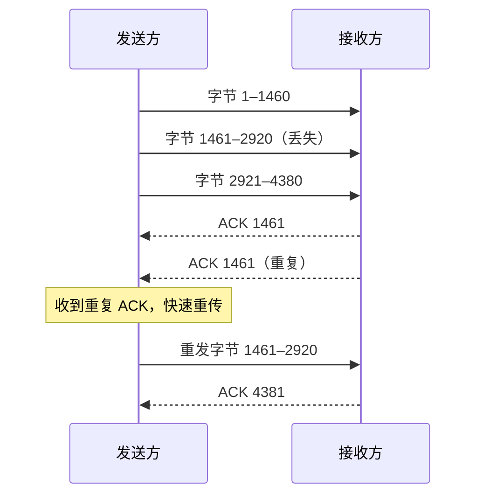
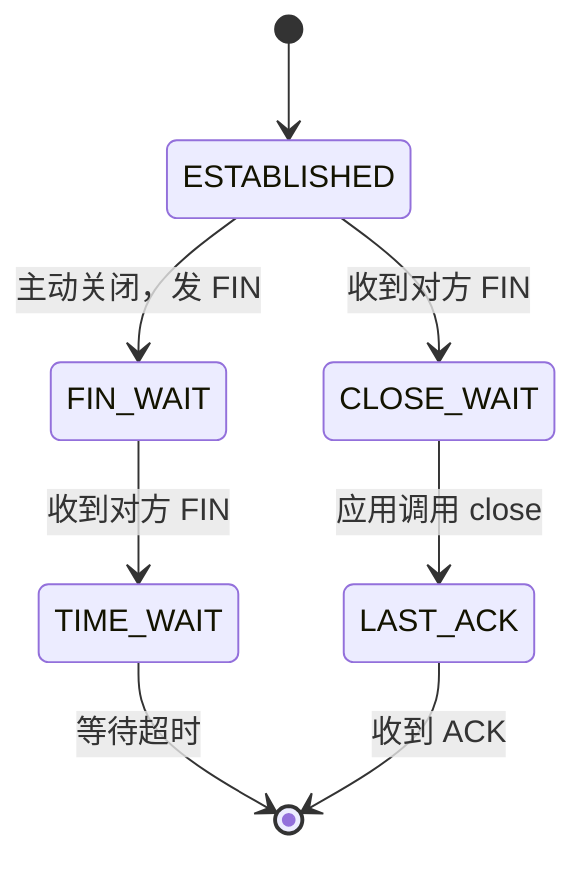

# TCP 与 UDP

网络层只负责「尽力」把包送到对方主机：包可能丢、可能乱序、可能重复，网络层都不管。传输层在它之上做两件事：一是用**端口**把数据交给主机上正确的进程；二是（对 TCP 而言）把不可靠的包变成**可靠、有序的字节流**。本章讲清 TCP 是怎么做到的、代价是什么，以及这些机制在线上会以什么样的故障出现。

## 两种选择

| | TCP | UDP |
|---|---|---|
| 连接 | 先握手建立连接 | 无连接，直接发 |
| 可靠性 | 丢包重传、保证顺序 | 不保证，丢了就丢了 |
| 数据形态 | 字节流，没有消息边界 | 数据报，一次发送就是一条消息 |
| 流量 / 拥塞控制 | 有 | 没有，应用自己负责 |
| 头部 | 至少 20 字节 | 8 字节 |
| 典型应用 | HTTP/1.1、HTTP/2、SSH、数据库连接 | DNS 查询、音视频通话、游戏、QUIC（HTTP/3） |

「TCP 可靠、UDP 不可靠」只说对了一半。更准确的理解是：**TCP 把可靠性做进了内核，所有应用用同一套策略；UDP 什么都不做，让应用按自己的需求决定**。实时语音宁可丢一点也不要等重传，所以用 UDP；HTTP/3 想要可靠但又不想被 TCP 的某些设计拖累，于是在 UDP 上自己实现了一套（QUIC，见第 4 章）。

「字节流没有消息边界」是写 TCP 程序最常见的坑：对方 `write` 了两次各 100 字节，你可能一次 `read` 到 200 字节，也可能先读到 37 字节。所以基于 TCP 的协议都要自己定边界：HTTP/1.1 用 `Content-Length` 或分块编码，很多二进制协议用「长度前缀」。hatch-shelf 的局域网传书服务自己解析 HTTP，就要一直累积数据直到收满 `Content-Length` 指定的字节数，才算一个完整请求（第 8 章细讲）。

## 三次握手

TCP 发数据前必须先建立连接，双方要交换并确认各自的**初始序号**，这样之后的每个字节都有编号，丢了、乱了都能发现。



为什么是三次而不是两次？因为双方都要确认「我发的序号对方收到了」。客户端的 SYN 由服务端的 SYN-ACK 确认，服务端的 SYN 由客户端最后的 ACK 确认。

握手的代价是**一个往返时间**（RTT）。从上海连到美西的服务器，RTT 大约在 150ms 以上，光握手就要等这么久，后面 TLS 还要再加。这就是为什么连接复用（keep-alive）、把服务放得离用户近（CDN、边缘计算）这么重要。

### 连不上时的两种症状

握手阶段失败，客户端看到的报错能直接告诉你原因：

| 报错 | 底层发生了什么 | 常见原因 |
|---|---|---|
| `Connection refused` / `ECONNREFUSED` | 对方主机回了 RST | 主机在，但这个端口没有进程在听；或进程只听了 `127.0.0.1` |
| `Connection timed out` / `ETIMEDOUT` | SYN 发出去没有任何回应，重试几次后放弃 | 防火墙 / 安全组把包丢了；IP 根本不对；路由不通 |
| `No route to host` / `EHOSTUNREACH` | 收到了 ICMP 不可达，或本机就没有路由 | 本地网络问题，或防火墙用「拒绝」而不是「丢弃」 |

**refused 是好消息**：它说明网络是通的，包到达了对方主机，只是端口上没人。**timeout 才麻烦**：包在路上某处被默默丢掉了，要逐段排查。第 7 章讲防火墙时会再用到这个区分。

## 可靠传输：序号、确认与重传

建立连接后，发送方给每个字节编号，接收方回 ACK 告诉对方「我已经连续收到第几号之前的所有字节」。发送方如果在一段时间（RTO，重传超时）内没收到某段数据的 ACK，就重发。



这里有个关键性质：**TCP 必须按顺序把数据交给应用**。第二段丢了，第三段虽然已经到了，也只能在内核里等着，直到第二段重传成功。这叫**队头阻塞**（head-of-line blocking）。一个 TCP 连接上只跑一个请求时问题不大；HTTP/2 在一个连接上同时跑几十个请求时，一个包丢失会让所有请求一起等，这是 HTTP/3 要改用 UDP 的根本原因。

重传的另一面是**延迟会被放大**。RTO 通常从几百毫秒起步，而且每次重传失败都会翻倍。所以丢包率哪怕只有百分之几，用户感受到的也不是「慢了百分之几」，而是「偶尔卡好几秒」。这就是为什么看网络质量不能只看平均延迟，要看丢包和长尾。

## 流量控制与拥塞控制

TCP 发送方不能想发多快就发多快，受两个窗口限制：

- **接收窗口**（rwnd）：接收方告诉发送方「我的缓冲区还能放多少」，防止把接收方撑爆。这是流量控制
- **拥塞窗口**（cwnd）：发送方自己估计「网络能承受多少」，防止把中间的路由器撑爆。这是拥塞控制

实际能在途的数据量取两者较小值。

### 慢启动

新连接不知道网络有多宽，所以从一个较小的拥塞窗口开始，每收到一轮确认就大致翻倍，直到出现丢包或达到阈值。Linux 当前默认的初始窗口是 10 个报文段（约 14.6 KB）。


这张图解释了几个前端性能常识：

- **新连接传大文件很慢**：一个 400 KB 的 JS 包在新连接上至少需要 5 个往返才能发完，跨洋时就是接近一秒，和带宽多大关系不大
- **首屏关键内容尽量小**：头 14 KB 左右能在第一个往返里发完，所以有「关键 CSS 内联、HTML 首段尽量小」的建议
- **连接复用很值钱**：已经「热」起来的连接窗口大，新开连接要重新慢启动

拥塞控制算法有多种，Linux 默认是 CUBIC，Google 提出的 BBR 在高延迟、有随机丢包的链路上通常表现更好。能不能开、开了有没有用取决于内核版本和链路，作为服务端优化可以尝试，但不是必须：

```bash
# 查看当前算法和可用算法
sysctl net.ipv4.tcp_congestion_control
sysctl net.ipv4.tcp_available_congestion_control
```

## 断开连接与 TIME_WAIT

关闭连接是四次挥手：双方各自发 FIN、各自确认。**主动关闭的一方**最后会进入 `TIME_WAIT` 状态，停留一段时间（Linux 上固定 60 秒）才真正释放，目的是让网络里残留的旧包过期，不会被误认为属于下一个使用同样四元组的新连接。



线上两个状态值得关注：

- **大量 `TIME_WAIT`**：通常出现在频繁主动发起短连接的一方，比如每个请求都新建连接去调用上游 API 的服务。它本身不是错误，但可能耗尽本地端口。根治办法是**复用连接**（HTTP keep-alive、连接池），而不是去改内核参数
- **大量 `CLOSE_WAIT`**：对方已经关闭了，但你的程序一直没调用 `close`。这几乎总是**程序 bug**，比如连接泄漏、响应流没读完没释放

```bash
# 按状态统计连接数（Linux）
ss -tan | awk 'NR>1 {print $1}' | sort | uniq -c | sort -rn
```

## 长连接与空闲超时

HTTP keep-alive 让多个请求复用同一条 TCP 连接，省掉握手和慢启动。但长连接引入了一个经典故障：**两端对「空闲多久算断」的看法不一致**。

场景：nginx 到 Node 服务之间开了连接复用（hatch-counter 的 nginx 配置里 `upstream` 就写了 `keepalive`）。Node 的 HTTP 服务默认 `keepAliveTimeout` 是 5 秒，空闲 5 秒就关掉连接。如果 nginx 恰好在 Node 关闭的那一瞬间往这条连接上发请求，就会收到 RST，用户看到偶发的 502。

规则很简单：**上游（后端）的空闲超时要比下游（代理）长**，让代理先关。

```ts
import http from 'node:http';

const server = http.createServer(app);
// 比前面代理 / 负载均衡的空闲超时长；headersTimeout 要比 keepAliveTimeout 再大一点
server.keepAliveTimeout = 65_000;
server.headersTimeout = 66_000;
server.listen(3000, '127.0.0.1');
```

NestJS 下可以在 `app.listen()` 之后通过 `app.getHttpServer()` 拿到同一个对象来设置。

另一类空闲问题出在中间设备：NAT 网关、防火墙、负载均衡都会记录连接状态，空闲太久就删掉记录，之后的包会被丢掉或被回 RST。SSE、WebSocket 这种长时间不说话的连接最容易中招，解决办法是**应用层心跳**：每隔一段时间（比如 15–30 秒）发一条注释行或 ping 帧，让连接看起来一直活着。

## UDP 什么时候用

开发者直接写 UDP 的机会不多，但要知道哪些东西在用它，因为防火墙放行 TCP 不等于放行 UDP：

| 用途 | 端口 | 漏开会怎样 |
|---|---|---|
| DNS 查询 | 53 | 解析失败（大响应会回退到 TCP 53） |
| HTTP/3（QUIC） | 443 | 浏览器自动退回 HTTP/2，不报错但享受不到 HTTP/3 |
| mDNS | 5353 | 局域网 `.local` 名字解析不了（第 8 章） |
| WireGuard / Tailscale | 自定义 / 41641 等 | VPN 建立不了或只能走中继 |

UDP 没有握手，所以「端口通不通」不能用 `nc -vz` 简单判断：发出去没回应，可能是被丢了，也可能是对方收到了但不打算回。验证 UDP 服务要用那个协议自己的客户端，比如 DNS 用 `dig @server`。

## 本章要点

- TCP 提供可靠有序的**字节流**，应用协议要自己定消息边界；UDP 只发数据报，可靠性留给应用
- 三次握手花一个 RTT；`refused` 说明网络通但端口没人听，`timeout` 说明包被丢了
- TCP 按序交付带来**队头阻塞**；丢包会把延迟放大成「偶尔卡几秒」
- 慢启动让新连接从约 14.6 KB 起步逐轮翻倍：大文件在新连接上要多个 RTT，**连接复用很值钱**
- 大量 `TIME_WAIT` 靠复用连接解决；大量 `CLOSE_WAIT` 是程序没关连接的 bug
- 后端的 keep-alive 空闲超时要**长于**前面代理的；长连接要加应用层心跳
- 防火墙要单独考虑 UDP：DNS、HTTP/3、mDNS 都依赖它

## 动手练习

1. **看 keep-alive 的空闲超时**：把下面的代码存成 `ka.mjs`，用 Node 22/24 运行 `node ka.mjs`。它用同一个 keep-alive agent 发三次请求，间隔分别是 3 秒和 6 秒，打印每次是否复用了旧连接。

   ```js
   import http from 'node:http';
   const srv = http.createServer((q, r) => r.end('ok')).listen(3000);
   const agent = new http.Agent({ keepAlive: true });
   const get = () => new Promise((res) => {
     const req = http.get('http://127.0.0.1:3000', { agent }, (r) => {
       r.resume(); r.on('end', () => res(req.reusedSocket));
     });
   });
   const sleep = (ms) => new Promise((r) => setTimeout(r, ms));
   console.log(await get());
   await sleep(3000); console.log(await get());
   await sleep(6000); console.log(await get());
   srv.close(); agent.destroy();
   ```

   验证：依次打印 `false`、`true`、`false`。

   参考答案：Node 服务端默认 `keepAliveTimeout` 是 5 秒，空闲 3 秒时连接还在，空闲 6 秒时服务端已经关掉，只能新建。把 `srv.keepAliveTimeout = 10_000` 加在 `listen` 前再跑，第三个也会是 `true`。前面有代理时，就是靠这个值比代理的长来避免偶发 502。

2. **造一个 CLOSE_WAIT**：执行 `node -e "require('net').createServer({allowHalfOpen:true}, s => {}).listen(4000)"`，另开终端执行 `nc 127.0.0.1 4000`，然后按 Ctrl+C 退出 nc，再执行 `netstat -an | grep 4000`（Linux 上也可以用 `ss -tan | grep 4000`）。

   验证：看到一条连接处于 `CLOSE_WAIT`，而且不会自己消失；停掉 Node 进程后它才没了。

   参考答案：客户端发了 FIN，服务端程序收到后一直不调用 `end()` / `close()`，连接就卡在 `CLOSE_WAIT`。线上大量 `CLOSE_WAIT` 说明程序漏关连接，查代码而不是调内核参数。

3. **谁主动关闭谁背 TIME_WAIT**：在一次性容器 `docker run --rm -it python:3.12-slim bash` 里执行 `apt-get update && apt-get install -y curl iproute2`，后台起 `python -m http.server 8000 &`，然后 `for i in $(seq 20); do curl -s -o /dev/null http://127.0.0.1:8000/; done; ss -tan state time-wait`。

   验证：列出约 20 条 `TIME-WAIT` 连接；看每条的本地地址是 `:8000` 还是客户端的临时端口。

   参考答案：`http.server` 默认按 HTTP/1.0 回完响应就关连接，主动关闭的是服务端，所以 `TIME-WAIT` 落在 `:8000` 这一侧。换成每个请求都新建连接去调上游的 Node 服务，`TIME-WAIT` 就会堆在调用方，治本的办法是复用连接。
