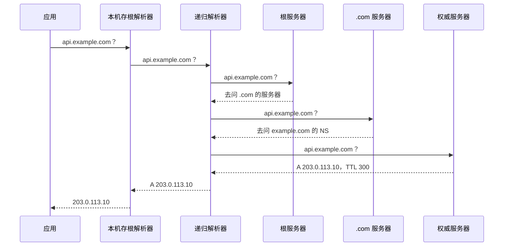

# DNS 全链路

DNS 把域名翻译成 IP 地址，是每次请求的第一步，也是最容易被误解的一环。「改了解析怎么还没生效」「我这里能访问、用户那里不行」「容器里解析不了内网服务」，这些问题背后都是同一套机制：**分布式的层级查询 + 到处都有的缓存**。本章把一次解析从头到尾走一遍，再讲清记录类型、TTL 和几个开发中的常见坑。

## 一次解析经过了谁

DNS 的参与者有四类：

| 角色 | 在哪里 | 做什么 |
|---|---|---|
| 存根解析器（stub resolver） | 你的电脑、手机、服务器上，操作系统的一部分 | 只会把问题转给递归解析器，再缓存答案 |
| 递归解析器（recursive resolver） | 运营商、路由器、公共 DNS（如 1.1.1.1、8.8.8.8、223.5.5.5） | 替你从根开始一层层问，并缓存结果 |
| 根 / 顶级域服务器 | 全球分布 | 只告诉你「下一层该去问谁」 |
| 权威服务器（authoritative） | 你的 DNS 服务商，如 Cloudflare、阿里云 DNS | 保存你配置的记录，给出最终答案 |

一次没有命中任何缓存的完整查询：



实际上大部分查询在前两步就被缓存挡住了：浏览器有缓存，操作系统有缓存，递归解析器的缓存更是被成千上万人共享。这也意味着**答案可能来自任何一层的缓存，而不是你刚改过的权威服务器**。

## 记录类型

| 类型 | 作用 | 例子 |
|---|---|---|
| A | 域名 → IPv4 | `api.example.com. 300 IN A 203.0.113.10` |
| AAAA | 域名 → IPv6 | `api.example.com. 300 IN AAAA 2001:db8::10` |
| CNAME | 域名是另一个域名的别名 | `www.example.com. CNAME example.pages.dev.` |
| NS | 这个区由哪些权威服务器负责 | `example.com. NS ns1.dnsprovider.com.` |
| MX | 邮件交给哪台服务器 | `example.com. MX 10 mx.mailprovider.com.` |
| TXT | 任意文本，常用于验证和邮件策略 | SPF、DKIM、DMARC、域名所有权验证 |
| CAA | 允许哪些 CA 给这个域名签证书 | `example.com. CAA 0 issue "letsencrypt.org"` |
| SRV | 某服务在哪个主机和端口 | 局域网服务发现、部分协议使用（第 8 章） |

几个容易踩的规则：

- **CNAME 不能和其他记录共存**：一个名字有了 CNAME，就不能再有 A、MX、TXT。所以**根域名（`example.com` 本身）不能用 CNAME**，因为根域必须有 NS 和 SOA。托管平台让你「把根域指向我们」时，要用服务商提供的 CNAME 拉平（flattening）或 ALIAS 记录，它在权威服务器端替你解析成 A 记录
- **CNAME 会多一次查询**：解析 `www` 得到 CNAME，还要再解析它指向的名字。一般无所谓，但别串成长链
- **末尾的点**：区文件里 `example.com.` 末尾的点表示「完整域名」，没有点会被补上当前区名。在 DNS 服务商的网页上通常不用管，手写区文件时要注意
- **邮件相关的 TXT**：用自己的域名发信（注册验证码、通知），要配 SPF、DKIM、DMARC 三件套，否则很容易进垃圾箱。具体值由邮件服务商给，照抄即可

## TTL 与缓存

每条记录都带一个 **TTL**（Time To Live，秒）：拿到这条记录的解析器可以缓存它多久。TTL 300 表示 5 分钟内不再回来问。

这带来了「解析生效时间」的真相：**DNS 没有「传播」，只有「缓存过期」**。你在服务商那里改了记录，权威服务器立刻就是新值；但世界各地的递归解析器还缓存着旧值，要等各自的 TTL 到期才会重新查询。所以生效时间取决于**旧记录的 TTL**，而不是新记录的。

迁移服务器时的标准做法：

1. **提前**把要改的记录 TTL 调小，比如从 3600 改成 60
2. 等至少一个旧 TTL（这里是 1 小时），让所有缓存都拿到「TTL 60」的版本
3. 切换 IP，此时最多 60 秒全部生效
4. 观察一段时间没问题，再把 TTL 调回较大的值

还有一种缓存经常被忽略：**否定缓存**。查询一个不存在的名字，解析器会把「不存在」（NXDOMAIN）也缓存一段时间，时长由区的 SOA 记录决定。典型场景：还没配记录就先访问了一次 `new.example.com`，然后去配置，结果发现半天都解析不到。遇到这种情况换个递归解析器验证，或者等一会儿。

各层缓存的清理方式：

```bash
# macOS
sudo dscacheutil -flushcache; sudo killall -HUP mDNSResponder

# Ubuntu（systemd-resolved）
resolvectl flush-caches
resolvectl statistics   # 看缓存命中情况

# Chrome：地址栏打开 chrome://net-internals/#dns 点 Clear host cache
```

递归解析器的缓存你清不了，只能等，或者换一个解析器查。

## 用 dig 看清每一步

`dig` 是 DNS 排障的主力工具（macOS 自带，Ubuntu 装 `dnsutils` 或 `bind9-dnsutils`）。

```bash
# 只要结果
dig +short api.example.com

# 看完整应答：TTL、应答来自哪个服务器、耗时
dig api.example.com

# 指定记录类型
dig example.com MX
dig example.com TXT

# 指定解析器：对比不同解析器的结果
dig @1.1.1.1 api.example.com
dig @223.5.5.5 api.example.com

# 直接问权威服务器，绕过所有缓存：看你配置的真实值
dig example.com NS +short
dig @ns1.dnsprovider.com api.example.com

# 从根开始完整追一遍，看每一层的委派
dig +trace api.example.com
```

读 `dig` 输出时关注这几处：

```text
;; ->>HEADER<<- opcode: QUERY, status: NOERROR, id: 4242
;; flags: qr rd ra; QUERY: 1, ANSWER: 1, AUTHORITY: 0, ADDITIONAL: 1

;; ANSWER SECTION:
api.example.com.    287    IN    A    203.0.113.10

;; Query time: 3 msec
;; SERVER: 192.168.1.1#53(192.168.1.1) (UDP)
```

- `status`：`NOERROR` 正常，`NXDOMAIN` 名字不存在，`SERVFAIL` 解析器出错了（常见于 DNSSEC 配置错误或权威服务器不可达）
- `flags` 里有 `aa`：这是权威服务器直接给的答案；没有 `aa` 说明来自缓存
- TTL 是 287 而不是配置的 300：说明这条已经在缓存里待了 13 秒
- `SERVER`：是谁回答的，确认你问的是自己以为的那个解析器

排查「我这里好、用户那里不好」：分别 `dig @权威`、`dig @几个公共解析器`，如果权威是新值、某个公共解析器还是旧值，那就是缓存问题，等 TTL；如果权威本身就不对，是配置问题。

## dig 不等于你的程序

**`dig` 直接发 DNS 查询，不走操作系统的解析流程**。而你的程序（浏览器、curl、Node）走的是系统解析器，会先查 `/etc/hosts`、走 macOS 的 `/etc/resolver/` 配置、VPN 下发的 DNS、mDNS 等。所以 `dig` 结果正确、程序还是解析错，非常常见。

```bash
# macOS：按系统解析流程查询（和浏览器、curl 走的路一致）
dscacheutil -q host -a name api.example.com

# Linux：getent 走 /etc/nsswitch.conf 定义的完整流程（含 /etc/hosts）
getent hosts api.example.com

# Ubuntu 上 systemd-resolved 的实际上游和每个网卡的 DNS
resolvectl status
```

排查时先检查 `/etc/hosts`：开发时为了测试临时加的一行，过几个月后忘了，是相当常见的「灵异事件」。

### Node 里的两种解析

Node 有两套 DNS API，行为不同：

| API | 实现 | 读 /etc/hosts | 特点 |
|---|---|---|---|
| `dns.lookup()` | 调用系统 `getaddrinfo` | 是 | `http`、`fetch`、`net.connect` 默认用它；在 libuv 线程池里执行，大量并发解析会占满线程池 |
| `dns.resolve*()` | 直接发 DNS 查询（c-ares） | 否 | 行为像 `dig`，不受线程池限制 |

还有一个经典坑：`localhost` 在新系统上可能先解析成 IPv6 的 `::1`。Node 17 起 `dns.lookup` 不再强制把 IPv4 排在前面，于是服务只听了 `127.0.0.1`，客户端连 `localhost` 却去连 `::1`，报 `ECONNREFUSED ::1:3000`。最省事的办法是**本地开发配置里直接写 `127.0.0.1`**，而不是 `localhost`。

## 容器里的 DNS

Docker Compose 给每个项目建一个网络，并在容器内提供一个内嵌 DNS（容器里 `/etc/resolv.conf` 指向 `127.0.0.11`）。它能把**服务名**解析成对应容器的 IP，这就是 hatch-counter 的服务端可以直接用 `postgres:5432` 连数据库的原因：`postgres` 是 compose 里的服务名，而不是一个公网域名。

几个推论：

- 服务名只在同一个 compose 网络里有效，宿主机上 `ping postgres` 是解析不到的
- 容器重建后 IP 会变，但服务名不变，所以**永远用服务名连，不要写死容器 IP**
- 外部域名由内嵌 DNS 转发给宿主机配置的上游；宿主机 DNS 有问题，容器里也会有问题

## 什么时候换 DNS 服务商

域名注册商和 DNS 服务商可以不是同一家。把 NS 记录指向哪家，就由哪家提供权威解析。选择时看这几点：

- 有没有 API：自动化签证书（DNS-01 验证，见第 5 章）和部署脚本都要用
- 是否支持根域 CNAME 拉平
- 境内用户为主时，权威服务器在境内是否有节点、解析是否稳定
- 是否和你的 CDN 是同一家（比如用 Cloudflare 做 CDN 通常要把 NS 交给它，见第 6 章）

改 NS 本身也受缓存影响，顶级域的 NS 记录 TTL 往往比较长，切换期间新旧两边都要保持记录一致。

## 本章要点

- 解析经过存根解析器 → 递归解析器 → 根 → 顶级域 → 权威服务器，每一层都可能缓存
- **DNS 没有「传播」，只有缓存过期**：生效时间取决于旧记录的 TTL；迁移前先调小 TTL
- 不存在的名字也会被缓存（否定缓存），先访问后配置会「迟迟不生效」
- 根域名不能用 CNAME，要用服务商的拉平或 ALIAS
- `dig @权威` 看真实配置，`dig @公共解析器` 看缓存，`dig +trace` 看委派链
- `dig` 不走系统解析流程；程序的解析要用 `dscacheutil` / `getent` 验证，先查 `/etc/hosts`
- Node 里 `localhost` 可能解析成 `::1`，开发配置写 `127.0.0.1` 最省心
- Compose 内用服务名互相访问，不要写死容器 IP
