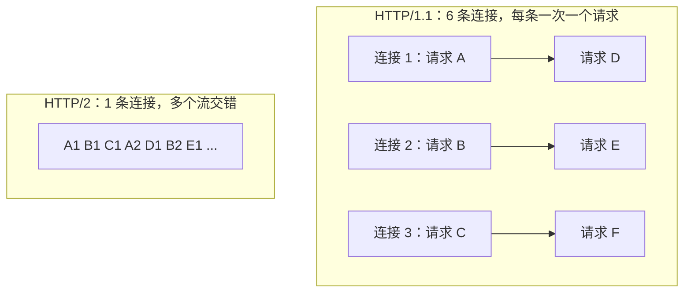
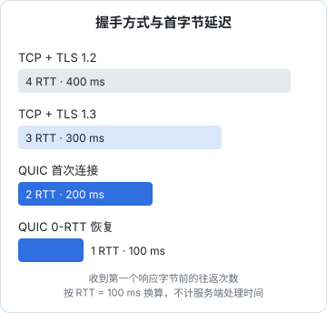

# HTTP/1.1 → 2 → 3

HTTP 的语义三十年来几乎没变：方法、URL、头部、状态码、正文。变的是**怎么把这些东西搬到网络上**。HTTP/1.1 用文本、一个连接一次一个请求；HTTP/2 改成二进制帧、一个连接并发多个请求；HTTP/3 干脆换掉了 TCP。本章先把 HTTP/1.1 的报文看清楚（排障时你看到的就是它），再讲每一代解决了上一代的什么问题、又带来了什么新问题。

## HTTP/1.1：看得见的文本

HTTP/1.1 的报文是纯文本，用 `curl -v` 就能看到原样：

```text
> POST /upload HTTP/1.1
> Host: 192.168.1.23:8080
> User-Agent: curl/8.7.1
> Accept: */*
> X-Pin: 1234
> Content-Length: 48213
> Content-Type: multipart/form-data; boundary=------------------------9f2c1b
> Expect: 100-continue
>
< HTTP/1.1 100 Continue
< HTTP/1.1 200 OK
< Content-Type: application/json
< Content-Length: 52
< Connection: close
<
{"ok":true,"bookId":"networking","status":"added"}
```

这是往 hatch-shelf 局域网传书接口推一本书的真实形态。几个关键点：

- **请求行**：方法、路径、协议版本。路径里不含域名，域名在 `Host` 头里
- **`Host` 头**：HTTP/1.1 必填。一个 IP 上跑多个网站（nginx 按 `server_name` 分流）全靠它
- **头部和正文之间是一个空行**（`\r\n\r\n`），解析器靠它找到头部的结尾
- **正文多长**：要么 `Content-Length` 写明字节数，要么 `Transfer-Encoding: chunked` 分块发送、以长度为 0 的块结束。没有这两样，接收方不知道正文在哪结束
- **`Expect: 100-continue`**：curl 上传较大正文时会先只发头部，等服务端回 `100 Continue` 再发正文，让服务端有机会在收大文件之前就拒绝（比如 PIN 错了）。自己实现 HTTP 服务时如果不处理这个头，curl 会干等一秒左右再发，表现为「上传前莫名卡一下」

### 状态码速查

排障时最常看到的几个：

| 状态码 | 含义 | 排障方向 |
|---|---|---|
| 301 / 308 | 永久重定向（308 保持方法和正文） | 浏览器会缓存 301，配错了很难撤回 |
| 302 / 307 | 临时重定向 | HTTP → HTTPS 跳转、登录跳转 |
| 304 | 未修改，用缓存 | 缓存协商生效 |
| 400 | 请求格式错 | 看请求体、Content-Type |
| 401 / 403 | 未认证 / 无权限 | 令牌、Cookie、CORS 之外的权限问题 |
| 413 | 请求体太大 | nginx 的 `client_max_body_size` 默认只有 1 MB |
| 499 | 客户端先断开了（nginx 专有） | 客户端超时比服务端处理时间短 |
| 502 | 代理连不上上游，或上游返回了无效响应 | 后端挂了、端口不对、keep-alive 竞争（第 2 章） |
| 503 | 服务暂不可用 | 维护模式、限流、健康检查失败 |
| 504 | 代理等上游超时 | 后端处理太慢，或 `proxy_read_timeout` 太短 |

**502 和 504 是代理说的，不是你的应用说的**。看到它们先去看 nginx 的 `error.log`，那里会写明是 `connect() failed (111: Connection refused)` 还是 `upstream timed out`。

### HTTP/1.1 的瓶颈

HTTP/1.1 一个连接同一时刻只能处理一个请求（「管线化」理论上存在，实际上被浏览器禁用）。要并发，只能开多个连接，浏览器对每个域名一般最多开 6 个。于是有了一整套「优化」：

- 把小图拼成雪碧图、把 JS 打成一个大包，减少请求数
- 把静态资源分散到多个子域名（域名分片），突破 6 个连接的限制
- 内联小资源

这些都是在绕过协议限制，而且每个新连接都要重新握手、重新慢启动。

## HTTP/2：一条连接，多路复用

HTTP/2 不改变语义，改变的是传输格式：

- **二进制分帧**：请求和响应被切成带编号的帧（HEADERS 帧、DATA 帧……），不再是文本
- **多路复用**：每个请求是一个**流**（stream），多个流的帧在同一条 TCP 连接上交错传输，互不等待
- **头部压缩**（HPACK）：同一连接上重复的头部（Cookie、User-Agent）只发一次索引
- **一个域名一条连接**：只需握手一次，拥塞窗口一直是「热」的



推论是，**HTTP/1.1 时代的很多优化在 HTTP/2 下变成了负担**：域名分片会让浏览器开多条连接、失去复用；把所有代码打成一个巨型包，改一行就让整个包缓存失效。现代打包工具（Vite 的代码分割）配合 HTTP/2 正好合适。

### 怎么开启和验证

HTTP/2 在浏览器里实际只跑在 TLS 之上，协议版本在 TLS 握手中通过 **ALPN** 协商（客户端说「我支持 h2 和 http/1.1」，服务端选一个）。所以 nginx 开启 HTTP/2 一定是在 443 的 server 块上：

```nginx
server {
    # nginx 1.25.1 之前的写法；更新的版本也认，只是会有弃用警告
    listen 443 ssl http2;
    # nginx 1.25.1 起推荐：listen 443 ssl; 加一行 http2 on;
    server_name api.example.com;
    # ...
}
```

hatch-counter 的 nginx 配置里特意用了老写法，原因写在注释里：Ubuntu 22.04 / 24.04 仓库自带的 nginx 版本低于 1.25.1，不认 `http2 on;`。**配置要按服务器上实际的 nginx 版本写**，`nginx -v` 先看一眼。

验证：

```bash
# 看协商出来的协议版本
curl -sI --http2 https://api.example.com -o /dev/null -w '%{http_version}\n'
# 输出 2 表示 HTTP/2

# -v 里也能看到 ALPN 协商过程
curl -sv https://api.example.com -o /dev/null 2>&1 | grep -i alpn
```

nginx 到后端的那一段一般仍是 HTTP/1.1（`proxy_http_version 1.1`），这完全没问题：后端在本机，延迟可以忽略，HTTP/2 的收益主要在客户端到 nginx 那一段高延迟链路上。

### HTTP/2 没解决的问题

多路复用解决了 HTTP 层的队头阻塞，但所有流共用一条 TCP 连接，而 TCP 要按序交付（第 2 章）。**一个包丢了，所有流都要等它重传**。在丢包率高的移动网络上，HTTP/2 有时甚至不如开 6 条连接的 HTTP/1.1，因为后者一条连接卡住，其他五条还能动。

## HTTP/3：换掉 TCP

要彻底解决队头阻塞，就得离开 TCP。HTTP/3 跑在 **QUIC** 上，QUIC 跑在 UDP 上，它在用户态重新实现了可靠传输和拥塞控制，但**按流独立保证顺序**：流 A 丢包只阻塞流 A。

QUIC 顺带解决了另外两个问题：

- **握手更少**：QUIC 把传输握手和 TLS 1.3 握手合并成一次，首次连接 1 个 RTT 就能发请求；恢复之前的会话时甚至可以 0-RTT，把请求和握手一起发出
- **连接迁移**：TCP 连接由四元组标识，手机从 Wi-Fi 切到 5G、IP 一变连接就断了。QUIC 用**连接 ID** 标识连接，换网络后可以继续使用原连接



图里按 100ms 的往返时间换算：对跨洋或弱网的用户，握手方式的差异会直接体现成几百毫秒的首字节延迟。

### 浏览器怎么知道可以用 HTTP/3

浏览器第一次访问时并不知道服务器支持 HTTP/3，所以先用 TCP 走 HTTP/2，服务器在响应头里告诉它：

```text
alt-svc: h3=":443"; ma=86400
```

意思是「同一个主机的 UDP 443 端口也提供 h3，这个信息有效 86400 秒」。浏览器之后的请求就会尝试 QUIC，失败了自动退回 TCP。也可以通过 DNS 的 HTTPS 记录提前告知。

这个「静默退回」意味着：**HTTP/3 配错了不会报错，只是没生效**。最常见的原因是云服务器的安全组只放行了 TCP 443，没放行 UDP 443。

### 一人公司要不要自己开 HTTP/3

- 如果前面有 CDN（Cloudflare 等），CDN 到用户这一段通常已经支持 HTTP/3，一般在控制台打开开关即可，源站不用动
- 自己在 nginx 上开需要较新的版本（1.25 起在主线版本中提供 QUIC 支持）和相应的编译选项，还要放行 UDP 443。收益主要在移动端和弱网用户，配置和排障成本不低

对大多数个人项目，**让 CDN 或边缘平台处理 HTTP/3，源站专心做好 HTTP/2** 是性价比最高的选择。

## 几个和协议版本无关的实用话题

### 流式响应穿过代理

SSE（Server-Sent Events）和大模型的流式输出都依赖服务端边生成边发送。nginx 默认会**缓冲**上游响应，攒够了再发给客户端，结果用户看到的是「等半天然后一次性全部出来」。

```nginx
location /v1/stream {
    proxy_pass http://counter_api;
    proxy_http_version 1.1;
    proxy_set_header Connection "";
    proxy_buffering off;        # 不缓冲，收到就转发
    proxy_read_timeout 1h;      # 长连接，默认 60 秒没数据就断
}
```

也可以由后端在响应头里加 `X-Accel-Buffering: no`，只对这个响应关闭 nginx 缓冲。如果前面还有 CDN，也要确认 CDN 不缓冲这类响应。配合第 2 章说的心跳，长连接才稳。

### Range 请求

音视频播放、断点续传依赖 `Range` 请求：客户端只要文件的一部分，服务端回 `206 Partial Content`。

```bash
curl -s -o /dev/null -w '%{http_code}\n' -H 'Range: bytes=0-1023' https://cdn.example.com/a.mp3
# 206 表示支持；200 表示服务端忽略了 Range，返回了整个文件
```

hatch-recordwall 的桌面端用自定义协议给 `<audio>` 提供本地文件，就必须自己按 `Range` 头切片返回，否则拖进度条时播放器要等整个文件读完。实现静态文件服务或自定义协议时，**`Accept-Ranges: bytes` 和 206 是必修课**。

## 本章要点

- HTTP/1.1 是文本协议：请求行、头部、空行、正文；正文长度靠 `Content-Length` 或分块编码
- 502 / 504 是代理报的错，先看 nginx `error.log`；413 多半是 `client_max_body_size`
- HTTP/2 用二进制帧和多路复用让一条连接并发多个请求，域名分片、巨型包等老优化反而有害
- HTTP/2 通过 TLS 的 ALPN 协商；nginx 配置写法要按实际版本来
- HTTP/2 仍受 TCP 队头阻塞影响；HTTP/3 基于 QUIC（UDP），按流独立、握手更少、支持连接迁移
- HTTP/3 靠 `Alt-Svc` 发现，失败静默退回；记得放行 **UDP** 443，或交给 CDN
- 流式输出要关掉代理缓冲、调长读超时；媒体文件服务要支持 Range 和 206

## 动手练习

1. **手写一个 HTTP 请求**：执行 `printf 'GET / HTTP/1.1\r\nHost: example.com\r\nConnection: close\r\n\r\n' | nc example.com 80`；再把 `Host` 那一行去掉重发。

   验证：第一次先是状态行 `HTTP/1.1 200 OK`，接着是头部、一个空行、HTML 正文；去掉 `Host` 后多数服务器回 `400 Bad Request`。

   参考答案：HTTP/1.1 是文本协议，头部以空行结束；`Host` 是必填的，一个 IP 上的多个站点靠它区分。

2. **看 ALPN 协商出的版本**：执行 `curl -sI https://www.cloudflare.com -o /dev/null -w '%{http_version}\n'`，再加 `--http1.1` 执行一次；最后执行 `curl -sv https://www.cloudflare.com -o /dev/null 2>&1 | grep -i alpn`。

   验证：前两条分别输出 `2` 和 `1.1`；第三条能看到客户端提议了 `h2` 和 `http/1.1`，服务端选定了 `h2`。

   参考答案：协议版本在 TLS 握手里协商，不需要额外请求。curl 默认不主动尝试 HTTP/3，所以这里看不到 `3`。

3. **Range 与 206**：起一个 nginx 静态服务 `docker run --rm -d --name rng -p 8080:80 nginx:alpine`，执行 `curl -s -D - -o /dev/null -H 'Range: bytes=0-99' http://localhost:8080/`。

   验证：状态行是 `HTTP/1.1 206 Partial Content`，响应头里有 `Content-Range: bytes 0-99/` 和 `Content-Length: 100`。做完 `docker rm -f rng`。

   参考答案：静态文件服务支持 Range 时只回请求的那一段。自己实现文件服务时如果总是回 200 和整个文件，播放器拖动进度条就得等整个文件传完。
