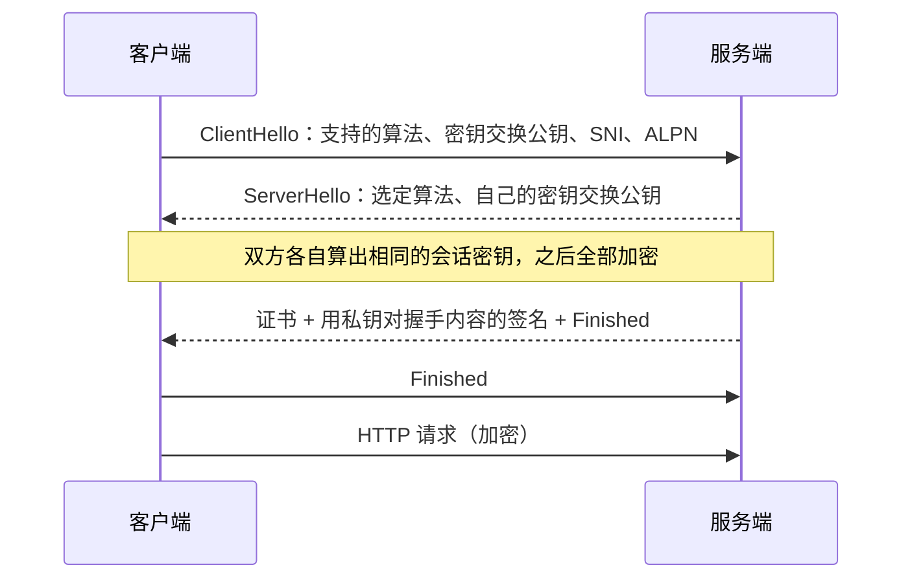
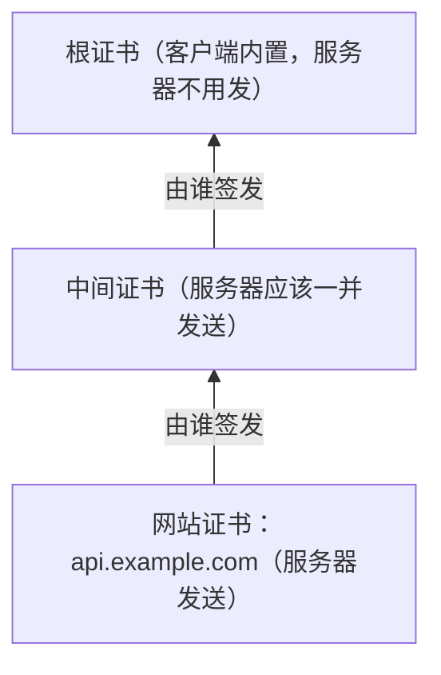

# TLS 与证书

HTTPS 就是 HTTP 跑在 TLS 之上。TLS 要同时做到三件事：别人看不到内容（加密），别人改不了内容（完整性），你连的确实是你以为的那个服务器（身份认证）。前两件靠密码学自动完成，几乎不会出问题；**第三件靠证书，而证书是运维中最常见的事故来源之一**：过期、链不完整、域名对不上、续期脚本静默失败。本章讲 TLS 握手在做什么、证书信任链怎么验证，以及一个人怎么把证书管理做到「永远不用想起它」。

## 握手在协商什么

通信双方需要一把只有彼此知道的**对称密钥**来加密数据（对称加密快）。难点是：怎么在一个可能被窃听的网络上商量出这把密钥，并且确认对方不是冒充的？

TLS 1.3 的握手（简化）：



拆开看三个关键动作：

1. **密钥交换**（ECDHE）：双方各生成一对临时密钥，交换公钥，各自算出同一个共享秘密。窃听者看到两个公钥也算不出这个秘密。因为密钥是临时的，即使服务器私钥将来泄露，过去录下来的流量也解不开，这叫**前向保密**
2. **身份认证**：服务端发来证书，并用证书对应的私钥对握手内容签名。客户端验证证书可信、签名正确，才相信对方确实持有这个域名的私钥
3. **扩展协商**：**SNI** 告诉服务端「我要访问哪个域名」（一个 IP 上有多个证书时靠它选），**ALPN** 协商上层协议（h2 还是 http/1.1）

TLS 1.2 需要两个往返才能完成握手，TLS 1.3 压到一个，这就是第 4 章那张图里两者差一个 RTT 的来源。现在应该只启用 TLS 1.2 和 1.3，更老的版本已被主流浏览器淘汰。

注意 SNI 在 ClientHello 里通常是明文的，所以**HTTPS 能隐藏你访问的路径和内容，但中间人一般能看到你访问的域名**。

## 证书与信任链

证书是一份由 CA（证书颁发机构）签名的文件，核心内容是：「这个公钥属于这些域名，有效期从某天到某天」。

浏览器和操作系统内置了一份**根证书**列表。但根 CA 一般不直接给网站签证书，而是签发**中间证书**，由中间证书去签网站证书。验证时客户端要拼出一条完整的链：



验证规则：

- 链上每一张证书的签名都能被上一级验证，最终追溯到客户端信任的根
- 每一张都在有效期内
- 网站证书的 **SAN**（Subject Alternative Name）字段包含你访问的域名。通配符 `*.example.com` 只匹配一级子域：能匹配 `api.example.com`，不能匹配 `example.com` 本身，也不能匹配 `a.b.example.com`

### 最隐蔽的坑：链不完整

服务器配置证书时只配了网站证书、漏了中间证书。结果是：

- **桌面浏览器往往正常**：浏览器会缓存见过的中间证书，或者按证书里的地址自动去下载
- **curl、Node、Python、移动端 App 报错**：它们一般不会自动补链，报 `unable to get local issuer certificate`、`UNABLE_TO_VERIFY_LEAF_SIGNATURE`

所以「浏览器能打开、接口调不通」时要第一个怀疑它。用 certbot 时，nginx 的 `ssl_certificate` 要指向 `fullchain.pem`（网站证书 + 中间证书），**不是** `cert.pem`：

```nginx
ssl_certificate     /etc/letsencrypt/live/api.example.com/fullchain.pem;
ssl_certificate_key /etc/letsencrypt/live/api.example.com/privkey.pem;
```

## 用 openssl 看证书

```bash
# 连上去看服务器实际发了什么：-servername 设置 SNI，多证书的服务器必须带
openssl s_client -connect api.example.com:443 -servername api.example.com </dev/null

# 只看有效期、域名和签发者
openssl s_client -connect api.example.com:443 -servername api.example.com </dev/null 2>/dev/null \
  | openssl x509 -noout -subject -issuer -dates -ext subjectAltName

# 看服务器发来的整条链（数一数有几张证书）
openssl s_client -connect api.example.com:443 -servername api.example.com -showcerts </dev/null

# 看本地证书文件
openssl x509 -in fullchain.pem -noout -text
```

`s_client` 输出里重点看：

```text
Certificate chain
 0 s:CN = api.example.com
   i:C = US, O = Let's Encrypt, CN = R11
 1 s:C = US, O = Let's Encrypt, CN = R11
   i:C = US, O = Internet Security Research Group, CN = ISRG Root X1
...
Verify return code: 0 (ok)
```

- `Certificate chain` 下应该至少有两张（0 是网站证书，1 是中间证书）；只有 0 一张就是链不完整
- 每张的 `i:`（签发者）应该等于下一张的 `s:`（主体）
- `Verify return code: 0 (ok)` 才是验证通过；其他值后面会附上原因

## 常见证书错误对照

| 报错（浏览器 / Node / curl） | 原因 | 处理 |
|---|---|---|
| `NET::ERR_CERT_DATE_INVALID` / `CERT_HAS_EXPIRED` | 证书过期；也可能是**客户端系统时间错了** | 检查续期；让用户检查手机时间 |
| `NET::ERR_CERT_COMMON_NAME_INVALID` / `ERR_TLS_CERT_ALTNAME_INVALID` | 访问的域名不在证书 SAN 里 | 证书漏了某个子域；或 nginx 选错了 server 块 |
| `unable to get local issuer certificate` | 链不完整，或客户端缺根证书 | 改用 fullchain；老设备可能缺新根 |
| `self signed certificate` | 自签证书 | 开发环境用 mkcert；生产不要用 |
| `SSL_ERROR_RX_RECORD_TOO_LONG` / `wrong version number` | 对着一个非 TLS 端口说 TLS | 端口错了，或 nginx 的 listen 没写 `ssl` |
| `handshake failure` | 协议版本或算法谈不拢；或没带 SNI | 加 `-servername`；检查 `ssl_protocols` |

「nginx 选错了 server 块」值得多说一句：客户端的 SNI 没有匹配到任何 `server_name` 时，nginx 会用该端口的默认 server 块和它的证书回应。于是新加的子域名忘了写进 `server_name`，访问时拿到的是别的域名的证书，报域名不匹配。

## 证书怎么来：ACME

Let's Encrypt 等免费 CA 通过 **ACME** 协议自动签发证书。CA 要先确认「你确实控制这个域名」，常用两种验证方式：

| | HTTP-01 | DNS-01 |
|---|---|---|
| 怎么证明 | 在 `http://域名/.well-known/acme-challenge/` 下放一个指定文件 | 在 `_acme-challenge.域名` 加一条指定的 TXT 记录 |
| 前提 | 80 端口能从公网访问到这台机器 | DNS 服务商有 API，机器上有 API 令牌 |
| 通配符证书 | 不支持 | 支持 |
| 适合 | 单台 VPS 上的普通站点 | 通配符、内网服务、80 端口不能开的机器 |

hatch-counter 用的是 HTTP-01 的 `webroot` 模式：nginx 的 80 端口 server 块只做两件事，把 ACME 挑战路径指向一个目录，其余全部跳转 HTTPS。

```nginx
server {
    listen 80;
    server_name api.example.com;

    location /.well-known/acme-challenge/ {
        root /var/www/certbot;
    }
    location / {
        return 301 https://$host$request_uri;
    }
}
```

```bash
# 只签发，不让 certbot 改 nginx 配置
sudo certbot certonly --webroot -w /var/www/certbot -d api.example.com

# 续期成功后 reload nginx，让新证书生效
sudo certbot renew --deploy-hook "systemctl reload nginx"
```

它的注释里解释了为什么选 `certonly --webroot` 而不是 `--nginx`：`--nginx` 模式会就地改写 server 块，仓库里的配置文件就不再是线上的真实版本，下次从仓库覆盖回去会把证书配置抹掉。**让工具只负责签证书，配置文件由你的仓库管**，这是可维护的分工。

### 续期才是重点

Let's Encrypt 的证书目前有效期是 90 天，而且整个行业在逐步缩短证书最长有效期，未来手动续期会越来越不现实，具体时间表以 CA 和 CA/B 论坛的公告为准。所以真正要关心的不是「怎么签」，而是：

1. **续期是自动的**：Ubuntu 上用 apt 装的 certbot 自带 systemd timer，`systemctl list-timers | grep certbot` 确认它在
2. **续期后服务会重载**：证书文件换了，nginx 不 reload 就还在用内存里的旧证书。这就是 `--deploy-hook` 的作用；也可以把脚本放进 `/etc/letsencrypt/renewal-hooks/deploy/`
3. **续期失败你会知道**：定期演练 `sudo certbot renew --dry-run`；再加一个**从外部**检查证书剩余天数的监控

第 3 点最容易漏。续期失败的常见原因都是「后来改了别的东西」：80 端口被防火墙关了、DNS 指向了 CDN 导致挑战请求到不了源站、webroot 目录换了。这些都不会立刻出问题，而是在两个月后证书真正过期那天爆发。一个最简单的外部检查脚本：

```bash
#!/usr/bin/env bash
# 证书剩余天数少于 14 天时以非零退出，可以挂在 cron 或监控平台上
host="$1"
end=$(openssl s_client -connect "$host:443" -servername "$host" </dev/null 2>/dev/null \
  | openssl x509 -noout -enddate | cut -d= -f2)
# GNU date；macOS 上改用 date -j -f "%b %d %T %Y %Z" "$end" +%s
days=$(( ( $(date -d "$end" +%s) - $(date +%s) ) / 86400 ))
echo "$host: $days days left"
[ "$days" -ge 14 ]
```

更省心的做法是用托管的拨测服务（很多监控平台都带证书到期提醒），[《一人运维手册》](../production-ops/)会讲完整的监控方案。

## HSTS 与其他加固

- **HTTP 跳 HTTPS**：80 端口统一 301 到 443（上面的配置）
- **HSTS**：响应头 `Strict-Transport-Security: max-age=31536000` 告诉浏览器「以后这个域名只用 HTTPS」，防止首次访问被降级。注意它会被浏览器记住很久，**确认所有子域都支持 HTTPS 之后再加 `includeSubDomains`**
- **CAA 记录**：在 DNS 里声明只允许哪个 CA 给你签证书（第 3 章的记录类型表），防止别的 CA 被骗签发
- **私钥权限**：`privkey.pem` 只允许 root 读；不要把私钥复制到容器镜像或仓库里

## 开发环境与内网

- **本地 HTTPS**：用 mkcert 生成一个本机信任的根证书和 `localhost` 证书，比自签证书加「忽略证书错误」干净得多。测试 Service Worker、Secure Cookie、某些需要安全上下文的浏览器 API 时会用到
- **内网服务**：不暴露到公网的服务，可以用 DNS-01 签真实域名的证书，或用 Tailscale 这类工具自带的证书功能
- **永远不要在生产代码里关闭证书校验**（`NODE_TLS_REJECT_UNAUTHORIZED=0`、`rejectUnauthorized: false`）。它让 TLS 退化成只加密不认证，中间人可以随意冒充；调试时临时用过的话，务必确认没有进入提交

## 本章要点

- TLS 用 ECDHE 协商临时密钥（前向保密），用证书 + 签名认证服务器身份；TLS 1.3 握手只需一个 RTT
- SNI 选证书、ALPN 选协议；HTTPS 隐藏内容但一般不隐藏域名
- 证书链：网站证书 → 中间证书 → 客户端内置的根；服务器要发 **fullchain**
- 「浏览器正常、curl / Node / App 报错」先怀疑**链不完整**
- `openssl s_client -servername` 看服务器实际发了什么，`Verify return code: 0` 才算通过
- ACME 的 HTTP-01 需要 80 端口可达，DNS-01 支持通配符；让工具只签证书、配置由仓库管
- 重点是续期：自动续期 + 续期后 reload + **外部监控剩余天数**
- 不要在生产中关闭证书校验

## 动手练习

1. **读一张真实的证书**：执行 `openssl s_client -connect github.com:443 -servername github.com </dev/null 2>/dev/null | openssl x509 -noout -subject -issuer -dates -ext subjectAltName`；再加 `-showcerts` 重新连接，用 `grep -c 'BEGIN CERTIFICATE'` 数服务器发了几张证书。

   验证：SAN 里有 `DNS:github.com`；`notBefore` 和 `notAfter` 给出有效期；证书数量至少是 2。

   参考答案：服务器发的是网站证书加中间证书，根证书在客户端本地。数出来只有 1 张，就是链不完整。

2. **复现域名不匹配**：生成一张只对 `a.test` 有效、有效期 1 天的自签证书并起一个 TLS 服务：

   ```bash
   openssl req -x509 -newkey rsa:2048 -nodes -days 1 -keyout k.pem -out c.pem \
     -subj /CN=a.test -addext subjectAltName=DNS:a.test
   openssl s_server -accept 8443 -cert c.pem -key k.pem -www
   ```

   系统自带的 openssl 不认 `-addext` 时，换用 Homebrew 装的 openssl。另开终端依次执行 `curl -s -o /dev/null -w '%{http_code}\n' --cacert c.pem --resolve a.test:8443:127.0.0.1 https://a.test:8443/`、把两处 `a.test` 换成 `b.test` 再执行一次、去掉 `--cacert c.pem` 再访问 `a.test`。

   验证：第一条输出 `200`；第二条报主体名不匹配（错误信息里有 `subject name` 或 `does not match` 一类字样）；第三条报证书不受信任（`self signed` 或 `unable to get local issuer` 一类字样）。

   参考答案：验证同时检查「链到可信根」和「SAN 包含访问的域名」，两条各对应一类常见报错。`--resolve` 让 curl 用指定 IP 但仍按域名发 SNI 和校验证书。

3. **给到期检查一个开关**：对上题的证书执行 `openssl x509 -in c.pem -noout -checkend $((14*86400)); echo $?`，再对 github.com 的证书做同样的检查（把第 1 题的管道末尾换成 `openssl x509 -noout -checkend $((14*86400))`）。

   验证：本地证书输出 `Certificate will expire`、退出码 `1`；github.com 一般输出 `Certificate will not expire`、退出码 `0`。

   参考答案：`-checkend` 判断证书在 N 秒内是否过期，退出码可以直接挂到 cron 或监控上，比自己算日期更省事。
