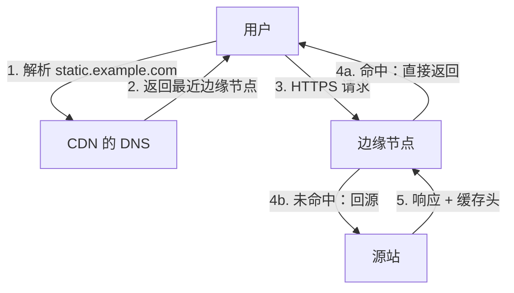

# CDN

前几章反复出现同一个约束：**光速是有限的**。握手要往返，慢启动要往返，每次往返都受物理距离限制。服务器放在一个地方，离它远的用户就注定慢。CDN（内容分发网络）的思路是在全球很多地方放「边缘节点」，让用户连离自己最近的节点，能缓存的内容直接从边缘返回，不能缓存的再由边缘回到你的服务器（源站）去取。本章讲 CDN 怎么把用户引到边缘、缓存规则怎么定，以及接入 CDN 后最常见的几类事故。

## CDN 帮你做了什么

| 能力 | 原理 | 收益 |
|---|---|---|
| 就近接入 | 用户连最近的边缘节点 | TCP 和 TLS 握手的往返变短 |
| 边缘缓存 | 静态资源在边缘直接返回 | 首字节快，源站负载和流量大减 |
| 回源优化 | 边缘到源站之间用长连接、优化过的线路 | 动态请求也会快一些 |
| 协议升级 | 边缘支持 HTTP/2、HTTP/3、TLS 1.3 | 源站不用折腾新协议（第 4 章） |
| 抗攻击 | 流量先打到 CDN 巨大的网络上 | 小型 DDoS 打不到源站 |
| 隐藏源站 | 公网只看到 CDN 的 IP | 配合源站防火墙，源站不可直接访问 |

对一人公司来说，最后三点有时比加速更有价值：一个开着 CDN 的静态站，几乎不需要任何运维。

## 用户怎么被引到边缘

两种主流做法：

**DNS 调度**：你把域名 CNAME 到 CDN 给的域名，CDN 的权威 DNS 根据**发起查询的递归解析器**的位置返回最近节点的 IP。缺点是它看到的是解析器的位置，不是用户本人的：用户用了一个远方的公共 DNS，就可能被调度到远方的节点。（EDNS Client Subnet 扩展可以把用户网段带给权威服务器，缓解这个问题，但不是所有解析器都支持。）

**Anycast**：所有边缘节点宣告同一个 IP，互联网路由会自然把包送到「路由意义上最近」的节点。Cloudflare 是典型。好处是不依赖 DNS 判断位置；你接入时通常要把整个域名的 NS 交给它。



## 缓存规则：由谁说了算

边缘节点要决定两件事：**能不能缓存**、**缓存多久**。默认听源站响应头的，CDN 控制台里的规则可以覆盖它。

### Cache-Control 速查

| 指令 | 含义 |
|---|---|
| `max-age=N` | 浏览器和 CDN 都可以缓存 N 秒 |
| `s-maxage=N` | 只对共享缓存（CDN、代理）生效，优先于 `max-age` |
| `public` | 允许共享缓存存储，即使请求带了认证信息 |
| `private` | 只允许浏览器缓存，CDN 不能存（个人数据用它） |
| `no-cache` | **可以存**，但每次使用前必须向源站验证是否变了 |
| `no-store` | 完全不许存 |
| `immutable` | 有效期内内容绝不会变，浏览器刷新时也不用验证 |
| `stale-while-revalidate=N` | 过期后 N 秒内可以先返回旧内容，后台去更新 |

`no-cache` 和 `no-store` 的区别是高频误解：`no-cache` 不是「不缓存」，而是「缓存但每次都问」。配合 `ETag` 或 `Last-Modified`，源站可以回一个没有正文的 `304 Not Modified`，省掉传输。

### 前端构建产物的标准策略

Vite 构建出来的文件分两类，策略完全相反：

| 文件 | 特征 | 缓存策略 |
|---|---|---|
| `assets/index-3f9a1c.js` 等带哈希的文件 | 内容变了文件名就变 | `public, max-age=31536000, immutable`，永久缓存 |
| `index.html` | 文件名不变，内容引用最新的哈希文件 | `no-cache`，每次验证 |

这样发版后用户一刷新就拿到新的 `index.html`，它引用新的哈希文件名，旧缓存自然失效，**永远不需要手动清 CDN 缓存**。如果 `index.html` 被长时间缓存了，用户会拿着旧 HTML 去请求已经被删掉的旧 JS 文件，看到白屏。

在 nginx 源站上：

```nginx
location /assets/ {
    add_header Cache-Control "public, max-age=31536000, immutable";
    try_files $uri =404;
}

location / {
    add_header Cache-Control "no-cache";
    try_files $uri /index.html;
}
```

### 缓存键

CDN 用**缓存键**区分「这是不是同一个资源」，默认一般是协议 + 主机 + 路径 + 查询字符串。要注意：

- 查询字符串不同就是不同的缓存项：`/a.js?v=1` 和 `/a.js?v=2` 各存一份；带随机参数的请求会让缓存命中率归零
- `Vary` 响应头会把某个请求头也加入缓存键。`Vary: Accept-Encoding` 正常；`Vary: Cookie` 或 `Vary: User-Agent` 会让缓存几乎失效
- 很多 CDN 默认**不缓存 HTML 和没有扩展名的路径**，只缓存图片、JS、CSS 这类静态扩展名。想缓存 HTML 要单独加规则

### 看缓存有没有命中

```bash
curl -sI https://static.example.com/assets/index-3f9a1c.js | grep -iE 'cache|age|etag'
```

```text
cache-control: public, max-age=31536000, immutable
age: 5321
cf-cache-status: HIT
etag: "a1b2c3"
```

- 各家 CDN 用自己的头报告命中状态：Cloudflare 是 `cf-cache-status`（`HIT` / `MISS` / `EXPIRED` / `DYNAMIC`，`DYNAMIC` 表示按规则不缓存），其他家常见 `x-cache`
- `age` 表示这份内容在缓存里待了多少秒
- 连续请求两次，第二次还是 `MISS`，就要检查源站的缓存头和 CDN 规则

## 接入 CDN 后的常见事故

### 1. 把私人数据缓存给了别人

最严重的一类：某个接口返回了用户的个人数据，没带 `private`，又被 CDN 规则「缓存所有内容」命中，于是 A 用户的数据被返回给了 B。

防线：

- 所有需要登录的接口响应带 `Cache-Control: private, no-store`
- CDN 规则用**白名单**：只缓存明确的静态路径（`/assets/*`），而不是「缓存一切然后排除接口」
- API 和静态资源用不同的子域名（`api.` 和 `static.` / `app.`），API 子域根本不开缓存

### 2. 源站拿到的客户端 IP 全是 CDN 的

接入 CDN 后，源站看到的连接来源都是 CDN 节点。限流、审计、风控如果按来源 IP 计算，所有用户会被当成少数几个 IP。CDN 会把真实 IP 放在请求头里（通用的 `X-Forwarded-For`，各家还有自己的头，如 Cloudflare 的 `CF-Connecting-IP`）。

但**请求头可以被伪造**。只有在确认请求来自 CDN 时才能信任这些头。nginx 用 `realip` 模块按来源网段决定是否采信：

```nginx
# 只信任来自 CDN 网段的 X-Forwarded-For（网段以 CDN 官方公布的列表为准，并定期更新）
set_real_ip_from 192.0.2.0/24;
real_ip_header X-Forwarded-For;
real_ip_recursive on;
```

hatch-counter 的代理配置里有一段注释说明了同一件事的另一半：nginx 用 `$proxy_add_x_forwarded_for` 把真实来源追加到这个头的最后，后端只信「最后一跳」，所以客户端伪造的前缀不影响结果；漏配的后果是所有用户共享一个限流额度，「验证码一天只发得出 30 条」，而报错里完全看不出和 nginx 有关。

### 3. 重定向死循环

CDN 到源站这一段可以用 HTTP 也可以用 HTTPS。如果 CDN 用 HTTP 回源，而源站配置了「HTTP 一律跳 HTTPS」，就会形成：浏览器 → CDN（HTTPS）→ 源站（HTTP）→ 301 到 HTTPS → 浏览器再请求 CDN → ……无限循环。Cloudflare 的「Flexible」加密模式就是这种回源方式。

解决：让 CDN 用 HTTPS 回源并**校验源站证书**（Cloudflare 叫「Full (strict)」），源站保留自己的有效证书。

### 4. 证书续期失败

源站用 HTTP-01 续期证书时，Let's Encrypt 的验证请求会先到 CDN。如果 CDN 规则把 `/.well-known/acme-challenge/` 也跳转了或缓存了，续期就会失败，而且是在两个月后才暴露（第 5 章）。接入 CDN 后要么确认挑战路径能透传到源站，要么改用 DNS-01。

### 5. 源站被绕过

CDN 只隐藏了源站 IP，没有挡住它。源站 IP 一旦泄露（历史解析记录、邮件头、某个没走 CDN 的子域名），攻击者可以直接打源站，绕过 CDN 的防护和缓存。源站防火墙应该只放行 CDN 的网段，或者使用 CDN 提供的隧道 / 回源认证。

## 境内与境外

用户主要在中国大陆时，有两点和网络本身无关、但直接决定方案：

- 使用境内 CDN 节点，加速的域名需要完成 ICP 备案。hatch-counter 的部署文档里，备案是「挡着上线」的那一步
- 境外 CDN 在境内的访问质量取决于其节点和线路情况，差异很大，要用境内的拨测工具实际测，不要只看厂商宣传

具体政策和流程以主管部门和云厂商的最新规定为准。

## 什么时候用边缘平台代替 CDN

Cloudflare Workers + R2 这类边缘平台，可以理解为「CDN 节点上能跑你的代码」。hatch-recordwall 就是这种结构：音频文件放在 R2，Worker 在边缘处理鉴权和路由。对一人公司，它有几个吸引力：

- 静态资源和对象存储直接挂在 CDN 后面，不需要源站
- 简单的 API 在边缘执行，没有服务器要维护
- 流量费用模型和传统 CDN + 云主机不同，需要按自己的流量形态估算

代价是运行时受限（不是完整的 Node）、调试和本地开发方式不同。这部分在[《云与边缘》](../cloud-and-edge/)里展开。

## 本章要点

- CDN 让用户就近接入、在边缘缓存，同时提供协议升级、抗攻击和隐藏源站
- 调度方式有 DNS 调度和 Anycast；DNS 调度看的是递归解析器的位置
- `no-cache` 是「缓存但每次验证」，`no-store` 才是不存；`private` 禁止 CDN 存储
- 前端产物：带哈希的文件 `immutable` 永久缓存，`index.html` 用 `no-cache`，发版不用清缓存
- 缓存键默认包含查询字符串；慎用 `Vary`；用响应头里的命中状态和 `age` 验证
- 事故清单：私人数据被缓存、真实 IP 丢失或被伪造、HTTP 回源导致重定向循环、ACME 挑战被拦、源站被绕过
- 境内节点需要备案，以最新规定为准；边缘平台可以替代「CDN + 源站」的部分场景
