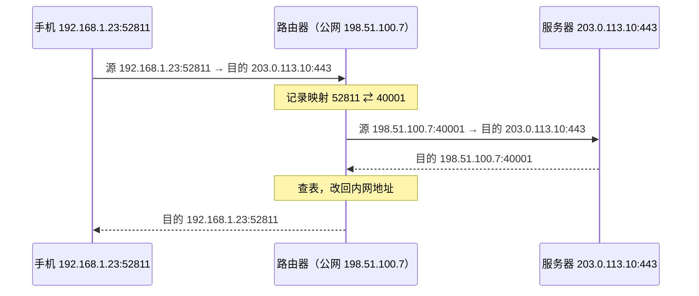
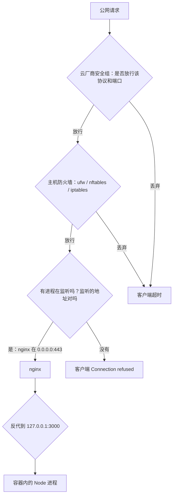

# NAT、防火墙与端口

「服务明明起来了，端口也监听了，外面就是连不上」，这是自己运维服务时出现频率最高的问题。从用户到你的进程，中间可能隔着家用路由器的 NAT、云厂商的安全组、主机上的 ufw / nftables、Docker 自己插入的转发规则，最后还有进程的监听地址。任何一层没放行，结果都一样：超时。本章把这些层逐一讲清，最后给出一张固定的排查清单。

## 私网地址与 NAT

IPv4 只有约 43 亿个地址，远远不够每台设备一个。解决办法是划出几段**私网地址**，只在局域网内部使用，不在公网上路由：

| 网段 | 范围 | 常见于 |
|---|---|---|
| `10.0.0.0/8` | 10.0.0.0 – 10.255.255.255 | 云厂商 VPC、企业内网 |
| `172.16.0.0/12` | 172.16.0.0 – 172.31.255.255 | Docker 默认网桥（172.17.0.0/16 起） |
| `192.168.0.0/16` | 192.168.0.0 – 192.168.255.255 | 家用路由器 |
| `100.64.0.0/10` | 100.64.0.0 – 100.127.255.255 | 运营商级 NAT（CGNAT）；Tailscale 也用这一段 |
| `169.254.0.0/16` | 链路本地 | 拿不到 DHCP 地址时系统自动配的，看到它说明 DHCP 失败了 |

私网设备要访问公网，靠路由器做 **NAT**（网络地址转换），更准确地说是端口地址转换：路由器把出去的包的源地址改成自己的公网 IP，源端口改成一个它自己分配的端口，并在**连接跟踪表**里记下这个映射；回来的包按表反向改回去。



NAT 有三个直接后果：

1. **外面主动连不进来**：路由器收到一个发往公网 IP 的新连接，表里没有对应映射，不知道该交给内网哪台设备，只能丢掉。这就是在家里电脑上起的服务外网访问不了的原因
2. **映射会过期**：表项在连接空闲一段时间后被删除。长时间不说话的 TCP 连接（SSE、WebSocket、数据库连接池里的空闲连接）可能在你不知情的情况下「断了」，下次发数据才发现。这就是第 2 章强调心跳的原因
3. **你可能根本没有公网 IP**：很多宽带和所有移动网络都在运营商那里再做一层 NAT（CGNAT）。路由器 WAN 口的地址如果是 `100.64.x.x` 或私网地址，就说明你在 CGNAT 后面，在自家路由器上做端口转发也没用

### 让外面访问到内网服务

| 方法 | 原理 | 适用 |
|---|---|---|
| 路由器端口转发 | 手动在 NAT 表里加一条固定映射 | 有公网 IP 的家宽，自己用 |
| 反向隧道（Cloudflare Tunnel、frp 等） | 内网机器主动连到外部服务器，外部请求从这条连接反向送进来 | 没有公网 IP；不想暴露家里 IP |
| 组网 VPN（Tailscale、WireGuard） | 把设备组成一个虚拟局域网，尽量打洞直连，不行就中继 | 只给自己和团队访问 |

一人公司的建议：**生产服务放云服务器，不要放家里**；家里的 NAS、开发机这类只给自己用的，用组网 VPN，不对公网开端口。

## 一个请求要过的几道关

以云服务器上的 nginx + Docker 部署为例，外部请求到达容器里的进程，要依次通过：



注意两种失败的不同表现（第 2 章）：安全组和防火墙通常是**静默丢弃**，客户端只能等到超时；而包到达了主机、但端口上没有进程，内核会回 RST，客户端立刻看到 `Connection refused`。**看报错就能判断问题在防火墙前面还是后面**。

### 安全组

云厂商在虚拟机外面的一层防火墙，在控制台或 API 里配置。它最常见的坑：

- 新买的机器默认只开 22，忘了开 80 / 443
- 开了 TCP 443，没开 **UDP 443**，HTTP/3 静默失效（第 4 章）
- 来源写成了某个 IP，后来自己换了网络连不上 SSH

### 主机防火墙：ufw

Ubuntu 上最省事的是 ufw，它是 iptables / nftables 的一层包装：

```bash
# 先放行 SSH，否则一启用就把自己锁在外面
sudo ufw allow OpenSSH
sudo ufw default deny incoming
sudo ufw default allow outgoing
sudo ufw allow 80,443/tcp
sudo ufw allow 443/udp        # 需要 HTTP/3 时
sudo ufw enable
sudo ufw status verbose
```

有了安全组还要不要主机防火墙？建议都要，两层的分工不同：安全组防的是外部，主机防火墙在安全组被误改时还能兜底，并且对同 VPC 内的其他机器也有效。

### Docker 会绕过 ufw

**用 `ports:` 发布的容器端口不受 ufw 约束**：Docker 直接往 iptables 里插转发规则，在 ufw 之前生效，`"5432:5432"` 等于把数据库挂到公网。防法是数据库不发布端口、应用只绑 `127.0.0.1`，原理和 hatch-counter 的写法见[《容器技术》Docker 会绕过防火墙](../docker-containers/05-network-storage.md#docker-会绕过防火墙)。这里只补两件网络层面的事：怎么在不开端口的前提下连库，以及怎么验证到底暴露了什么。

需要临时用 psql 时，用 `docker compose exec postgres psql ...` 进去，或者用 SSH 隧道转发到本地，而不是开端口：

```bash
# 本机执行：把服务器上只监听 127.0.0.1 的 5432 映射到本机 15432
ssh -N -L 15432:127.0.0.1:5432 user@server
```

（这条隧道要求数据库在宿主机的 127.0.0.1 上可达；容器不发布端口时，可以临时用 `docker compose exec` 代替。）

验证到底暴露了什么，从**外部**扫一下自己的服务器最直接：

```bash
# 在另一台机器上执行；只扫自己的服务器
nc -vz -w 3 your-server-ip 5432
nmap -Pn -p 22,80,443,3000,5432 your-server-ip
```

### Docker 网段冲突

Docker 默认网桥用 `172.17.0.0/16`，compose 每个项目会再分配 `172.18.0.0/16`、`172.19.0.0/16`……如果你的 VPC、公司内网或 VPN 恰好也用了这些网段，服务器访问那部分内网时，包会被路由进 Docker 网桥，表现为「某些内网地址突然不通」。可以在 `/etc/docker/daemon.json` 里用 `default-address-pools` 换成不冲突的网段，改完重启 Docker 并重建网络。

## 端口的几条规则

- **1024 以下是特权端口**：Linux 上普通用户进程默认不能监听 80、443。这也是让 nginx（以 root 启动、绑定端口后降权）挡在前面、Node 监听 3000 的原因之一
- **临时端口**：客户端发起连接时，源端口由系统从一个范围里自动分配（Linux 看 `sysctl net.ipv4.ip_local_port_range`）。大量短连接耗尽它时会报 `EADDRNOTAVAIL`，根治办法是连接复用
- **端口被占用**：`EADDRINUSE` 时查是谁占了：

```bash
sudo ss -tlnp 'sport = :3000'          # Linux
lsof -iTCP:3000 -sTCP:LISTEN -n -P     # macOS
```

## 连接跟踪表满了

主机防火墙（和 Docker 的 NAT）依赖内核的连接跟踪（conntrack），每条连接占一个表项。并发连接很多、或者遭遇大量扫描时，表会满，新连接被直接丢弃，表现为**间歇性超时**，而 CPU、内存都正常。

```bash
# 当前条目数和上限
cat /proc/sys/net/netfilter/nf_conntrack_count
cat /proc/sys/net/netfilter/nf_conntrack_max

# 表满时内核日志里会有 "nf_conntrack: table full, dropping packet"
sudo dmesg | grep conntrack
```

小流量的个人项目很少碰到，但它属于「知道就能秒查、不知道能查一整天」的那类问题。

## MTU 问题怎么验证

第 1 章提到过「小包通、大包卡」。验证方法是发送不允许分片的大 ping，逐步减小大小，找出能通过的最大值：

```bash
# Linux：-M do 禁止分片；1472 = 1500 - 20（IP 头）- 8（ICMP 头）
ping -M do -s 1472 -c 3 203.0.113.10

# macOS：-D 设置不分片
ping -D -s 1472 -c 3 203.0.113.10
```

如果 1472 不通、更小的通，说明路径上有 MTU 更小的一段（PPPoE 拨号通常是 1492，各种隧道更小）。正常情况下 TCP 会通过路径 MTU 发现自动适应，问题出在中间设备把必需的 ICMP「需要分片」消息丢了。处理方式是在隧道或网关上做 **MSS 钳制**，或者调小相关网卡的 MTU。这也是为什么**不要在防火墙上一刀切禁掉所有 ICMP**。

## 排查清单：端口为什么连不上

按顺序走，每一步都能排除一层：

1. **进程在监听吗，监听的是哪个地址？** 服务器上 `ss -tlnp`，确认是 `0.0.0.0` / `[::]`，而不是 `127.0.0.1`（容器里的进程尤其要注意，容器内监听 `127.0.0.1` 时端口映射也到不了它）
2. **本机能连上吗？** 服务器上 `curl -v http://127.0.0.1:端口/`
3. **主机防火墙放行了吗？** `sudo ufw status verbose` 或 `sudo nft list ruleset`
4. **安全组放行了吗？** 去控制台看入方向规则，注意协议（TCP / UDP）和来源
5. **从外部看是什么结果？** 在另一台机器上 `nc -vz -w 3 IP 端口`：`refused` 说明前面几层都通了、问题在监听；超时说明被某一层丢了
6. **还是不通，就抓包**：服务器上 `sudo tcpdump -ni any port 端口`，外部再连一次。看到 SYN 进来但没有回应，问题在主机内部；连 SYN 都没看到，问题在主机外面（第 9 章）

## 本章要点

- 私网地址靠 NAT 访问公网；NAT 让外部无法主动连入，空闲映射会过期，很多网络还在 CGNAT 后面
- 内网服务对外：端口转发、反向隧道或组网 VPN；生产服务放云上，私人服务用 VPN
- 外部请求依次经过安全组 → 主机防火墙 → 监听地址；**超时是被丢了，refused 是没人听**
- 安全组和 ufw 都要配，别忘了 UDP 443；启用 ufw 前先放行 SSH
- **Docker 发布的端口绕过 ufw**：绑 `127.0.0.1`，数据库不发布端口
- conntrack 表满会造成间歇性超时；MTU 问题用不分片的 ping 验证，不要禁掉全部 ICMP
- 按排查清单从内到外一层层验证，最后用 tcpdump 定位

## 动手练习

1. **丢弃和拒绝的区别**：改防火墙规则要在一次性容器里做：`docker run --rm -it --cap-add NET_ADMIN python:3.12-slim bash`，进去后 `apt-get update && apt-get install -y iptables curl`，后台起 `python -m http.server 8000 &`。先加 `iptables -A INPUT -p tcp --dport 8000 -j DROP`，执行 `curl -sS --connect-timeout 3 http://127.0.0.1:8000/`；再 `iptables -F` 清掉，改加 `iptables -A INPUT -p tcp --dport 8000 -j REJECT --reject-with tcp-reset`，重试。

   验证：DROP 时等满 3 秒报超时；REJECT 时立刻报 `Connection refused`。

   参考答案：安全组和大多数防火墙默认静默丢弃，客户端只能等超时；回 RST 的表现和「端口没人听」一样。所以超时指向防火墙，refused 指向监听。

2. **你在 NAT 后面吗**：在家里或公司的电脑上执行 `ipconfig getifaddr en0`（Linux 用 `ip -4 addr`），再执行 `dig +short myip.opendns.com @resolver1.opendns.com` 看外部看到的地址；如果能登录路由器，再看 WAN 口地址。

   验证：本机地址落在 `192.168.0.0/16`、`10.0.0.0/8` 或 `172.16.0.0/12`，外部看到的是另一个公网地址。

   参考答案：两者不同说明经过了 NAT。路由器 WAN 口地址如果也是私网或 `100.64.x.x`，说明还在运营商的 CGNAT 后面，在自家路由器上做端口转发不会有用。

3. **找路径 MTU**：在 Mac 上执行 `ping -D -s 1472 -c 3 1.1.1.1`，再把 `-s` 改成 `1473`（Linux 用 `ping -M do -s ...`）；连上 VPN 或手机热点后再试一次，逐步减小大小找能通过的最大值。

   验证：普通以太网或 Wi-Fi 下 1472 能通、1473 不通（本机直接报 `Message too long` 或收不到回应）；走 VPN 时能通过的最大值通常更小。

   参考答案：1472 加 8 字节 ICMP 头和 20 字节 IP 头正好 1500。走隧道多一层封装，可用 MTU 就变小，这是「小包通、大包卡」的验证方法。
