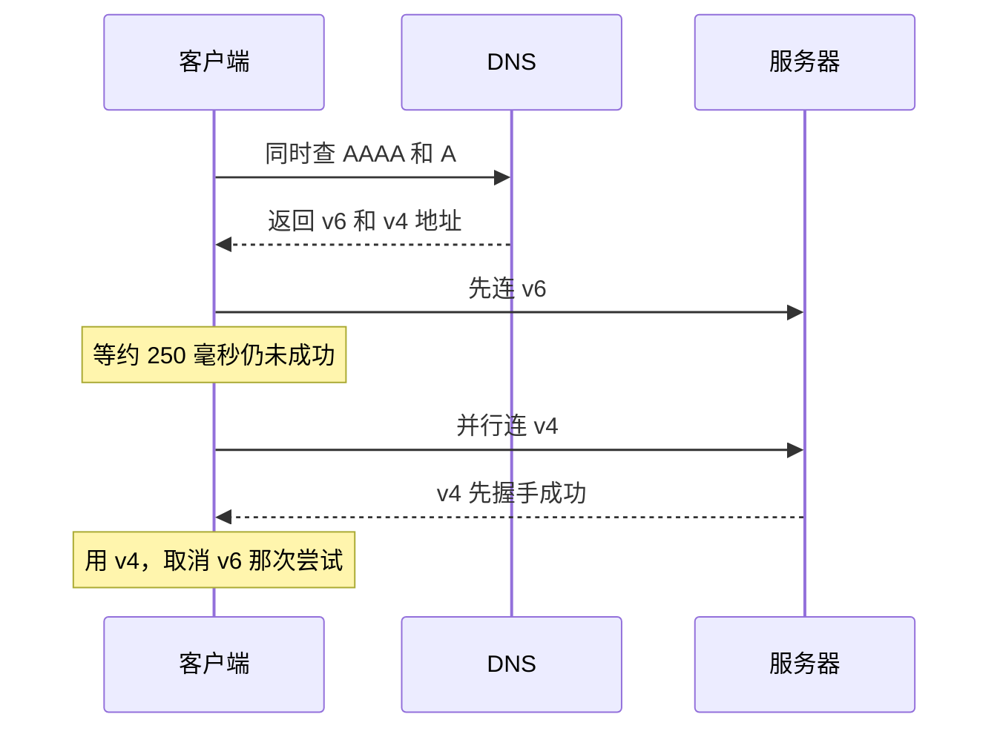

# IPv6 与双栈

前面八章几乎只用 IPv4 举例：`192.168.1.23`、`203.0.113.10`、NAT、端口转发。现实里，你的手机走蜂窝网络时多半已经在用 IPv6，云服务器的控制台里也有一个「分配 IPv6 地址」的勾选框。大多数时候两套协议同时在跑，叫**双栈**。双栈本身不难，难的是两条路的配置不一致：域名有 AAAA 记录，服务器却没在 v6 上监听；防火墙只放行了 v4；限流按 IP 计数，v6 用户换个地址就绕过去了。这一章先把 IPv6 地址读懂，再讲客户端在两条路之间怎么选，最后是给一台云服务器开 IPv6 时要同步改的几处配置。

## 为什么还要关心 IPv6

第 7 章说过，IPv4 地址不够用，靠私网地址加 NAT 续命。IPv6 把地址从 32 位扩到 128 位，地址多到每台设备都能分到全球唯一的地址，原则上不再需要 NAT。

对一个自己运维服务的开发者，和 IPv6 打交道的场景主要有三个：

- **你的用户在用它**：移动网络普遍下发 IPv6 地址，客户端只要拿到 AAAA 记录，就会优先尝试 v6
- **云厂商在推它**：IPv4 公网地址越来越贵，一些海外云已经对公网 IPv4 单独收费，IPv6 地址通常免费
- **它会以你没想到的方式出问题**：配了 AAAA 却没配好 v6 的站点，部分用户会慢、会连不上，而你在只有 v4 的办公网络里永远复现不出来

## 读懂一个 IPv6 地址

IPv6 地址写成 8 组 16 位的十六进制数，用冒号隔开。书里的示例统一用 `2001:db8::/32`，这是专门留给文档用的前缀，和 IPv4 的 `203.0.113.0/24` 一样不会出现在公网上：

```text
完整写法  2001:0db8:0000:0000:0000:0000:0000:0001
省略前导零 2001:db8:0:0:0:0:0:1
压缩连续零 2001:db8::1
```

两条压缩规则：每组的前导零可以省；**一段连续的全零组**可以写成 `::`，但一个地址里只能出现一次，否则无法还原。在 URL 里，地址要用方括号括起来，因为冒号已经被端口占用了：`http://[2001:db8::1]:8080/`。

### 前缀和接口标识

IPv6 地址通常分成两半：前 64 位是**网络前缀**，由运营商或云厂商分配；后 64 位是**接口标识**，由设备自己生成。一个 `/64` 就是一个子网，里面有 $2^{64}$ 个地址，所以 IPv6 里很少讨论「子网够不够大」，讨论的是「分到了几个 /64」：家用宽带常见拿到一个 `/56` 或 `/60`（可以划出 256 或 16 个子网），云服务器通常是一个 `/64` 里的一个或几个地址。

### 常见的地址类型

| 前缀 | 名字 | 相当于 IPv4 的 | 说明 |
|---|---|---|---|
| `::1/128` | 回环 | `127.0.0.1` | 本机 |
| `fe80::/10` | 链路本地 | `169.254.0.0/16` | 每块网卡都有，只在本链路有效，邻居发现和路由器通告都靠它 |
| `fc00::/7`（实际用 `fd00::/8`） | 唯一本地（ULA） | `10.0.0.0/8` 等私网 | 内网用，不在公网路由 |
| `2000::/3` | 全球单播 | 公网地址 | 你的服务器和手机拿到的公网 v6 地址都在这里 |
| `::ffff:0:0/96` | IPv4 映射地址 | 无 | 双栈 socket 里用来表示一个 v4 连接，例如 `::ffff:198.51.100.7` |

`ip -6 addr`（macOS 用 `ifconfig`）看到的一块网卡上往往同时有 `fe80::` 开头的链路本地地址和一到多个全球地址，这是正常的。最后一行那种 `::ffff:` 开头的地址，后面讲应用层的坑时会再出现。

### 没有 ARP，也没有广播

第 8 章讲过，IPv4 局域网靠 ARP 广播找 MAC 地址。IPv6 取消了广播，改用 **ICMPv6 的邻居发现（NDP）**，通过多播完成同样的事。这带来一条硬规则：**IPv6 下不能像 IPv4 那样随手禁掉 ICMP**。邻居发现、路由器通告、路径 MTU 发现都靠 ICMPv6；而且 IPv6 的路由器不替你分片，「Packet Too Big」消息被防火墙丢掉，就是第 7 章「小包通、大包卡」的 v6 版本，而且更常见。

## 地址从哪来：SLAAC 与 DHCPv6

IPv4 的设备地址几乎都靠 DHCP 分配。IPv6 有两套机制，经常同时出现：

| | SLAAC（无状态自动配置） | DHCPv6 |
|---|---|---|
| 怎么工作 | 路由器周期性发**路由器通告（RA）**，里面带着前缀；设备自己拼出后 64 位 | 和 DHCP 一样，向服务器申请地址 |
| 服务器记录谁用了哪个地址吗 | 不记录 | 有状态模式下记录 |
| 谁支持 | 所有主流系统 | Android 不支持有状态 DHCPv6 拿地址，只用 SLAAC |
| 常见用途 | 终端设备拿地址 | 下发 DNS 等额外配置；运营商给家用路由器分配整个前缀（前缀委派，PD） |

所以家里的链路通常是这样的：光猫或路由器用 DHCPv6-PD 从运营商那里拿到一个 `/56` 或 `/60` 前缀，切出一个 `/64` 给局域网，再用 RA 广而告之；手机和电脑收到 RA，用 SLAAC 生成自己的地址。

设备自己拼的后 64 位，早期直接由 MAC 地址推出，等于把硬件标识暴露给所有访问过的网站。现在的系统默认用两类随机化地址：一个**稳定但不含 MAC 的地址**用来接收连接，再加若干个定期更换的**临时地址**用来发起连接。这就是为什么你在服务端日志里看到同一个用户的 v6 地址每天都不一样，后面讲限流时这一点很要紧。

云服务器上的情况更简单：地址由云厂商分配，通过 SLAAC 或 DHCPv6 下发到网卡，多数官方镜像已经配好，开通后执行 `ip -6 addr show scope global` 能看到一个全球地址就说明系统层面拿到了。

## 双栈下客户端怎么选路

一个域名同时有 A 和 AAAA 记录时，客户端拿到两组地址，要决定先连哪个。

### 默认偏好 IPv6

操作系统按 RFC 6724 的地址选择规则给目标地址排序，默认**IPv6 排在 IPv4 前面**。Linux 上 `getaddrinfo` 返回的列表就是排好序的，`getent ahosts example.com` 能看到这个顺序；需要临时调整时可以改 `/etc/gai.conf`，但多数时候不该去动它。

问题在于：如果客户端只是**按顺序**一个个试，而 v6 那条路是坏的（本地网络宣称有 v6 实际不通，或者服务端没在 v6 上监听、防火墙静默丢弃），客户端就要等 v6 连接超时才轮到 v4。TCP 连接超时动辄几十秒，用户看到的就是「这个网站偶尔特别慢」。

### Happy Eyeballs

为了解决这个问题，现代客户端用 **Happy Eyeballs**（RFC 8305，「快乐眼球」）：先发起 v6 连接，如果几百毫秒内没成功，不等它失败，直接并行发起 v4 连接，谁先握手成功用谁，另一个取消。



浏览器、iOS / macOS 的网络框架、curl 都实现了它；Node 从 20 版起 `net.connect`（以及基于它的 `http`、`fetch`）默认开启 `autoSelectFamily`，第 3 章说的 `ECONNREFUSED ::1` 那类问题因此少了很多，但没有完全消失：自己写的工具、老版本运行时、以及一些语言的标准库仍然是串行尝试。

Happy Eyeballs 是一层保护，也是一层遮挡：**v6 坏了，大部分用户只是慢了几百毫秒，你很难注意到**。所以配了 AAAA 记录，就要像对待 v4 一样主动验证 v6。

### 验证两条路

```bash
# 分别查两种记录
dig +short A api.example.com
dig +short AAAA api.example.com

# 强制只走一种协议，各测一遍
curl -4 -sS -o /dev/null -w '%{remote_ip} %{http_code} %{time_connect}\n' https://api.example.com/v1/health
curl -6 -sS -o /dev/null -w '%{remote_ip} %{http_code} %{time_connect}\n' https://api.example.com/v1/health

# 本机有没有 v6 出口
ping -6 -c 3 2606:4700:4700::1111   # macOS 上用 ping6
```

`curl -6` 报 `Couldn't connect to server` 而 `-4` 正常，说明 v6 那条路有问题；如果本机根本没有 v6 出口，`curl -6` 会立刻失败，这时换一台有 v6 的机器（比如开了 IPv6 的云服务器）从外面测。

## 给云服务器开 IPv6

> [!WARNING]
> 本节涉及的云厂商控制台步骤和计费方式按 2026 年 11 月的情况整理，各厂商的产品名、是否收费、哪些规格支持 IPv6 都可能调整，以对应云厂商的官方文档为准。

### 云厂商这一侧

国内外主流云的思路相同，一般是四步：

1. **VPC 开启 IPv6**：给 VPC 和交换机（子网）各分配一个 IPv6 网段
2. **实例分配 IPv6 地址**：创建时勾选，或者事后给网卡分配
3. **开通 IPv6 公网访问**：有的云默认 v6 地址就是公网可达的，有的（例如阿里云）还要单独开通 IPv6 公网带宽，否则只能在 VPC 内通信
4. **安全组加 IPv6 规则**：v4 规则里的 `0.0.0.0/0` 不覆盖 v6，要另加来源为 `::/0` 的入方向规则

第 4 步最容易漏，漏了的症状是「v6 地址 ping 得通（如果放行了 ICMP）、443 超时」。另外，不是所有实例规格都支持 IPv6，老规格可能要换代。

### 系统和服务这一侧

v6 地址到了网卡上，还要检查三层：监听、防火墙、应用。

**nginx 要显式监听 v6**。`listen 443` 只监听 v4，要加一行 `listen [::]:443`：

```nginx
server {
    listen 443 ssl;
    listen [::]:443 ssl;
    listen 443 quic reuseport;      # 开了 HTTP/3 的话，UDP 也要两份
    listen [::]:443 quic reuseport;
    http2 on;
    server_name api.example.com;
    # ...
}
```

Ubuntu 默认的 `default` 站点已经带了 `listen [::]:80`，但你自己写的 server 块需要逐个检查。改完用 `ss -tlnp` 确认能看到 `[::]:443`。80 端口同样要两份，原因见下面的证书一节。

**ufw 默认两套一起管**。`/etc/default/ufw` 里 `IPV6=yes` 是默认值，此时 `ufw allow 443/tcp` 会同时加 v4 和 v6 规则，`ufw status` 里能看到带 `(v6)` 的行。如果你改用 nftables 或 iptables 手写规则，就要记住 v4 和 v6 是两张表（`iptables` 和 `ip6tables`，或 nftables 的 `inet` 族同时覆盖两者），只写了一边等于另一边不设防。手写 v6 规则时记得放行 ICMPv6，理由见前文。

**Docker 发布的端口默认 v4、v6 都监听**。`ports: ["3000:3000"]` 会同时绑到 `0.0.0.0:3000` 和 `[::]:3000`，即使容器网络本身没开 IPv6，Docker 也会把 v6 进来的连接转给容器。[第 7 章](07-nat-firewall.md#docker-会绕过-ufw)说的「Docker 绕过 ufw」在 v6 上同样成立，所以「只绑 `127.0.0.1`」的建议不变：绑了 `127.0.0.1` 就只在本机 v4 回环上监听，v6 不会暴露。容器之间要用 v6 通信才需要在 Docker 里显式开启 IPv6 网络，单机反代的场景用不到。

### DNS：最后才加 AAAA

上面全部验证通过之后，再给域名加 AAAA 记录。顺序反过来，就会出现那种「部分用户偶尔慢」的半坏状态。

还有一个和证书有关的细节：**Let's Encrypt 验证 HTTP-01 时，域名有 AAAA 记录就优先走 IPv6**，只有 v6 连接超时才退回 v4；v6 连上了但返回 404 或别的错误，验证直接失败，而且没有办法让它改为优先 v4。所以 80 端口的挑战路径（[第 5 章](05-tls.md#证书怎么来acme)）必须在 v6 上也能访问到。一个常见的事故链是：加了 AAAA，443 配好了 v6，80 端口的 server 块却只写了 `listen 80`，平时没人发现，两个月后证书续期失败。

## 应用层的几个坑

### 日志里的 `::ffff:` 地址

Node 的 `server.listen(3000)` 不写主机名时，在支持 IPv6 的系统上监听的是 `::`，一个 socket 同时接收 v4 和 v6 连接。v4 客户端进来时，`req.socket.remoteAddress` 是 `::ffff:198.51.100.7` 这种映射形式，而不是 `198.51.100.7`。按字符串比较 IP 白名单、按前缀判断内网地址的代码会因此失效。处理办法是在比较前统一去掉 `::ffff:` 前缀，或者用能正确解析两种地址的库。经过 nginx 反代时，服务端拿到的是 `X-Forwarded-For` 里 nginx 写入的地址，nginx 会写成普通的点分格式，但白名单、日志分析这些按地址处理的逻辑仍然要准备好遇到真正的 v6 地址。

### 按 IP 限流要按前缀

第 7 章讲 NAT 时说过，IPv4 下很多用户共享一个公网地址，按 IP 限流容易误伤。IPv6 正好相反：**一个用户手里就有整个 `/64`**，临时地址每天都换，想绕过按单个地址计数的限流，换个地址就行。所以对 v6 地址，限流、封禁、风控的单位应该是 `/64` 前缀，而不是完整的 128 位地址。nginx 的 `limit_req_zone` 按 `$binary_remote_addr` 计数，要按前缀限流需要先用 `map` 把地址截成前缀再作为键；用 Cloudflare 这类边缘服务时，看它们的限流规则是否已经按前缀聚合。

### 只听 v4 的上游

反代配置里写 `proxy_pass http://localhost:3000` 时，nginx 解析 `localhost` 可能得到 `::1` 和 `127.0.0.1` 两个地址，而 Node 服务如果只听了 `127.0.0.1`，nginx 第一次尝试 `::1` 失败，错误日志里就会出现 `connect() failed (111: Connection refused) while connecting to upstream, upstream: "http://[::1]:3000/"`。请求最终会落到 v4 上，但错误日志会一直刷。和第 3 章的建议一样：**上游地址直接写 `127.0.0.1`**。

## 国内的 IPv6 现状

> [!WARNING]
> 本节数据按 2026 年 7 月中国网信网（cac.gov.cn）报道的第五届中国 IPv6 创新发展大会致辞整理，口径为截至 2025 年底。最新数据以国家 IPv6 发展监测平台和中央网信办的公告为准。

按官方公布的数字，截至 2025 年底，国内 IPv6 活跃用户数达到 8.69 亿；**移动网络中 IPv6 流量占比约 71%，固定网络约 32%**。换句话说，用 4G / 5G 访问你服务的用户，多数请求已经可以走 v6；家里和办公室的宽带用户则还是以 v4 为主。中央网信办已经印发 2026—2030 年的 IPv6 推进实施方案，这个比例还会继续提高。

对一个面向国内用户的小服务，这意味着：

- **不开 IPv6 服务照样能用**：运营商和终端都保留了完整的 v4 能力，没有 AAAA 记录的域名，客户端就走 v4
- **开了就要开对**：半坏的 v6 比不开更糟，移动端用户首当其冲
- **国内主流云都支持 IPv6**，开通后除了上面的四步，备案、公安联网备案这些合规要求和 v4 一样，并不因为换了协议而改变
- **家宽的公网 v6 地址不等于能对外提供服务**：很多家用宽带能拿到公网 v6 前缀，但光猫或路由器默认开着 v6 入站防火墙，运营商对家宽开放服务端口也有限制。和第 7 章的结论一样，生产服务放云服务器

## 本章要点

- IPv6 地址 128 位，前 64 位是网络前缀、后 64 位是接口标识；`::` 只能压缩一段连续的零，URL 里要加方括号
- 链路本地 `fe80::`、唯一本地 `fd00::`、全球单播 `2000::/3`；`::ffff:` 开头的是双栈 socket 上的 v4 连接
- IPv6 用 ICMPv6 做邻居发现和路径 MTU 发现，**不能禁掉 ICMPv6**
- 终端地址多用 SLAAC 自己生成，DHCPv6 负责下发配置和给路由器委派前缀；现代系统默认用随机化的临时地址
- 系统默认优先 v6；Happy Eyeballs 让坏掉的 v6 只表现为「慢一点」，所以要用 `curl -4` / `curl -6` 主动分别验证
- 开 v6 的顺序：云上开地址和安全组 → nginx 加 `listen [::]` → 防火墙确认 v6 规则 → 验证通过后最后加 AAAA；80 端口也要支持 v6，Let's Encrypt 优先用 v6 验证
- 应用层注意 `::ffff:` 映射地址、按 `/64` 限流、上游写 `127.0.0.1`
- 国内移动网络 v6 流量已占多数，固网仍以 v4 为主；不开可以，开了就要开对

## 动手练习

1. **本机的 v6 地址和默认偏好**：在 Mac 上执行 `ifconfig en0 | grep inet6`（Linux 用 `ip -6 addr`），再执行 `curl -s -o /dev/null -w '%{remote_ip}\n' https://www.google.com/`（访问不了时换成 `https://www.cloudflare.com/`），最后分别加 `-4` 和 `-6` 再执行一次。

   验证：网卡上至少有一个 `fe80::` 开头的地址；如果所在网络有 v6，还会有 `2` 或 `3` 开头的全球地址，并且不加参数时 `remote_ip` 是一个 v6 地址；没有 v6 的网络里 `curl -6` 立刻失败，不加参数时自动用 v4。

   参考答案：链路本地地址每块网卡都有，不代表能上 v6 公网。有全球地址时系统默认先连 v6，这就是为什么服务端的 v6 配置必须和 v4 一样可靠。

2. **双栈 socket 里的映射地址**：执行 `node -e "require('http').createServer((q,r)=>r.end(q.socket.remoteAddress+'\n')).listen(3000)"`，另开终端依次执行 `curl -s http://127.0.0.1:3000/` 和 `curl -s 'http://[::1]:3000/'`。

   验证：第一次输出 `::ffff:127.0.0.1`，第二次输出 `::1`。

   参考答案：不写主机名时 Node 监听 `::`，一个 socket 同时接两种协议，v4 连接以 `::ffff:` 映射地址的形式出现。按字符串匹配 `127.0.0.1` 的白名单在这里会失效。

3. **只听一边的后果**：停掉上题的服务，改成只听 v4：`node -e "require('http').createServer((q,r)=>r.end('ok\n')).listen(3000,'127.0.0.1')"`。然后执行 `curl -sv http://localhost:3000/ 2>&1 | grep -E 'Trying|Connected|refused'`。

   验证：如果 `localhost` 同时解析出 `::1` 和 `127.0.0.1`，能看到先 `Trying [::1]:3000` 被拒，再 `Trying 127.0.0.1:3000` 并连上；最终输出 `ok`。

   参考答案：curl 实现了 Happy Eyeballs，一条路失败就换另一条，所以请求成功了，但失败的那次尝试是真实存在的。nginx 的 `proxy_pass http://localhost:3000` 在同样的情况下会在错误日志里记一条 `Connection refused`。上游地址写 `127.0.0.1` 就没有这个问题。
