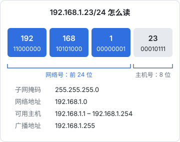
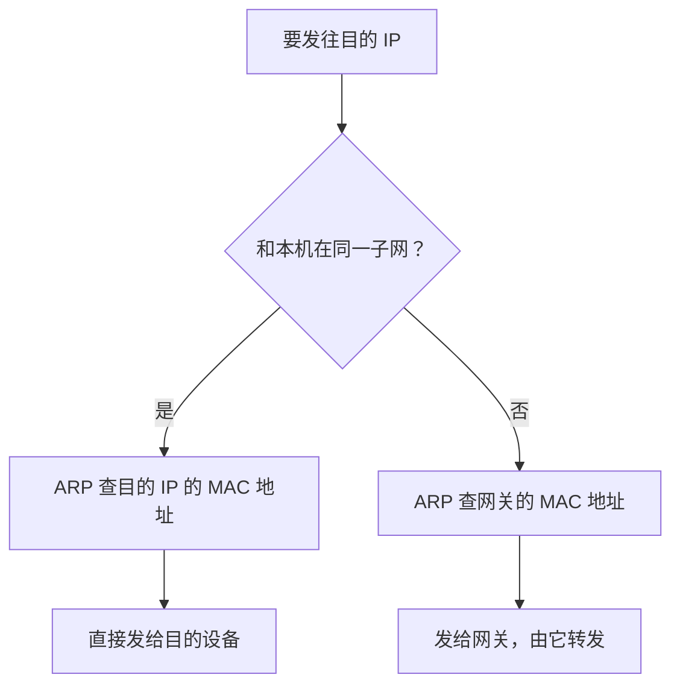
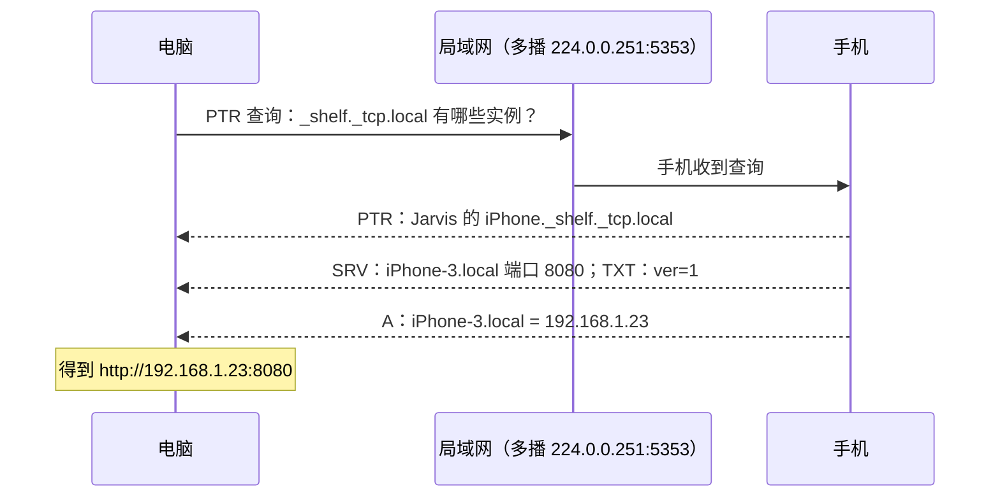

# 局域网与 mDNS

前面几章的场景都是「客户端经过互联网访问服务器」。局域网是另一个世界：没有 DNS 服务商、没有证书、没有公网 IP，设备之间靠广播和多播互相发现。开发中碰到它的机会并不少：手机连电脑上的 Metro、电脑往手机传文件、调试局域网里的打印机或 NAS。本章先讲局域网里数据是怎么走的、设备怎么发现彼此，再以 hatch-shelf 的「局域网传书」为案例，看一个手机做 HTTP 服务端的功能会碰到哪些网络问题，以及怎么给它加上 mDNS 自动发现。

## 子网：谁和我在「同一个网」

一台设备的网络配置核心是三样东西：IP 地址、子网掩码、默认网关。

```bash
# macOS：Wi-Fi 网卡的 IP、掩码和默认网关
ipconfig getifaddr en0
ipconfig getoption en0 subnet_mask
route -n get default | grep gateway

# Linux
ip -4 addr show
ip route
```

`192.168.1.23/24` 里的 `/24` 表示前 24 位是**网络号**，后 8 位是**主机号**。网络号相同的地址在同一个子网里：



系统发包前先判断目的地址是不是在同一个子网：

- **在**：直接在局域网里送过去，不经过路由器转发
- **不在**：交给默认网关（通常是路由器），由它往外转发



### ARP：从 IP 找到 MAC

链路层只认 MAC 地址（第 1 章）。知道对方 IP 后，还要用 **ARP** 在局域网里**广播**一句「谁是 192.168.1.23？请告诉我你的 MAC」，对方单播回应。结果会缓存一段时间：

```bash
arp -a          # macOS
ip neigh        # Linux
```

排障时 ARP 表很有用：能看到对方的 MAC 条目，说明链路层是通的；条目显示 `incomplete`，说明对方根本没回应，可能不在这个网段，或者被隔离了。

### DHCP：地址从哪来

设备连上 Wi-Fi 后用 DHCP 向路由器要一个地址，拿到的是有期限的**租约**。推论：**手机的局域网 IP 不是固定的**，换个 Wi-Fi、重连、租约到期都可能变。iOS 和 Android 默认对每个 Wi-Fi 使用随机的私有 MAC 地址，也会影响路由器按 MAC 做的固定分配。所以任何要求用户「输入手机 IP」的功能，都要每次重新显示当前 IP。

## 广播与多播

局域网里除了一对一的**单播**，还有两种一对多的通信：

| 方式 | 目的地址 | 谁会收到 | 用途 |
|---|---|---|---|
| 广播 | 子网广播地址，如 `192.168.1.255`；链路层 `ff:ff:ff:ff:ff:ff` | 子网内所有设备 | ARP、DHCP |
| 多播 | `224.0.0.0/4` 中的组地址 | 加入了这个组的设备 | mDNS、各类局域网发现协议 |

两者都有一个共同限制：**默认不跨路由器**。所以局域网发现只在同一个二层网络里有效，跨网段、跨 VPN 就失效了。这一点在「为什么找不到设备」时非常关键。

## mDNS：没有 DNS 服务器的 DNS

局域网里没有人帮你配置 DNS 记录，但你仍然希望用名字而不是 IP 访问设备（IP 会变）。**mDNS**（多播 DNS）的做法是：

- 查询不发给某个服务器，而是发到多播地址 `224.0.0.251`（IPv6 是 `ff02::fb`）的 UDP 5353 端口，局域网里所有支持 mDNS 的设备都能听到
- 谁拥有这个名字，谁就自己回答
- 名字都以 `.local` 结尾，如 `jarvis-mbp.local`

Apple 的实现叫 Bonjour，Linux 上是 Avahi，Windows 10 之后也内置了 mDNS 支持。

```bash
# macOS：本机在局域网里的 mDNS 名字
scutil --get LocalHostName

# 解析一个 .local 名字（走 mDNS）
dns-sd -G v4 jarvis-mbp.local

# Linux（需要 avahi-utils）
avahi-resolve -n jarvis-mbp.local
```

注意 `.local` 是保留给 mDNS 的。如果公司内网的 DNS 用了 `.local` 作为内部域名，会和 mDNS 冲突，造成各种解析异常。内部域名应该用自己拥有的域名的子域。

### DNS-SD：发现「服务」而不只是主机

知道主机名还不够，客户端想知道的是「局域网里有哪些书架 App 在提供传书服务，各自的地址和端口是什么」。**DNS-SD**（基于 DNS 的服务发现）用三种普通的 DNS 记录回答这个问题：

| 记录 | 名字 | 内容 |
|---|---|---|
| PTR | `_shelf._tcp.local` | 有哪些服务实例：`Jarvis 的 iPhone._shelf._tcp.local` |
| SRV | 实例名 | 主机名和端口：`iPhone-3.local:8080` |
| TXT | 实例名 | 附加的键值对：`ver=1`、`path=/` |

服务类型的格式是 `_服务名._tcp` 或 `_服务名._udp`。一次发现的流程：



macOS 自带的 `dns-sd` 可以浏览、解析和临时注册服务，开发调试非常方便：

```bash
# 浏览局域网里的 HTTP 服务（Ctrl+C 结束）
dns-sd -B _http._tcp

# 查看某个实例的主机、端口和 TXT
dns-sd -L "Jarvis 的 iPhone" _shelf._tcp local

# 临时注册一个假服务，用来测试客户端的发现逻辑
dns-sd -R "Shelf Test" _shelf._tcp local 8080 ver=1 path=/
```

Linux 上对应的是 `avahi-browse -rt _shelf._tcp` 和 `avahi-publish -s "Shelf Test" _shelf._tcp 8080 ver=1`。

## 案例：hatch-shelf 的局域网传书

hatch-shelf 是一个离线 Markdown 书架 App。书在电脑上写好后，除了 AirDrop，还可以在局域网里推到手机：打开 App 的「传书」页面，页面显示一个地址和一个 4 位 PIN，电脑浏览器打开这个地址拖文件，或者用命令行推送。

### 为什么让手机做服务端

方向是一个设计决策：可以电脑开服务、手机去拉，也可以手机开服务、电脑来推。项目选了后者，理由记在 README 的决策记录里：和常见的「Wi-Fi 传书」习惯一致，电脑这边只需要一个浏览器，或者一行 `curl`，命令行工具也能直接推送。

```bash
curl -H "X-Pin: 1234" -F file=@book.zip http://192.168.1.23:8080/upload
```

代价是手机要扮演一个它不擅长的角色：服务端。下面几个问题都是由此而来的。

### 问题 1：iOS 不让 App 在后台当服务器

iOS 会挂起进入后台的 App，监听的套接字也随之失效。所以服务**只在传书页面可见、并且 App 在前台时运行**：离开页面或切到后台就关闭，回到前台再重新启动；页面打开期间保持屏幕常亮，避免锁屏后传到一半断掉。这不是网络问题，但用户看到的症状是网络症状：「刚才还能连，过一会儿就连不上了」。

### 问题 2：本地网络权限

iOS 14 起，App 和局域网里的设备通信、使用 Bonjour 等需要用户授权「本地网络」权限（具体哪些操作会触发，以 Apple 当前文档为准）。hatch-shelf 的设计文档记录了首次使用传书时会弹出这个授权窗口，弹窗文案来自 `Info.plist` 的 `NSLocalNetworkUsageDescription`。在 Expo 项目里写在 `app.json` 的 `ios.infoPlist` 下，由 prebuild 生成到原生工程：

```json
{
  "expo": {
    "ios": {
      "infoPlist": {
        "NSLocalNetworkUsageDescription": "用于在同一 Wi-Fi 下从电脑向书架传书"
      }
    }
  }
}
```

用户如果点了「不允许」，表现往往是电脑连手机**超时**，App 这边却看起来一切正常。排障时要让用户去「设置 → 隐私与安全性 → 本地网络」里确认开关。

### 问题 3：监听地址和显示的 IP

服务监听 `0.0.0.0:8080`，接受来自任何网卡的连接（第 1 章）。页面上显示的地址通过 `expo-network` 获取当前 IP，并在回到前台时刷新，因为切换 Wi-Fi 后 IP 会变。不在 Wi-Fi 上时（比如只有蜂窝网络），拿到的地址对局域网里的电脑没有意义，页面要提示用户连接 Wi-Fi。

### 问题 4：自己实现的 HTTP 只支持一个子集

React Native 里没有现成的 HTTP 服务器，项目在 TCP 套接字（`react-native-tcp-socket`）上自己实现了一个最小的 HTTP/1.1 解析器。它刻意只支持一个子集，每一条限制都对应第 2、4 章的知识：

| 限制 | 原因 |
|---|---|
| 只接受带 `Content-Length` 的请求，不支持分块编码 | TCP 是字节流，需要知道正文在哪里结束（第 2 章）；只支持一种方式，解析器简单得多 |
| 每个连接处理一个请求后关闭 | 不用处理 keep-alive 和管线化，响应带 `Connection: close` |
| 响应 `Expect: 100-continue` | curl 上传较大文件时先等 100 再发正文，不回会白等（第 4 章） |
| 正文上限约 50 MB | 防止一个请求把手机内存撑爆 |

第一条限制反过来影响了客户端：命令行工具 `shelf-pack push` 没有直接用 `fetch` + `FormData`，而是**手动拼接 multipart 正文并显式设置 `Content-Length`**，因为 `fetch` 对 `FormData` 可能使用分块传输，而手机端不接受。服务端和客户端都在同一个仓库里，这类约束才能被看到并一起处理。

### 问题 5：安全

这个服务跑的是明文 HTTP，在局域网里任何人都能连上来。设计上的取舍：

- **为什么不用 HTTPS**：局域网 IP 拿不到公共 CA 签发的证书（第 5 章），自签证书在浏览器里要用户手动信任，体验很差。传的是自己写的书，同一个 Wi-Fi 里的风险可以接受
- **PIN 防止被别人推送**：4 位 PIN 只有一万种组合，如果允许无限尝试，脚本几分钟就能试完。所以连续错误 5 次本次服务就失效，攻击者只有万分之五的机会，失败后用户重开页面会生成新 PIN
- **服务只在页面打开时存在**：暴露窗口越短越好

这是「局域网服务」的通用思路：**没法做强认证时，就缩小暴露面和暴露时间**。

### 连不上时怎么查

用户反馈「电脑打不开手机上显示的地址」，按顺序排查：

1. **在同一个子网吗？** 电脑 `ipconfig getifaddr en0`，和手机显示的地址比对网络号。路由器的 2.4G 和 5G 通常在同一子网，但「访客网络」一般是独立网段
2. **App 在前台、传书页面开着吗？** 手机锁屏或切走后服务就关了
3. **本地网络权限开了吗？** 被拒绝时表现为超时
4. **Wi-Fi 有没有开启客户端隔离？** 访客网络、酒店、咖啡店、部分公司网络会禁止无线设备互访，表现为 ping 不通、ARP 表里没有对方。这种情况只能换网络，或者用手机热点让电脑连上来
5. **电脑上开了 VPN 吗？** 某些全局代理或 VPN 会接管所有路由，包括局域网网段，访问手机的请求被送进了隧道。临时关掉 VPN 验证
6. **端口通吗？** `nc -vz -w 3 192.168.1.23 8080`：`refused` 说明手机可达但服务没起；超时说明被隔离、权限拒绝或不在一个网络
7. **HTTP 层正常吗？** `curl -v http://192.168.1.23:8080/` 应该返回上传页面

## 给传书加上自动发现

目前的版本要求用户手动输入 IP，README 里记着「第一版不做 Bonjour 自动发现」。用本章的 mDNS 知识，可以设计下一版：

1. **手机端发布服务**：传书页面启动 HTTP 服务后，用 Bonjour 发布一个 `_shelf._tcp` 服务，端口 8080，TXT 里带协议版本 `ver=1`；页面关闭时一并撤销发布
2. **声明服务类型**：iOS 要求在 `Info.plist` 的 `NSBonjourServices` 中声明 App 使用的 Bonjour 服务类型，同样写在 `app.json` 的 `ios.infoPlist` 里
3. **原生依赖**：发布服务需要原生模块（社区有 Zeroconf / Bonjour 的 React Native 封装），选型时确认它支持当前 Expo SDK、能在 dev client 中使用；新增原生依赖后要重新构建
4. **电脑端发现**：`shelf-pack push` 在没有指定 `--to` 时浏览 `_shelf._tcp`，找到一个就直接用，找到多个让用户选。Node 端可以用 mDNS 库实现，也可以在 macOS 上直接调用 `dns-sd`
5. **保留手动输入**：mDNS 依赖多播，客户端隔离、跨网段、VPN 下都会失效，必须保留 IP 直连作为兜底

```json
{
  "expo": {
    "ios": {
      "infoPlist": {
        "NSBonjourServices": ["_shelf._tcp"]
      }
    }
  }
}
```

开发时不必等手机端完成：先用 `dns-sd -R "Shelf Test" _shelf._tcp local 8080 ver=1` 在电脑上注册一个假服务，就能独立开发和测试 CLI 的发现逻辑。具体的 API 和权限要求以 Apple 和所选库当前版本的文档为准。

## 本章要点

- 同一子网内直接用 ARP 找 MAC 通信，不同子网交给默认网关；`/24` 表示前 24 位是网络号
- DHCP 分配的局域网 IP 会变，显示 IP 的功能要随时刷新
- 广播和多播默认**不跨路由器**，局域网发现只在同一个二层网络里有效
- mDNS 用多播 `224.0.0.251:5353` 解析 `.local` 名字；DNS-SD 用 PTR / SRV / TXT 发现服务
- 手机做服务端要处理：后台挂起、本地网络权限、IP 变化、受限的 HTTP 实现
- 无法强认证的局域网服务：短 PIN + 错误次数上限 + 只在需要时开启
- 「同一个 Wi-Fi 却连不上」：查子网、前台状态、权限、客户端隔离、VPN，再用 `nc` 和 `curl` 验证
- 自动发现用 mDNS，但必须保留手动 IP 作为兜底

## 动手练习

1. **注册并发现一个假服务**：在 Mac 上开一个终端执行 `dns-sd -R "Shelf Test" _shelf._tcp local 8080 ver=1`；另开终端执行 `dns-sd -B _shelf._tcp`，再执行 `dns-sd -L "Shelf Test" _shelf._tcp local`；最后在第一个终端按 Ctrl+C。

   验证：浏览结果里出现一行 `Add` 和实例名 `Shelf Test`；`-L` 的输出里有端口 `8080` 和 `ver=1`；停止注册后浏览窗口出现一行 `Rmv`。

   参考答案：PTR 告诉你有哪些实例，SRV 和 TXT 给出主机、端口和附加信息。不用等手机端写完，CLI 的发现逻辑就可以对着这个假服务开发。

2. **判断是否同一子网**：手机显示 `192.168.1.23`，掩码 `255.255.255.0`；电脑连的是访客网络，地址 `192.168.0.15/24`。另一组：`10.0.5.20/16` 和 `10.0.200.3/16`。判断每组能否直接通信，然后用 `ipconfig getoption en0 subnet_mask` 和 `arp -a` 看自己的子网和邻居。

   验证：第一组不在同一子网，第二组在。

   参考答案：`/24` 比较前三段，`192.168.1` 和 `192.168.0` 不同，要经网关转发，而访客网络通常不让互访；`/16` 只比较前两段，都是 `10.0`。`arp -a` 里能看到 MAC 的设备，说明链路层通。

3. **Content-Length 还是分块**：把下面的代码存成 `len.mjs` 运行，然后分别执行 `curl -s -F file=@/etc/hosts http://127.0.0.1:8080/` 和 `cat /etc/hosts | curl -s -T - http://127.0.0.1:8080/`。

   ```js
   import http from 'node:http';
   http.createServer((req, res) => {
     console.log(req.headers['content-length'], req.headers['transfer-encoding']);
     req.resume();
     req.on('end', () => res.end('ok\n'));
   }).listen(8080);
   ```

   验证：第一条请求服务端打印一个数字和 `undefined`；第二条打印 `undefined chunked`。

   参考答案：长度事先知道时 curl 带 `Content-Length`，从管道读时不知道长度只能分块。只接受 `Content-Length` 的服务端（比如手机上的传书服务）会拒绝第二种，所以客户端要先算出长度再发。
