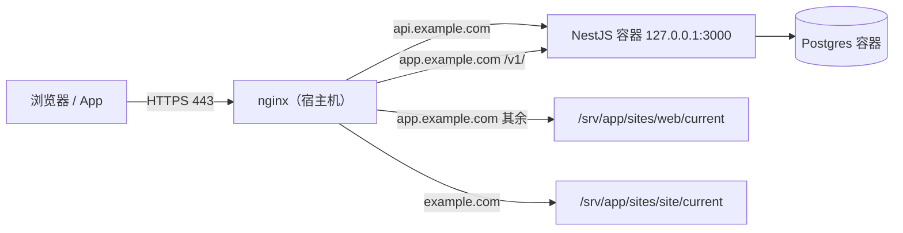
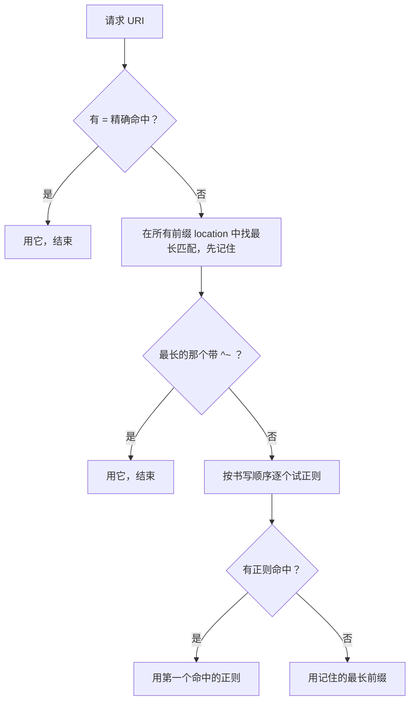

# 配置模型与 location 匹配

## 这本书讲什么

一台 VPS 上跑着 NestJS 服务、几个 Vite 构建出来的静态站、一个 Postgres。外面的请求怎么找到它们？HTTPS 证书挂在哪？上传大图为什么 413？推送长连接为什么攒了几 K 才到一次？这些问题的答案几乎都落在同一个地方：站在所有服务前面的那一层 **nginx**。

这本书围绕「一个人维护一台机器」的场景，讲清 nginx 作为**反向代理和网关**的那部分能力：

| 章 | 解决的问题 |
|---|---|
| 1. 配置模型与 location 匹配 | 配置文件怎么读，一个请求最终落到哪一段配置 |
| 2. 反向代理与负载均衡 | 把请求转给后端，头怎么传、超时怎么配、多实例怎么分 |
| 3. HTTPS 与 ACME 自动续期 | 免费证书怎么签、怎么不过期 |
| 4. 静态资源与缓存 | 前端构建产物怎么发，哪些能缓存一年，哪些一秒都不能 |
| 5. 限流与防刷 | 验证码、登录、密码页怎么挡住暴力尝试 |
| 6. WebSocket / SSE 代理 | 长连接为什么要单独配，缓冲和超时怎么调 |
| 7. 日志与排障 | 502、504、413、499 各自意味着什么，怎么从日志里定位 |
| 8. Caddy 等替代品 | 什么时候不必用 nginx |

**适合谁**：会写后端服务、用 Docker Compose 部署过东西，但 nginx 配置主要靠复制粘贴的人。不需要网络编程背景，HTTP 的基本概念（方法、状态码、头）懂就够。

**怎么读**：前两章是地基，建议按顺序读；之后各章相对独立，遇到问题按需翻。全书贯穿一个真实案例：hatch-counter（一个门店管理系统）的线上 nginx 配置，一台机器上用 5 个域名分出 API、网页端、管理后台、官网、文档站。书里的域名统一换成了 `example.com`。

## nginx 在架构里的位置



它同时扮演几个角色：

- **TLS 终结**：外面是 HTTPS，到后端变成明文 HTTP，后端不用管证书
- **按域名和路径分流**：一个 443 端口，背后多个服务
- **静态文件服务器**：前端构建产物直接从磁盘发，不经过 Node
- **保护层**：请求体大小、限流、超时、维护开关，在请求进入业务代码之前就处理掉

后端服务只绑 `127.0.0.1`，公网只开 80 和 443。这样任何请求都必须过 nginx，上面那些保护才有意义。

## 配置文件的结构

nginx 的配置是一棵由**块**（block）和**指令**（directive）组成的树：

```nginx
# 主上下文（main）
user  www-data;
worker_processes auto;

events {
    worker_connections 1024;
}

http {
    include       /etc/nginx/mime.types;
    sendfile      on;

    server {
        listen      80;
        server_name example.com;

        location / {
            root /var/www/html;
        }
    }
}
```

几条基本规则：

- 指令以分号结尾，块用花括号；漏一个分号是最常见的 `nginx -t` 报错
- 每条指令只能出现在规定的上下文里。官方文档每条指令都写着 `Context: http, server, location` 这样的说明，写错地方会报 `directive is not allowed here`
- 外层的设置会被内层**继承**，内层可以覆盖

### Debian / Ubuntu 的目录约定

用 `apt install nginx` 装的，主配置在 `/etc/nginx/nginx.conf`，它的 `http` 块里会 include 两处：

| 路径 | 用途 |
|---|---|
| `/etc/nginx/conf.d/*.conf` | 推荐放自己站点的地方，文件名以 `.conf` 结尾就生效 |
| `/etc/nginx/sites-enabled/*` | Debian 系传统做法，通常是指向 `sites-available/` 的软链 |
| `/etc/nginx/snippets/` | Debian 系提供的片段目录，自己 include |

装完后 `sites-enabled/default` 是那个「Welcome to nginx」页面，它占着 80 端口的 `default_server`。自己的配置放进 `conf.d/` 之前最好先删掉它，否则可能报 `duplicate default server`。

hatch-counter 的做法：站点主配置放 `conf.d/`，两段要被多处复用的片段放 `snippets/`，在需要的 location 里 include。

### include 是唯一的复用手段

nginx 没有「函数」或「继承一组指令」的概念。如果三个 location 都要设置同样的代理头，要么写三遍，要么抽成文件 include：

```nginx
# /etc/nginx/snippets/proxy-common.conf
proxy_http_version 1.1;
proxy_set_header Connection "";
proxy_set_header Host              $host;
proxy_set_header X-Real-IP         $remote_addr;
proxy_set_header X-Forwarded-For   $proxy_add_x_forwarded_for;
proxy_set_header X-Forwarded-Proto $scheme;
```

```nginx
location /v1/ {
    proxy_pass http://api_backend;
    include /etc/nginx/snippets/proxy-common.conf;
}
```

hatch-counter 在注释里写了为什么必须这样做：漏了 `X-Forwarded-For` 的那一处，后端看到的所有请求都来自 127.0.0.1，按 IP 计数的验证码限流就会把所有用户算成同一个人。这种 bug 的报错里完全不会提到 nginx。

## 继承的陷阱：数组型指令

大多数指令的继承很直观：外层设了 `client_max_body_size 12m`，内层没设就沿用。但有一类指令**一旦内层出现一条，外层的全部失效**，典型的是 `add_header` 和 `proxy_set_header`：

```nginx
server {
    add_header X-Frame-Options "SAMEORIGIN" always;

    location /assets/ {
        add_header Cache-Control "public, immutable";
        # 这里 X-Frame-Options 已经没了
    }
}
```

规则是：只有当前层级**完全没有**定义 `add_header` 时，才会继承上一层的。所以 hatch-counter 网页端的配置里，每个带了 `Cache-Control` 的 location 都把 `X-Frame-Options` 再写了一遍，并在注释里说明原因。

`proxy_set_header` 同理：location 里写了一条，server 层和 http 层的全部作废。这也是把代理头整组放进 snippet、每处完整 include 的另一个理由。

## server 块：按域名选

一个请求进来，nginx 先根据**监听的地址端口**筛出候选 server 块，再用 `Host` 头匹配 `server_name`：

1. 完全相同的名字，如 `api.example.com`
2. 以 `*` 开头的最长通配，如 `*.example.com`
3. 以 `*` 结尾的最长通配，如 `mail.*`
4. 第一个匹配的正则，如 `~^(?<sub>.+)\.example\.com$`

都不匹配时，用该端口的 `default_server`；没显式标的话，就是配置里第一个监听该端口的 server 块。

这个兜底行为有个副作用：有人直接用 IP 访问，或者把别的域名解析到你的机器，请求会落到「第一个 server 块」里，可能把你的某个站点暴露在奇怪的域名下。可以显式加一个拒绝块：

```nginx
server {
    listen 80 default_server;
    listen [::]:80 default_server;
    server_name _;
    return 444;   # nginx 特有：直接断开连接，不回任何响应
}
```

## location 匹配：请求落到哪一段

选定 server 之后，nginx 用请求的 URI（不含查询串）去匹配 location。修饰符有五种：

| 写法 | 含义 | 例子 |
|---|---|---|
| `location = /path` | 精确匹配 | `= /v1/health` |
| `location ^~ /path` | 前缀匹配，命中后不再检查正则 | `^~ /assets/` |
| `location ~ regex` | 正则，区分大小写 | `~ \.php$` |
| `location ~* regex` | 正则，不区分大小写 | `~* \.webp$` |
| `location /path` | 普通前缀匹配 | `/v1/` |

匹配顺序**不是**配置里的书写顺序，而是下面这个流程：



要点只有两个：**前缀比长度，正则比先后**；正则的优先级高于普通前缀，除非前缀加了 `^~`。

### 用 hatch-counter 的网页端练一遍

网页端 server 块里的 location（简化后）：

```nginx
location = /v1/health   { ... }   # 探活
location /v1/ocr/       { ... }   # 识别，长超时
location = /v1/events   { ... }   # 推送长连接
location /v1/           { ... }   # 其余接口
location /assets/       { ... }   # 带哈希的静态资源
location = /index.html  { ... }   # 首页不缓存
location /              { ... }   # 兜底：SPA 回首页
```

| 请求 | 命中 | 原因 |
|---|---|---|
| `/v1/health` | `= /v1/health` | 精确匹配最优先 |
| `/v1/health/db` | `/v1/` | `=` 要求完全相同，这里退回最长前缀 |
| `/v1/ocr/receipt` | `/v1/ocr/` | 比 `/v1/` 更长 |
| `/v1/events?x=1` | `= /v1/events` | 查询串不参与匹配 |
| `/assets/index-a1b2.js` | `/assets/` | 最长前缀 |
| `/` | `/`，然后被 `index` 内部重定向到 `/index.html`，再命中 `= /index.html` | 见下文 |
| `/stores/42` | `/` | 只有它匹配 |

这份配置一个正则都没用，全靠精确和前缀，读起来不需要在脑子里模拟正则顺序。**能用前缀就别用正则**，这是让配置可维护的第一条经验。

### 内部重定向：index、try_files、error_page

上表倒数第二行提到一个容易忽略的机制：有些指令会让请求**换一个 URI 重新走一遍 location 匹配**。

- `index index.html`：请求 `/` 这种目录时，内部改写成 `/index.html` 再匹配
- `try_files $uri $uri/ /index.html`：前面几项都找不到文件时，最后一项会触发内部重定向
- `error_page 404 /404.html`：出错时转到另一个 URI

所以 `location = /index.html` 里的 `Cache-Control: no-cache` 对访问 `/` 也生效。反过来，如果你在 `location /` 里加了某个头，却发现首页没有，多半是请求已经被内部重定向到别的 location 去了。

## 修改配置的标准动作

```bash
sudo nginx -t                    # 语法和引用检查，过了才能 reload
sudo systemctl reload nginx      # 平滑重载：新 worker 用新配置，旧 worker 处理完手头请求再退出
sudo nginx -T | less             # 打印合并后的完整配置（含所有 include），排查「到底生效的是哪份」
```

`reload` 不断开已有连接，日常改配置不需要 `restart`。`nginx -t` 失败时 reload 不会生效，线上还是旧配置在跑，这是 nginx 很友好的一点。hatch-counter 的推送脚本把这一步自动化了：传上新配置后跑 `nginx -t`，不过就换回旧文件、不 reload。

## 本章要点

- nginx 配置是块和指令组成的树，指令只能写在规定的上下文里
- 复用一组指令只能靠 `include`；代理头这类东西抽成 snippet，每处完整引入
- `add_header`、`proxy_set_header` 这类指令：当前层写了一条，上层的全部不再继承
- server 按 `listen` + `server_name` 选，不匹配时落到 `default_server`，建议显式加一个 `return 444` 的兜底
- location 匹配：`=` 精确最先；前缀取最长；最长前缀带 `^~` 就停；否则正则按书写顺序，第一个命中的胜出
- `index`、`try_files`、`error_page` 会触发内部重定向，请求可能最终落在另一个 location
- 改配置永远是 `nginx -t` 通过后再 `reload`；`nginx -T` 看合并后的真实配置
