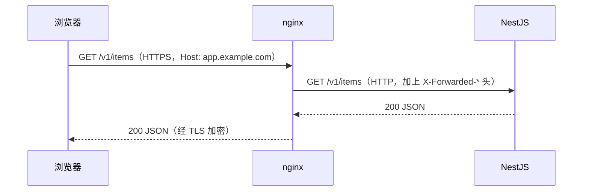
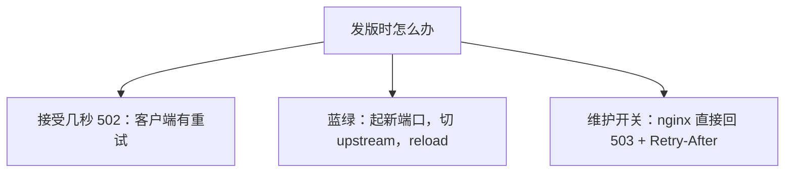

# 反向代理与负载均衡

上一章讲了请求怎么落到某个 location。这一章讲 location 里最常见的那件事：把请求**转给后端**。看起来只是一行 `proxy_pass`，但请求头怎么传、连接怎么复用、超时多长、请求体多大、后端挂了怎么办，每一项都有默认值，而默认值往往不适合你的应用。

## 正向代理和反向代理

| | 正向代理 | 反向代理 |
|---|---|---|
| 代表谁 | 客户端 | 服务端 |
| 谁知道它的存在 | 客户端主动配置 | 客户端通常不知道，以为在直接访问网站 |
| 典型用途 | 翻墙、公司出口审计 | TLS 终结、分流、负载均衡、缓存 |

nginx 两种都能做，但绝大多数场景是反向代理：对外它就是「网站」，对内它是后端服务的唯一客户端。



## proxy_pass 的斜杠规则

`proxy_pass` 后面的地址**带不带 URI 部分**，决定了转发时路径怎么改写。这是 nginx 最容易踩的坑之一。

```nginx
location /api/ {
    proxy_pass http://127.0.0.1:3000;        # 不带 URI
}
# 请求 /api/users → 后端收到 /api/users（原样转发）

location /api/ {
    proxy_pass http://127.0.0.1:3000/;       # 带 URI（就是一个 /）
}
# 请求 /api/users → 后端收到 /users（location 匹配到的前缀被替换成 /）

location /api/ {
    proxy_pass http://127.0.0.1:3000/v2/;
}
# 请求 /api/users → 后端收到 /v2/users
```

规则：`proxy_pass` 地址里只有协议、主机、端口时，原样转发 URI；一旦带了路径（哪怕只有一个 `/`），就把 location 匹配到的那段前缀**替换**成这个路径。

hatch-counter 的后端路由本身就以 `/v1/` 开头，所以统一用不带 URI 的写法，前后端路径完全一致，不需要在脑子里做替换。这是最省心的约定：**让后端路由的前缀和对外路径保持一致**。

另外两个细节：

- location 是正则时，`proxy_pass` 不能带 URI（nginx 不知道该替换哪一段），`nginx -t` 会报错
- `proxy_pass` 里用了变量（如 `http://$backend`），替换规则会变，而且需要配 `resolver` 才能解析域名。初期能不用变量就不用

## upstream：给后端起个名字

```nginx
upstream api_backend {
    server 127.0.0.1:3000;
    keepalive 16;
}

server {
    # ...
    location /v1/ {
        proxy_pass http://api_backend;
        include /etc/nginx/snippets/proxy-common.conf;
    }
}
```

即使只有一个后端，也建议写 upstream：

- 多个 server 块共用一个名字，后端端口改了只改一处
- 可以开 `keepalive`，复用到后端的连接

### keepalive 要配三件事

nginx 默认用 HTTP/1.0 连后端，并且每个请求结束就关闭连接。高并发时大量连接在 `TIME_WAIT` 里堆积，还白白多了建连的开销。开启连接复用需要三处配合：

```nginx
upstream api_backend {
    server 127.0.0.1:3000;
    keepalive 16;                     # 每个 worker 最多保留 16 条空闲连接
}

location /v1/ {
    proxy_pass http://api_backend;
    proxy_http_version 1.1;           # HTTP/1.1 才有持久连接
    proxy_set_header Connection "";   # 清掉客户端传来的 Connection: close
}
```

少写后两行中的任何一行，`keepalive` 都不起作用，而且不会有任何报错。hatch-counter 的代理 snippet 第一行就是 `proxy_http_version 1.1`，注释直接写着「这句不写的话每个请求都新建一条连接」。

`keepalive 16` 不是连接上限，只是空闲池的大小。单机小应用 16 到 32 足够。

## 请求头：让后端知道真实情况

经过代理后，后端看到的 TCP 对端永远是 127.0.0.1，协议永远是 HTTP。要让后端拿到真实信息，nginx 必须通过请求头传过去：

| 头 | 值 | 后端用来做什么 |
|---|---|---|
| `Host` | `$host` | 多租户路由、生成绝对 URL。不设的话默认是 upstream 的名字 |
| `X-Real-IP` | `$remote_addr` | 简单场景下取客户端 IP |
| `X-Forwarded-For` | `$proxy_add_x_forwarded_for` | 完整代理链，限流、审计、风控 |
| `X-Forwarded-Proto` | `$scheme` | 判断原始请求是否 HTTPS，决定 cookie 的 `Secure`、重定向地址 |

### X-Forwarded-For 为什么不能直接信

`$proxy_add_x_forwarded_for` 的值是「客户端传来的 `X-Forwarded-For`，后面追加上 `$remote_addr`」。客户端可以随便伪造前面那部分：

```text
客户端发送：X-Forwarded-For: 1.2.3.4
nginx 转发：X-Forwarded-For: 1.2.3.4, 198.51.100.7
```

第一段 `1.2.3.4` 是客户端自己写的，可以是任何值；最后一段 `198.51.100.7` 是 nginx 从 TCP 连接上看到的真实来源，伪造不了。

所以后端只能信**最后一跳**，也就是离自己最近的那个可信代理写进去的值。在 Express / NestJS 里：

```typescript
// main.ts —— 只有一层 nginx，信任 1 跳
const app = await NestFactory.create<NestExpressApplication>(AppModule);
app.set('trust proxy', 1);
// 之后 req.ip 就是 X-Forwarded-For 的最后一段，而不是 127.0.0.1
```

hatch-counter 把这个值做成环境变量 `TRUST_PROXY`，而不是写死：开发时没有 nginx，设成 1 反而会让客户端能伪造 IP。

如果前面还有 CDN（比如 Cloudflare），链条变成「客户端 → CDN → nginx → 后端」，要么把信任跳数改成 2，要么在 nginx 里用 realip 模块把真实 IP 还原到 `$remote_addr`：

```nginx
# 只信任来自 CDN 回源网段的头。网段以 CDN 官方公布的列表为准，会变
set_real_ip_from 203.0.113.0/24;
real_ip_header   X-Forwarded-For;
real_ip_recursive on;
```

## 超时与请求体：默认值什么时候会咬人

| 指令 | 默认 | 含义 |
|---|---|---|
| `proxy_connect_timeout` | 60s | 和后端建立 TCP 连接的超时 |
| `proxy_send_timeout` | 60s | 两次**写**给后端之间的最长间隔 |
| `proxy_read_timeout` | 60s | 两次从后端**读**到数据之间的最长间隔 |
| `client_max_body_size` | 1m | 请求体上限，超过直接 413 |
| `client_body_timeout` | 60s | 两次读客户端请求体之间的最长间隔 |

注意读写超时都是「**两次之间的间隔**」，不是整个请求的总时长。后端每 10 秒吐一点数据，请求可以持续一小时不超时；后端算了 61 秒才吐出第一个字节，就会 504。

### 案例：拍照识别的 150 秒

hatch-counter 用视觉模型识别进货单，后端有一条降级链：一个模型失败就换下一个，最长可能跑 150 秒。按默认 60 秒的 `proxy_read_timeout`，链还没跑完 nginx 就回了 504，而客户端只看到一句与真实原因毫无关系的「服务端出了点问题」。

解决办法是给这一条路径单开一个 location，**只放宽它自己**：

```nginx
location /v1/ocr/ {
    proxy_read_timeout 180s;          # 比后端的 150 秒截止时间多留余量
    proxy_pass http://api_backend;
    include /etc/nginx/snippets/proxy-common.conf;
}
```

不要图省事把整个 server 的超时都调到 180 秒：普通接口卡住时，你希望它尽快失败、尽快暴露问题。

### 案例：小图过得去、大图过不去

同一个项目，上传进货单照片。nginx 默认 `client_max_body_size 1m`，手机拍的照片很容易超过。表现是「有的能传、有的不行」，而且 413 的响应体是 nginx 自带的一页 HTML，前端解析 JSON 失败，报错信息什么都看不出来。

```nginx
server {
    # 必须和后端的 body 限制对齐（后端是 12MB）
    client_max_body_size 12m;
}
```

原则：**nginx 的上限和后端的上限设成一样**。nginx 更小，后端的限制形同虚设且报错难看；nginx 更大，大请求会白白占用磁盘缓冲（超过 `client_body_buffer_size` 的请求体会写入临时文件）再被后端拒绝。

## 负载均衡

当后端不止一个实例时，upstream 里列多个 server：

```nginx
upstream api_backend {
    least_conn;                                  # 策略，不写就是轮询
    server 127.0.0.1:3001 max_fails=3 fail_timeout=30s;
    server 127.0.0.1:3002 max_fails=3 fail_timeout=30s;
    server 127.0.0.1:3003 backup;                # 其他都不可用时才用
    keepalive 32;
}
```

| 策略 | 写法 | 适合 |
|---|---|---|
| 加权轮询 | 默认，可加 `weight=` | 请求耗时相近 |
| 最少连接 | `least_conn` | 请求耗时差异大（有慢接口、长连接） |
| IP 哈希 | `ip_hash` | 需要同一客户端落在同一实例（会话存在内存里） |
| 一致性哈希 | `hash $request_uri consistent` | 后端有本地缓存，希望同一资源命中同一实例 |

`ip_hash` 是「后端有状态」的补丁。更好的做法是让后端无状态：会话放 Redis 或 JWT，那样随便怎么分都行。

### 被动健康检查

开源版 nginx 没有主动探活（定时打健康接口那种是商业版 NGINX Plus 的功能），只有**被动**检查：

- 转发失败（连不上、超时、或 `proxy_next_upstream` 指定的状态码）计一次失败
- `fail_timeout` 时间内失败达到 `max_fails` 次（默认 1 次 / 10 秒），这个实例被标记不可用 `fail_timeout` 这么长时间
- 期间请求会转给其他实例，之后再试探

失败时是否转给下一个实例，由 `proxy_next_upstream` 控制，默认是 `error timeout`。有个重要的安全设计：**POST 这类非幂等请求默认不会重试到下一个实例**，避免一笔订单被创建两次。除非你明确知道接口幂等，否则不要加 `non_idempotent`。

## 单实例时的零停机

一个人的项目通常只有一个后端实例。发版时容器重启的那几秒，请求会得到 502。几种应对：



hatch-counter 选了第三种。部署脚本在换容器前 `touch` 一个标记文件，nginx 每个转给后端的 location 里 include 一段判断：

```nginx
# /etc/nginx/snippets/maintenance.conf
default_type application/json;
if (-f /srv/app/maintenance.on) {
    add_header Retry-After 30 always;
    return 503 '{"error":"正在维护，一般几分钟，好了自己接着用","code":"maintenance"}';
}
```

几个值得学的设计：

- nginx 每个请求都会检查文件是否存在，所以开关**立即生效，不用 reload**
- 返回体是合法 JSON，前端统一的错误解析能直接读出中文提示
- 没用 `error_page 503` 兜底：后端自己在数据库挂掉时也回 503，用 error_page 统一接住会把「库挂了」伪装成「正在维护」
- 必须写在 location 里而不是 server 里：`add_header` 不允许出现在 server 层的 `if` 中，`nginx -t` 会直接报错

蓝绿发布的完整做法在《部署与 CI/CD》里讲。

## 本章要点

- `proxy_pass` 带不带 URI 决定路径是否改写；让后端路由前缀和对外路径一致最省心
- 只有一个后端也写 upstream；`keepalive` 必须配 `proxy_http_version 1.1` 和清空 `Connection` 才生效
- 必传 `Host`、`X-Forwarded-For`、`X-Forwarded-Proto`；后端用 `trust proxy` 只信最后一跳
- 超时是「两次读写之间的间隔」；慢接口单开 location 只放宽它自己
- `client_max_body_size` 默认 1m，要和后端的请求体上限对齐
- 负载均衡默认轮询，耗时不均用 `least_conn`；开源版只有被动健康检查，非幂等请求默认不重试
- 单实例发版可以用「标记文件 + 503 + Retry-After」的维护开关，开关不需要 reload
