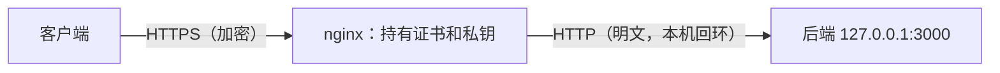
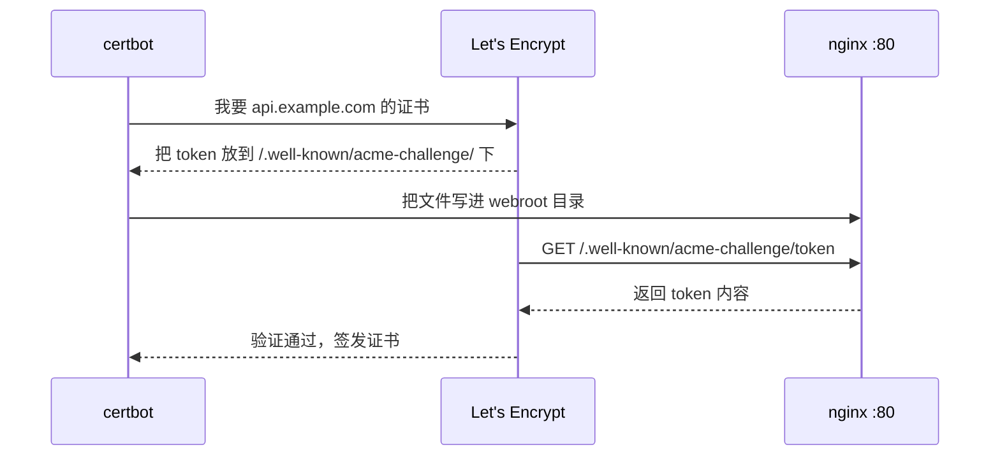

# HTTPS 与 ACME 自动续期

今天没有理由不上 HTTPS：浏览器会把 HTTP 站点标成「不安全」，Service Worker、地理位置、剪贴板等 API 只在安全上下文可用，iOS 默认禁止 App 发明文请求，而证书本身是免费的。真正的风险不在「怎么上」，而在「**哪天忘了续期**」：证书一过期，网页打不开，移动端（地址打包时写死）全部连不上，而且是在你最没准备的时候。

这一章讲 TLS 在 nginx 里怎么配，以及怎么用 ACME 协议让证书自己续期。

## TLS 终结在哪一层



nginx 负责握手、加解密，后端只说明文 HTTP。好处是证书只在一个地方，后端不用关心；前提是 nginx 到后端这一段**在可信网络里**，同一台机器的回环地址或 Docker 内网都满足。后端要知道原始请求是不是 HTTPS，看上一章的 `X-Forwarded-Proto`。

## 证书是怎么签出来的：ACME

Let's Encrypt 这类免费 CA 用 **ACME** 协议自动签发证书。核心问题是「怎么证明这个域名归你控制」，常用两种挑战方式：

| 挑战 | 怎么证明 | 优点 | 限制 |
|---|---|---|---|
| HTTP-01 | CA 访问 `http://域名/.well-known/acme-challenge/<token>`，能取到指定内容 | 简单，不需要 DNS 权限 | 必须开放 80 端口；不能签通配符 |
| DNS-01 | 在 `_acme-challenge.域名` 添加指定 TXT 记录 | 能签 `*.example.com`；机器可以不对公网开放 | 需要 DNS 服务商的 API 密钥 |



单机部署、每个子域名一张证书，HTTP-01 就够了。

## certbot 的三种模式

| 模式 | 命令 | 行为 |
|---|---|---|
| `--nginx` | `certbot --nginx -d example.com` | 自动改写你的 nginx 配置，插入证书路径和跳转 |
| `--webroot` | `certbot certonly --webroot -w /var/www/certbot -d example.com` | 只往一个目录写挑战文件，**不碰配置** |
| `--standalone` | `certbot certonly --standalone -d example.com` | 自己临时监听 80，需要先停掉 nginx |

hatch-counter 明确选了 `--webroot`，理由写在配置开头的注释里：`--nginx` 模式会就地改写 server 块，线上配置就和仓库里的不一样了；下次从仓库覆盖回去，证书配置会被一起抹掉。**配置文件要以仓库为准**，签证书的工具只负责签证书。

## 从零上线的顺序

有个先有鸡还是先有蛋的问题：完整配置里引用了证书文件，证书还没签，`nginx -t` 不过；而签证书又需要 nginx 在 80 端口上服务挑战文件。解法是**先放一份只处理挑战的临时配置**：

```bash
sudo rm -f /etc/nginx/sites-enabled/default
sudo mkdir -p /var/www/certbot

sudo tee /etc/nginx/conf.d/acme.conf >/dev/null <<'CONF'
server {
    listen 80;
    listen [::]:80;
    server_name example.com www.example.com api.example.com app.example.com;
    location /.well-known/acme-challenge/ { root /var/www/certbot; }
}
CONF
sudo nginx -t && sudo systemctl reload nginx
```

然后签证书。一张证书可以带多个名字（`-d` 写多次），也可以每个子域名一张：

```bash
sudo certbot certonly --webroot -w /var/www/certbot -d api.example.com
sudo certbot certonly --webroot -w /var/www/certbot -d app.example.com
sudo certbot certonly --webroot -w /var/www/certbot -d example.com -d www.example.com
```

第一次运行会问邮箱。一定填一个真能收到的：续期失败的提醒邮件是证书过期前唯一的预警。签好的文件在：

```text
/etc/letsencrypt/live/api.example.com/fullchain.pem   # 证书 + 中间证书链
/etc/letsencrypt/live/api.example.com/privkey.pem     # 私钥
```

`live/` 下是指向 `archive/` 的软链，续期后软链自动指向新文件，nginx 配置里的路径永远不用改。最后删掉临时配置，换上正式配置：

```bash
sudo rm /etc/nginx/conf.d/acme.conf
sudo cp site.conf /etc/nginx/conf.d/
sudo nginx -t && sudo systemctl reload nginx
```

> 国内服务器还有一个前置条件：域名未完成备案时，云厂商会在入口拦截 80 / 443 的访问，certbot 报的错看起来像 nginx 配错了。先确认 `curl -sI http://域名/` 返回的 `Server:` 是 nginx，再签证书。

## 正式配置

```nginx
# 80：只做两件事，服务 ACME 挑战、其余跳 HTTPS
server {
    listen 80;
    listen [::]:80;
    server_name example.com www.example.com api.example.com app.example.com;

    location /.well-known/acme-challenge/ { root /var/www/certbot; }
    location / { return 301 https://$host$request_uri; }
}

server {
    listen 443 ssl http2;
    listen [::]:443 ssl http2;
    server_name api.example.com;

    ssl_certificate     /etc/letsencrypt/live/api.example.com/fullchain.pem;
    ssl_certificate_key /etc/letsencrypt/live/api.example.com/privkey.pem;

    location / {
        proxy_pass http://api_backend;
        include /etc/nginx/snippets/proxy-common.conf;
    }
}
```

注意 80 端口的跳转块**必须保留** `/.well-known/acme-challenge/`：续期时 CA 仍然走 HTTP 访问挑战文件。Let's Encrypt 虽然会跟随跳转，但那样挑战文件就得在 443 的 server 块里也能取到，多一处容易漏配的地方；在 80 上直接服务掉，路径最短、最不依赖其他配置。

### http2 的两种写法

nginx 1.25.1 起推荐写成独立指令 `http2 on;`，`listen ... http2` 被标记为 deprecated。但 Ubuntu 22.04 和 24.04 自带的 nginx 分别是 1.18 和 1.24，不认识 `http2 on;`，`nginx -t` 直接报错。

hatch-counter 的选择是统一用老写法：新版本照样认，只多一句警告；新写法在老版本上起不来。用发行版自带 nginx 时这是更稳的选择。用 nginx 官方源装了新版的话，可以换成新写法：

```nginx
server {
    listen 443 ssl;
    http2 on;
    # ...
}
```

### TLS 参数要不要调

Debian / Ubuntu 打包的 `nginx.conf` 里已经有一行 `ssl_protocols`，新版本 nginx 的默认值也只开 TLS 1.2 和 1.3。对个人项目，以下几行足够：

```nginx
http {
    ssl_protocols TLSv1.2 TLSv1.3;
    ssl_session_cache   shared:SSL:10m;   # 会话复用，减少完整握手
    ssl_session_timeout 1d;
    ssl_session_tickets off;
}
```

密码套件不要凭记忆写，用 Mozilla 的「SSL Configuration Generator」按 nginx 版本和 OpenSSL 版本生成「Intermediate」档位即可。

### HSTS：上之前想清楚

```nginx
add_header Strict-Transport-Security "max-age=31536000" always;
```

HSTS 让浏览器在有效期内**只用 HTTPS** 访问这个域名。好处是防降级攻击；风险是一旦设了一年，哪天 HTTPS 出问题，用户连「点击继续访问」的选项都没有。建议先用短的 `max-age`（比如一天）跑一段时间，确认证书续期稳定再拉长。`includeSubDomains` 会波及所有子域名，加之前确认每个子域名都有 HTTPS。

## 自动续期

Let's Encrypt 证书目前默认有效期 90 天。老版本 certbot（比如 Ubuntu 24.04 apt 源里的 2.x）在剩余 30 天以内时才真正续期，4.0 起改为剩余三分之一有效期时续。整个行业正在缩短证书有效期，Let's Encrypt 计划 2027 年降到 64 天、2028 年降到 45 天，时间表见[《计算机网络》有效期在缩短](../networking/05-tls.md#有效期在缩短)，这更说明续期**必须全自动**。

用 apt 装的 certbot 自带一个 systemd 定时器，每天运行两次 `certbot renew`：

```bash
systemctl list-timers | grep certbot      # 确认定时器在
sudo certbot renew --dry-run              # 演练一次完整续期流程
sudo certbot certificates                 # 查看每张证书的到期时间
```

### 续期后必须 reload

certbot 换了磁盘上的文件，但 nginx 进程内存里还是旧证书，**不 reload 就等于没续**。用 deploy hook 让每次续期成功后自动 reload：

```bash
sudo tee /etc/letsencrypt/renewal-hooks/deploy/reload-nginx.sh >/dev/null <<'SH'
#!/bin/sh
systemctl reload nginx
SH
sudo chmod +x /etc/letsencrypt/renewal-hooks/deploy/reload-nginx.sh
sudo certbot renew --dry-run
```

`renewal-hooks/deploy/` 下的脚本只在**真正续期成功**后执行，不会每天无谓地 reload。

hatch-counter 没有把 nginx 和 certbot 放进 Docker Compose，原因也在这里：宿主机上的 certbot 续期 + deploy hook 是现成的；塞进容器之后，「续期后通知另一个容器 reload」这套得自己拼，而这正是最不能出错的环节。

### 防止「静默过期」

自动化最怕的是悄悄坏掉。至少做一层外部检查：

```bash
# 查看线上证书的到期时间
echo | openssl s_client -connect api.example.com:443 -servername api.example.com 2>/dev/null \
  | openssl x509 -noout -enddate
```

把它放进你已有的监控（定时任务 + 告警、或者第三方的拨测服务），剩余不足 14 天就报警。可观测性的整体做法见[《可观测性与性能》](../observability-performance/)。

## nginx 原生 ACME 模块

> [!WARNING]
> 本节按 2026 年 11 月 nginx.org 的 ngx_http_acme_module 文档和 GitHub 上 nginx/nginx-acme 仓库的 README 整理。模块版本号还在 0.x，指令和支持的挑战类型仍在变化，以 nginx.org 文档为准。

上面这一整套（certbot、webroot、定时器、deploy hook）是 nginx 用户十几年来的标准做法，也是很多人转向 Caddy 的理由。2025 年 8 月，nginx 官方发布了自己的 ACME 模块 `ngx_http_acme_module`（用 Rust 写成，最初以预览版发布），让 nginx 自己去签证书、自己续期，不再需要 certbot。

它是一个**动态模块**，不在 nginx 本体里：用 nginx.org 官方软件源装的 nginx，可以再装 `nginx-module-acme` 包；Ubuntu / Debian 自带源里的 nginx 有没有对应的模块包，要用 `apt-cache search nginx | grep -i acme` 自己查一下，没有就换成 nginx.org 的源，或者自己编译。配置大致是这样：

```nginx
# nginx.conf 顶层
load_module modules/ngx_http_acme_module.so;

http {
    resolver 127.0.0.1:53;      # 模块要解析 CA 的地址，必须配 resolver

    acme_issuer letsencrypt {
        uri         https://acme-v02.api.letsencrypt.org/directory;
        contact     ops@example.com;
        state_path  /var/lib/nginx/acme-letsencrypt;   # 账号密钥和证书存这里
        accept_terms_of_service;
    }

    acme_shared_zone zone=ngx_acme_shared:1M;

    server {
        listen 443 ssl;
        server_name api.example.com;

        acme_certificate letsencrypt;               # 按 server_name 申请证书

        ssl_certificate       $acme_certificate;
        ssl_certificate_key   $acme_certificate_key;
        ssl_certificate_cache max=2;                # 别每次握手都重新解析证书
        # ...
    }

    server {
        listen 80;                                  # HTTP-01 挑战需要 80 端口
        server_name api.example.com;
        location / {
            return 404;
        }
    }
}
```

和 certbot 相比，变化在三处：

- **没有「先有鸡还是先有蛋」**：前面「从零上线的顺序」要先放临时配置签证书、再换正式配置，用模块时一份配置直接 reload，nginx 自己去申请
- **没有 webroot 和 deploy hook**：挑战由模块在 80 端口上直接应答，签发和续期都在 nginx 进程里完成，证书通过 `$acme_certificate` 变量交给 `ssl_certificate`
- **证书不在 `/etc/letsencrypt/` 里了**：在 `state_path` 指定的目录，里面有账号密钥和私钥，权限要收紧，迁移机器时要一起搬，这一点和 Caddy 一样

目前的限制也要看清：

| 限制 | 影响 |
|---|---|
| 挑战类型只有 HTTP-01 和 TLS-ALPN-01，没有 DNS-01 | **签不了通配符证书**；80 / 443 不能对公网开放的机器用不了 |
| `server_name` 里的正则和通配符不能作为证书域名 | 用正则匹配多个子域名的 server 块要拆开写 |
| 官方示例里 80 端口的 server 块只返回 404 | 和「其余请求 301 到 HTTPS」能不能写在同一个 server 块里，文档没有说明，上线前实测一次 |
| 证书变量化后，nginx 在握手时按变量取证书 | 要配 `ssl_certificate_cache`，否则有额外开销 |

对本书的 hatch-counter 来说，certbot 那套已经稳定运行、换掉它收益不大；新开一台机器、域名不多、不需要通配符的时候，可以直接用模块，省掉本章大半的步骤。不管用哪种方式签证书，下面「防止静默过期」那层**外部监控都不能省**，自动化坏掉的方式只是换了一种。

## 常见问题

| 现象 | 可能原因 |
|---|---|
| certbot 报 `Timeout during connect` | DNS 还没生效，或防火墙 / 安全组没放行 80 |
| certbot 报 `Invalid response ... 403/404` | 挑战文件路径不对：`root` 和 `-w` 不是同一个目录；或者被备案拦截 |
| `nginx -t` 报 `cannot load certificate` | 引用的证书还没签成，或路径写错 |
| 浏览器报证书链不完整（部分安卓） | `ssl_certificate` 用了 `cert.pem` 而不是 `fullchain.pem` |
| 续期成功但浏览器还显示旧到期时间 | 没有 reload |

## 本章要点

- nginx 做 TLS 终结，后端只说 HTTP；后端靠 `X-Forwarded-Proto` 知道原始协议
- ACME 用 HTTP-01（需要 80 端口）或 DNS-01（能签通配符）证明域名所有权
- 用 `certbot certonly --webroot`，不让工具改写配置，配置以仓库为准
- 首次上线先放只处理挑战的临时配置，签完证书再换正式配置
- 80 端口块保留 `/.well-known/acme-challenge/`，其余 301 到 HTTPS
- 发行版自带的老 nginx 不认 `http2 on;`，统一用 `listen 443 ssl http2` 更稳
- 续期靠 certbot 定时器，**deploy hook 里 reload nginx** 是必需的一步；再加一层外部到期监控
- nginx 官方的 ACME 动态模块能让 nginx 自己签证书和续期，省掉 certbot；目前没有 DNS-01，签不了通配符

## 动手练习

不需要域名，也不向真实 CA 申请：用自签证书在本机容器里练 TLS 配置。在[第 1 章的练习](01-config-model.md#动手练习)目录里生成证书，并多映射一个 443 端口重新起容器：

```bash
cd ~/nginx-lab && mkdir -p certs acme/.well-known/acme-challenge
openssl req -x509 -newkey rsa:2048 -nodes -days 30 -keyout certs/key.pem -out certs/cert.pem \
  -subj /CN=localhost -addext subjectAltName=DNS:localhost
docker rm -f ng 2>/dev/null
docker run --rm -d --name ng -p 8080:80 -p 8443:443 -v "$PWD/conf.d:/etc/nginx/conf.d:ro" \
  -v "$PWD/certs:/etc/nginx/certs:ro" -v "$PWD/acme:/var/www/certbot:ro" nginx:1.27-alpine
```

系统自带的 openssl 不认 `-addext` 时，换用 Homebrew 装的 openssl。

1. **配一个 443 server 块**：写一个 `listen 443 ssl;` 的 server，`ssl_certificate` 和 `ssl_certificate_key` 指向 `/etc/nginx/certs/` 下的两个文件，`location /` 里 `return 200 "tls ok\n";`。reload 后执行 `curl --cacert certs/cert.pem https://localhost:8443/`；再把 `listen 443 ssl;` 里的 `ssl` 去掉，reload 后重试。

   验证：第一次输出 `tls ok`；去掉 `ssl` 后 curl 报 TLS 层的错误（常见字样是 `wrong version number`）。

   参考答案：`listen` 不带 `ssl` 时这个端口说的是明文 HTTP，客户端用 TLS 去握手，读到的是一段 HTTP 文本，于是报版本号不对。

2. **80 端口只做两件事**：写一个 80 端口的 server 块，`location /.well-known/acme-challenge/ { root /var/www/certbot; }`，其余 `return 301 https://$host$request_uri;`。执行 `echo token-abc > acme/.well-known/acme-challenge/t1`，然后 `curl -s localhost:8080/.well-known/acme-challenge/t1` 和 `curl -sI localhost:8080/foo`。

   验证：第一条输出 `token-abc`；第二条状态码 `301`，`Location: https://localhost/foo`。

   参考答案：挑战路径直接在 80 上服务，CA 不用跟随跳转；其余流量都去 HTTPS。`root` 加上 URI 才是磁盘路径，所以 webroot 目录下要有 `.well-known/acme-challenge/` 这一层。

3. **换了证书不 reload 等于没换**：先记下当前证书的序列号 `openssl s_client -connect localhost:8443 -servername localhost </dev/null 2>/dev/null | openssl x509 -noout -serial`，然后用同样的 `openssl req` 命令重新生成 `certs/` 下的两个文件，再查一次；最后 `docker exec ng nginx -s reload` 后再查。

   验证：重新生成后第二次查到的序列号和第一次相同；reload 之后才变成新的。

   参考答案：nginx 启动和 reload 时把证书读进内存，磁盘上的文件换了它并不知道。这就是续期后必须用 deploy hook reload 的原因。
