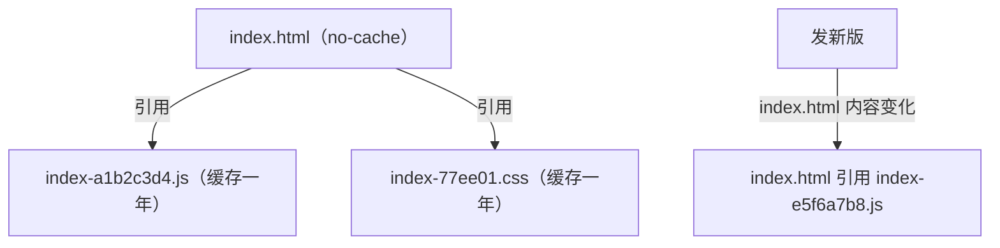

# 静态资源与缓存

Vite、Expo Web、VitePress 构建出来的都是一堆静态文件。让 nginx 直接从磁盘发它们，比经过 Node 快得多，也不占后端的进程。这一章讲三件事：怎么发（root、try_files、SPA 回退），怎么让浏览器缓存（哪些缓存一年，哪些一秒都不行），以及怎么让发版时切换版本是原子的。

## root 与 alias

```nginx
server {
    root /srv/app/sites/web/current;
    index index.html;

    location /static/ {
        # 请求 /static/logo.png → 文件 /srv/app/sites/web/current/static/logo.png
    }

    location /download/ {
        alias /srv/app/files/;
        # 请求 /download/a.zip → 文件 /srv/app/files/a.zip
    }
}
```

| | `root` | `alias` |
|---|---|---|
| 路径计算 | root + 完整 URI | alias 替换掉 location 匹配的那段前缀 |
| 写在哪 | http / server / location | 只能在 location |
| 常见坑 | 少 | location 带尾斜杠、alias 不带（或反过来），拼出错误路径 |

默认用 `root`，写在 server 层；只有 URL 前缀和磁盘目录名对不上时才用 `alias`，并且让两边的尾斜杠保持一致。

## try_files：找不到时怎么办

`try_files` 依次检查文件是否存在，都不存在时用最后一项：

```nginx
# 单页应用（React Router 的 history 模式）：任何路径都回首页，交给前端路由
location / {
    try_files $uri $uri/ /index.html;
}

# 纯静态站：找不到就是 404
location / {
    try_files $uri $uri/ =404;
}

# VitePress 的 cleanUrls：/guide 对应 guide.html
location / {
    try_files $uri $uri.html $uri/ =404;
}
```

选哪种不是技术问题，是产品问题。hatch-counter 一台机器上恰好三种都有，注释里写着各自的理由：

| 站点 | 写法 | 理由 |
|---|---|---|
| 管理后台 | 回退 `/index.html` | history 路由，刷新在 `/stores/42` 上不能 404 |
| 网页端 | 回退 `/index.html` | 用的是 hash 路由，正常只打到 `/`；店主手敲错一个字母不该看到 404 |
| 官网 | `=404` | 没有路由，错链就该是 404。回首页会让任何错地址看起来「好着呢」，错链永远发现不了 |
| 文档站 | `$uri.html` 再 `=404`，配站内 404 页 | 同上，错链要露出来 |

## 浏览器缓存：两类文件，两种策略

现代前端构建产物天然分成两类：

- **带内容哈希的资源**：`index-a1b2c3d4.js`、`logo-9f8e7d.svg`。内容变了，文件名就变
- **入口文件**：`index.html`、`manifest.webmanifest`、`sw.js`。文件名永远不变，里面引用着当前版本的哈希文件名



策略因此很清楚：

```nginx
# 带哈希的：内容永不改变，让浏览器一直留着，连验证请求都不用发
location /assets/ {
    expires 1y;
    add_header Cache-Control "public, immutable";
}

# 入口：每次都要向服务器确认是否有新版
location = /index.html {
    add_header Cache-Control "no-cache";
}
location = /manifest.webmanifest {
    add_header Cache-Control "no-cache";
}
```

如果 `index.html` 被缓存住了，就等于「发了新版、用户刷新还是旧的」。hatch-counter 网页端的「有新版，点这里刷新」功能完全依赖这一点。

### Cache-Control 的几个值

| 值 | 含义 |
|---|---|
| `no-cache` | **可以**缓存，但每次使用前必须向服务器验证（带 `If-None-Match` / `If-Modified-Since`），没变就回 304 |
| `no-store` | 完全不缓存，每次都完整下载。用于敏感内容 |
| `max-age=N` | N 秒内直接用缓存，不发请求 |
| `immutable` | 在有效期内连「用户点刷新」也不验证 |
| `public` / `private` | 是否允许 CDN 等共享缓存存储 |

`no-cache` 经常被误解为「不缓存」。它其实配合 nginx 默认开启的 `etag` 和 `Last-Modified` 工作：文件没变时只回一个很小的 304，代价很低。

`expires 1y` 会同时设置 `Expires` 头和 `Cache-Control: max-age=31536000`，再加上手写的 `add_header Cache-Control "public, immutable"`，响应里会出现两行 `Cache-Control`，浏览器会合并理解。想只出一行，可以去掉 `expires`，直接写 `add_header Cache-Control "public, max-age=31536000, immutable";`。

### 别忘了 add_header 的继承规则

第 1 章讲过：location 里写了 `add_header`，server 层的就全部失效。所以安全头要在每个带缓存头的 location 里重复写：

```nginx
location /assets/ {
    expires 1y;
    add_header Cache-Control "public, immutable";
    add_header X-Frame-Options "SAMEORIGIN" always;
}
```

如果安全头很多，抽成一个 snippet，每个 location include 一次。

## 压缩

```nginx
gzip on;
gzip_types text/css application/javascript application/json application/manifest+json image/svg+xml;
gzip_min_length 1024;
```

- `text/html` 总是会被压缩，不需要写进 `gzip_types`
- 图片（png、jpg、webp）、字体（woff2）本身已经压缩过，再 gzip 只会浪费 CPU
- 小于 1KB 的响应压缩收益很小，`gzip_min_length` 过滤掉

### 预压缩：gzip_static

构建时就把 `.js` 压成 `.js.gz`，nginx 发现同名的 `.gz` 文件存在且客户端支持，就直接发它，运行时不再消耗 CPU，还可以用最高压缩级别：

```nginx
location /assets/ {
    gzip_static on;
    expires 1y;
    add_header Cache-Control "public, immutable";
}
```

`gzip_static` 需要 `ngx_http_gzip_static_module`，Debian / Ubuntu 打包的 nginx 和官方 Docker 镜像都已编译进去，可以用 `nginx -V 2>&1 | grep -o gzip_static` 确认。Vite 可以用 `vite-plugin-compression` 之类的插件在构建时生成 `.gz`。Brotli 压缩率更高，但开源 nginx 需要额外编译第三方模块，个人项目用 gzip 就够了。

## 发版：用软链做原子切换

最直接的发版方式是 `rsync` 新文件进站点目录。问题在于切换不是原子的：同步到一半的那几秒，用户可能拿到新的 `index.html`，它引用的新哈希 JS 还没传完，于是白屏。

hatch-counter 的做法是**每个版本一个目录，`current` 是一条软链**：

```text
$ ls -l /srv/app/sites/web/
drwxr-xr-x  1.4.0
drwxr-xr-x  1.5.0
lrwxrwxrwx  current -> 1.5.0
```

```bash
# 新版本解压到旁边的目录
mkdir -p /srv/app/sites/web/1.6.0
tar -xzf web-1.6.0.tar.gz -C /srv/app/sites/web/1.6.0

# 原子替换软链：先建临时链，再 rename 覆盖
ln -sfn 1.6.0 /srv/app/sites/web/current.tmp
mv -T /srv/app/sites/web/current.tmp /srv/app/sites/web/current
```

`mv -T` 底层是 `rename(2)` 系统调用，在同一文件系统上是原子的：任何时刻 `current` 要么指向旧版本，要么指向新版本。（`ln -sfn` 直接覆盖其实是先删后建，中间有极短的空窗，所以用临时链加 rename。`mv -T` 是 GNU coreutils 的选项，Linux 服务器上可用。）

nginx 配置里 `root /srv/app/sites/web/current;` 不用改，**也不用 reload**：nginx 每个请求都重新解析路径。回滚就是把软链指回旧目录。

保留最近几个版本目录还有一个好处：用户的浏览器里可能开着旧版页面，它懒加载旧哈希的 chunk 时文件仍然存在。如果版本之间只保留一份目录，那些用户点到某个路由就会报 chunk 加载失败。

## 后端响应的缓存：proxy_cache

前面说的都是浏览器缓存。nginx 自己也能缓存后端的响应，对于「很多人读、偶尔变」的公开接口很有用：

```nginx
http {
    proxy_cache_path /var/cache/nginx/api levels=1:2 keys_zone=api_cache:10m
                     max_size=1g inactive=10m use_temp_path=off;
}

server {
    location /v1/public/ {
        proxy_cache       api_cache;
        proxy_cache_valid 200 1m;                  # 200 响应缓存 1 分钟
        proxy_cache_use_stale error timeout updating;  # 后端挂了先给旧的
        proxy_cache_lock  on;                      # 同一个 key 只放一个请求回源
        add_header X-Cache-Status $upstream_cache_status;
        proxy_pass http://api_backend;
        include /etc/nginx/snippets/proxy-common.conf;
    }
}
```

几条注意事项：

- **默认不会缓存带 `Set-Cookie` 的响应**，也会遵守后端的 `Cache-Control: private / no-store`，这是保护
- 默认缓存键是 `$scheme$proxy_host$request_uri`，**不包含用户身份**。凡是响应因用户而异的接口，绝对不能挂 proxy_cache，否则 A 会看到 B 的数据
- `X-Cache-Status` 头会显示 `HIT` / `MISS` / `EXPIRED` 等，方便验证

hatch-counter 的业务接口全部是按门店、按用户的，所以一个 proxy_cache 都没开，缓存策略由后端的版本号机制自己管。对个人项目，**先别开 proxy_cache**，除非你确实有一个公开的、昂贵的、读多写少的接口。

## 本章要点

- 静态文件默认用 server 层的 `root`；`alias` 只在路径对不上时用，注意尾斜杠
- `try_files` 的回退方式是产品决策：SPA 回首页，内容站让错链 404
- 带哈希的资源 `max-age` 一年加 `immutable`；入口文件 `no-cache`
- `no-cache` 不是不缓存，而是每次验证，配合 ETag 回 304 很便宜
- location 里写了 `add_header`，安全头要重复写
- gzip 只压文本类型；可以用 `gzip_static` 发构建时预压缩的文件
- 每版一个目录 + `current` 软链原子切换，不用 reload，回滚只是换链
- proxy_cache 的键默认不含用户身份，按用户返回不同内容的接口不能用

## 动手练习

这一章的练习用 Debian 版的官方镜像（带 GNU 的 `mv -T`），站点文件直接建在容器里：

```bash
cd ~/nginx-lab && docker rm -f ng 2>/dev/null
docker run --rm -d --name ng -p 8080:80 -v "$PWD/conf.d:/etc/nginx/conf.d:ro" nginx:1.27
docker exec ng sh -c 'mkdir -p /srv/site/1/assets /srv/site/2 && echo v1 > /srv/site/1/index.html \
  && echo "console.log(1)" > /srv/site/1/assets/app-a1b2.js && echo v2 > /srv/site/2/index.html \
  && ln -s 1 /srv/site/current'
```

server 块里写 `root /srv/site/current;` 和 `index index.html;`，其余按题目加。

1. **SPA 回退还是 404**：`location /` 里写 `try_files $uri $uri/ /index.html;`，执行 `curl -s -w ' %{http_code}\n' localhost:8080/stores/42`；改成 `try_files $uri $uri/ =404;` 后重试。

   验证：第一次输出 `v1 200`；第二次状态码是 `404`。

   参考答案：回退到 `/index.html` 时任何路径都「存在」，适合前端路由；内容站这么配会让错链永远发现不了。

2. **两类文件两种缓存**：加 `location /assets/ { add_header Cache-Control "public, max-age=31536000, immutable"; }` 和 `location = /index.html { add_header Cache-Control "no-cache"; }`，分别 `curl -sI localhost:8080/assets/app-a1b2.js` 和 `curl -sI localhost:8080/`；再拿 `/` 响应里的 `ETag` 带上 `If-None-Match` 请求一次。

   验证：JS 的响应头是一年加 `immutable`；访问 `/` 也拿到了 `Cache-Control: no-cache`；带 `If-None-Match` 的请求返回 `304 Not Modified`。

   参考答案：`/` 被 `index` 内部重定向到 `/index.html`，所以命中了精确匹配的那段。`no-cache` 不是不缓存，而是每次验证，没变时只回 304。

3. **软链原子切换，不用 reload**：执行 `curl -s localhost:8080/` 看到 `v1`，然后 `docker exec ng sh -c 'cd /srv/site && ln -sfn 2 current.tmp && mv -T current.tmp current'`，不 reload，再 `curl -s localhost:8080/`；回滚时把 `2` 换成 `1` 再做一次。

   验证：切换后直接输出 `v2`，回滚后又是 `v1`，全程没有执行 `nginx -s reload`。

   参考答案：nginx 每个请求都重新解析 `root` 里的路径，软链指向哪里就发哪里；`mv -T` 用 `rename(2)` 覆盖软链，任何时刻 `current` 都是完整的。
