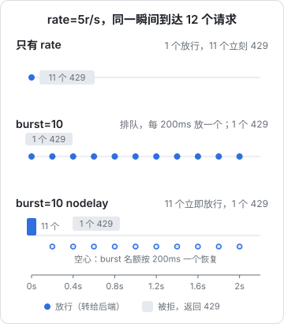

# 限流与防刷

只要服务暴露在公网，就会有人来试：扫描器批量尝试 `/wp-login.php`，脚本反复调发短信接口消耗你的余额，有人对登录接口跑字典。业务代码里当然可以做限流，但在 nginx 这一层先挡一道有几个好处：被挡掉的请求不消耗后端进程和数据库连接，规则集中在一处，而且对任何后端语言都一样。

这一章讲 nginx 的两种限制：**请求速率**（`limit_req`）和**并发连接数**（`limit_conn`），以及怎么配出合理的 burst。

## limit_req 的模型：漏桶

`limit_req` 用的是**漏桶**算法：每个 key（通常是客户端 IP）有一个桶，请求进桶，桶以固定速率漏出（放行），桶满了就拒绝。

```nginx
http {
    # 定义一块共享内存区：按 IP 计数，名字 api，10MB，每秒 5 个
    limit_req_zone $binary_remote_addr zone=api:10m rate=5r/s;
}

server {
    location /v1/ {
        limit_req zone=api burst=10 nodelay;
        limit_req_status 429;
        proxy_pass http://api_backend;
        include /etc/nginx/snippets/proxy-common.conf;
    }
}
```

| 参数 | 含义 |
|---|---|
| `$binary_remote_addr` | 限流的 key。用二进制形式的 IP，比 `$remote_addr` 省内存 |
| `zone=api:10m` | 共享内存区，所有 worker 共用计数。官方文档的说法是 1MB 大约能存 16000 个 IP 的状态 |
| `rate=5r/s` | 漏出速率。也可以写 `r/m`，如 `10r/m` |
| `burst=10` | 桶的容量：超出速率的请求最多排队 10 个 |
| `nodelay` | 桶里的请求立即放行，不按速率排队等待 |
| `limit_req_status 429` | 被拒时的状态码，默认是 503 |

**`limit_req_status` 一定要改成 429**。默认的 503 会和「后端挂了」「正在维护」混在一起，客户端和监控都分不清。

### rate 不是「每秒最多 N 个」

`rate=5r/s` 的实际含义是「**每 200 毫秒放行一个**」，nginx 内部按毫秒粒度计算。如果不配 burst，同一毫秒到达的两个请求，第二个就会被拒，哪怕这一秒总共只有两个请求。浏览器打开一个页面同时发出五六个接口请求是常态，不配 burst 的 limit_req 几乎一定会误伤正常用户。

## burst 和 nodelay 的三种组合

假设 `rate=5r/s`，一个客户端在同一瞬间发来 12 个请求：



| 配置 | 行为 | 适合 |
|---|---|---|
| 只有 rate | 放行第 1 个，其余 11 个立刻 429 | 几乎不适合任何面向浏览器的接口 |
| `burst=10` | 放行第 1 个，接下来 10 个排队，每 200ms 放一个；第 12 个 429 | 后端能承受的平滑流量，但用户会感到延迟（最后一个等了 2 秒） |
| `burst=10 nodelay` | 前 11 个立即放行，第 12 个 429；桶里的 10 个名额按每 200ms 一个的速度恢复 | **大多数 API 的推荐配置**：允许突发，但限制持续速率 |

`nodelay` 不是「不限流」：突发用掉的名额要按速率慢慢还回来。如果这个客户端在接下来一秒内又发 12 个，只有 5 个左右能通过。

nginx 1.15.7 起还有一个折中：`delay=N`，前 N 个超额请求立即放行，再往后的排队。例如 `burst=20 delay=8`。

## 按场景配置

不同接口的风险和正常用量差别很大，不要一个 zone 管所有：

```nginx
http {
    # 一般接口：宽松，防止脚本刷爆
    limit_req_zone $binary_remote_addr zone=api:10m   rate=10r/s;
    # 登录：防字典攻击
    limit_req_zone $binary_remote_addr zone=login:10m rate=5r/m;
    # 发验证码：每条都要花钱
    limit_req_zone $binary_remote_addr zone=sms:10m   rate=1r/m;
}

server {
    limit_req_status 429;

    location = /v1/auth/login {
        limit_req zone=login burst=5 nodelay;
        proxy_pass http://api_backend;
        include /etc/nginx/snippets/proxy-common.conf;
    }

    location = /v1/auth/sms-code {
        limit_req zone=sms burst=2 nodelay;
        proxy_pass http://api_backend;
        include /etc/nginx/snippets/proxy-common.conf;
    }

    location /v1/ {
        limit_req zone=api burst=30 nodelay;
        proxy_pass http://api_backend;
        include /etc/nginx/snippets/proxy-common.conf;
    }
}
```

nginx 层按 IP 限流只是第一道粗筛。验证码接口这类东西，后端仍然必须按**手机号**、按**账号**再限一次：攻击者换 IP 很便宜，而且同一个手机号一天收几十条短信本身就是骚扰。hatch-counter 就是后端按手机号和 IP 双维度限流，nginx 负责把真实 IP 通过 `X-Forwarded-For` 传过去（第 2 章）。

## 案例：只给「锁着的」请求限流

hatch-counter 的文档站整站锁在一个 6 位数字密码后面。密码页把哈希写进 cookie，nginx 比对 cookie 决定是否放行。6 位数字只有一百万种组合，必须防暴力尝试；但已经输对密码的伙伴正常翻页，一个请求都不应该被计数。

技巧在于：**`limit_req_zone` 的 key 为空字符串时，这个请求不计数**。用 `map` 根据「是否已放行」算出 key：

```nginx
# 已放行的请求 key 为空，不计数；锁着的请求按 IP 计数
map $docs_pass $docs_lock_key {
    0       $binary_remote_addr;
    default "";
}
limit_req_zone $docs_lock_key zone=docs_pin:1m rate=10r/m;

server {
    server_name docs.example.com;
    # ...

    limit_req zone=docs_pin burst=10 nodelay;
    limit_req_status 429;

    # 401 和 429 都回中文锁页，而不是 nginx 自带的英文错误页
    error_page 401 429 /__lock.html;
    location = /__lock.html {
        internal;
        add_header Cache-Control "no-store" always;
    }

    location / {
        if ($docs_pass = 0) { return 401; }
        try_files $uri $uri.html $uri/ =404;
    }
}
```

算一下效果：一个 IP 每分钟 10 次，一百万种组合全部试完需要十万分钟，也就是两个多月。而正常用户完全感觉不到限流的存在。

上面用到的 `$docs_pass` 是这样算出来的：cookie 对得上，或者请求来自本机（发版代理从本机验首页，它手里没有也不该有密码），有一样就放行。nginx 没有「或」运算，于是把两个开关拼成一个字符串再匹配：

```nginx
# 期望的哈希只放在机器上的这个文件里，不进仓库
map $cookie_docs_pin $docs_pin_ok {
    default 0;
    "~^<64 位十六进制哈希>$" 1;
}

geo $docs_local {
    default   0;
    127.0.0.1 1;
    ::1       1;
}

# 两个都是 0 才锁
map "$docs_local$docs_pin_ok" $docs_pass {
    default 1;
    "00"    0;
}
```

哈希写成正则 `~^...$` 而不是普通字符串键，是因为 64 字符的长键会撑爆 map 默认的哈希桶，`nginx -t` 报 `could not build map_hash`（也可以调大 `map_hash_bucket_size`）。这里只需要记住「**空 key 不计数**」这个技巧。

`map` 和 `geo` 必须写在 `http` 上下文（`conf.d/*.conf` 本身就被 include 在 `http` 块里，所以直接写在文件顶层即可），它们是惰性求值的：只有被用到时才计算，不用担心性能。

## limit_conn：限制并发连接

`limit_req` 管速率，`limit_conn` 管同时有多少个连接：

```nginx
http {
    limit_conn_zone $binary_remote_addr zone=perip:10m;
}

server {
    location /download/ {
        limit_conn perip 2;          # 每个 IP 同时最多 2 个下载
        limit_rate_after 10m;        # 前 10MB 不限速
        limit_rate 1m;               # 之后每个连接限速 1MB/s
    }
}
```

适合下载、长连接这类「单个请求持续很久」的场景。对长连接（下一章的 SSE、WebSocket）可以用 `limit_conn` 防止一个客户端开几百条连接耗尽 worker 的连接数。

## 先观察，再拒绝：dry run

上线新的限流规则最怕误伤。nginx 1.17.1 起支持 dry run 模式，只记录不拒绝：

```nginx
location /v1/ {
    limit_req zone=api burst=30 nodelay;
    limit_req_dry_run on;
    proxy_pass http://api_backend;
    include /etc/nginx/snippets/proxy-common.conf;
}
```

开启后，本该被拒的请求照常放行，error log 里会记一条 `limiting requests, dry run`，变量 `$limit_req_status` 的值是 `REJECTED_DRY_RUN`。可以把它加进 access log 的格式（第 7 章），跑几天看看哪些 IP、哪些路径会被误伤，再决定 rate 和 burst。

## 白名单

自己的监控探针、本机的健康检查不应该被限流。利用「空 key 不计数」，配合 `geo`：

```nginx
geo $limit_exempt {
    default        0;
    127.0.0.1      1;
    ::1            1;
    10.0.0.0/8     1;     # 内网
}

map $limit_exempt $limit_key {
    0       $binary_remote_addr;
    1       "";
}

limit_req_zone $limit_key zone=api:10m rate=10r/s;
```

## nginx 限流挡不住什么

| 攻击 | nginx 能做的 | 还需要 |
|---|---|---|
| 单 IP 刷接口 | `limit_req` 有效 | 后端按账号再限 |
| 分布式（大量 IP 各发少量） | 基本无效 | 业务层校验、验证码、风控 |
| 大流量 DDoS | 无效，带宽在到达 nginx 前就满了 | CDN / 云厂商的高防 |
| 慢速攻击（slowloris） | 调小 `client_header_timeout`、`client_body_timeout`，配 `limit_conn` | 必要时前置 CDN |

nginx 限流是成本最低的一道防线，但它只是第一道。

## 本章要点

- `limit_req` 是漏桶：`rate` 是漏出速率，按毫秒粒度计算，`burst` 是桶容量
- 不配 burst 几乎一定误伤浏览器的并发请求；大多数 API 用 `burst=N nodelay`
- `limit_req_status 429`，不要用默认的 503
- 不同风险的接口用不同 zone；nginx 按 IP 粗筛，后端按账号、手机号细限
- **key 为空字符串时不计数**：配合 `map` / `geo` 实现「只限锁着的请求」和白名单
- `limit_conn` 限并发连接，适合下载和长连接
- 新规则先用 `limit_req_dry_run on` 观察，再真正拒绝

## 动手练习

环境同[第 1 章的练习](01-config-model.md#动手练习)。注意 `return` 指令在限流检查之前就执行了，所以被限流的 location 要真的转发出去，这里转给同一个 nginx 的 9000 端口：

```nginx
limit_req_zone $binary_remote_addr zone=t1:1m rate=5r/s;
limit_req_zone $binary_remote_addr zone=t2:1m rate=5r/s;
map $http_x_vip $vip_key { yes ""; default $binary_remote_addr; }
limit_req_zone $vip_key zone=t3:1m rate=5r/s;

server { listen 9000; location / { return 200 "ok\n"; } }
server {
    listen 80;
    limit_req_status 429;
    location /a/ { limit_req zone=t1;                   proxy_pass http://127.0.0.1:9000; }
    location /b/ { limit_req zone=t2 burst=10 nodelay; proxy_pass http://127.0.0.1:9000; }
    location /c/ { limit_req zone=t3;                   proxy_pass http://127.0.0.1:9000; }
}
```

1. **burst 的差别**：同一瞬间发 12 个请求：`seq 12 | xargs -P12 -I{} curl -s -o /dev/null -w '%{http_code}\n' localhost:8080/a/ | sort | uniq -c`，再对 `/b/` 做一次。

   验证：`/a/` 大约 1 个 `200`、其余 `429`；`/b/` 大约 11 个 `200`、1 个 `429`。

   参考答案：`rate=5r/s` 是每 200 毫秒放一个，没有 burst 时同一瞬间的第二个就被拒；`burst=10 nodelay` 允许 10 个超额请求立即通过，之后按速率恢复名额。

2. **空 key 不计数**：对 `/c/` 发同样的 12 个并发请求，然后加上 `-H 'X-VIP: yes'` 再发一次。

   验证：不带头时和 `/a/` 一样大多是 `429`；带上 `X-VIP: yes` 后 12 个全是 `200`。

   参考答案：`map` 把带这个头的请求的 key 算成空字符串，`limit_req` 对空 key 不计数。真实配置里换成按 cookie 或 `geo` 来源网段判断，不能用客户端随手能伪造的头。

3. **先 dry run**：在 `/a/` 里加一行 `limit_req_dry_run on;`，reload 后重发 12 个并发请求，再看 `docker logs ng 2>&1 | tail`。

   验证：12 个全是 `200`；日志里出现 `limiting requests, dry run` 的记录。

   参考答案：dry run 只记录不拒绝，可以先在线上观察会误伤谁，再决定 rate 和 burst。
