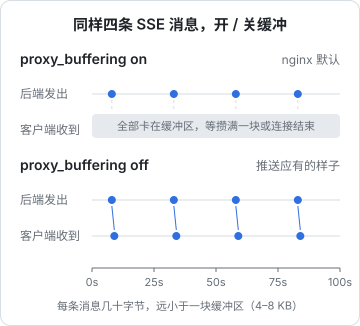
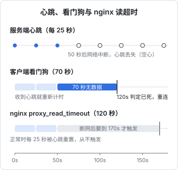

# WebSocket / SSE 代理

普通的 HTTP 请求是「问一句、答一句、结束」。推送类的功能不一样：连接要挂几分钟甚至几小时，服务端隔一段时间才吐出一点数据。nginx 的默认配置是为短请求优化的，直接拿来代理长连接，会出现三种典型故障：WebSocket 握手失败、SSE 消息攒了几 K 才一起到、连接每 60 秒被掐断一次。

这一章先讲 WebSocket 和 SSE 各自需要 nginx 做什么，然后完整拆解 hatch-counter 的 `/v1/events` 推送配置。

## 两种长连接的区别

| | WebSocket | SSE（Server-Sent Events） |
|---|---|---|
| 方向 | 双向 | 只有服务端到客户端 |
| 协议 | HTTP/1.1 握手后**升级**成独立的帧协议 | 就是一个普通的 HTTP 响应，只是一直不结束 |
| 浏览器 API | `WebSocket` | `EventSource`（不能带自定义头），或 `fetch` 读流 |
| 断线重连 | 自己写 | `EventSource` 自带；自己读流就要自己写 |
| 过 nginx 要做的事 | 转发 `Upgrade` 头 | 关缓冲 |
| 鉴权、限流、维护开关 | 只在握手时过一次 | 和其他 HTTP 请求完全一样 |

选择的经验很简单：**只需要服务端推，就用 SSE**。hatch-counter 的推送只告诉客户端「哪块数据换了版本」，客户端再自己去取，完全不需要客户端往上发，所以选了 SSE。它最大的好处是「就是一个普通的 HTTP 响应」，鉴权、版本守卫、维护开关都不用另写一套。

## WebSocket：转发 Upgrade

WebSocket 握手是一个带特殊头的 GET 请求：

```text
GET /ws HTTP/1.1
Host: app.example.com
Upgrade: websocket
Connection: Upgrade
Sec-WebSocket-Key: dGhlIHNhbXBsZSBub25jZQ==
Sec-WebSocket-Version: 13
```

`Upgrade` 和 `Connection` 是**逐跳头**（hop-by-hop），按 HTTP 规范代理不会自动往下传。所以 nginx 必须显式转发：

```nginx
# http 上下文：有 Upgrade 头时 Connection 设为 upgrade，否则清空（便于复用 keepalive）
map $http_upgrade $connection_upgrade {
    default upgrade;
    ""      "";
}

server {
    location /ws {
        proxy_pass http://api_backend;
        proxy_http_version 1.1;
        proxy_set_header Upgrade    $http_upgrade;
        proxy_set_header Connection $connection_upgrade;
        proxy_set_header Host            $host;
        proxy_set_header X-Forwarded-For $proxy_add_x_forwarded_for;
        proxy_read_timeout 3600s;
    }
}
```

注意这里的 `Connection` 头和第 2 章 keepalive 用的 `Connection ""` 冲突：WebSocket 的 location 如果再 include 通用代理 snippet，同一个头就被设置了两次，这种写法的结果不直观，别依赖它。两种干净的做法：

- WebSocket 的 location 单独写全所有头（上面的写法）
- 把通用 snippet 里的 `proxy_set_header Connection "";` 换成 `proxy_set_header Connection $connection_upgrade;`，再加一行 `proxy_set_header Upgrade $http_upgrade;`。普通请求没有 `Upgrade` 头，map 给出空字符串，效果和原来一样；WebSocket 请求自然得到 `upgrade`。这样所有 location 都能 include 同一份 snippet

升级成功后，nginx 只是在两端之间搬运字节，不再解析内容。此时 `proxy_buffering` 对它不起作用，需要关心的只剩超时。

## SSE：一个永远不结束的响应

SSE 的响应长这样：

```text
HTTP/1.1 200 OK
Content-Type: text/event-stream; charset=utf-8
Cache-Control: no-cache, no-transform

event: snapshot
data: {"epoch":3,"versions":{"items":12,"stock":40}}

: heartbeat

event: changed
data: {"blocks":["stock"]}

```

每条消息以空行结束；以冒号开头的行是注释，客户端会忽略，常被用作心跳。服务端不关闭连接，有事件就往里写一段。

问题在于 nginx 默认会**缓冲**上游响应：先从后端读满一块缓冲区（`proxy_buffer_size` 和 `proxy_buffers`，通常是 4K 或 8K 的若干块），再往客户端发。对普通接口这能让后端尽快释放连接；对 SSE 来说，一条几十字节的 `changed` 消息会一直卡在缓冲区里，直到攒够一块才发出去。



关掉缓冲有两种方式，hatch-counter **两处都写**：

```nginx
# 1. nginx 配置里关
location = /v1/events {
    proxy_buffering off;
    # ...
}
```

```typescript
// 2. 后端响应头里告诉 nginx 别缓冲（nginx 认这个头）
res.setHeader('Content-Type', 'text/event-stream; charset=utf-8');
res.setHeader('Cache-Control', 'no-cache, no-transform');
res.setHeader('X-Accel-Buffering', 'no');
res.flushHeaders();
```

两边各写一遍是有意的冗余：后端的头让「换了一台没专门配置的 nginx」也能工作，nginx 的配置让「后端哪天忘了带这个头」也能工作。这两处在代码注释里互相指向，改一边会看到另一边。

`Cache-Control: no-transform` 告诉中间环节（CDN、代理）不要改写响应，比如不要给它加 gzip。另外确认 `gzip_types` 里**没有** `text/event-stream`：gzip 压缩需要攒够一块数据才能输出，效果和开缓冲一样。

## 超时：心跳必须比读超时短

第 2 章讲过，`proxy_read_timeout` 是「两次从后端读到数据之间的最长间隔」，默认 60 秒。SSE 连接在没有事件时可能几分钟一个字节都没有，到 60 秒 nginx 就会断开它。

解法不是把超时调到无限大，而是**让服务端定时发心跳**，并保证：

$$
\text{心跳间隔} < \text{proxy\_read\_timeout}
$$

而且中间的每一层（nginx、云厂商的负载均衡、家里路由器的 NAT 表）都有自己的空闲超时，心跳要比其中**最短的那个**还短。



hatch-counter 的三个数字：

| 位置 | 值 | 理由 |
|---|---|---|
| 服务端心跳 | 25 秒 | 低于常见中间设备的空闲超时 |
| nginx `proxy_read_timeout` | 120 秒 | 默认 60 秒其实够，放宽一倍留余量；真断了也只是客户端重连 |
| 客户端看门狗 | 70 秒 | 70 秒一个字节都没收到就判定连接已死，主动重连（够容忍两次心跳丢失） |

客户端看门狗这一条经常被忽略。TCP 连接可能「半死」：中间某个设备丢了状态，两端都不知道，客户端会一直傻等。只有客户端自己计时才能发现。

## 拆解 hatch-counter 的 /v1/events

完整配置（域名已替换）：

```nginx
upstream counter_api {
    server 127.0.0.1:3000;
    keepalive 16;
}

server {
    listen 443 ssl http2;
    listen [::]:443 ssl http2;
    server_name app.example.com;

    ssl_certificate     /etc/letsencrypt/live/app.example.com/fullchain.pem;
    ssl_certificate_key /etc/letsencrypt/live/app.example.com/privkey.pem;

    location = /v1/events {
        include /etc/nginx/snippets/counter-maintenance.conf;
        proxy_buffering off;
        proxy_cache off;
        proxy_read_timeout 120s;
        proxy_pass http://counter_api;
        include /etc/nginx/snippets/counter-proxy.conf;
    }

    location /v1/ {
        include /etc/nginx/snippets/counter-maintenance.conf;
        proxy_pass http://counter_api;
        include /etc/nginx/snippets/counter-proxy.conf;
    }
}
```

逐行看：

- **`location = /v1/events`**：精确匹配，只影响这一条路径。其他 `/v1/` 接口仍然开缓冲、仍然 60 秒超时，「长连接的特殊配置」不会污染普通接口
- **维护开关照样挂**：维护期间推送连接拿到 503 加 `Retry-After`，客户端识别后退回「每次请求都去取」的模式，维护结束自动连回来。SSE 就是普通 HTTP 响应，这件事不需要任何特殊处理
- **`proxy_buffering off`**：随到随发
- **`proxy_cache off`**：这个 server 没有开 proxy_cache，这一行是防御性的，防止将来有人在 server 层开了缓存把推送也缓存住
- **`proxy_read_timeout 120s`**：大于 25 秒心跳
- **通用代理 snippet**：`proxy_http_version 1.1` 加 `Connection ""`，长连接也走 upstream 的 keepalive；`X-Forwarded-For` 让后端按真实 IP 记录连接

这里没有出现 `Upgrade` 相关的头，因为 SSE 不需要升级协议。

### 与 HTTP/2 的配合

浏览器对 HTTP/1.1 的同一个域名最多同时开 6 条连接。用户开了 7 个标签页，每个标签页一条 SSE，第 7 个页面的所有请求都会卡住。HTTP/2 在一条 TCP 连接上多路复用，这个限制基本消失。这也是 `listen 443 ssl http2` 对推送功能的实际意义。

### 断了怎么办

hatch-counter 的协议设计让「断开」变成一件不需要特殊处理的事：服务端推的是**版本号**而不是事件，连上时先发一份完整快照。断线、服务端重启、合盖睡一晚，统一走「重连 → 拿新快照 → 和本地比 → 不一样的块作废」。所以 nginx 层的超时、reload、维护开关导致的断开都无害。

客户端重连要做退避加抖动（1、2、4、8、15、30 秒，带随机偏移），否则服务端一重启，所有客户端会在同一秒涌回来。

## reload 时长连接会怎样

`nginx -s reload` 时，旧 worker 不再接受新连接，但会等手上的请求处理完才退出。对长连接来说，「处理完」可能永远不来，于是旧 worker 进程会一直挂着。

```nginx
# 主上下文（nginx.conf 顶层）：reload 后旧 worker 最多再等 30 秒，到点强制关闭
worker_shutdown_timeout 30s;
```

配了它，reload 后 30 秒内所有长连接会被断开，客户端按重连逻辑接到新 worker 上。对于设计成「断了就重连」的协议，这正是想要的行为。

## 检查清单

| 症状 | 检查 |
|---|---|
| WebSocket 握手返回 400 或直接变成普通 HTTP | `Upgrade` / `Connection` 头没转发；`proxy_http_version` 不是 1.1 |
| SSE 消息延迟、成批到达 | `proxy_buffering` 没关；后端没 flush；gzip 压了 `text/event-stream`；前面还有一层 CDN 在缓冲 |
| 连接每 60 秒左右断一次 | 心跳间隔大于 `proxy_read_timeout`，或者根本没有心跳 |
| 本地正常，上线后不推 | 直连后端时没有缓冲问题，过 nginx 才暴露；用 `curl -N` 分别测两端 |
| reload 后 nginx 进程越来越多 | 旧 worker 被长连接拖住，配 `worker_shutdown_timeout` |

用 curl 测 SSE 时一定加 `-N`（关闭 curl 自己的输出缓冲）：

```bash
curl -N -H "Authorization: Bearer $TOKEN" https://app.example.com/v1/events
```

## 本章要点

- 只需要服务端推就用 SSE：它是普通 HTTP 响应，鉴权、限流、维护开关都不用另写
- WebSocket 要显式转发 `Upgrade` 和 `Connection`，用 `map $http_upgrade` 生成 Connection 的值
- SSE 要关缓冲：nginx 里 `proxy_buffering off`，后端响应带 `X-Accel-Buffering: no`，两处都写
- 不要 gzip `text/event-stream`，响应带 `Cache-Control: no-transform`
- 心跳间隔必须小于路径上最短的空闲超时；客户端也要有自己的看门狗
- 长连接用 `location =` 单独配置，不要污染普通接口
- 协议设计成「断了就重连 + 快照对账」，reload、维护、超时都变得无害；配 `worker_shutdown_timeout` 让 reload 干净收尾
