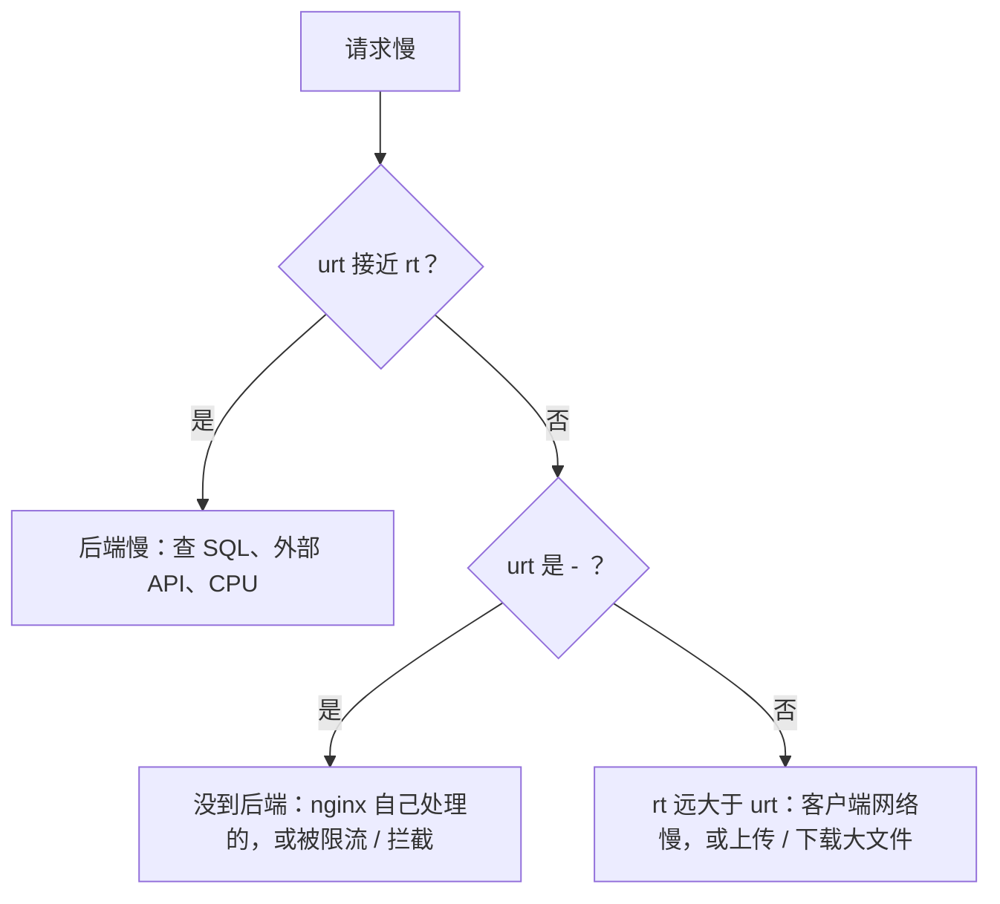

# 日志与排障

前面几章的案例有一个共同点：问题发生时，客户端看到的错误和真实原因几乎毫无关系。「服务端出了点问题」背后可能是 nginx 的 504、413，也可能是后端真的崩了。nginx 恰好站在客户端和后端之间，它的日志是区分「谁的错」最快的依据。

这一章讲两种日志各记什么、怎么改造 access log 让它能回答「慢在哪」，以及常见状态码的排查路径。

## 两种日志

| | access log | error log |
|---|---|---|
| 记什么 | 每个请求一行：谁、什么时候、请求什么、结果如何 | nginx 自己遇到的问题：连不上后端、超时、配置警告、限流 |
| 默认位置（Debian 系） | `/var/log/nginx/access.log` | `/var/log/nginx/error.log` |
| 典型用途 | 统计、找慢请求、看状态码分布 | 定位 502 / 504 的具体原因 |

**排查 5xx 时先看 error log**。access log 只告诉你「返回了 502」，error log 会告诉你为什么：

```text
2026/11/02 10:15:03 [error] 1234#1234: *5678 connect() failed (111: Connection refused)
  while connecting to upstream, client: 198.51.100.7, server: api.example.com,
  request: "GET /v1/items HTTP/2.0", upstream: "http://127.0.0.1:3000/v1/items"
```

`Connection refused` 说明后端端口上没有进程在监听：容器没起来，或者正在重启。

## 让 access log 回答「慢在哪」

默认的 `combined` 格式没有任何耗时信息。加上几个变量：

```nginx
http {
    log_format timed '$remote_addr - [$time_local] "$request" $status $body_bytes_sent '
                     'rt=$request_time uct=$upstream_connect_time '
                     'urt=$upstream_response_time us=$upstream_status '
                     'host=$host ua="$http_user_agent"';

    access_log /var/log/nginx/access.log timed;
}
```

| 变量 | 含义 |
|---|---|
| `$request_time` | 从读到客户端第一个字节到发完最后一个字节，总耗时（秒，精确到毫秒） |
| `$upstream_connect_time` | 和后端建立连接用了多久 |
| `$upstream_response_time` | 从开始连后端到读完后端响应的时间 |
| `$upstream_status` | 后端返回的状态码。nginx 自己生成的响应（413、429、444）这里是 `-` |

对照着看就能判断责任：



SSE、WebSocket 这类长连接的 `$request_time` 会是几分钟甚至几小时，统计慢请求时要按路径排除。

### JSON 格式

如果日志要被 Loki、Vector 这类工具采集，直接输出 JSON 省去解析：

```nginx
log_format json escape=json '{'
    '"time":"$time_iso8601",'
    '"ip":"$remote_addr",'
    '"host":"$host",'
    '"method":"$request_method",'
    '"uri":"$request_uri",'
    '"status":$status,'
    '"bytes":$body_bytes_sent,'
    '"rt":$request_time,'
    '"urt":"$upstream_response_time",'
    '"ua":"$http_user_agent"'
'}';
```

`escape=json` 让 nginx 正确转义引号和控制字符。`$upstream_response_time` 加了引号，因为它可能是 `-`，或者在重试过多个后端时是逗号分隔的多个值，不能当数字。

### 日志里不该出现的东西

`$request_uri` 包含查询串。如果有接口把令牌、手机号放在 URL 参数里，它们会原样进日志。规矩是**敏感数据不进 URL**；做不到的话，至少别在 log_format 里记完整的 `$request_uri`，改用不含参数的 `$uri`。同理，不要为了排障把 `$http_authorization` 写进日志格式。

### 关掉噪音

```nginx
location = /v1/health {
    access_log off;      # 探活每几秒一次，记下来只是噪音
    proxy_pass http://api_backend;
    include /etc/nginx/snippets/proxy-common.conf;
}

location = /favicon.ico {
    access_log off;
    log_not_found off;
}
```

日志轮转：Debian 系的 nginx 包自带 `/etc/logrotate.d/nginx`，默认按天轮转并保留一段时间，一般不用改。容器里的 nginx 通常输出到 stdout，由 Docker 的日志驱动管，记得像 hatch-counter 的 compose 那样配 `max-size` 和 `max-file`，否则磁盘迟早被吃满。

## 状态码排查表

| 状态码 | 谁生成的 | 常见原因 | 先看哪里 |
|---|---|---|---|
| 400 | nginx 或后端 | 请求头过大、HTTP 走了 HTTPS 端口 | error log；`large_client_header_buffers` |
| 413 | nginx | 请求体超过 `client_max_body_size` | 和后端的上限对齐（第 2 章） |
| 429 | nginx（配了 `limit_req_status`） | 被限流 | error log 里的 `limiting requests`（第 5 章） |
| 499 | nginx 记录，不是真的发出去的 | **客户端**在 nginx 返回前主动断开 | 通常是后端太慢、用户关页面或客户端超时 |
| 502 | nginx | 连不上后端，或后端返回了不合法的响应 | error log：`Connection refused`、`upstream prematurely closed` |
| 503 | nginx 或后端 | 维护开关、默认的限流状态码、后端主动返回 | 看响应体和 `$upstream_status` |
| 504 | nginx | 等后端响应超过 `proxy_read_timeout` | error log：`upstream timed out`；单独放宽慢接口 |

### 502 的几种面孔

| error log 关键词 | 含义 |
|---|---|
| `connect() failed (111: Connection refused)` | 后端没在监听：没起、在重启、端口写错 |
| `no live upstreams` | upstream 里所有实例都被标记为不可用（第 2 章的 `max_fails`） |
| `upstream prematurely closed connection` | 后端处理到一半崩了或主动断开 |
| `upstream sent too big header` | 后端响应头太大（比如一堆 Set-Cookie），调大 `proxy_buffer_size` |
| `connect() to ... failed (13: Permission denied)` | CentOS / RHEL 上 SELinux 不允许 nginx 发起网络连接 |

### 499：不要急着怪 nginx

499 是 nginx 自定义的状态码，意思是「客户端先挂了」。大量 499 的根因几乎都在后端太慢：客户端设了 30 秒超时，后端 40 秒才回，nginx 记一个 499。看同一行的 `urt`，就知道后端到底花了多久。

## 排查工具箱

```bash
# 配置相关
sudo nginx -t                         # 语法检查
sudo nginx -T | grep -n "server_name" # 看合并后的配置里有哪些 server 块
nginx -V 2>&1 | tr ' ' '\n' | grep module   # 看编译了哪些模块

# 实时看日志
sudo tail -f /var/log/nginx/error.log
sudo tail -f /var/log/nginx/access.log | grep ' 50[234] '

# 绕过 nginx 直接打后端，判断问题在哪一层
curl -i http://127.0.0.1:3000/v1/health

# 经过 nginx，带上 Host 头，在机器本地测某个 server 块（不依赖 DNS）
curl -ik --resolve api.example.com:443:127.0.0.1 https://api.example.com/v1/health

# 看响应头：缓存策略、压缩、是否 HIT
curl -sI -H 'Accept-Encoding: gzip' https://app.example.com/assets/index-a1b2c3d4.js

# 端口被谁占了
sudo ss -ltnp | grep -E ':80|:443|:3000'
```

最有用的思路是**分段验证**：直连后端正常、经过 nginx 不正常，问题在 nginx 配置；直连后端也不正常，问题在后端。`curl --resolve` 让你在 DNS 还没切过来时就能测试新配置。

### 用 awk 快速统计

```bash
# 状态码分布（默认 combined 格式，状态码在第 9 列）
awk '{print $9}' /var/log/nginx/access.log | sort | uniq -c | sort -rn

# 请求最多的 IP 前 10（看有没有人在刷）
awk '{print $1}' /var/log/nginx/access.log | sort | uniq -c | sort -rn | head

# 用上面 timed 格式时，找出耗时超过 2 秒的请求
awk '{ for (i = 1; i <= NF; i++) if ($i ~ /^rt=/) { split($i, a, "="); if (a[2] + 0 > 2) print } }' \
  /var/log/nginx/access.log | head
```

这些命令适合临时排查。长期需要的话，把日志送进可观测性系统做聚合和告警，见[《可观测性与性能》](../observability-performance/)。

### 调高 error log 级别

```nginx
error_log /var/log/nginx/error.log info;   # 默认 error，临时调到 info 能看到更多细节
```

`debug` 级别需要 nginx 编译时带 `--with-debug`，日志量巨大，只在本地复现问题时用，排查完立刻改回来。

## 一次完整的排障

用户反馈「上传进货单偶尔失败」。

1. 让用户说出大致时间，查 access log 里那个时间段对 `/v1/ocr/` 的请求：发现几条 `413`，`us=-`
2. `us=-` 说明请求根本没到后端，是 nginx 自己拒的；413 指向 `client_max_body_size`
3. `nginx -T | grep client_max_body_size`：发现只在 `api.` 那个 server 块设了 12m，用户走的是网页端 `app.` 域名，那里还是默认的 1m
4. 在 `app.` 的 server 块补上，`nginx -t && systemctl reload nginx`
5. 用一张 5MB 的图片 `curl -F` 验证，返回 200

这个例子的教训：同一个后端挂在多个域名下时，**每个 server 块的限制都要检查**。hatch-counter 的配置里对此有一句注释：「下面几条 /v1 的特例跟 api 那个块一一对着，改一边看一眼另一边」。

## 本章要点

- 5xx 先看 error log，它写着具体原因；access log 只有结果
- 自定义 log_format 加上 `$request_time`、`$upstream_response_time`、`$upstream_status`，就能区分慢在后端、慢在网络，还是根本没到后端
- 采集用 JSON 格式加 `escape=json`；敏感数据不进 URL，也不进日志
- 499 是客户端先断开，根因通常是后端慢
- 502 看 error log 关键词：refused、no live upstreams、prematurely closed
- 分段验证：直连后端 vs 经过 nginx；`curl --resolve` 不依赖 DNS 测试 server 块
- 同一个后端挂在多个域名下时，每个 server 块的限制都要一致
