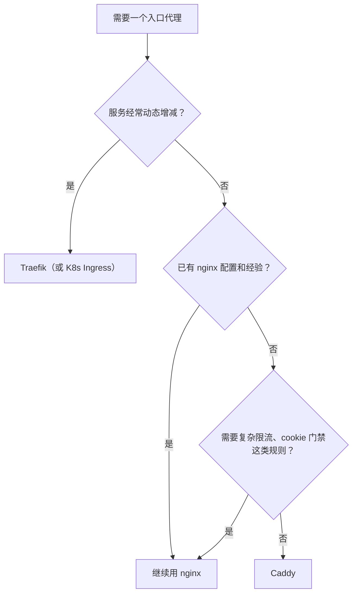

# Caddy 等替代品

前七章把 nginx 当作默认选择来讲，因为它最普及、资料最多、几乎所有云厂商和教程都以它为例。但 nginx 不是唯一的答案。对一个人维护的项目，有时候换一个工具能省掉整章的配置。这一章比较几个常见的替代品，讲清各自适合什么场景，最后给出一个选择思路。

## 先看清 nginx 的成本

用了前七章的内容，你会发现 nginx 的「麻烦」集中在几个地方：

| 麻烦 | 出现在 |
|---|---|
| 证书要另外装 certbot、配 webroot、挂 reload 钩子 | 第 3 章 |
| 继承规则反直觉：`add_header`、`proxy_set_header` 写一条就丢光上层的 | 第 1、4 章 |
| 很多默认值为短请求优化：1MB 请求体、60 秒超时、开缓冲 | 第 2、6 章 |
| 没有「或」，复杂条件要靠 `map` 拼字符串；`if` 的行为有很多坑 | 第 5 章 |
| 动态配置要 reload，开源版没有 API 改上游 | 第 2 章 |

这些成本换来的是：极其成熟、性能可预测、文档和问答覆盖几乎所有场景，以及 AI 编码 agent 对它的配置非常熟悉。

## Caddy：自动 HTTPS 的反向代理

Caddy 是用 Go 写的 Web 服务器，最大的卖点是**默认开启 HTTPS**：只要写出域名，它就自动通过 ACME 签证书、自动续期、自动把 HTTP 跳到 HTTPS，不需要 certbot，不需要钩子。

把第 2 到 6 章的核心配置翻译成 Caddyfile（Caddy 2）：

```text
api.example.com {
	request_body {
		max_size 12MB
	}

	handle /v1/ocr/* {
		reverse_proxy 127.0.0.1:3000 {
			transport http {
				read_timeout 180s
			}
		}
	}

	handle {
		reverse_proxy 127.0.0.1:3000
	}
}

app.example.com {
	request_body {
		max_size 12MB
	}

	handle /v1/* {
		reverse_proxy 127.0.0.1:3000
	}

	handle {
		root * /srv/app/sites/web/current
		header /assets/* Cache-Control "public, max-age=31536000, immutable"
		header /index.html Cache-Control "no-cache"
		try_files {path} /index.html
		file_server
	}
}
```

和 nginx 版本对比：

- **没有任何证书配置**，也没有 80 端口的跳转块
- `reverse_proxy` 默认就会设置 `X-Forwarded-For`、`X-Forwarded-Proto`、`X-Forwarded-Host`，并保留原始 `Host`
- **SSE 不需要专门配置**：Caddy 的文档说明，响应的 `Content-Type` 是 `text/event-stream` 时会立即刷新，不做缓冲；WebSocket 也自动处理升级
- `handle` 块之间互斥，按「最具体的匹配」选一个，比 nginx 的 location 规则更直观

> 上面的 Caddyfile 是按 Caddy 2 的语法写的，指令名和子选项在小版本间偶有调整，部署前用 `caddy validate --config Caddyfile` 校验，并以官方文档为准。

### Caddy 的代价

| 方面 | 情况 |
|---|---|
| 限流 | 核心没有内置，需要第三方插件（如 `caddy-ratelimit`），而加插件要用 `xcaddy` 重新编译 |
| 生态 | 资料和问答比 nginx 少得多，遇到冷门问题更依赖读官方文档 |
| 证书存储 | 默认存在 Caddy 自己的数据目录里，迁移机器时要记得一起搬，否则会重新签发（短时间大量重签可能撞上 CA 的频率限制） |
| 国内环境 | 未备案时 80 / 443 被拦截，自动签证书一样失败，只是报错位置变成了 Caddy 的日志 |

**适合**：新项目、站点多、不想管证书、不需要复杂限流的场景。对一个人维护的 VPS，Caddy 往往是更省心的默认选项。

## Traefik：为容器而生

Traefik 的设计前提是「后端服务会动态增减」。它监听 Docker、Kubernetes 等平台的事件，**从容器的 label 里读路由规则**，新起一个容器就自动加上路由，不用改任何中心配置文件：

```yaml
# docker-compose.yml 片段
services:
  api:
    image: myapp/api:1.2.0
    labels:
      - "traefik.enable=true"
      - "traefik.http.routers.api.rule=Host(`api.example.com`)"
      - "traefik.http.routers.api.tls.certresolver=le"
      - "traefik.http.services.api.loadbalancer.server.port=3000"
```

同样内置 ACME 自动证书，还带一个 Web 面板。代价是概念多（entrypoint、router、service、middleware、provider），配置分散在每个容器的 label 里，出问题时不如一份 nginx 配置一目了然。label 的具体写法随 Traefik 大版本变化，以对应版本的文档为准。

**适合**：一台机器上跑很多个容器、经常增减服务，或者已经在用 Kubernetes（Traefik 是 k3s 默认的 Ingress Controller）。只有一两个固定服务时，它的动态能力用不上。

## HAProxy：专业的负载均衡器

HAProxy 专注于四层（TCP）和七层（HTTP）负载均衡，在健康检查、连接管理、统计面板方面比开源 nginx 强：主动健康检查是开源版就有的，后端状态有现成的统计页。它不擅长发静态文件，通常放在 nginx 或应用前面专门做流量分发。

**适合**：多实例、需要精细的健康检查和流量控制。单机个人项目基本用不上。

## nginx 的分支与衍生

| 名称 | 是什么 |
|---|---|
| OpenResty | nginx 加 LuaJIT，可以用 Lua 写请求处理逻辑，很多 API 网关基于它 |
| Angie | 由 nginx 前开发者发起的分支，兼容 nginx 配置，加入了一些开源 nginx 没有的功能 |
| freenginx | 2024 年由 nginx 核心开发者之一发起的分支 |
| Tengine | 阿里巴巴基于 nginx 的分支，国内部分云产品在用 |

它们的配置语法和 nginx 基本兼容，这本书讲的概念全部适用。各自的功能差异和维护状况变化较快，选用前查看项目官网的最新说明。

## 不在机器上跑代理

还有一类方案，把「入口」这件事交给托管服务：

| 方案 | 怎么做 | 什么时候考虑 |
|---|---|---|
| Cloudflare 代理（橙色云） | DNS 托管到 Cloudflare，流量先经过它的边缘节点 | 想要 CDN、DDoS 防护、隐藏源站 IP；源站上仍然需要 nginx 或 Caddy |
| Cloudflare Tunnel | 机器上跑 `cloudflared`，主动连出去建立隧道，**不用开放任何入站端口** | 家里的机器、内网服务、不想暴露公网 IP |
| 云厂商负载均衡 | 证书和监听配在云上，后面挂多台机器 | 已经多机部署 |
| Serverless / 边缘函数 | 根本没有长期运行的服务器 | 无状态 API、静态站，见[《云与边缘》](../cloud-and-edge/) |

用了 Cloudflare 代理之后，nginx 看到的 `$remote_addr` 全是 Cloudflare 的地址，记得按第 2 章用 realip 模块还原真实 IP，否则限流会把所有用户当成同一个人。另外，Cloudflare 对 SSE 这类流式响应的处理、对请求体大小的限制都有自己的规则，以其文档为准。

## 怎么选



hatch-counter 用 nginx，是因为它需要的几样东西恰好都是 nginx 的强项：维护开关的文件判断、按 cookie 和 IP 组合的门禁、只给锁着的请求限流、每个路径单独的超时和缓存头。用 Caddy 也能实现，但要么写更绕的匹配器，要么引入插件。

对于一个新起的、只有一个 API 加一个前端的小项目，Caddy 十几行配置就能上线，省下的是第 3 章整章的工作量。**工具的选择取决于你的配置里有多少「特殊规则」**：规则少，选最省心的；规则多，选表达力最强、资料最全的。

无论选哪个，前七章的概念都通用：TLS 终结、按域名和路径分流、真实 IP 的传递、请求体和超时的对齐、长连接的缓冲和心跳、静态资源的缓存分层、限流的粒度。换工具只是换语法。

## 接下来读什么

这本书解决的是「请求如何进入你的机器」。沿着导读，接下来可以读：

- [《部署与 CI/CD》](../deploy-release/)：发版脚本、零停机切换、回滚，把本书第 2、4 章提到的软链切换和维护开关串成完整的发布流程
- [《一人运维手册》](../production-ops/)：备份、告警、故障处理这些上线之后的日常，本书的维护开关和证书监控是其中一环
- [《可观测性与性能》](../observability-performance/)：把第 7 章的日志接进监控和告警，加上证书到期、错误率、慢请求的指标

如果哪天单机不够了，[《Kubernetes 入门到实战》](../kubernetes/)里的 Ingress 就是集群里的「nginx」。

## 本章要点

- nginx 的主要成本在证书管理、反直觉的继承规则和为短请求优化的默认值
- Caddy 自动 HTTPS、SSE 自动不缓冲、配置更短，适合规则不多的新项目；限流要靠插件
- Traefik 从容器 label 读路由，适合服务动态增减的场景
- HAProxy 专注负载均衡和健康检查，单机项目用不上
- OpenResty、Angie 等分支兼容 nginx 配置，概念全部通用
- Cloudflare 代理或 Tunnel 可以把入口交给托管服务，但要处理真实 IP 和流式响应的差异
- 选择看「特殊规则」的多少：规则少选最省心的，规则多选表达力最强的
