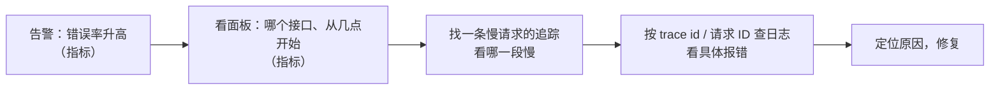
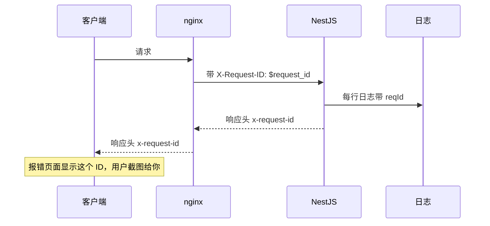
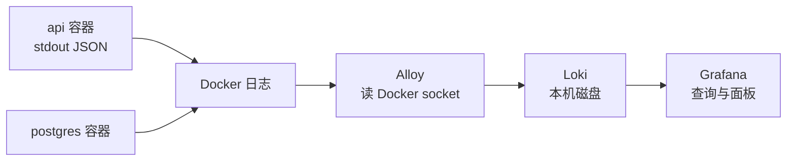

# 日志

服务上线之后，你和它之间就隔了一层：看不到它在干什么，只能等用户来说「好像有点慢」「刚才点了没反应」。可观测性要解决的就是这件事：**不登上机器、不加调试代码，也能回答「系统现在怎么样、刚才发生了什么、为什么」**。

这一章先讲日志在可观测性里的位置，再把应用日志从「能看」升级到「能查、能关联、能汇总」。

## 关于这本书

这本书面向一个具体场景：**一个人、一台 VPS，上面用 Docker Compose 跑着 NestJS + PostgreSQL，前面一台 nginx**。所有方案都按这个尺度挑：能自托管、资源占用小、一个人维护得动。大厂那套多集群、多租户的可观测平台不在讨论范围内。

适合已经把服务部署上线、开始关心「线上到底怎么样」的人。前置知识：

- [《Linux 系统与命令行》](../linux-essentials/)：journald、`journalctl`、logrotate、Docker 日志轮转，本书不再重复
- [《Nginx 与反向代理》](../nginx-gateway/)：access log 加耗时字段、按状态码排查，本书也不再重复
- [《容器技术》](../docker-containers/)：Compose 的基本用法

章节分三段：

| 段落 | 章节 | 回答的问题 |
|---|---|---|
| 看见 | 日志、指标、链路追踪 | 系统里发生了什么 |
| 被提醒 | 告警、错误监控、可用性监控 | 出事时谁来叫醒我 |
| 预判 | 压测、瓶颈定位、容量规划 | 能扛多少、慢在哪、什么时候该加机器 |

建议按顺序读。前三章是工具，后面都会用到它们产生的数据。

## 三种信号

可观测性通常讲三种信号（也叫「三大支柱」）：

| 信号 | 是什么 | 擅长回答 | 成本 |
|---|---|---|---|
| 日志 | 一条条离散事件，带任意上下文 | 「这一次请求为什么失败」 | 量大，存储贵，查询慢 |
| 指标 | 按时间聚合的数字 | 「整体错误率、延迟是多少，趋势如何」 | 很便宜，几乎不随流量增长 |
| 追踪 | 一次请求经过的每一段及其耗时 | 「这次请求的 3 秒花在哪」 | 中等，通常要采样 |

它们不是三选一，而是配合使用：



指标告诉你「有问题」，追踪告诉你「在哪一段」，日志告诉你「具体是什么」。一个人项目起步时，**日志 + 少量指标 + 外部可用性探测**就能覆盖大部分需要；追踪是锦上添花。

## 从文本日志到结构化日志

NestJS 自带的 `Logger` 输出的是给人读的彩色文本：

```text
[Nest] 1  - 11/02/2026, 10:21:07 AM   ERROR [Expenses] 保存开支失败：store=42 ECONNREFUSED
```

对人友好，对机器不友好：想统计「过去一小时 Expenses 模块报了几次错」「耗时超过 1 秒的请求有哪些」，只能靠 `grep` 和正则硬抠。结构化日志是一行一个 JSON 对象：

```json
{"level":50,"time":1793615467000,"reqId":"a1b2c3d4","context":"Expenses","storeId":"42","err":{"type":"Error","message":"connect ECONNREFUSED"},"msg":"保存开支失败"}
```

每个字段都能直接过滤、聚合。Node 生态里最常用的是 **pino**：快（异步写、序列化开销小），默认就输出 JSON。NestJS 里通过 `nestjs-pino` 接入，它同时会用 `pino-http` 给每个 HTTP 请求记一条带耗时的日志。

### 接入 nestjs-pino

```bash
pnpm add nestjs-pino pino-http pino
pnpm add -D pino-pretty   # 只在开发时用，把 JSON 美化成可读文本
```

```ts
// app.module.ts
import { Module } from "@nestjs/common";
import { LoggerModule } from "nestjs-pino";
import { randomUUID } from "node:crypto";

const isProd = process.env.NODE_ENV === "production";

@Module({
  imports: [
    LoggerModule.forRoot({
      pinoHttp: {
        level: isProd ? "info" : "debug",
        // 开发时美化输出；生产保持一行一个 JSON，交给收集器处理
        transport: isProd ? undefined : { target: "pino-pretty" },
        // 优先沿用上游传来的请求 ID（nginx 可以生成），没有就自己生成一个
        genReqId: (req, res) => {
          const existing = req.headers["x-request-id"];
          const id = typeof existing === "string" && existing ? existing : randomUUID();
          res.setHeader("x-request-id", id);
          return id;
        },
        // 敏感字段在序列化时就替换掉，不会出现在任何输出里
        redact: {
          paths: ["req.headers.authorization", "req.headers.cookie", "*.password", "*.token"],
          censor: "[已隐藏]",
        },
        // 探活每 10 秒一次，记下来全是噪音
        autoLogging: { ignore: (req) => req.url === "/v1/health" },
      },
    }),
  ],
})
export class AppModule {}
```

```ts
// main.ts
import { NestFactory } from "@nestjs/core";
import { Logger } from "nestjs-pino";
import { AppModule } from "./app.module";

async function bootstrap() {
  // bufferLogs：启动阶段的日志先缓存，等 pino 接管后再输出，格式统一
  const app = await NestFactory.create(AppModule, { bufferLogs: true });
  app.useLogger(app.get(Logger));
  await app.listen(3000);
}
bootstrap();
```

`app.useLogger` 之后，业务代码里原来的 `new Logger("Expenses")` 不用改，输出自动变成 JSON，`context` 字段就是那个名字。

`nestjs-pino` 和 `pino` 的 API 在大版本之间有过调整，接入前以它们 README 的当前版本为准。

### 请求 ID：把一次请求的日志串起来

并发请求的日志是交错的。没有请求 ID，你看到一行「保存失败」，根本不知道它前面那几行属于哪个请求。

`pino-http` 生成的 `reqId` 会自动出现在这次请求的访问日志里。但业务代码里用 `Logger` 打的日志怎么带上它？`nestjs-pino` 内部用 Node 的 `AsyncLocalStorage` 保存了当前请求的上下文，所以只要注入它提供的 `PinoLogger`，打出来的每一行都自动带 `reqId`：

```ts
import { Injectable } from "@nestjs/common";
import { InjectPinoLogger, PinoLogger } from "nestjs-pino";

@Injectable()
export class ExpensesService {
  constructor(@InjectPinoLogger(ExpensesService.name) private readonly logger: PinoLogger) {}

  async save(storeId: string, input: ExpenseInput) {
    // 第一个参数是结构化字段，第二个是给人读的消息
    this.logger.info({ storeId, amount: input.amount }, "保存开支");
  }
}
```

更进一步，让请求 ID 贯穿整条链路：



nginx 内置变量 `$request_id` 可以生成随机 ID，用 `proxy_set_header X-Request-ID $request_id;` 传给后端，同时写进 access log。这样 nginx 日志、应用日志、用户截图里的编号是同一个，排查时一个 ID 查到底。

hatch-counter 的做法更朴素：没认领的异常回 500 时生成一个 8 位十六进制的短编号，同时写进错误日志和回包。店主报障时报这个编号，在日志里一搜就能找到完整堆栈，而回包里不暴露任何内部细节。

## 日志级别怎么用

| 级别 | pino 数值 | 什么时候用 | 生产是否输出 |
|---|---|---|---|
| `fatal` | 60 | 进程马上要退出 | 是 |
| `error` | 50 | 这次操作失败了，需要人看 | 是 |
| `warn` | 40 | 不正常但已处理：重试成功、降级、输入可疑 | 是 |
| `info` | 30 | 重要的业务事件：登录、下单、发版启动 | 是 |
| `debug` | 20 | 排查用的细节 | 否 |
| `trace` | 10 | 更细 | 否 |

两条经验：

1. **`error` 必须是「需要人处理」的**。用户输错密码不是 error，是 info 或 warn；第三方接口超时但重试成功了，是 warn。一旦 error 里混进大量「正常的失败」，后面基于 error 的告警就会狼来了
2. **动态调级别**。线上排查时想临时看 debug，不该重新发版。可以留一个只有管理员能调的接口，调用 pino 实例的 `logger.level = "debug"`，排查完调回去

## 记什么、不记什么

**该记的**：

- 每个请求一条访问日志：方法、路由模板（`/v1/stores/:id`，不是带具体 ID 的路径）、状态码、耗时、请求 ID、调用方身份（门店 ID、用户 ID）
- 外部调用的结果：调哪个服务、耗时、成功与否、失败原因。hatch-counter 调视觉模型识别进货单，降级链上每一家为什么没成都逐条 warn
- 状态变化：任务开始和结束、配置重新加载、连接池耗尽

**不该记的**：

- 密码、令牌、验证码、完整手机号、身份证号。日志的访问控制、保留期、备份范围通常都比数据库宽松
- 完整的请求体和响应体。量大，而且极易夹带敏感数据
- 异常里的连接串。数据库驱动的错误消息里常常带着整条连接串，hatch-counter 的探活接口特意只回布尔值，原因只进日志，就是这个考虑

`redact` 是最后一道防线，不能替代「不往日志里写敏感字段」的习惯。

## 集中收集：要不要上日志平台

单机单服务时，`docker compose logs api | jq` 已经很好用：

```bash
# 最近一小时的 error，只看消息和请求 ID
docker compose logs --since 1h --no-log-prefix api \
  | jq -c 'select(.level >= 50) | {time, reqId, msg, err: .err.message}'

# 耗时最长的 10 个请求
docker compose logs --since 1h --no-log-prefix api \
  | jq -c 'select(.responseTime) | {url: .req.url, ms: .responseTime}' \
  | jq -s 'sort_by(-.ms) | .[:10]'
```

出现下面任一情况，再考虑集中收集：

- 不止一个服务、不止一台机器，查一个问题要登好几处
- 想在同一个面板里把日志和指标对齐着看
- 想基于日志内容告警（比如某个关键字一分钟出现超过 N 次）
- 容器重建后日志就没了，而你需要更长的保留期

### 轻量方案：Loki + Alloy

自托管里最轻的组合是 Grafana 家的 **Loki**：它只给日志的少量「标签」（服务名、容器名、级别）建索引，正文压缩存在磁盘上，查询时再扫。代价是全文检索慢，好处是资源占用比 Elasticsearch 一类小得多，单机文件系统存储就能跑。

采集端用 **Grafana Alloy**。早年的配套采集器 Promtail 已被官方标记为弃用，新部署直接用 Alloy。



Alloy 的配置文件（`config.alloy`），读取本机所有容器的日志并打上容器名标签：

```text
discovery.docker "containers" {
  host = "unix:///var/run/docker.sock"
}

discovery.relabel "containers" {
  targets = []
  rule {
    source_labels = ["__meta_docker_container_name"]
    regex         = "/(.*)"
    target_label  = "container"
  }
}

loki.source.docker "containers" {
  host          = "unix:///var/run/docker.sock"
  targets       = discovery.docker.containers.targets
  relabel_rules = discovery.relabel.containers.rules
  forward_to    = [loki.write.local.receiver]
}

loki.write "local" {
  endpoint {
    url = "http://loki:3100/loki/api/v1/push"
  }
}
```

挂载 Docker socket 等于给这个容器宿主机的 root 权限（见《容器技术》容器安全一章），只读挂载也一样。所以采集器要用官方镜像、固定版本，不要随便换成来路不明的替代品。

Loki 的查询语言叫 LogQL，先按标签选流，再逐行过滤：

```text
# api 容器里所有 error 级别的日志
{container="api"} | json | level >= 50

# 耗时超过 1 秒的请求
{container="api"} | json | responseTime > 1000

# 每分钟 error 数，可以画成曲线，也可以拿来告警
sum(count_over_time({container="api"} | json | level >= 50 [1m]))
```

### 保留期

日志是可观测数据里最占磁盘的。Loki 默认不删数据，要显式开启 compactor 的保留功能并设置 `retention_period`（具体配置项以你用的 Loki 版本文档为准）。一个人项目的经验值：

- 应用日志保留 14–30 天，足够覆盖「上周那次故障」的复盘
- 需要长期保留的不是日志，而是**事件**（谁在什么时候改了什么）。这类数据应该写进数据库的审计表，而不是靠日志平台留着

## 本章要点

- 可观测性有三种信号：日志回答「具体发生了什么」，指标回答「整体怎么样」，追踪回答「慢在哪一段」
- 生产日志用 JSON：NestJS 接 `nestjs-pino`，业务代码的 `Logger` 调用不用改
- 每条日志带请求 ID；让 nginx 生成、应用沿用、回包带回、报错页展示，一个 ID 查到底
- `error` 只留给需要人处理的事，否则基于它的告警会失效
- 不记密钥和个人敏感信息，`redact` 只是最后一道防线
- 单机时 `docker compose logs | jq` 就够；多服务或需要长期保留时上 Loki + Alloy，并设好保留期
