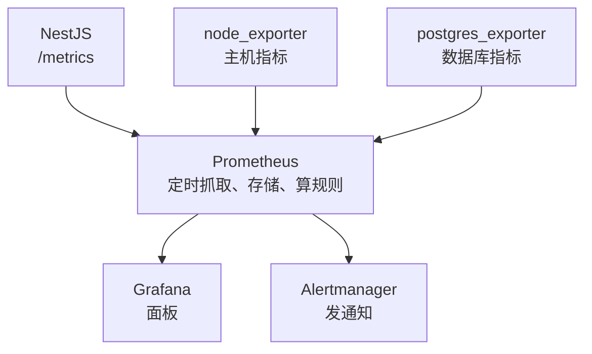
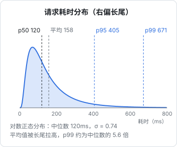

# 指标与 Prometheus

日志适合回答单个事件的问题，但回答不了「过去一周 p95 延迟的趋势」这类问题：要么扫几千万行，要么根本没记。**指标**是另一种思路：不记每一次发生了什么，只记数字随时间怎么变化。一个计数器无论每秒一次还是一万次请求，存储成本都一样。

这一章讲指标的类型、该看哪些指标、怎么用 Prometheus 在一台 VPS 上把它们采集起来，以及读懂延迟分布这件最容易被误读的事。

## 指标的四种类型

Prometheus 的数据模型很简单：一个指标名加一组标签，对应一条随时间变化的数值序列（时间序列）。

```text
http_requests_total{method="POST", route="/v1/expenses", status="201"}  10342
```

客户端库里有四种类型：

| 类型 | 特点 | 例子 | 怎么用 |
|---|---|---|---|
| Counter 计数器 | 只增不减，进程重启归零 | 请求总数、错误总数 | 永远配合 `rate()` 看增速，绝对值没意义 |
| Gauge 仪表 | 可增可减的当前值 | 内存占用、连接池使用数、队列长度 | 直接看 |
| Histogram 直方图 | 把观测值落进预设的桶里计数 | 请求耗时、响应体大小 | 用 `histogram_quantile()` 算分位数 |
| Summary 摘要 | 在客户端算好分位数 | 同上 | 不能跨实例聚合，一般优先用 Histogram |

Counter 重启归零不是问题：`rate()` 会自动识别计数器回落并修正。

## 该看哪些指标

指标可以无穷无尽，先抓两套方法论：

**RED**，面向服务（请求驱动的东西）：

- **R**ate：每秒请求数
- **E**rrors：每秒失败请求数（或失败比例）
- **D**uration：耗时分布

**USE**，面向资源（CPU、内存、磁盘、连接池）：

- **U**tilization：使用率，忙的时间占比
- **S**aturation：饱和度，排队等待的量
- **E**rrors：资源层面的错误

一台 NestJS + Postgres 的 VPS，起步只需要这几组：

| 层 | 指标 | 来源 |
|---|---|---|
| HTTP 服务 | 请求速率、5xx 比例、耗时直方图（按路由） | 应用里埋点 |
| Node 进程 | 事件循环延迟、堆内存、GC 时间 | `prom-client` 默认指标 |
| 数据库 | 连接数、事务速率、慢查询、死锁、库大小 | `postgres_exporter` |
| 主机 | CPU、内存、磁盘空间与 IO、网络 | `node_exporter` |
| 外部依赖 | 第三方调用耗时与失败率 | 应用里埋点 |

## 整体架构

Prometheus 是**拉模型**：被监控的程序暴露一个 HTTP 端点（通常是 `/metrics`），Prometheus 定期（比如每 15 秒）去抓一次，存进自己的时序库。



拉模型的好处：被监控端不需要知道 Prometheus 在哪；抓不到本身就是一个信号（`up` 指标为 0）。

## 在 NestJS 里暴露指标

用 `prom-client`。社区有封装好的 Nest 模块，但核心只有几十行，自己写更透明：

```bash
pnpm add prom-client
```

```ts
// metrics/metrics.ts
import { collectDefaultMetrics, Counter, Histogram, Registry } from "prom-client";

export const registry = new Registry();

// 进程级默认指标：CPU、内存、事件循环延迟、GC、打开的文件句柄
collectDefaultMetrics({ register: registry });

export const httpDuration = new Histogram({
  name: "http_request_duration_seconds",
  help: "HTTP 请求耗时",
  labelNames: ["method", "route", "status"] as const,
  // 桶的边界要覆盖你关心的范围；识别类接口能到几十秒，所以上限放宽
  buckets: [0.01, 0.025, 0.05, 0.1, 0.25, 0.5, 1, 2.5, 5, 10, 30, 60],
  registers: [registry],
});

export const externalCalls = new Counter({
  name: "external_calls_total",
  help: "第三方调用次数",
  labelNames: ["provider", "outcome"] as const,
  registers: [registry],
});
```

```ts
// metrics/metrics.interceptor.ts
import { CallHandler, ExecutionContext, Injectable, NestInterceptor } from "@nestjs/common";
import type { Request, Response } from "express";
import { Observable, finalize } from "rxjs";
import { httpDuration } from "./metrics";

@Injectable()
export class MetricsInterceptor implements NestInterceptor {
  intercept(ctx: ExecutionContext, next: CallHandler): Observable<unknown> {
    if (ctx.getType() !== "http") return next.handle();
    const req = ctx.switchToHttp().getRequest<Request>();
    const res = ctx.switchToHttp().getResponse<Response>();
    const end = httpDuration.startTimer();
    return next.handle().pipe(
      finalize(() => {
        // 用路由模板而不是真实路径：/v1/stores/:id 是一个标签值，/v1/stores/42 会是成千上万个
        const route = req.route?.path ?? "unmatched";
        end({ method: req.method, route, status: String(res.statusCode) });
      }),
    );
  }
}
```

拦截器只看得到进了路由的请求；被异常过滤器改写的状态码在 `finalize` 时可能还没写进 `res`。要求精确的话，改用 Express 中间件监听 `res.on("finish")`，那时状态码已确定。

暴露端点：

```ts
// metrics/metrics.controller.ts
import { Controller, Get, Header } from "@nestjs/common";
import { registry } from "./metrics";

@Controller("metrics")
export class MetricsController {
  @Get()
  @Header("Content-Type", registry.contentType)
  metrics(): Promise<string> {
    return registry.metrics();
  }
}
```

**`/metrics` 不能对公网开放**：里面有路由列表、错误量、版本信息。两种做法：nginx 上对 `/metrics` 直接 `deny all`，Prometheus 走 Docker 内网访问 `api:3000/metrics`；或者把指标放在另一个只监听内网的端口上。

### 标签基数：最容易犯的错

每个不同的标签组合都是一条独立的时间序列。`route` 有 50 个值、`status` 有 10 个值、`method` 有 4 个值，就是最多 2000 条序列，Prometheus 毫无压力。但如果你把 `userId`、`storeId`、完整 URL、错误消息放进标签，序列数会随用户数增长，内存和磁盘一起爆炸。

规则：**标签值必须是有限的、可枚举的小集合**。按门店、按用户的分析是日志或数据库的活，不是指标的活。

## 部署 Prometheus 栈

在已有的 compose 文件旁边单独放一份 `monitoring/compose.yaml`，跟业务服务分开升级、分开重启：

```yaml
# monitoring/compose.yaml
name: monitoring

services:
  prometheus:
    image: prom/prometheus:${PROMETHEUS_TAG}
    restart: unless-stopped
    command:
      - --config.file=/etc/prometheus/prometheus.yml
      - --storage.tsdb.retention.time=30d
      - --storage.tsdb.retention.size=5GB
    volumes:
      - ./prometheus.yml:/etc/prometheus/prometheus.yml:ro
      - ./rules:/etc/prometheus/rules:ro
      - prom-data:/prometheus
    # 只绑本机，用 SSH 隧道访问 UI
    ports: ["127.0.0.1:9090:9090"]
    networks: [monitoring, app]
    mem_limit: 512m

  postgres-exporter:
    image: prometheuscommunity/postgres-exporter:${PG_EXPORTER_TAG}
    restart: unless-stopped
    env_file: postgres-exporter.env   # DATA_SOURCE_NAME=postgresql://监控用户:密码@postgres:5432/库名?sslmode=disable
    networks: [app]

  grafana:
    image: grafana/grafana:${GRAFANA_TAG}
    restart: unless-stopped
    volumes: [grafana-data:/var/lib/grafana]
    ports: ["127.0.0.1:3001:3000"]
    networks: [monitoring]

volumes:
  prom-data:
  grafana-data:

networks:
  monitoring:
  # 业务 compose 创建的网络，Prometheus 加进去才能按服务名访问 api 和 postgres
  app:
    external: true
    name: myapp_default
```

镜像 tag 写在同目录的 `.env` 里并固定到具体版本。国内服务器拉不到 Docker Hub 时，先转存到自己的镜像仓库（见[《容器技术》](../docker-containers/)镜像仓库一章）。

几个选择的理由：

- **node_exporter 不放进容器**。它要读宿主机的 `/proc`、`/sys` 和所有挂载点，容器里跑要一堆特权挂载。Ubuntu 上直接 `sudo apt install prometheus-node-exporter`，它作为 systemd 服务监听 9100 端口，再用防火墙挡住外网
- **postgres_exporter 用专门的只读角色**。Postgres 内置的 `pg_monitor` 角色就是为此准备的：`CREATE ROLE monitor LOGIN PASSWORD '…' IN ROLE pg_monitor;`
- **保留期双限**：时间和大小哪个先到按哪个删，避免磁盘被监控数据吃满，反过来拖垮业务

`prometheus.yml`：

```yaml
global:
  scrape_interval: 15s
  evaluation_interval: 15s

rule_files:
  - /etc/prometheus/rules/*.yml

scrape_configs:
  - job_name: api
    static_configs:
      - targets: ["api:3000"]

  - job_name: postgres
    static_configs:
      - targets: ["postgres-exporter:9187"]

  - job_name: node
    static_configs:
      # 容器里访问宿主机；Linux 上需要在 compose 里给 prometheus 加 extra_hosts: ["host.docker.internal:host-gateway"]
      - targets: ["host.docker.internal:9100"]
```

整套栈在一台 2 核 4G 的机器上占用通常是几百 MB 内存量级，具体取决于序列数和保留期。机器更小的话，可以用 VictoriaMetrics 单机版替代 Prometheus，它兼容 Prometheus 的抓取配置和查询语言，资源占用更省。

## PromQL 入门

几条覆盖日常 80% 需求的查询：

```text
# 每秒请求数（过去 5 分钟的平均增速）
sum(rate(http_request_duration_seconds_count[5m]))

# 5xx 比例
sum(rate(http_request_duration_seconds_count{status=~"5.."}[5m]))
  / sum(rate(http_request_duration_seconds_count[5m]))

# 按路由的 p95 耗时
histogram_quantile(0.95,
  sum by (le, route) (rate(http_request_duration_seconds_bucket[5m])))

# 事件循环延迟 p99（prom-client 默认指标）
nodejs_eventloop_lag_p99_seconds

# 根分区剩余空间比例
node_filesystem_avail_bytes{mountpoint="/"} / node_filesystem_size_bytes{mountpoint="/"}

# Postgres 当前连接数
sum(pg_stat_activity_count)
```

模式记住两个：Counter 一律 `rate()` 再 `sum`；Histogram 一律对 `_bucket` 做 `rate()`，按 `le` 聚合后交给 `histogram_quantile()`。

## 读懂延迟：平均值会骗人

延迟的分布几乎从来不是对称的钟形，而是右偏的：绝大多数请求很快，少数请求很慢，形成一条长尾。



这张图按对数正态分布算出（中位数 120ms，形状参数 σ = 0.74）。可以看到：

- **平均值比中位数高**，它被长尾拉了过去，既不代表「典型用户」，也不代表「慢的用户」
- **p95 和 p99 比中位数高出好几倍**。如果一个页面要串行调 5 个接口，至少有一个落进各自最慢 5% 的概率约为 $1 - 0.95^5 \approx 23\%$

所以看延迟永远看分位数：**p50 看典型体验，p95 / p99 看尾部**，告警一般基于 p95 或 p99。

还有两个细节：

- `histogram_quantile` 算出来的是**在桶内线性插值的估计值**，精度取决于桶的划分。如果你关心「是否超过 300ms」，就在 0.3 附近放一个桶边界
- 分位数**不能平均**。两个实例各自的 p95 求平均不等于整体 p95，这也是 Histogram 优于 Summary 的原因：桶计数可以先相加，再算分位数

## Grafana 面板

Grafana 连上 Prometheus 数据源后，不用从零画：node_exporter、postgres_exporter 都有社区维护的现成面板，在 Grafana 官网的面板库里按名字搜，导入时填编号即可。

自己的服务建一个「概览」面板，一屏放下 RED 加关键资源：

| 行 | 面板 |
|---|---|
| 第一行 | 请求速率、5xx 比例、p95 耗时（三个大数字加曲线） |
| 第二行 | 按路由的 p95 耗时（找出最慢的接口） |
| 第三行 | 事件循环延迟、堆内存、数据库连接数 |
| 第四行 | CPU、内存、磁盘剩余、磁盘 IO |

一个面板好不好，标准是：**出事时打开它，30 秒内能判断问题在哪一层**。

## 本章要点

- 指标只记聚合后的数字，成本不随流量增长，适合看趋势和整体状况
- Counter 配 `rate()`，Gauge 直接看，耗时用 Histogram
- 服务看 RED，资源看 USE；起步只需 HTTP、Node 进程、Postgres、主机四组
- 标签值必须是有限小集合，用户 ID、完整 URL 不能当标签
- `/metrics` 不对公网开放；node_exporter 用 apt 装在宿主机上；Prometheus 设时间和大小两个保留上限
- 延迟看分位数不看平均值，桶边界放在你关心的阈值附近

## 动手练习

1. **亲眼看一个 /metrics 端点**：在空目录里 `npm init -y && npm i prom-client`，写一个 Node HTTP 服务：每个请求给 Counter `demo_requests_total` 加 1，`/metrics` 返回 `registry.metrics()`。启动后请求根路径 5 次，再抓一次指标。

   验证：`curl -s localhost:9464/metrics | grep '^demo_requests_total'` 输出 `demo_requests_total 5`（`/metrics` 本身不计数时）。同一输出里还能看到 `# TYPE demo_requests_total counter`。

   参考答案：

   ```js
   // server.mjs
   import http from "node:http";
   import { Counter, Registry } from "prom-client";
   const registry = new Registry();
   const c = new Counter({ name: "demo_requests_total", help: "请求数", registers: [registry] });
   http.createServer(async (req, res) => {
     if (req.url === "/metrics") {
       res.setHeader("Content-Type", registry.contentType);
       return res.end(await registry.metrics());
     }
     c.inc();
     res.end("ok");
   }).listen(9464);
   ```

2. **感受标签基数**：在上一题的服务里再加一个带 `userId` 标签的 Counter `demo_by_user_total`，启动时对 `u1` 到 `u1000` 各 `inc` 一次。

   验证：`curl -s localhost:9464/metrics | grep -c '^demo_by_user_total{'` 输出 `1000`。也就是说，一个标签值就是一条独立的时间序列。

   参考答案：用户数涨到十万，这个指标就是十万条序列，Prometheus 的内存和磁盘随之上涨。按用户的分析应该放到日志或数据库里，标签只用路由模板、状态码这类有限集合。

3. **手算 histogram_quantile**：某接口过去 5 分钟的累计桶计数是 `le="0.1"`: 60，`le="0.25"`: 90，`le="0.5"`: 100，`le="+Inf"`: 100。按 Prometheus 的算法估算 p95。

   验证：结果是 0.375 秒。可以把这组数换成 p50、p99 再算一遍，体会估计值完全由桶边界决定。

   参考答案：第 95 个观测值落在 0.25–0.5 这个桶里（前面已有 90 个，这个桶有 10 个），桶内线性插值：$0.25 + (0.5 - 0.25) \times \frac{95 - 90}{100 - 90} = 0.375$。如果你关心的阈值是 300ms，就该在 0.3 放一个桶边界，否则 0.25 到 0.5 之间的值全靠插值猜。
