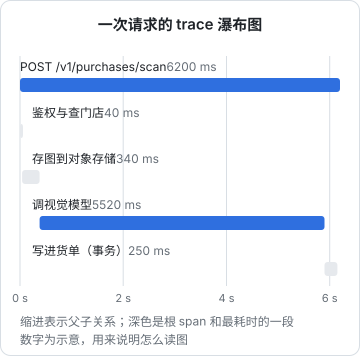
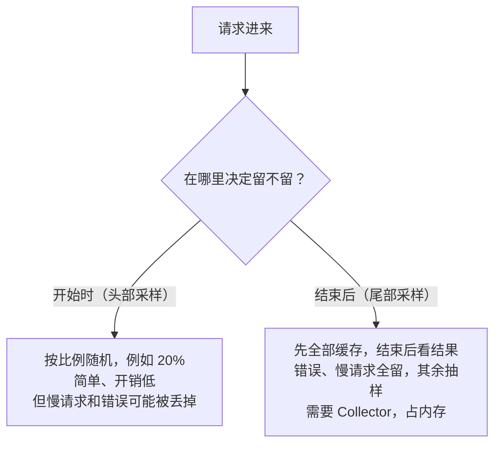

# 链路追踪与 OpenTelemetry

指标告诉你「`POST /v1/purchases/scan` 的 p95 从 4 秒涨到了 12 秒」，但这个接口里有鉴权、查库、存图、调视觉模型、写库好几步，到底哪一步变慢了？日志里每一步都打耗时当然可以，但打漏一步就白搭，而且还得自己把一次请求的几十行日志拼起来。

**链路追踪**（tracing）把一次请求经过的每一段都自动记录成一棵带时间的树。这一章讲追踪的基本概念、OpenTelemetry 这个标准、在 NestJS 里怎么接入，以及一个人的项目值不值得上。

## trace 与 span

一次请求的完整记录叫一个 **trace**，它由多个 **span** 组成。每个 span 代表一段操作：有名字、开始时间、耗时、属性（键值对）、状态，以及父 span 是谁。



一眼就能看出：6.2 秒里有 5.5 秒花在视觉模型上，库和存图都不是问题。再点开那个 span，属性里写着调的是降级链上的第二家，说明第一家失败后重试过。

span 之间通过 **trace id**（整条链路共享）和 **span id**（每段唯一）关联。跨进程时，trace id 放在请求头里传下去，标准格式是 W3C 的 `traceparent`：

```text
traceparent: 00-4bf92f3577b34da6a3ce929d0e0e4736-00f067aa0ba902b7-01
             版本-trace id（32 位十六进制）-父 span id（16 位）-标志位（01 表示已采样）
```

下游服务读到这个头，就把自己的 span 挂到同一棵树上。单体服务里这件事意义不大，一旦有了「API 调 Worker」「API 投递任务给队列消费者」，跨服务的完整链路就是追踪最大的价值。

## OpenTelemetry 是什么

**OpenTelemetry**（简称 OTel）是 CNCF 的开源项目，定义了一套与厂商无关的可观测数据标准：

| 组成 | 作用 |
|---|---|
| API 与 SDK | 各语言的埋点库，Node 是 `@opentelemetry/*` 一系列包 |
| 自动埋点（instrumentation） | 给 http、express、常见数据库驱动等打补丁，不改业务代码就产生 span |
| OTLP 协议 | 传输数据的标准协议，gRPC 走 4317 端口，HTTP 走 4318 端口 |
| Collector | 可选的中转站：接收、批处理、过滤、采样，再转发给后端 |

它的意义在于**埋点和后端解耦**：代码里只依赖 OTel，数据发给 Jaeger、Grafana Tempo、SigNoz 还是商业平台，改一个地址就行。OTel 也覆盖指标和日志，但目前在 Node 生态里，追踪是最成熟的部分；指标继续用上一章的 `prom-client` 完全没问题。

## 在 NestJS 里接入

### 安装

```bash
pnpm add @opentelemetry/sdk-node @opentelemetry/auto-instrumentations-node \
  @opentelemetry/exporter-trace-otlp-http @opentelemetry/sdk-trace-base
```

### 初始化文件

自动埋点的原理是在模块被 `require` 时打补丁，所以**必须在加载任何业务代码之前初始化**，不能写在 `main.ts` 里面：

```ts
// src/tracing.ts
import { NodeSDK } from "@opentelemetry/sdk-node";
import { getNodeAutoInstrumentations } from "@opentelemetry/auto-instrumentations-node";
import { OTLPTraceExporter } from "@opentelemetry/exporter-trace-otlp-http";
import { ParentBasedSampler, TraceIdRatioBasedSampler } from "@opentelemetry/sdk-trace-base";

const sdk = new NodeSDK({
  serviceName: "api",
  traceExporter: new OTLPTraceExporter({
    // 后端的 OTLP HTTP 接收地址，走 Docker 内网
    url: process.env.OTEL_EXPORTER_OTLP_TRACES_ENDPOINT ?? "http://jaeger:4318/v1/traces",
  }),
  // 有上游决定就听上游的；自己是起点时按 20% 采样
  sampler: new ParentBasedSampler({ root: new TraceIdRatioBasedSampler(0.2) }),
  instrumentations: [
    getNodeAutoInstrumentations({
      // fs 的 span 又多又没用
      "@opentelemetry/instrumentation-fs": { enabled: false },
      // 探活和指标抓取不进追踪
      "@opentelemetry/instrumentation-http": {
        ignoreIncomingRequestHook: (req) => req.url === "/v1/health" || req.url === "/metrics",
      },
    }),
  ],
});

sdk.start();

// 收到停止信号时把缓冲区里的 span 发完再退出
process.on("SIGTERM", () => {
  sdk.shutdown().finally(() => process.exit(0));
});
```

启动时用 `--require` 预加载（CommonJS 构建的 Nest 项目）：

```dockerfile
CMD ["node", "--require", "./dist/tracing.js", "dist/main.js"]
```

如果项目是 ESM，要改用 `--import` 并配合 OTel 文档里说明的 loader 钩子，ESM 的自动埋点支持仍在演进，接入前以官方文档的当前说明为准。

注意上面的 `SIGTERM` 处理会接管退出流程。如果你的 Nest 应用调用了 `app.enableShutdownHooks()` 做优雅退出，要把 `sdk.shutdown()` 放进 Nest 的 `onApplicationShutdown` 钩子里，而不是在这里直接 `process.exit`，否则正在处理的请求会被打断。

### 自动埋点覆盖了什么

`auto-instrumentations-node` 打包了几十个库的埋点，常用的有 http、express、`pg`（node-postgres）、ioredis、undici（Node 内置 `fetch` 的底层）。装上就有：

- 每个入站 HTTP 请求一个根 span，带路由、状态码
- 每次出站 HTTP 调用一个子 span，并自动注入 `traceparent` 头
- 每条 SQL 一个子 span（如果驱动有对应埋点）

**并不是所有驱动都有埋点**。比如 hatch-counter 用的 `postgres`（postgres.js）就不在官方自动埋点列表里，SQL 不会自动出现在 trace 中。哪些库被支持，以 OTel 的 `opentelemetry-js-contrib` 仓库的当前列表为准。没有覆盖的部分，用手动 span 补上。

### 手动 span

给业务关键步骤加 span，顺便记下有助于排查的属性：

```ts
import { trace, SpanStatusCode } from "@opentelemetry/api";

const tracer = trace.getTracer("ocr");

export async function recognize(image: Buffer, provider: string): Promise<OcrResult> {
  return tracer.startActiveSpan("ocr.recognize", async (span) => {
    span.setAttribute("ocr.provider", provider);
    span.setAttribute("ocr.image_bytes", image.length);
    try {
      const result = await callProvider(provider, image);
      span.setAttribute("ocr.lines", result.lines.length);
      return result;
    } catch (err) {
      span.recordException(err as Error);
      span.setStatus({ code: SpanStatusCode.ERROR });
      throw err;
    } finally {
      // 不 end 的 span 永远不会被导出
      span.end();
    }
  });
}
```

`@opentelemetry/api` 是 `sdk-node` 的依赖，但业务代码直接 import 它时应显式加进 `package.json`。

和日志一样，**属性里不放敏感数据**：不放手机号、令牌、图片内容、完整 SQL 参数。

### 把 trace id 写进日志

日志和追踪最好能互相跳转。`pino` 配合 `@opentelemetry/instrumentation-pino`（已包含在自动埋点包里）会自动往每行日志注入 `trace_id` 和 `span_id`。在 Grafana 里给 Loki 数据源配置「派生字段」，日志里的 trace id 就能直接点开对应的 trace。

## 后端：Jaeger 还是 Tempo

| 后端 | 特点 | 适合 |
|---|---|---|
| Jaeger | 老牌，自带查询 UI；all-in-one 镜像一个容器就能跑，可以只用内存存储 | 先试试追踪有没有用 |
| Grafana Tempo | 只按 trace id 索引，数据存对象存储或本地磁盘，很省资源；通过 Grafana 查询 | 已经有 Grafana + Loki，想统一 |
| SigNoz、OpenObserve 等 | 日志、指标、追踪一体化 | 不想自己拼栈 |

起步用 Jaeger 最快：

```yaml
# 加进 monitoring/compose.yaml
  jaeger:
    image: jaegertracing/jaeger:${JAEGER_TAG}
    restart: unless-stopped
    ports:
      - "127.0.0.1:16686:16686"   # 查询 UI，只绑本机，用 SSH 隧道访问
    networks: [app]
    mem_limit: 512m
```

默认的内存存储重启即丢、且有条数上限，作为试用足够。打算长期保留时，换成 Jaeger 的持久化存储或 Tempo。镜像名和存储配置在 Jaeger 1.x 到 2.x 之间有变化，以官方文档为准。

在本机看 UI：

```bash
ssh -L 16686:127.0.0.1:16686 deploy@你的服务器
# 然后浏览器打开 http://localhost:16686
```

## 采样：不是每条都要留

追踪数据比指标大得多。采样有两种思路：



一个人的项目流量不大时，**直接 100% 采样**往往最省心：每天几万个请求，存储完全扛得住，而且永远不会遇到「出问题的那条恰好没采到」。流量上来后再降比例；真的需要「错误全留」，再引入 OTel Collector 做尾部采样。

## 一个人值不值得上追踪

追踪的收益和服务的「复杂度」成正比，不和流量成正比：

| 情况 | 建议 |
|---|---|
| 单体 NestJS，接口逻辑简单，主要就是查库 | 不急。慢查询靠 `pg_stat_statements`（第 8 章），接口耗时靠指标 |
| 接口里串着多个外部调用（模型、短信、对象存储、支付） | 值得。哪一家慢、重试了几次，trace 一目了然 |
| 有多个服务互相调用，或有异步任务队列 | 很值得。没有 trace id 串联，跨服务排查几乎只能靠猜 |

还有一条低成本的中间路线：不上 OTel，只在日志里统一带请求 ID，并在关键外部调用前后各打一行带耗时的日志。等这种手工拼接让你烦了，就是上追踪的时候。

## 本章要点

- 一次请求是一个 trace，每段操作是一个 span；trace id 通过 `traceparent` 头跨服务传播
- OpenTelemetry 让埋点和后端解耦；Node 里追踪最成熟，指标可以继续用 `prom-client`
- 初始化必须早于业务代码加载，用 `--require` 预加载；优雅退出时要 `shutdown` 把 span 发完
- 自动埋点不覆盖所有库，比如 postgres.js；关键步骤用手动 span 补上，属性里不放敏感数据
- 起步用 Jaeger all-in-one；流量小就 100% 采样
- 外部调用多、服务多时追踪价值最大；简单单体可以先只靠请求 ID 加日志
