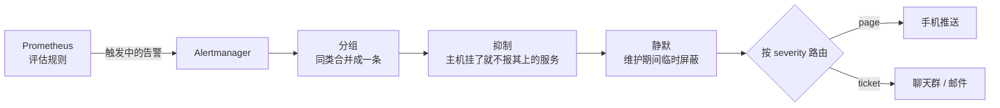

# 告警设计

前三章让你「能看见」，但没有人会一天到晚盯着面板。告警的职责是：**在需要你介入的时候，用你一定会注意到的方式通知你；不需要的时候，保持安静**。

后半句比前半句难。一个人的项目，最常见的失败不是「没告警」，而是告警太多，手机一天响二十次，于是你开始忽略它，直到真正的故障也被忽略。这一章讲怎么设计告警规则、怎么用 Alertmanager 路由和收敛，以及一套可以直接起步的规则。

## 好告警的标准

每条告警发出之前，都应该能回答三个问题：

1. **用户受影响了吗，或者马上会受影响吗？** 不影响用户的事不该在半夜叫醒你
2. **需要人做什么吗？** 如果收到之后的标准动作是「看一眼，然后不管」，它就不该是告警
3. **紧急吗？** 现在不处理会怎样？能等到明早的，就不该走即时通知

按这个标准，告警分两级就够了：

| 级别 | 含义 | 通知方式 | 例子 |
|---|---|---|---|
| `page` | 用户正在受影响，现在就要处理 | 手机推送，能响铃的那种 | 服务不可用、错误率飙升、磁盘一小时内写满 |
| `ticket` | 需要处理，但可以等到工作时间 | 聊天群、邮件，每天汇总 | 证书 14 天内到期、磁盘一周内写满、备份失败一次 |

再往下的「信息」级别不要做成告警，放在面板上就好。

## 对症状告警，不对原因告警

一个反直觉但很重要的原则：**告警应该基于用户能感受到的症状，而不是可能导致问题的原因**。

| 原因型（不推荐 page） | 症状型（推荐 page） |
|---|---|
| CPU 超过 80% | p95 延迟超过 2 秒 |
| 内存使用超过 90% | 5xx 比例超过 5% |
| 数据库连接数高 | 健康检查连续失败 |
| 某个容器重启了 | 外部探测访问不到首页 |

理由：CPU 80% 可能完全正常（批处理任务跑满了核，用户无感）；反过来，CPU 只有 20% 时服务也可能挂掉（死锁、连接池耗尽、依赖超时）。原因型指标有无数种，你永远列不全；症状型指标就那几个，覆盖了所有原因导致的后果。

原因型指标不是没用，它们是**排查时看的**，放在面板上。

例外是那些「症状出现时已经来不及」的原因：磁盘快满、证书快过期、备份连续失败。这类要基于趋势提前告警。

## 规则的三个要素

Prometheus 的告警规则长这样：

```yaml
- alert: HighErrorRate
  expr: |
    sum(rate(http_request_duration_seconds_count{status=~"5.."}[5m]))
      / sum(rate(http_request_duration_seconds_count[5m])) > 0.05
  for: 5m
  labels:
    severity: page
  annotations:
    summary: "API 5xx 比例 {{ $value | humanizePercentage }}"
    runbook: "先看 Grafana 概览面板的按路由错误；再按请求 ID 查日志"
```

- `expr`：条件表达式，结果非空就算「触发中」
- `for`：条件要**持续**这么久才真正发出告警。这是过滤抖动最重要的手段，一次 10 秒的毛刺不该叫醒你
- `annotations`：给人看的内容。`runbook` 写「收到后第一步做什么」，半夜迷迷糊糊时你会感谢自己

`for` 的取舍：太短会被毛刺骚扰，太长会延迟发现。经验上 page 级别 2–5 分钟，ticket 级别 15 分钟到 1 小时。

还要注意**低流量时的比例告警**。半夜一分钟只有 3 个请求，1 个失败就是 33% 的错误率。给比例类告警加一个最小流量条件：

```text
(错误比例表达式 > 0.05)
  and
sum(rate(http_request_duration_seconds_count[5m])) > 0.2
```

`0.2` 表示每秒至少 0.2 个请求（5 分钟约 60 个），流量低于这个数时不判断比例，靠外部可用性探测兜底。

## 一套起步规则

放在 `monitoring/rules/basic.yml`：

```yaml
groups:
  - name: service
    rules:
      - alert: TargetDown
        expr: up == 0
        for: 2m
        labels: { severity: page }
        annotations:
          summary: "{{ $labels.job }} 抓不到指标"
          runbook: "docker compose ps 看容器状态；journalctl 或 docker logs 看退出原因"

      - alert: HighErrorRate
        expr: |
          (sum(rate(http_request_duration_seconds_count{status=~"5.."}[5m]))
            / sum(rate(http_request_duration_seconds_count[5m])) > 0.05)
          and sum(rate(http_request_duration_seconds_count[5m])) > 0.2
        for: 5m
        labels: { severity: page }
        annotations:
          summary: "5xx 比例 {{ $value | humanizePercentage }}"

      - alert: HighLatency
        expr: |
          histogram_quantile(0.95,
            sum by (le) (rate(http_request_duration_seconds_bucket{route!~"/v1/ocr.*|/v1/events"}[5m]))) > 2
        for: 10m
        labels: { severity: page }
        annotations:
          summary: "p95 延迟 {{ $value | humanizeDuration }}（不含识别和长连接）"

      - alert: EventLoopBlocked
        expr: nodejs_eventloop_lag_p99_seconds > 0.5
        for: 5m
        labels: { severity: ticket }
        annotations:
          summary: "事件循环 p99 延迟 {{ $value | humanizeDuration }}，有同步计算阻塞了进程"

  - name: host
    rules:
      - alert: DiskWillFillIn24h
        expr: predict_linear(node_filesystem_avail_bytes{mountpoint="/"}[6h], 24 * 3600) < 0
        for: 30m
        labels: { severity: page }
        annotations:
          summary: "按过去 6 小时的趋势，根分区 24 小时内写满"
          runbook: "du -xh / --max-depth=2 | sort -h | tail；先查 Docker 日志和镜像"

      - alert: DiskLow
        expr: node_filesystem_avail_bytes{mountpoint="/"} / node_filesystem_size_bytes{mountpoint="/"} < 0.15
        for: 1h
        labels: { severity: ticket }
        annotations:
          summary: "根分区剩余 {{ $value | humanizePercentage }}"

      - alert: MemoryPressure
        expr: node_memory_MemAvailable_bytes / node_memory_MemTotal_bytes < 0.1
        for: 15m
        labels: { severity: ticket }
        annotations:
          summary: "可用内存只剩 {{ $value | humanizePercentage }}"

  - name: postgres
    rules:
      - alert: PostgresDown
        expr: pg_up == 0
        for: 1m
        labels: { severity: page }
        annotations:
          summary: "postgres_exporter 连不上数据库"

      - alert: PostgresConnectionsHigh
        expr: sum(pg_stat_activity_count) / scalar(pg_settings_max_connections) > 0.8
        for: 10m
        labels: { severity: ticket }
        annotations:
          summary: "连接数达到上限的 {{ $value | humanizePercentage }}"
```

几点说明：

- **识别接口、SSE 长连接要从延迟告警里排除**。识别一次几秒到几十秒是正常的，长连接的「耗时」是整个连接时长，混进来 p95 永远超标。路由名按你自己的实际情况改
- **磁盘用趋势预测**：`predict_linear` 根据过去 6 小时的斜率外推 24 小时后的值。磁盘满了以后 Postgres 的表现是最难查的那一类，提前一天知道比任何事后补救都便宜
- **CPU 不告警**。它会体现在延迟告警上
- exporter 的指标名以你部署的版本实际暴露的为准，上线前在 Prometheus UI 里逐条执行一遍 `expr`，确认有数据

规则文件可以用 `promtool` 检查语法：

```bash
docker compose run --rm --entrypoint promtool prometheus check rules /etc/prometheus/rules/basic.yml
```

## Alertmanager：路由、分组、抑制

Prometheus 只负责判断「哪些告警在触发」，发通知是 **Alertmanager** 的事。它做三件 Prometheus 不做的事：



加进 compose：

```yaml
  alertmanager:
    image: prom/alertmanager:${ALERTMANAGER_TAG}
    restart: unless-stopped
    volumes:
      - ./alertmanager.yml:/etc/alertmanager/alertmanager.yml:ro
    ports: ["127.0.0.1:9093:9093"]
    networks: [monitoring]
```

`prometheus.yml` 里告诉 Prometheus 往哪发：

```yaml
alerting:
  alertmanagers:
    - static_configs:
        - targets: ["alertmanager:9093"]
```

`alertmanager.yml`：

```yaml
route:
  receiver: ticket
  group_by: [alertname]
  group_wait: 30s        # 第一条告警到达后等 30 秒，把同时触发的合并成一条通知
  group_interval: 5m     # 同一组有新告警加入时，最快 5 分钟再通知一次
  repeat_interval: 4h    # 一直没恢复的告警，每 4 小时提醒一次
  routes:
    - matchers: [severity="page"]
      receiver: page
      repeat_interval: 1h

inhibit_rules:
  # 数据库挂了，API 的错误率告警就别再单独发了
  - source_matchers: [alertname="PostgresDown"]
    target_matchers: [alertname=~"HighErrorRate|HighLatency"]

receivers:
  - name: page
    telegram_configs:
      - bot_token_file: /etc/alertmanager/secrets/telegram_token
        chat_id: 123456789
  - name: ticket
    webhook_configs:
      - url: http://alert-relay:8080/feishu
```

通知渠道的选择：

| 渠道 | 接法 | 备注 |
|---|---|---|
| Telegram | Alertmanager 内置 `telegram_configs` | 推送可靠，国内网络环境需要考虑可达性 |
| 企业微信 | 内置 `wechat_configs`，或群机器人 webhook | 国内可达 |
| 飞书 / 钉钉群机器人 | 消息格式和 Alertmanager 的 webhook 不同，需要一个小的转发服务把 JSON 改写一下 | 社区有现成的转发器，也可以自己写几十行 |
| 邮件 | 内置 `email_configs` | 适合 ticket 级别，不适合半夜叫人 |

`page` 级别一定要选**手机上会响、你不会静音的渠道**，并单独给它设置通知音。各渠道的配置项以 Alertmanager 当前版本文档为准，令牌放文件里，不写进配置文件本身。

## 让告警系统可信

### 测试告警链路

配完之后，人为制造一次告警，确认手机真的响了：

```bash
# 直接往 Alertmanager 发一条测试告警（amtool 在 alertmanager 镜像里自带）
docker compose exec alertmanager amtool alert add TestAlert severity=page \
  --annotation=summary="告警链路测试" --alertmanager.url=http://localhost:9093
```

之后每次改动通知配置都再测一次。告警链路是那种「坏了也不会有人告诉你」的东西。

### 维护时静默

发版、迁移数据库前，在 Alertmanager UI 或用 `amtool silence add` 加一个有时限的静默，避免自己制造的停机吵醒自己。**静默一定要设结束时间**，忘了取消的永久静默比没有告警更危险。

### 定期清理

每个月看一次告警历史：

- 触发了但你什么都没做的：提高阈值、加长 `for`，或者删掉
- 故障发生了却没有告警的：补一条症状型规则
- 每次收到都要做同样操作的：考虑自动化，比如磁盘清理脚本

目标是**每一条 page 都值得被叫醒**。基于服务等级目标（SLO）和错误预算的燃烧率告警，是这条思路的进一步系统化，详见《一人运维手册》。

## 告警器自己挂了怎么办

Alertmanager 和 Prometheus 跑在被监控的同一台机器上。机器宕机、网络断了、Docker 守护进程崩了，告警系统一起消失，你收到的是**一片寂静**，和「一切正常」无法区分。

解决办法是**从外面看**：

- 外部可用性探测（第 6 章）：在另一台机器或第三方服务上定期访问你的网站
- 「死人开关」（dead man's switch）：配置一条永远触发的告警，让 Alertmanager 每隔几分钟把它发给外部的心跳服务；心跳服务一段时间收不到，就从外部通知你

```yaml
- alert: Watchdog
  expr: vector(1)
  labels: { severity: heartbeat }
  annotations:
    summary: "告警链路心跳，正常情况下一直在触发"
```

Alertmanager 里给 `severity="heartbeat"` 单独路由到心跳服务的 webhook，`repeat_interval` 设成 5 分钟。心跳服务可以是自托管的 Healthchecks（第 6 章），但它必须跑在**另一台机器**上。

## 本章要点

- 告警分 page 和 ticket 两级；只有用户受影响、需要人处理、而且紧急的才 page
- 对症状告警（错误率、延迟、可用性），原因型指标（CPU、内存）留给面板；磁盘、证书这类用趋势提前告警
- `for` 过滤抖动；比例告警加最小流量条件；长耗时接口从延迟告警里排除
- Alertmanager 负责分组、抑制、静默和路由；page 走会响的手机渠道
- 配完要人为触发测试，静默必须有结束时间，每月清理一次告警
- 告警系统和业务在同一台机器上，必须有外部探测或死人开关兜底
