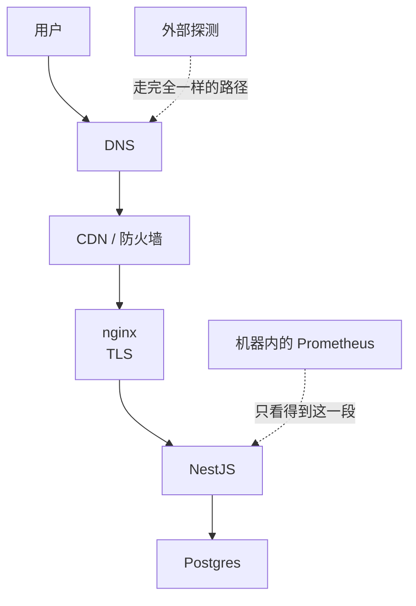
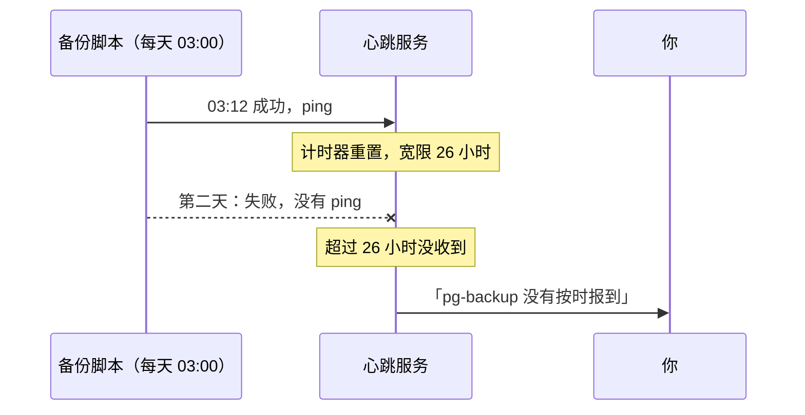

# 可用性监控

前面几章的工具都有一个共同的盲区：它们跑在被监控的机器上，从**里面**往外看。DNS 解析错了、证书过期了、云厂商的网络抖了、整台机器宕了，里面的监控要么看不到，要么跟着一起消失。

可用性监控（也叫拨测、黑盒监控）从**外面**像用户一样访问你的服务：能不能打开、多久打开、证书还有几天过期。它是一个人项目最应该**第一个**上的监控，配置十分钟，覆盖面最广。这一章讲探测什么、从哪里探、怎么设计健康检查接口，以及定时任务的心跳监控。

## 从外面看到的才是真相



外部探测走的是和用户完全相同的路径，任何一环出问题都会被发现。它不告诉你**为什么**坏了，但会第一时间告诉你**坏了**，原因交给前几章的工具去查。

## 探测什么

| 探测项 | 方式 | 发现什么问题 |
|---|---|---|
| 首页 / 静态站 | HTTP GET，期望 200，可选校验页面里的某个关键字 | 站点挂了、被劫持、部署了空白页 |
| API 健康检查 | HTTP GET `/v1/health`，期望 200 | 服务挂了、连不上数据库 |
| 关键业务接口 | 带测试账号的只读请求 | 「健康检查通过但登录不了」这类问题 |
| TLS 证书 | 检查证书剩余天数 | 自动续期悄悄失败 |
| 域名 | 检查注册到期日 | 忘记续费（这是真实发生过很多次的事故） |
| TCP 端口 | 连接测试 | SSH、数据库端口是否**意外**对外开放（期望失败） |

最后一条是反向探测：确认不该开的端口确实是关着的。防火墙规则被误改，Docker 端口映射绕过了防火墙（见[《容器技术》](../docker-containers/)网络与存储卷一章），都能被它发现。

## 健康检查接口怎么设计

外部探测、Docker 的 `HEALTHCHECK`、负载均衡器都依赖健康检查接口。设计得不好，要么探不出问题，要么制造问题。

### 浅检查与深检查

| 类型 | 检查什么 | 用途 |
|---|---|---|
| 存活（liveness） | 进程活着、能响应 HTTP | 判断要不要重启容器 |
| 就绪（readiness） | 依赖都能用：数据库能查、必要的配置齐全 | 判断能不能接流量、服务对用户是否可用 |

hatch-counter 的 `/v1/health` 是一个就绪检查：它真的去执行一次 `select 1`，连不上库就回 503。注释里写了原因：服务端口一开就通，而它干的每件事都要数据库，如果只看端口，一个连不上库的实例照样应答、每个请求都回「服务端出了点问题」，滚动发布时会被当成健康的实例接上流量。

几条设计原则：

- **用状态码表达结果**：健康回 200，不健康回 503。探测工具看的是状态码，不要回 200 加一个 `ok: false`
- **不泄露细节**：这个接口通常是公开的。失败原因只进日志，回包里只有布尔值。数据库驱动的错误消息里常带着连接串
- **只检查自己的必要依赖**：第三方识别服务挂了，不代表你的服务整体不可用；把它也放进健康检查，会让一个外部问题变成「整个服务被判定挂掉」，甚至被编排工具反复重启
- **便宜**：探测每几十秒一次，健康检查里不能有慢查询
- **带版本号**：回包里加上当前运行的版本，`curl` 一下就知道线上跑的是哪一版，发版后确认很方便

### 不要让探测制造日志噪音

健康检查每 10 秒一次，一天就是 8640 行访问日志。在日志中间件、追踪、指标里都把它排除掉（前面几章的配置里已经这样做了）。

## 从哪里探测

探测点**必须在被监控的机器之外**。选择：

| 方案 | 优点 | 缺点 |
|---|---|---|
| 第三方拨测服务（UptimeRobot、Better Stack 等，以及国内云厂商的云监控拨测） | 零维护，多地探测，免费额度通常够一个人用 | 数据在别人那里；免费版的频率和功能有限，以各家当前政策为准 |
| 另一台便宜的 VPS 上自托管 | 完全自主，可以同时承载心跳服务、状态页 | 多维护一台机器；这台机器也要被监控 |
| 家里的 NAS 或常开的电脑 | 不花钱 | 家庭网络不稳定，会有误报 |

一个比较稳的组合是：**第三方服务做主探测 + 自托管做补充**。两者互为备份，也能交叉验证「是我的服务挂了，还是探测器自己挂了」。

国内服务器还要注意：只从海外探测，可能把跨境网络抖动误报成故障；只从国内探测，又发现不了海外用户的问题。用户在哪，探测点就放在哪。

## 自托管：Uptime Kuma

**Uptime Kuma** 是最流行的自托管可用性监控工具：单个容器、内置 SQLite、有 Web 界面，支持 HTTP、关键字、TCP、DNS、证书到期、推送式心跳等多种探测，还能生成公开的状态页。它要部署在**被监控机器之外**；部署、管理界面的保护、通知渠道和「谁监控谁」的安排见[《自托管工具栈》部署 Uptime Kuma](../self-hosting/04-monitoring.md#部署-uptime-kuma)。这里只讲探测本身怎么设计。

建议的探测配置：

| 监控项 | 间隔 | 重试 | 说明 |
|---|---|---|---|
| API `/v1/health` | 60 秒 | 2 次后报警 | 重试过滤单次网络抖动 |
| 网页端首页，校验关键字 | 60 秒 | 2 次 | 关键字选一个只有正常页面才有的词 |
| 官网 | 5 分钟 | 2 次 | 静态站，变化少 |
| 证书到期 | 每天 | - | 剩余 14 天时通知 |
| 数据库端口 5432 | 1 小时 | - | 期望连不上，连上了反而要告警 |

## 心跳监控：发现「没有发生的事」

有一类故障，前面所有手段都发现不了：**本该发生的事没有发生**。

- 每天凌晨的数据库备份脚本，因为磁盘满了，已经一周没成功了
- 定时清理任务的 systemd timer 被误禁用了
- 订阅到期提醒的定时任务卡死了

这些任务失败时不会报错给你，它们只是安静地不再运行。办法是反过来：**让任务每次成功后主动报到，一段时间没报到就告警**。这叫心跳监控，或者死人开关。



开源的 **Healthchecks** 可以自托管（Uptime Kuma 的「推送」类型监控也能实现同样的效果）。每个任务对应一个唯一的 ping 地址，在脚本**成功结束时**访问它：

```bash
#!/usr/bin/env bash
set -euo pipefail

# ……执行备份，任何一步失败都会因为 set -e 直接退出，不会走到下面
docker compose exec -T postgres pg_dump -U app app | gzip > "/srv/backup/app-$(date +%F).sql.gz"

# 走到这里说明成功了。ping 地址放在环境变量里，不写死在脚本中
curl -fsS -m 10 --retry 3 "$HEARTBEAT_URL_PG_BACKUP" > /dev/null
```

Healthchecks 还支持在开始时 ping `/start`、失败时 ping `/fail`，这样能拿到任务耗时，失败时也能立即通知，而不用等到超时。

宽限时间要比任务周期稍长：每天一次的任务，设 25–26 小时，给执行时间的波动留余量。

第 4 章提到的 Alertmanager 心跳（Watchdog）也是同一个机制：让告警系统定期向外部报到，告警系统自己挂了，外部的心跳服务会告诉你。

## 状态页

如果你的产品有付费用户，一个公开的状态页能减少很多「是不是挂了」的咨询，也体现专业。Uptime Kuma 自带状态页功能，可以选择公开哪些监控项；公开时不要把整个 Kuma 开到公网，做法见[《自托管工具栈》公开的状态页](../self-hosting/04-monitoring.md#公开的状态页)。

状态页要**和主服务分开部署**：主服务挂的时候，正是用户最需要看状态页的时候。放在探测机上，或者用第三方服务的状态页。

## 本章要点

- 外部探测走和用户相同的路径，是一个人项目最应该第一个上的监控
- 探测首页、健康检查、关键业务接口、证书、域名到期，并反向探测不该开放的端口
- 健康检查用状态码表达结果、只检查必要依赖、不泄露错误细节、足够便宜、带版本号
- 探测点必须在被监控机器之外；第三方服务加自托管互为备份；探测点放在用户所在的网络
- 定时任务用心跳监控：成功后报到，超时未报到即告警；告警系统自己也要有心跳
- 状态页和主服务分开部署

## 动手练习

1. **写一个会说实话的健康检查**：本机 `docker run -d --name pg-health -e POSTGRES_PASSWORD=dev -p 5432:5432 postgres:16`，再写一个 Node 服务（`npm i pg`），`/health` 执行一次 `select 1`：成功回 200，失败回 503 且回包只有 `{"ok":false}`，原因只打印到控制台。

   验证：`curl -s -o /dev/null -w '%{http_code}\n' localhost:3000/health` 先输出 `200`；`docker stop pg-health` 后再执行输出 `503`，回包里看不到连接串或错误消息。做完 `docker rm -f pg-health`。

   参考答案：每次请求新建一个 `pg.Client`，`connect()` 和 `query("select 1")` 包在 `try/catch` 里，并给连接设几秒超时（`connectionTimeoutMillis`），避免数据库无响应时探测一直挂着。状态码才是探测工具看的东西。

2. **心跳监控抓住「没发生的事」**：`docker run -d --name kuma -p 3001:3001 louislam/uptime-kuma:1` 起一个本地 Uptime Kuma，建一个 Push 类型监控，心跳间隔设 60 秒，复制它的推送地址。写一个脚本：开头 `set -euo pipefail`，然后执行 `false`（模拟备份失败），最后一行 `curl -fsS "$PUSH_URL"`。

   验证：先手动 `curl` 一次推送地址，监控变成 UP；之后每分钟运行一次脚本，几分钟后监控变成 DOWN。做完 `docker rm -f kuma`。

   参考答案：`set -e` 让脚本在 `false` 处退出，`curl` 永远走不到，心跳服务就收不到报到。任务失败不需要它主动报错，「没来报到」本身就是信号。

3. **检查证书和反向探测端口**：对你自己的域名执行 `echo | openssl s_client -connect 你的域名:443 -servername 你的域名 2>/dev/null | openssl x509 -noout -enddate`；再从**另一台机器**执行 `nc -zv -w 3 你的服务器IP 5432`。

   验证：第一条输出 `notAfter=` 开头的一行到期时间；第二条应该是超时或连接被拒，如果显示 `succeeded` 或 `open`，说明数据库端口对外开放了，要立刻检查防火墙和 Docker 端口映射。

   参考答案：这两项正是外部探测里最容易被忽略的：证书自动续期悄悄失败，以及 Docker 端口映射绕过防火墙。把它们配进 Uptime Kuma，就不必再手动执行。
