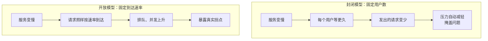

# 压测（k6）

到目前为止，所有工具都是被动的：等问题发生，然后告诉你。压测是主动的：**在用户之前，自己制造流量，找出系统能扛多少、先在哪里崩**。

一个人的项目常常觉得「我才几十个用户，压什么测」。但压测回答的不只是「能扛多少并发」，还有：这次改动有没有让某个接口变慢一倍？连接池 10 条够不够？导入一份一万行的报表时，其他用户的请求会不会卡住？这一章用 k6 回答这些问题。

## 先想清楚要回答什么

压测不是「把并发开到最大看看什么时候挂」。不同的问题对应不同的测试：

| 类型 | 负载形状 | 回答的问题 |
|---|---|---|
| 冒烟测试 | 1–2 个虚拟用户，跑 1 分钟 | 脚本本身对不对，系统在零负载下是否正常 |
| 基准测试 | 预期的日常负载，跑 10–30 分钟 | 正常情况下延迟和资源占用是多少，作为以后对比的基线 |
| 压力测试 | 逐步加压，直到指标恶化 | 拐点在哪，先耗尽的是什么资源 |
| 尖峰测试 | 突然拉高，再突然回落 | 突发流量（推送、营销活动）时会不会雪崩，回落后能否恢复 |
| 浸泡测试 | 中等负载，跑几小时 | 内存泄漏、连接泄漏、磁盘增长这类随时间累积的问题 |

一人项目最有价值的是**基准测试**和**压力测试**：前者让你在每次大改之后有据可比，后者告诉你离天花板还有多远。

## k6 基础

k6 是 Grafana Labs 维护的开源压测工具：引擎用 Go 写，性能好，一台笔记本就能产生可观的负载；测试脚本用 JavaScript 写，新版本也直接支持 TypeScript，对 TS 全栈开发者没有学习门槛。

```bash
# macOS
brew install k6
# 或用 Docker，不用安装
docker run --rm -i grafana/k6 run - < script.js
```

k6 的脚本虽然是 JS，但**不是在 Node 里运行的**，没有 `require("fs")`、没有 npm 包（可以打包后引入纯 JS 库），HTTP 用它自己的 `k6/http` 模块。

最小的脚本：

```js
// smoke.js
import http from "k6/http";
import { check, sleep } from "k6";

export const options = {
  vus: 2,
  duration: "1m",
};

export default function () {
  const res = http.get(`${__ENV.BASE_URL}/v1/health`);
  check(res, {
    "状态码 200": (r) => r.status === 200,
    "数据库可用": (r) => r.json("db") === true,
  });
  sleep(1);
}
```

```bash
k6 run -e BASE_URL=https://staging.example.com smoke.js
```

`default` 函数是每个虚拟用户（VU）反复执行的一次「迭代」。`check` 只记录成功率，不会让测试失败；要让测试有通过与否的判定，用阈值。

## 阈值：把期望写成代码

```js
export const options = {
  thresholds: {
    // 整体失败率低于 1%
    http_req_failed: ["rate<0.01"],
    // p95 低于 500ms，p99 低于 1.5s
    http_req_duration: ["p(95)<500", "p(99)<1500"],
    // 按标签单独设阈值：列表接口要求更严
    "http_req_duration{name:list-purchases}": ["p(95)<300"],
    // check 通过率
    checks: ["rate>0.99"],
  },
};
```

任何阈值不满足，`k6 run` 以非零退出码结束。这意味着压测可以放进 CI 或发版脚本，作为性能回归的守门员。

## 开放模型与封闭模型

这是压测里最容易被忽视、却最影响结论的概念。

**封闭模型**：固定 N 个虚拟用户，每个用户发请求、等响应、再发下一个。上面的 `vus: 2` 就是。问题在于：**系统变慢时，请求速率会自动下降**，因为每个用户都在等。系统在「自我保护」，压测结果看起来比实际乐观。

**开放模型**：按固定**速率**发起请求（比如每秒 50 个），不管前面的请求有没有返回。这更接近真实世界：用户不会因为你的服务慢了就少来几个。



面向公网用户的 Web 服务，用开放模型。k6 里对应的是 `constant-arrival-rate` 和 `ramping-arrival-rate` 两个执行器。

## 场景：一个完整的压力测试

以 hatch-counter 这类门店管理系统为例，模拟店主的典型操作：登录后看概览、翻进货单列表、偶尔记一笔开支。

```js
// stress.js
import http from "k6/http";
import { check, sleep, group } from "k6";

const BASE = __ENV.BASE_URL;

export const options = {
  scenarios: {
    browse: {
      executor: "ramping-arrival-rate",
      startRate: 5,           // 起始每秒 5 次迭代
      timeUnit: "1s",
      preAllocatedVUs: 50,    // 预先准备的虚拟用户
      maxVUs: 300,            // 响应变慢时最多扩到这么多，用尽后的迭代记为 dropped_iterations
      stages: [
        { target: 20, duration: "2m" },    // 爬到每秒 20
        { target: 20, duration: "5m" },    // 保持
        { target: 60, duration: "3m" },    // 继续加压
        { target: 120, duration: "3m" },
        { target: 0, duration: "1m" },     // 回落，观察能否恢复
      ],
    },
  },
  thresholds: {
    http_req_failed: ["rate<0.01"],
    http_req_duration: ["p(95)<800"],
  },
};

// setup 只执行一次：用测试账号登录，拿到的令牌传给每次迭代
export function setup() {
  const res = http.post(
    `${BASE}/v1/auth/test-login`,
    JSON.stringify({ account: __ENV.TEST_ACCOUNT }),
    { headers: { "Content-Type": "application/json" } },
  );
  check(res, { "登录成功": (r) => r.status === 200 });
  return { token: res.json("accessToken") };
}

export default function (data) {
  const params = {
    headers: { Authorization: `Bearer ${data.token}`, "Content-Type": "application/json" },
  };

  group("看概览", () => {
    const res = http.get(`${BASE}/v1/overview`, { ...params, tags: { name: "overview" } });
    check(res, { "概览 200": (r) => r.status === 200 });
  });

  group("翻进货单", () => {
    // 带查询参数的 URL 用 name 标签归为一类，否则每个不同的 URL 都是一条单独的统计
    const page = Math.floor(Math.random() * 5) + 1;
    const res = http.get(`${BASE}/v1/purchases?page=${page}`, { ...params, tags: { name: "list-purchases" } });
    check(res, { "列表 200": (r) => r.status === 200 });
  });

  // 十次里有一次是写操作
  if (Math.random() < 0.1) {
    group("记开支", () => {
      const res = http.post(
        `${BASE}/v1/expenses`,
        JSON.stringify({ amount: 1280, category: "压测", note: "k6" }),
        { ...params, tags: { name: "create-expense" } },
      );
      check(res, { "记账 201": (r) => r.status === 201 });
    });
  }

  sleep(Math.random() * 2);   // 模拟人的思考时间
}
```

接口路径、登录方式按你的项目实际情况改。上面的 `test-login` 是示意：**压测环境需要一个不经过短信验证码的登录方式**，但这个后门绝不能出现在生产环境，要由配置开关控制并在生产启动时强制关闭。

## 在哪里压、压什么

### 不要从服务器本机发压

压测机和被测服务在同一台机器上，k6 自己就会抢走 CPU，结论完全不可信。从本机笔记本或另一台机器发压。注意家庭宽带的上行带宽可能先成为瓶颈，压大流量时用一台临时的云主机，用完就释放。

### 压测环境

| 方式 | 说明 |
|---|---|
| 生产环境 | 结论最真实，但会影响真实用户、污染数据。一人项目可以在凌晨低峰、对只读接口做短时压测，提前在告警系统里加静默 |
| 同配置的临时机器 | 用同样的 compose 起一套，导入脱敏后的数据，压完销毁。最推荐 |
| 本地 | 只能用来调试脚本和做相对比较（改前改后），绝对数字没有参考价值 |

数据量要接近生产。100 行的表上什么查询都快，问题往往在表涨到百万行之后才出现。

### 隔离外部依赖

压测会把流量放大几十上百倍，**绝不能打到真实的第三方服务**：

- 视觉模型识别：按次计费，一次压测可能烧掉一个月的预算，还可能触发对方的限流甚至封号
- 短信验证码：真的会发出去
- 支付：不用说

在压测环境里把这些依赖换成桩（mock）：一个返回固定结果、带可配置延迟的假服务。延迟要模拟真实情况，比如识别接口给 3–8 秒的随机延迟，这样才能测出「慢的外部调用占住连接」的问题。

## 压测时看什么

k6 的输出只是客户端视角。压测的真正价值在于**同时观察服务端**，前几章搭的面板这时候派上用场：

| 看哪里 | 关注什么 |
|---|---|
| k6 输出 | 吞吐量（`http_reqs`）、延迟分位数、失败率、`dropped_iterations` |
| Grafana 概览面板 | 服务端看到的延迟是否和 k6 一致；哪个路由先变慢 |
| Node 进程 | 事件循环延迟、堆内存、CPU 是否打满单核 |
| Postgres | 活跃连接数、锁等待、慢查询 |
| 主机 | CPU、内存、磁盘 IO、网络 |

k6 运行结束时会打印一份汇总：

```text
     http_req_duration..............: avg=212ms min=18ms med=96ms max=9.8s p(90)=420ms p(95)=1.2s
       { name:list-purchases }......: avg=380ms min=31ms med=210ms max=9.8s p(90)=890ms p(95)=2.4s
     http_req_failed................: 2.31%  ✗ 1204   ✓ 50912
     http_reqs......................: 52116  62.3/s
     dropped_iterations.............: 318
```

（数字为示意。）读法：

- `dropped_iterations` 大于 0：`maxVUs` 不够用了，说明响应时间变长导致需要更多并发用户才能维持速率，这本身就是系统已经过载的信号
- 某个 `name` 的分位数显著高于整体：它就是瓶颈接口，下一章的重点
- 失败率在加压的某个阶段突然上升：对照时间轴，找到那个时刻服务端哪个资源先到头

## 找拐点

压力测试的核心产出是一条曲线：横轴是请求速率，纵轴是 p95 延迟。速率低时延迟几乎不变；到了某个点之后，延迟开始陡峭上升，这就是**拐点**。它背后的原理是排队论，第 9 章会详细讲。

记录下三个数：

1. **拐点前的最大吞吐量**：系统在可接受延迟下能扛的上限
2. **最先耗尽的资源**：CPU、连接池、数据库、外部依赖中的哪一个
3. **过载后能否恢复**：负载回落后，延迟是否回到正常水平。不能恢复，说明有资源泄漏或请求堆积

把这三个数和日期、版本号一起记在项目文档里。下次大改之后再跑一遍，就能知道这次改动让系统变好了还是变坏了。

## 本章要点

- 压测前先明确问题：基准测试建立基线，压力测试找拐点，浸泡测试找泄漏
- k6 用 JS / TS 写脚本，但不在 Node 里运行；`check` 只记录，`thresholds` 才决定成败
- 面向公网的服务用开放模型（`arrival-rate` 执行器），封闭模型会在系统变慢时自动减压，掩盖问题
- 不从服务器本机发压；数据量接近生产；第三方付费服务一律换成带延迟的桩
- 压测时同时看服务端面板；`dropped_iterations` 大于 0 说明已过载
- 记录拐点吞吐量、最先耗尽的资源、过载后能否恢复，和版本号一起存档
