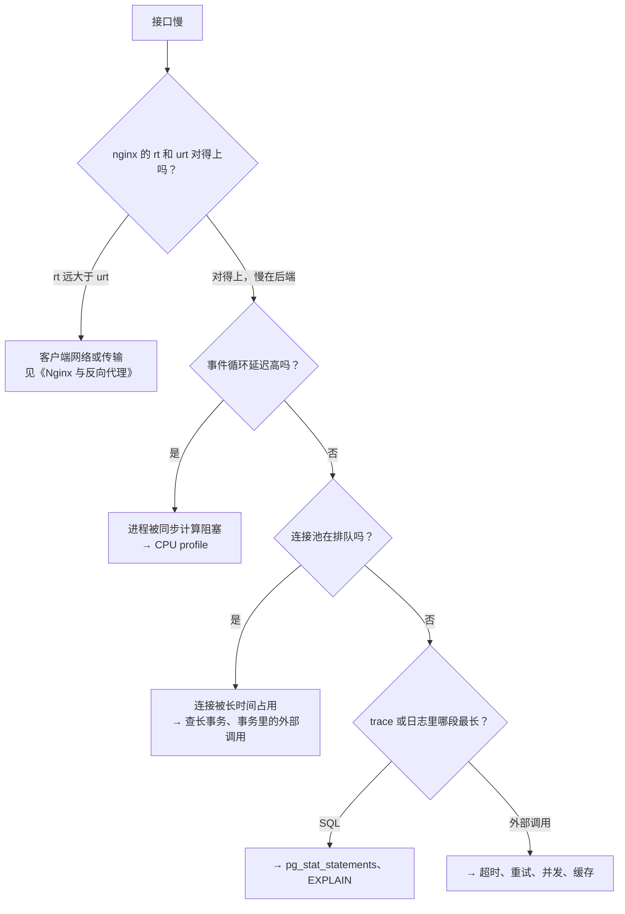

# 瓶颈定位

指标和压测告诉你「慢了」「到头了」，这一章解决下一步：**到底慢在哪里**。性能优化最大的浪费是凭直觉动手：花一天把一个 JSON 序列化优化快了 3 倍，结果它只占请求耗时的 2%。

先用数据定位，再动手改，改完再用数据验证。这一章按 NestJS + Postgres 的典型结构，讲定位瓶颈的思路和每一层的工具。

## 思路：先分层，再深入

一个请求的耗时可以拆成几段。先确定是哪一段，再用那一层的工具深挖：



这个顺序是有讲究的：越靠前的问题，越会**影响所有请求**。事件循环被阻塞，所有接口一起慢；连接池耗尽，所有用到数据库的接口一起排队。单条慢 SQL 通常只影响用到它的那几个接口。

## Node 进程：事件循环

Node 是单线程处理 JavaScript 的。一段同步代码跑 200ms，这 200ms 里**所有其他请求都在等**，哪怕它们只需要 1ms。

### 怎么发现

第 2 章的 `prom-client` 默认指标里有 `nodejs_eventloop_lag_p99_seconds`。正常情况下它是毫秒级；持续超过 100ms 就说明有同步代码在阻塞。

也可以在代码里直接测：

```ts
import { monitorEventLoopDelay } from "node:perf_hooks";

const h = monitorEventLoopDelay({ resolution: 20 });
h.enable();

setInterval(() => {
  // 单位是纳秒
  const p99ms = h.percentile(99) / 1e6;
  if (p99ms > 100) console.warn(`事件循环 p99 延迟 ${p99ms.toFixed(0)}ms`);
  h.reset();
}, 10_000).unref();
```

另一个典型症状：**CPU 刚好卡在 100%（一个核），而机器还有空闲的核**。Node 进程只用满了一个核，`top` 里看整机 CPU 可能只有 50%（2 核机器），容易被忽略。

### 常见元凶

| 元凶 | 例子 | 处理 |
|---|---|---|
| 大 JSON 序列化 | 一次返回上万行数据 | 分页；只返回需要的字段 |
| 同步加密、压缩 | `bcrypt.hashSync`、`zlib.gzipSync` | 用异步版本，它们在线程池里跑 |
| 在内存里处理大数组 | 导入的一万行报表逐行做复杂匹配 | 能下推到 SQL 的下推；必须在 JS 里做的，放进 `worker_threads` 或拆成小批 |
| 生成文件 | 在请求里同步生成 Excel、PDF | 放到后台任务，生成完再通知 |
| 低效的正则 | 回溯爆炸的正则匹配用户输入 | 改写正则，限制输入长度 |

### CPU profile：看时间花在哪个函数

确认是 CPU 问题后，抓一份 CPU profile。Node 内置了这个能力：

```bash
# 本地或压测环境：启动时开启，进程退出时在当前目录写出 .cpuprofile 文件
node --cpu-prof dist/main.js
# 跑一会儿压测，然后 Ctrl+C 停掉进程
```

容器里的线上进程不方便重启时，可以用 `--inspect` 远程连接（**只绑 127.0.0.1，通过 SSH 隧道访问**，调试端口等于远程代码执行权限）：

```bash
# 临时用带 --inspect 的命令启动一个实例
node --inspect=127.0.0.1:9229 dist/main.js

# 本机
ssh -L 9229:127.0.0.1:9229 deploy@你的服务器
# Chrome 打开 chrome://inspect，连接后在 Performance 面板录制
```

得到的 `.cpuprofile` 文件拖进 Chrome DevTools 的 Performance 面板，或者用 speedscope 这类工具打开，看**火焰图**：

- 横向宽度表示占用的 CPU 时间，越宽越耗时
- 纵向是调用栈，上层调用下层
- 找**又宽又平的顶部**：那是函数自身在消耗 CPU，而不是在调用别人

### 内存：泄漏还是正常增长

Node 进程内存持续上涨、从不回落，最后被 OOM 杀掉重启，是泄漏的典型表现。区分：

- **正常**：内存涨到某个水平后稳定，GC 后会回落一部分
- **泄漏**：在负载稳定的情况下，`nodejs_heap_size_used_bytes` 呈锯齿状但整体持续上升

常见原因：全局的 Map 或数组只增不删（比如自己写的缓存没有上限和过期）、事件监听器反复注册不移除、闭包意外持有大对象。hatch-counter 的 `OpsService` 在内存里攒事件时设了 5000 条上限，满了就丢，注释写的就是「库挂了的时候别让这一路先把进程撑爆」，这是防泄漏的好习惯：**所有内存里的集合都要有上限**。

定位泄漏用堆快照：间隔一段时间抓两份，在 Chrome DevTools 的 Memory 面板里对比，看哪类对象的数量在增长。

```bash
# 给进程发信号，让它写出一份堆快照（需要启动时加这个参数）
node --heapsnapshot-signal=SIGUSR2 dist/main.js
kill -USR2 <pid>
```

抓堆快照时进程会暂停，耗时和内存占用都与堆大小相关，生产环境慎用。

## 连接池：被忽视的排队点

数据库连接池是典型的「隐形瓶颈」：池子满了之后，新请求在应用内部**排队等连接**，这段等待既不算 SQL 耗时，也不体现在数据库的任何指标里。表现是：接口很慢，但每条 SQL 都很快，数据库 CPU 也很低。

hatch-counter 业务连接池一共 10 条。它的服务端约束里专门写了一条：**存图、取图、删图一律放在数据库事务外面**，因为那是一次网络往返，放在事务里等于让一条连接干等着。设想一个识别请求在事务里调了 6 秒视觉模型，10 个这样的请求就能把整个池子占满，其他所有用户的请求全部排队。

排查方法：

```sql
-- 当前连接在干什么：重点看 state 和持续时间
SELECT pid, usename, state, wait_event_type, wait_event,
       now() - xact_start AS xact_age,
       now() - query_start AS query_age,
       left(query, 80) AS query
FROM pg_stat_activity
WHERE datname = current_database() AND pid <> pg_backend_pid()
ORDER BY xact_start NULLS LAST;
```

关注 `state = 'idle in transaction'` 的连接：事务开着，但连接上什么都没在执行。这几乎总是意味着代码在事务里做了别的事（调外部 API、读文件、等用户），是连接池耗尽的头号原因。

防护措施：

- 事务里只做数据库操作，外部调用一律移到事务前后
- 给数据库设置 `idle_in_transaction_session_timeout`，空闲事务超时自动断开
- 在应用里给获取连接设置超时，排队太久直接报错，比无限等待更容易发现问题
- 把连接池的使用数、等待数做成指标（多数驱动能拿到这些数据）

## 数据库：找出最贵的 SQL

### pg_stat_statements

Postgres 自带的扩展 `pg_stat_statements` 会把所有执行过的 SQL 按「形状」归类（参数替换成 `$1`），累计执行次数和耗时。它是数据库性能分析的起点。

启用需要预加载，在 compose 里给 postgres 加启动参数：

```yaml
  postgres:
    command: ["postgres", "-c", "shared_preload_libraries=pg_stat_statements"]
```

重启后在库里执行一次：

```sql
CREATE EXTENSION IF NOT EXISTS pg_stat_statements;
```

按总耗时排序，找出最值得优化的 SQL：

```sql
SELECT
  calls,
  round(total_exec_time::numeric / 1000, 1) AS total_s,
  round(mean_exec_time::numeric, 1)         AS mean_ms,
  rows / calls                              AS rows_per_call,
  left(query, 100)                          AS query
FROM pg_stat_statements
ORDER BY total_exec_time DESC
LIMIT 15;
```

按**总耗时**而不是平均耗时排序是关键：一条 5ms 的查询每分钟执行 1 万次，比一条 2 秒但一天只跑一次的报表查询重要得多。

几种典型的模式：

| 现象 | 可能原因 |
|---|---|
| 某条简单查询 `calls` 极高，是其他查询的几十倍 | N+1：循环里逐条查询，应改成一次批量查 |
| `mean_ms` 高，`rows_per_call` 很少 | 缺索引，扫了大量行才找到几行 |
| `rows_per_call` 很大 | 一次返回太多行，考虑分页或只取需要的列 |

### EXPLAIN ANALYZE

找到可疑的 SQL 后，看它的执行计划：

```sql
EXPLAIN (ANALYZE, BUFFERS)
SELECT * FROM purchases
WHERE store_id = '…' AND created_at > now() - interval '30 days'
ORDER BY created_at DESC LIMIT 50;
```

`ANALYZE` 会**真的执行**这条语句，对写操作要包在事务里执行完再回滚。读计划时看几个关键点：

- 大表上出现 `Seq Scan`，且过滤后只剩很少的行：缺索引
- 估计行数（`rows=`）和实际行数（`actual … rows=`）差几个数量级：统计信息过时，执行 `ANALYZE 表名`
- `Sort` 节点后面写着 `external merge`：排序超出了 `work_mem`，在用磁盘
- `Buffers: shared read` 很大：数据不在缓存里，在读磁盘

索引设计、参数调优、慢查询治理的完整内容见[《PostgreSQL 运维》](../database-ops/)。

### N+1：ORM 的经典陷阱

```ts
// 一次查出 50 张进货单，再对每张单查一次明细：总共 51 条 SQL
const list = await db.select().from(purchases).where(eq(purchases.storeId, storeId)).limit(50);
for (const p of list) {
  p.items = await db.select().from(purchaseItems).where(eq(purchaseItems.purchaseId, p.id));
}
```

改成一次批量查询：

```ts
import { eq, inArray } from "drizzle-orm";

const list = await db.select().from(purchases).where(eq(purchases.storeId, storeId)).limit(50);
const items = await db
  .select()
  .from(purchaseItems)
  .where(inArray(purchaseItems.purchaseId, list.map((p) => p.id)));
// 在内存里按 purchaseId 分组，挂回每张单
```

或者用 Drizzle 的关系查询（`db.query.purchases.findMany({ with: { items: true } })`），它会生成数量固定的 SQL。N+1 在开发环境里几乎察觉不到（本地数据库延迟不到 1ms），到了生产环境网络往返加上数据量，就是成倍的耗时。

## 外部调用

调用第三方服务的耗时不受你控制，但影响是你的。检查清单：

- **一定要设超时**。Node 的 `fetch` 默认没有总超时，用 `AbortSignal.timeout(ms)`。没有超时的外部调用，一旦对方卡住，你的请求和资源会无限期挂着
- **重试要退避、要有上限**。hatch-counter 调识别服务时，遇到 429、5xx、超时会隔 0.8 秒、2.5 秒重试，同一家最多三次；遇到 key 被拒、额度用完这类不会自愈的错误直接换下一家，不重试
- **能并行的不要串行**。三个互不依赖的外部调用，用 `Promise.all` 同时发
- **能缓存的就缓存**。结果短时间内不变的（汇率、配置、第三方元数据），缓存几分钟就能消掉大部分调用

## 优化之后：验证

每次优化都要回答：**改善了多少？** 用同一个压测脚本、同样的数据，在改动前后各跑一次，对比 p95 和吞吐量。没有对比的优化，你无法确定它是否有效，甚至可能是负优化。

## 本章要点

- 先分层定位再动手：nginx 耗时 → 事件循环 → 连接池 → SQL → 外部调用，越靠前影响面越大
- 事件循环延迟高说明有同步代码阻塞，用 `--cpu-prof` 抓火焰图找宽而平的顶部
- 内存里的集合都要有上限；疑似泄漏时对比两份堆快照
- 连接池耗尽的表现是「接口慢但 SQL 快」；`idle in transaction` 是头号嫌疑，外部调用不要放进事务
- `pg_stat_statements` 按总耗时排序找最贵的 SQL，`EXPLAIN (ANALYZE, BUFFERS)` 看执行计划
- 外部调用必须有超时，重试要退避和设上限；优化前后用同一压测对比
