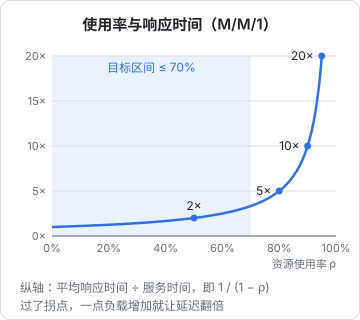
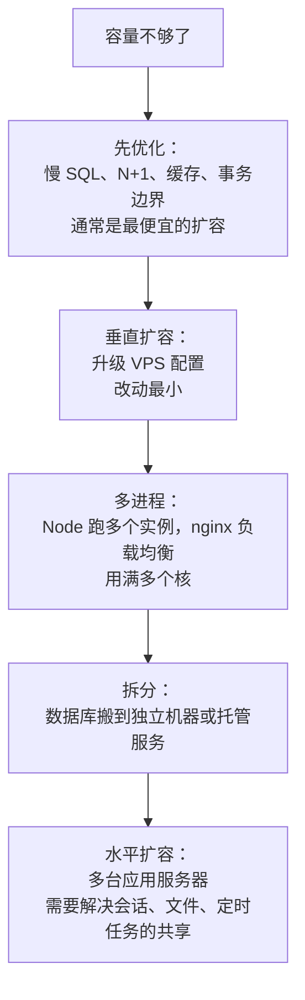

# 容量规划

最后一章回答一个所有独立开发者都会遇到的问题：**这台机器还能撑多久？什么时候该升级，升级什么？**

升级太早，每个月白花钱；升级太晚，在用户增长最快、最需要稳定的时候出故障。容量规划不需要复杂的模型，需要的是三样东西：一点排队论的直觉、几个从监控里读出来的数、一份定期更新的记录。

## 两个公式

### 利特尔定律

$$
L = \lambda \times W
$$

系统里平均同时存在的请求数 $L$，等于请求到达速率 $\lambda$ 乘以每个请求在系统里的平均停留时间 $W$。它不依赖任何分布假设，几乎在所有稳定系统里都成立。

这个公式在容量规划里最常见的用途是**估算并发资源需要多少**。以数据库连接池为例：

| 场景 | 到达速率 $\lambda$ | 每次占用连接时长 $W$ | 平均占用连接数 $L$ |
|---|---|---|---|
| 普通接口 | 30 次/秒 | 20ms | 0.6 条 |
| 识别接口，外部调用放在事务**外** | 1 次/秒 | 30ms（只算写库） | 0.03 条 |
| 识别接口，外部调用放在事务**里** | 1 次/秒 | 6s（含等模型） | 6 条 |

同样每秒一次的识别请求，因为事务边界划错，平均就要占掉 6 条连接，10 条的池子瞬间只剩 4 条给所有其他请求。这就是上一章「外部调用不要放进事务」的量化解释。

注意 $L$ 是**平均值**，请求到达是随机的，峰值会明显高于平均。连接池、线程数这类资源要在平均值之上留出余量。

### 使用率与延迟

把一个资源（一个 CPU 核、一个数据库）看成一个服务台，请求在它前面排队。最简单的排队模型（M/M/1，到达和服务时间都是随机的）给出了平均响应时间：

$$
R = \frac{S}{1 - \rho}
$$

$S$ 是请求本身的服务时间，$\rho$ 是资源的使用率（忙碌时间占比）。



这条曲线是容量规划里最重要的直觉：

- 使用率 50% 时，响应时间是服务时间的 2 倍
- 80% 时是 5 倍，90% 时是 10 倍
- 越接近 100%，曲线越陡，一点点负载增加就会让延迟翻倍

真实系统不完全符合这个模型，但形状是一样的：**存在一个拐点，过了拐点延迟急剧恶化**。这就是第 7 章压测找到的那个拐点的来源。

所以容量目标不是「使用率不超过 100%」，而是**峰值时段的使用率保持在拐点之前**。对一人项目来说，关键资源在峰值时不超过 60%–70% 是比较稳妥的目标：既留出应对突发的余量，也给你发现问题后从容升级的时间。

## 盘点：你的系统有哪些资源

一台 VPS 上跑 NestJS + Postgres，可能先耗尽的资源有：

| 资源 | 看哪个指标 | 耗尽时的表现 |
|---|---|---|
| Node 进程的 CPU（单核） | `process_cpu_seconds_total` 的增速、事件循环延迟 | 所有接口一起变慢 |
| 整机 CPU | `node_cpu_seconds_total` | 进程之间互相抢，Postgres 也变慢 |
| 内存 | `node_memory_MemAvailable_bytes` | 开始用 swap，或进程被 OOM 杀掉 |
| 数据库连接 | 连接池使用数、`pg_stat_activity` | 接口慢但 SQL 快 |
| 磁盘空间 | `node_filesystem_avail_bytes` | 数据库写入失败，后果最严重 |
| 磁盘 IO | `node_disk_io_time_seconds_total` | 数据库查询变慢，`iowait` 升高 |
| 带宽 | `node_network_transmit_bytes_total` | 大文件下载慢；超出套餐后限速或额外计费 |
| 外部配额 | 第三方的用量和限流 | 识别、短信服务返回 429 |

最后一项常被忘记：**第三方服务的配额和预算也是容量**。每天识别多少张图、发多少条短信，增长到多少会触及套餐上限，同样需要规划。

## 估算：从现在推到未来

### 第一步：测量单位成本

找出「每个请求消耗多少资源」。以 CPU 为例，在一段负载稳定的时间里：

```text
# Node 进程每秒消耗的 CPU 秒数
rate(process_cpu_seconds_total{job="api"}[1h])
# 同期每秒请求数
sum(rate(http_request_duration_seconds_count[1h]))
```

两者相除就是每个请求平均消耗的 CPU 时间。假设算出来是 8ms：单个 Node 进程只能用一个核，理论上限是每秒 $1000 / 8 = 125$ 个请求；按 60% 的目标使用率，舒适上限约每秒 75 个。

这类估算有两个前提要记住：一是不同接口的成本差异很大，流量结构变了（比如导入报表的用户多了）单位成本也会变；二是这只是 CPU 一项，还要逐个看其他资源，**最先到达上限的那个才是真正的容量**。最可靠的验证仍然是第 7 章的压力测试。

### 第二步：找到峰值

容量看的是峰值，不是平均值。门店类业务有明显的日内规律：饭点前后、打烊后对账是高峰，凌晨几乎为零。用过去 30 天每天的最高值：

```text
max_over_time(sum(rate(http_request_duration_seconds_count[5m]))[30d:5m])
```

### 第三步：预测增长

把峰值和业务增长挂钩。对一人项目，业务指标比技术指标更好预测：「每个活跃门店在高峰期贡献大约每秒 0.1 个请求」，那么门店数从 200 涨到 600，峰值就从每秒 20 涨到 60，仍在每秒 75 的舒适上限之内，但余量已经不多了。

磁盘的增长更有规律，直接看趋势：

```sql
-- 每张表（含索引和 TOAST）的大小，按大小排序
SELECT relname,
       pg_size_pretty(pg_total_relation_size(relid)) AS total
FROM pg_catalog.pg_statio_user_tables
ORDER BY pg_total_relation_size(relid) DESC
LIMIT 10;
```

每月记录一次，或者用 postgres_exporter 的库大小指标配合 `predict_linear` 外推：

```text
# 按过去 30 天的趋势，90 天后数据库多大
predict_linear(pg_database_size_bytes{datname="app"}[30d], 90 * 86400)
```

别忘了磁盘上的其他住户：Docker 镜像、容器日志、备份文件、监控数据。备份放在同一块盘上，既占容量，也不算真正的备份。

## 扩容的顺序

确认要扩容时，一人项目的推荐顺序：



- **先优化**：第 8 章的手段往往能换来数倍的余量，而且不增加每月成本
- **垂直扩容**：升配置通常只需要在控制台点几下、重启一次。一人项目在很长时间内都不需要越过这一步，一台配置合理的 VPS 能支撑的业务量往往超出预期
- **多进程**：Node 单进程只用一个核。机器有 4 核而 Node 进程 CPU 已经接近 100% 时，在 compose 里起多个 api 实例，nginx 用 upstream 做负载均衡（见[《Nginx 与反向代理》](../nginx-gateway/)）。注意进程内的状态（内存缓存、SSE 连接、定时任务）会因此变成多份，需要逐一检查
- **拆分数据库**：数据库和应用抢资源、或者想让数据库获得更好的备份与高可用时，把它搬到独立机器或云厂商的托管数据库
- **水平扩容**：多台应用服务器意味着架构上的改变，是最后的选项

## 容量记录

把容量规划变成一份定期更新的文档，放在项目仓库里。每月或每次大版本发布后花半小时更新：

```markdown
## 容量记录 2026-11

- 机器：2 核 4G，40G 系统盘
- 峰值请求：每秒 18 次（近 30 天最高）
- 压测拐点：每秒约 70 次，最先耗尽的是 Node 单核 CPU（2026-10 压测，版本 1.1.2）
- 当前余量：约 3.9 倍
- 内存：峰值可用 1.2G
- 磁盘：已用 21G，近 30 天增长 1.1G，按此速度约 17 个月写满
- 数据库连接：峰值 6 / 10
- 外部配额：识别日均 340 次，套餐上限的 23%
- 下一步：余量降到 2 倍时，先查最慢的 3 个接口，再考虑起第二个 api 实例
```

（数字为示意。）这份记录的价值在于**提前写好的触发条件**：余量降到多少、磁盘还剩多少个月时做什么。到时候照着执行，而不是在故障里临时决策。

## 成本也是容量

一人公司的容量规划，最终要和收入放在一起看：

- 计算每个付费用户（或每个门店）对应的基础设施成本，它应该是收入里一个很小且稳定的比例
- 监控数据、日志、备份的存储都在花钱，保留期按需设置，不要「先存着再说」
- 第三方按量计费的服务（模型调用、短信、对象存储流量）往往比服务器本身贵，也更容易失控，要设预算告警

成本控制的更多内容，见[《一人运维手册》](../production-ops/)。

## 本章要点

- 利特尔定律 $L = \lambda W$ 用来估算并发资源；事务里夹着外部调用会让连接占用成倍增长
- 响应时间随使用率按 $S / (1 - \rho)$ 的形状增长，峰值使用率保持在 60%–70% 以内
- 逐项盘点 CPU、内存、连接、磁盘、IO、带宽和第三方配额，最先耗尽的那个才是容量
- 测单位成本、找峰值、按业务指标预测增长，再用压测验证
- 扩容顺序：先优化，再升配置，再多进程，最后才拆分和水平扩容
- 维护一份带触发条件的容量记录，每月更新

## 接下来读什么

这本书让你「看得见」系统，接下来的两本把它用起来：

- [《PostgreSQL 运维》](../database-ops/)：第 8 章只开了个头的慢查询治理、连接池、参数调优，在那里系统展开；备份与时间点恢复更是一人项目的生命线
- 《一人运维手册》：把告警、复盘、SLO 与错误预算、值班制度串成一套一个人能执行的运维流程
