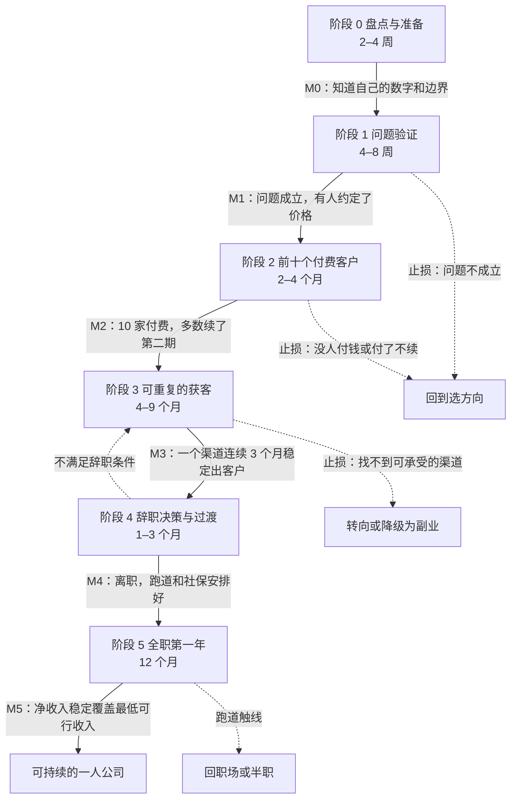
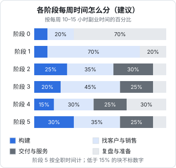

# 总览：六个阶段与里程碑

书架上的一人公司系列已经有十一本，每一本讲一块：怎么选方向、怎么访谈、怎么定价、怎么记账、怎么备案、怎么让 agent 接活。读完之后最常见的状态是：每块都懂一点，但不知道**下周一晚上该干什么**。

这本书只做一件事：把那些书里的内容排成一条时间线，让一个在职、下班做副业的开发者能照着走，从「有个产品」走到「这个产品养活自己」。全书以 hatch-counter（产品名「掌柜眼」，给中小餐饮门店用的经营管理 SaaS）为主线，先做国内市场。

它不重复其他书讲过的方法。讲到访谈怎么问、价格怎么定、发票怎么开时，只说「这一阶段要做这件事、做到什么程度算完」，具体做法用「见《书名》第 N 章」指过去。附录把这些引用汇总成一张阅读对照表。

## 这本书和其他书的关系

| 你想知道 | 去哪本 |
|---|---|
| 一人公司的底层判断：选方向、验证、过渡、止损的框架 | [《一人公司方法论》](../opc-playbook/) |
| 某一块具体怎么做：访谈、定价、获客、记账、备案 | 对应的专题书 |
| 怎么让 agent 承担各岗位的执行 | [《用 AI 撑起一人公司》](../ai-native-opc/) |
| **每个阶段先做什么、做到什么程度、什么时候停** | 本书 |

[《一人公司方法论》第 3 章](../opc-playbook/03-fast-validation.md)的验证三问（问题是否存在、有没有人付钱、能否持续触达）、第 4 章的跑道计算、第 6 章的止损线，是本书阶段划分的骨架。本书的六个阶段，就是把这三问和「辞职、全职」两个决定按时间摊开：

| 阶段 | 回答的问题 | 对应《一人公司方法论》 |
|---|---|---|
| 0 盘点与准备 | 我有多少时间、多少钱、需要多少收入、有哪些边界 | 第 1 章最低可行收入、第 4 章副业边界 |
| 1 问题验证 | 问题存在吗、目标用户在意吗 | 第 3 章第一问 |
| 2 前十个付费客户 | 有人愿意付钱吗，而且付了还续吗 | 第 3 章第二问 |
| 3 可重复的获客 | 我能持续、以可承受的成本触达他们吗 | 第 3 章第三问、第 7 章单位经济 |
| 4 辞职决策与过渡 | 现在辞职划算吗，怎么辞 | 第 4 章 |
| 5 全职第一年 | 全职后怎么把收入做到能持续 | 第 5 章、[《用 AI 撑起一人公司》第 8 章](../ai-native-opc/08-org-design.md) |

## 六个阶段一张图



每个里程碑（M0–M5）都是**可以判断「到没到」的结果**，不是「做完了某些事」。比如 M2 不是「做完了在线付费」，而是「有 10 家店付了钱、其中多数续了第二期」。做了很多事但结果没到，就还在这个阶段。

图里的周期按**每周副业 10–15 小时**估算：工作日晚上两三个时段，加周末半天。这个投入量是可以持续一两年的量，不是冲刺量。时间更多的人周期会短一些，但不会按比例缩短：访谈要等对方有空，门店续费要等一个账期，渠道效果要看几个月，这些等待和你投入多少小时无关。

从阶段 0 走到 M3，顺利的话大约 9–18 个月；再加上辞职过渡和全职第一年，全程两年左右。这个数字的用处是**校准预期**：如果你的计划是「三个月后辞职」，那它和这条路线对不上，要么你已经走完了前几个阶段，要么计划太乐观。

## 每个阶段都写清七件事

后面第 2–7 章每章讲一个阶段，结构相同：

| 项 | 写什么 | 为什么要有 |
|---|---|---|
| 进入条件 | 上一个里程碑达成的证据 | 防止跳阶段：没验证问题就去铺渠道 |
| 大致周期 | 按每周 10–15 小时估 | 校准预期，超出太多就要检查 |
| 要做的事 | 拆到周的清单 | 下周一晚上知道打开电脑做什么 |
| 退出条件 | 量化的标准 | 知道什么时候可以进下一阶段 |
| 止损线 | 到什么时间、什么结果就停下来评审 | 防止在一个阶段里无限期耗着 |
| 常见的坑 | 这个阶段最容易犯的错 | 别人踩过的不用再踩 |
| 要读的书 | 哪本书的哪几章 | 需要方法时去哪查 |

退出条件和止损线里的数字，本书会给一个**建议值**，是按 hatch-counter 这类低客单价门店 SaaS 估的。你的产品客单价、销售周期不同，数字要换，但「事先写下数字、到时候不改」这条规矩不变，理由见《一人公司方法论》第 3 章「事先写好成功标准」和第 6 章「在开始时写好止损线」。

## 各阶段的里程碑总表

| 里程碑 | 判断标准（建议值） | 不算数的情况 |
|---|---|---|
| M0 | 写下了最低可行收入、每周可用时段、副业边界核对结果、第一版止损线 | 「大概知道」但没写下来 |
| M1 | 访谈过至少 8 家目标门店的决策人；至少 5 家描述了同样的麻烦，且现在正为它花时间或钱；至少 3 家同意试用并口头接受了一个具体价格 | 访谈对象主要是熟人；只问了「你会不会用」 |
| M2 | 10 家非熟人门店付过钱；其中至少 7 家付了第二期；单店开户上手的时间被压到你能接受的范围 | 免费送的、朋友帮忙的；只付了一期就不续的 |
| M3 | 一个主渠道连续 3 个月每月带来稳定的新付费门店；可控流失在可接受范围；单店获客花的时间可估算且在下降 | 一次性的爆发（一篇帖子火了）；全靠你本人的熟人圈 |
| M4 | 辞职条件满足，跑完保守场景储蓄仍有余量；社保、医保、主体、家人都安排好 | 「上班太累了」 |
| M5 | 连续 3 个月净收入覆盖最低可行收入；每周工作量可持续 | 靠一次大单撑起来的一个月 |

为什么 M2 定在 10 家、M1 定在 8 家访谈，这些数字背后的理由在各阶段章里讲。

## 为什么要分阶段

不分阶段的副业，常见的样子是：什么都在推进一点，什么都没推到底。写代码、做官网、拍宣传片、研究公司注册、看定价理论，每样都有进展，但三个月后回答不了「有没有人愿意付钱」。

分阶段的好处有三个：

1. **每个阶段只有一个主问题**。阶段 1 只回答「问题是否存在」，所以这个阶段不做官网改版、不研究注册公司。不属于这个阶段的事，写进「以后再做」的清单
2. **阶段决定时间怎么分**。同样是每周 12 小时，阶段 1 大部分花在找人聊，阶段 2 花在开户、陪客户用、修阻碍付费的问题，阶段 3 花在渠道实验。下面这张图是建议的分配，第 8 章会讲怎么每周对照



3. **止损有了节点**。没有阶段的项目，没有自然的评审时刻，于是永远「再做一点看看」。每个阶段有截止时间，到了就评审，这是[《一人公司方法论》第 6 章](../opc-playbook/06-when-to-quit.md)说的「模糊的进展」最好的解药

图里阶段 1–3 的「构建」都不超过三成，这是对开发者最反直觉的地方。代码写得最舒服，所以最容易被它吃掉时间；而这三个阶段的瓶颈都不在代码上。

## 阶段不是严格线性的

现实中的阶段会重叠，也会倒退：

- **重叠**：阶段 2 签第 8 家店的时候，你已经在留意哪个渠道来的客户更多，这是在为阶段 3 收集数据。可以，但主精力仍在阶段 2 的主问题上
- **倒退**：阶段 3 发现客户来了一批就流失一批，追查下来是产品没解决核心问题，那就回到阶段 1 或 2 重新验证。这不是失败，是止损机制在起作用
- **跳过**：如果你已经有了阶段 2 的证据（比如在职时就有几家店在付费），可以直接从阶段 3 开始。但要拿得出证据，不能凭感觉跳

还有一种情况很常见，也是 hatch-counter 现在的样子：**产品走在验证前面**。代码已经写到了能收费、能续期、能发到期短信的程度，但真实付费门店的证据还没有。这时阶段按证据算，不按产品完成度算。第 2 章的现状盘点会细说。

## 节奏要能持续

这本书里没有「每天打卡」「连续多少天不断更」这类要求。一人公司的副业期动辄一两年，靠冲刺撑不到终点。本书的节奏设计有几条原则：

- **按周计划，不按天**：今天加班没碰副业不要紧，这一周的几件事做完就行。第 8 章给周计划和周复盘的模板
- **留出不做的周**：每个季度留一两周什么都不推进，休息、陪家人、只处理必须响应的客户问题。计划里提前写上，不算掉队
- **用结果衡量，不用时长衡量**：一周花了多少小时不重要，三个目标完成了几个才重要
- **允许阶段周期拉长**：家里有事、工作忙，周期拉长到上限的 1.5 倍都正常。超过这个范围，按第 9 章「卡住了怎么办」排查原因

为什么这样设计，[《一人公司方法论》第 5 章](../opc-playbook/05-energy-rhythm.md)「精力与节奏」讲了道理：一人公司真正稀缺的是能做出好判断的注意力，长期透支会直接损害判断力。

## 怎么用这本书

- **第一遍**：读完本章和第 2 章，做完阶段 0 的盘点。不用一次读完全书，后面的阶段到了再读
- **每进入一个阶段**：读对应的章，把「要做的事」抄进你的周计划，把退出条件和止损线写进公司仓库（[《用 AI 撑起一人公司》第 1 章](../ai-native-opc/01-ai-native-opc.md)讲的那个 Git 仓库）的一个文件里
- **每周**：按第 8 章的模板做计划和复盘
- **卡住时**：查第 9 章
- **要查某件事该读哪本书**：查第 10 章附录的对照表

一个建议：在公司仓库里建一个 `plan/` 目录，放这几个文件，后面各章会往里填内容。

```text
plan/
  numbers.md        阶段 0 的数字：最低可行收入、时间预算、跑道
  stages.md         当前阶段、进入日期、退出条件、止损线和评审日
  weekly/           每周一份计划 + 复盘，如 2026-W45.md
  experiments/      每个验证或渠道实验一张卡片
  later.md          不属于当前阶段、以后再做的事
```

## 本章要点

- 本书把其他书讲的方法排成一条时间线，只讲「每个阶段做什么、做到什么程度、什么时候停」，方法本身见引用的书
- 六个阶段：盘点与准备、问题验证、前十个付费客户、可重复的获客、辞职决策与过渡、全职第一年；骨架来自《一人公司方法论》的验证三问和跑道计算
- 每个里程碑是可以判断到没到的结果，不是做完了哪些事
- 按每周 10–15 小时估，走到可重复获客大约 9–18 个月，全程两年左右
- 每个阶段写清进入条件、周期、周任务、量化退出条件、止损线、常见坑、要读的书
- 阶段 1–3 的瓶颈都不在代码上，构建时间不超过三成
- 阶段按证据算，不按产品完成度算；产品走在验证前面时，回到证据缺的那一阶段
- 节奏按周、按结果、可拉长，留出不做的周；不打卡、不比时长
