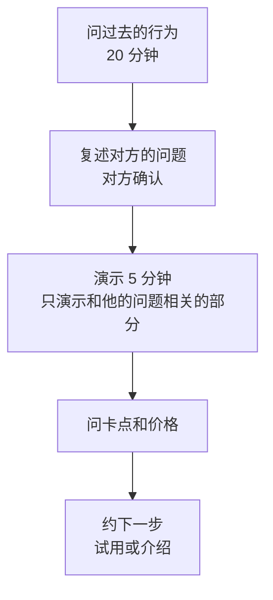

# 阶段 1：问题验证

阶段 1 只回答一个问题：**你要解决的问题，在目标用户那里是否真实存在，而且他们在意**。顺带收集两样东西：他们现在为这个问题花了多少时间和钱（付费意愿的线索），以及你是通过什么路子找到他们的（渠道的线索）。

方法本身[《一人公司方法论》第 3 章](../opc-playbook/03-fast-validation.md)和[《产品思维》第 2 章](../product-thinking/02-user-interviews.md)已经讲透了：问过去不问将来、先桌面调研再访谈、事先写成功标准。这一章不重复方法，只讲怎么把它排进 4–8 周的副业时间里，以及做到什么程度算完。

## 进入条件与周期

- **进入条件**：M0 达成。`plan/stages.md` 里写好了本阶段的退出条件和止损线
- **周期**：4–8 周。约访要等对方有空，见面要用白天，这是周期的主要约束，不是你的工时
- **时间分配**：七成用在找人和聊，一成准备演示，两成整理和复盘。这个阶段几乎不写代码

## 访谈谁

### 只访谈决策人

对 hatch-counter 来说，使用者和付费决策者都是店主，这是好事：不需要分别说服两个人。但要确认你聊的是**真正拍板花钱的人**。店长、收银员、老板的亲戚能告诉你操作上的麻烦，但回答不了「这件事值不值得花钱」。

一家店里如果实际记账的是老板娘，那她就是访谈对象。访谈前问一句「店里的账一般是谁在管」，比事后发现聊错了人强。

### 样本要分散

8 家是建议的下限，理由是：少于这个数，一两家的特殊情况就能左右结论；多于十几家，在这个阶段边际信息变少。更重要的是**来源分散**：

| 来源 | 建议占比 | 说明 |
|---|---|---|
| 熟人或熟人介绍 | 不超过三成 | 好约，但会说好听的；他们的意见要打折看 |
| 主动走访（附近街区的店） | 三到五成 | 最难开口，但样本最真实，也最接近阶段 3 的地推渠道 |
| 行业群、供应商、收银系统服务商介绍 | 两到三成 | 顺便验证这些人愿不愿意帮你介绍，这是阶段 3 的渠道线索 |

还要覆盖不同类型的店：快餐和正餐、单店和两三家店、开了几个月的和开了几年的。如果只聊了某一类，结论只适用于那一类。

### 约访话术

主动走访时，开口最难。下面是一个可以改的骨架，核心是**说清你要什么、要多久、对方能得到什么**，而不是推销产品：

```text
老板您好，打扰两分钟。我是做软件的，在研究小饭馆怎么算清楚每天赚没赚钱、
进货怎么记。不是来卖东西的，想跟您请教 20 分钟，听听您现在是怎么弄的。
您看今天下午两点到四点之间，或者这周哪天不忙的时候方便？
聊完我可以把整理出来的「几家店都怎么记账」的要点发给您参考。
```

几条经验：

- **避开饭点**。中午十一点到一点半、晚上五点到八点基本不可能聊。下午两点到四点半、上午十点前相对好约
- **先买一单再开口**。在店里吃顿饭、买杯饮料，再在结账时问。被拒绝了也没有损失
- **被拒绝很正常**。走访十家约到两三家是常见的比例。记录每家的结果，这个数字本身就是阶段 3 的渠道数据
- **线上约的，先发一句话说明来意**，不要一上来发产品链接

## 问什么

通用的访谈原则见《产品思维》第 2 章。下面是针对 hatch-counter 的问题清单，按「过去发生的事」来问：

```text
# 访谈提纲（20–30 分钟）

开场（2 分钟）
- 店开了多久？几个人？一天大概多少桌 / 多少单？

现在怎么算钱（10 分钟）
- 上个月赚了还是亏了？您是怎么知道的？什么时候知道的？
- 最近一次「感觉不对，钱去哪了」是什么时候？当时怎么查的？
- 收银用的是什么系统？能导出报表吗？导出来以后干什么？

进货和库存（8 分钟）
- 进货单现在怎么处理？手写的单子最后放哪了？
- 上一次发现某样料用得比预期多 / 坏掉了，是怎么发现的？
- 月底盘点吗？怎么盘？花多长时间？

现在的投入（5 分钟）
- 现在为收银、记账、进销存这些付了什么钱？一年大概多少？
- 有没有请人 / 让家人专门记账？每周花多少时间？
- 以前试过什么软件或表格？为什么不用了？

收尾（2 分钟）
- 如果能解决一件事，您最想解决哪件？
- 您认识的老板里，还有谁也在为这个头疼？方便介绍吗？
```

**最后一问不要省**。愿意转介绍，本身就是「问题真实、对方在意」的信号；介绍来的人，是下一轮访谈和阶段 3 转介绍渠道的种子。

## 带着产品的访谈

如果像 hatch-counter 一样已经有了能用的产品，可以在访谈后段加一段演示。顺序很重要：**先问完，再演示**。先演示的话，对方的回答会被你的产品框住，你听到的是他对你方案的看法，而不是他的问题。



演示后问的不是「您觉得怎么样」，而是：

- 「如果明天开始用，第一周最可能卡在哪一步？」——卡点往往是阶段 2 交付时真正要解决的事，比如收银系统导不出报表、配方录不全
- 「像这样的工具，您觉得一个月多少钱是合理的？」——听他先说数字；他不说，再报一个具体价格看反应。只有当对方说「这个价格可以」「再便宜点就行」时才算「没有否定」；说「挺好的，到时候再说」不算。价格测试的方法见[《定价与商业模式》第 4 章](../pricing-monetization/04-price-experiments.md)
- 「愿意先用两周试试吗？试用期间我来帮您把菜品和配方录好。」——同意的，就是阶段 2 的第一批候选

演示用一家准备好的演示店，不要现场注册。演示的目标是让对方 5 分钟内看到「这家店这个月赚了多少、哪道菜在亏钱」，其他功能不讲。

## 记录和汇总

每次访谈后 24 小时内写笔记，记原话，不记你的解读。一份笔记一个文件：

```text
# 2026-12-06 访谈 07
店：街口面馆（化名），单店，开了 3 年，6 个人
来源：主动走访，第 2 次去约到
决策人：老板本人，账老板娘管

原话：
- 「赚没赚钱月底看银行卡余额」
- 「进货单都在抽屉里，月底一沓，从来不对」
- 「收银机是 XX 的，报表能导，没导过」
现在的投入：
- 收银系统年费（金额对方没说）
- 老板娘每周日晚上大概两小时对账
以前试过：Excel，坚持了一个月
最想解决：知道哪几道菜其实不赚钱
价格反应：报 99/月，说「要是真能省事，可以」
下一步：同意试用，约下周三下午录菜单
转介绍：说隔壁卤味店老板也问过类似的事，可以介绍
```

笔记里的店名、人名用化名；真实的联系方式另存，不进公司仓库，理由见[《用 AI 撑起一人公司》第 1 章](../ai-native-opc/01-ai-native-opc.md)「公司仓库」。

访谈到一半（4 家左右）和全部结束时，各做一次汇总。可以让 agent 读所有笔记，按问题归类、数出现次数，但**结论自己下**：

```text
读 interviews/ 下所有访谈笔记，整理一张表：
1. 每家提到的麻烦，归成不超过 6 类，每类列出是哪几家、各自的原话
2. 每家现在为这些麻烦花的时间和钱（只写笔记里有的，没有的写「未提及」）
3. 每家对价格的反应，原话照抄
4. 每家的来源和约访次数
不要推测笔记里没写的内容。
```

## 拆到周

按 8 周排，节奏快的可以压到 4–5 周：

| 周 | 要做的事 | 这周结束时应该有 |
|---|---|---|
| 1 | 桌面调研半天（应用商店差评、餐饮老板社群里的抱怨）；列 30 家候选门店名单，标来源；改好约访话术和提纲；准备演示店 | 名单、提纲、演示店 |
| 2 | 走访 8–10 家约访；约熟人介绍的 2 家 | 约定的访谈 3–4 场 |
| 3 | 完成前 3–4 场访谈，每场后 24 小时内写笔记 | 3–4 份笔记 |
| 4 | 中期汇总：哪些问题问不出东西就换掉；样本缺哪类店就补 | 修订后的提纲、补充名单 |
| 5–6 | 继续访谈，加入演示和价格问题；向供应商或行业群要介绍 | 累计 6–8 份笔记 |
| 7 | 补访谈到 8–10 家；对表示愿意试用的，约好具体时间 | 试用约定 |
| 8 | 最终汇总，对照退出条件做评审，写评审记录 | 评审结论 |

如果第 3 周结束时一场访谈都没约到，不要等到第 8 周，直接看第 9 章「约不到人」那一节。

## 退出条件与止损线

**退出条件（M1）**，建议值：

- 访谈至少 8 家目标门店的决策人，其中非熟人不少于 5 家
- 至少 5 家描述了同一类麻烦，并且**现在正在为它花时间或钱**（每周对账几小时、请人记账、买过软件又放弃）
- 至少 3 家同意试用，并且对一个具体价格没有否定

第二条的关键是「正在花」。对方说「这个问题挺烦的」不算；对方说「每周日晚上老板娘要对两小时账」算。

**止损线**：到评审日出现下面任一情况，进入评审：

- 约到的访谈少于 4 家：先查是约访方法的问题还是人群本身难触达，见第 9 章
- 访谈过的门店里，认为这个问题严重的不到一半：问题可能不够痛，或者你找错了人群
- 大家都承认问题，但没人在为它花时间或钱：可能是「有了更好，没有也行」的问题

评审时按[《一人公司方法论》第 6 章](../opc-playbook/06-when-to-quit.md)的流程判断是换做法、换人群还是换问题。对 hatch-counter 来说，常见的调整是收窄人群：比如发现单店小馆子不在意，但两三家店的老板很在意，那就把阶段 2 的目标客户改成多店老板。

## 常见的坑

| 坑 | 表现 | 怎么办 |
|---|---|---|
| 访谈变成推销 | 一半时间在讲自己的产品 | 演示放在最后，限时 5 分钟 |
| 只聊熟人 | 8 家里 6 家是朋友的店 | 熟人不超过三成，结论按非熟人的算 |
| 问将来 | 「您会不会用」「您觉得有用吗」 | 照提纲问过去的行为 |
| 访谈完又回去写代码 | 听到一个需求就加功能 | 记进 `plan/later.md`，阶段 1 不改产品 |
| 把礼貌当认可 | 「挺好的，做出来告诉我」 | 只把付出了时间、介绍了人、接受了价格的当信号 |
| 无限期访谈 | 访谈了 20 家还在「再聊几家」 | 按评审日下结论，信息不够就设计一个更明确的实验 |

## 这一阶段要读的

| 书 | 章 | 用来做什么 |
|---|---|---|
| [《一人公司方法论》](../opc-playbook/) | 第 3 章 | 验证三问、验证阶梯、成功标准 |
| [《产品思维》](../product-thinking/) | 第 2 章 | 访谈方法 |
| 《产品思维》 | 第 3 章 | 把问题和方案分开记录 |
| [《定价与商业模式》](../pricing-monetization/) | 第 4 章 | 访谈里怎么测价格 |
| [《销售与 To B 成交》](../b2b-sales/) | 需求发现、触达相关章节 | 走访和约访的销售技巧 |
| [《国内私域与内容平台》](../private-domain-cn/) | 门店 SaaS 的私域打法 | 访谈对象加微信之后怎么维护 |

## 本章要点

- 阶段 1 只回答问题是否存在、对方是否在意，顺带收集付费和渠道的线索
- 只访谈拍板花钱的人；8 家起步，熟人不超过三成，覆盖不同类型的店
- 约访说清要什么、要多久、对方能得到什么；避开饭点，被拒绝是常态
- 已有产品时先问完再演示，演示只讲和对方问题相关的部分；演示后问卡点、价格和试用
- 每次访谈后 24 小时内记原话，用化名；让 agent 归类，结论自己下
- 退出条件的关键是「正在为这个问题花时间或钱」，不是「觉得挺烦」
- 阶段 1 不改产品，听到的需求写进以后再做的清单
