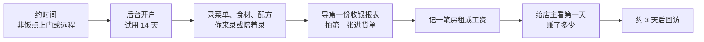

# 阶段 2：前十个付费客户

阶段 1 证明了问题存在、有人在意。阶段 2 回答下一个问题：**他们愿不愿意付钱，付了之后还续不续**。

这一阶段的目标很具体：10 家非熟人门店付过钱，其中多数付了第二期。听起来不多，但对副业来说，这往往是整条路上最累的一段：每家店都要你亲自开户、陪着录数据、在下班后回消息、在周末上门。好在这正是《一人公司方法论》第 3 章说的「手工服务」：客户只有个位数的时候，人工完成比自动化便宜得多，而且每一次接触都在告诉你产品哪里挡住了人。

## 进入条件与周期

- **进入条件**：M1 达成。手里有至少 3 家愿意试用的门店
- **周期**：2–4 个月。下限由账期决定：月付客户至少要过两个账期才能看到续费，这段时间压缩不了
- **时间分配**：三成五找新客户和转化试用，三成交付和陪用，两成五修挡路的问题，一成复盘

## 收第一笔钱之前要定的事

第一次收钱之前，有几件事要有明确的答案。它们不复杂，但临时想会出错。

### 以什么身份收、怎么开票

早期可以用个人身份收款，等出现开发票、对公转账、资质需求时再注册主体，这是《一人公司方法论》第 4 章「主体什么时候注册」的结论。对门店客户，要提前想到两件事：

- **有店主会要发票**。尤其是开了几家店、请了会计的老板。个人可以去税务机关申请代开，或者注册个体户、公司后自行开具，怎么选见《国内合规实务》第 1 章和《财务与税务》第 3 章。至少在报价时说清楚「能不能开票、开什么票」
- **收款码的用途**。中国人民银行 2021 年发布的条码支付相关通知要求，对有明显经营活动特征的个人，收款服务机构应提供特约商户收款码；之后中国支付清算协会在 2022 年 2 月 22 日公告，现行个人收款码不关闭、不停用、功能不变，另设可自愿选用的「个人经营收款码」（据[每日经济新闻 2022-02-23 报道](https://www.nbd.com.cn/articles/2022-02-23/2135447.html)）。收软件服务费用哪种方式、怎么入账，以支付机构和中国人民银行的最新规定为准，收款方式的比较见《定价与商业模式》第 5 章

hatch-counter 的现行做法是线下转账、在管理后台确认收款并上传凭证截图，这个流程在前十家完全够用，不需要在这个阶段做在线支付。

### 收多少、怎么收

前十个客户的定价有两个原则：

1. **不要免费**。免费送出去的账号得不到「愿不愿意付钱」的答案，而这是本阶段唯一的问题。可以给早期客户优惠，但要有一个对方真金白银付出的数字
2. **让续费信号落在本阶段之内**。如果第一单就收年付，要一年后才知道对方续不续。前十家建议用月付或季付，主动要求年付的可以收，但在统计里单独标出来

可以给早期客户一个明确条件的价格，比如「前十家店按标准价打折，条件是每两周给我 15 分钟反馈，价格锁定一年」。这样写下来的条件，比口头的「先便宜点」更好管理，也不会在后面涨价时引起误会。价格怎么定、档位怎么分，见《定价与商业模式》第 8 章的推演。

### 双方的约定写下来

哪怕只是一页纸，也要把这些写清楚：服务内容、价格和账期、试用期、到期后数据怎么处理、退款规则、你的响应时间。用户协议和隐私政策要在客户录入真实数据之前就有。SaaS 服务合同、用户协议怎么写，见《合同与法律文书》；退款规则怎么定，见《定价与商业模式》第 7 章。

## 开户：把手工服务当成调研

每家店的开户过程都按同一套流程走，并且**计时**：



几个要点：

- **由你完成最费劲的部分**。配方录入是 hatch-counter 开户最耗时的一步，前十家可以由你来录：拿菜单、问配比、用模板一次导入。这样做有两个收获：客户能在第一天就看到结果，而你会知道录一家店的配方到底要多久、卡在哪
- **每一步记时长和卡点**。第一家可能花了四个小时，其中两个小时在问配方。这条数据直接决定了阶段 3 的获客成本，也告诉你下一个该优化的是什么
- **第一天就要让店主看到「赚了多少」**。这是整个产品的价值时刻。如果第一天看不到（比如报表还没导、开支还没记），试用期很容易在沉默中过去
- **3 天、7 天、13 天各回访一次**。第 13 天是试用到期前一天，问一句要不要续，比让到期短信替你开口好得多

### 激活要有定义

「开了户」不等于「在用」。给激活下一个可以判断的定义，比如 hatch-counter 可以定成：

> 试用前 7 天里，至少有 5 天导入了收银报表，至少补过一次进货单，并且打开过一次「赚了多少」

定义具体是什么不重要，重要的是写下来、每家都按它判断。试用期结束时，激活了的店和没激活的店，转化率通常差别很大；没激活的那几家，要逐家问清楚卡在哪。指标怎么定义、怎么算，见《数据分析与埋点》第 1 章和第 4 章。

## 客户台账

十家店，用一个 Markdown 表或者表格文件就能管住，不需要 CRM。每家一行：

```text
| 店（化名） | 来源 | 开户日 | 开户耗时 | 激活 | 付费日 | 价格/账期 | 第二期 | 最近一次反馈 | 下一步 |
|---|---|---|---|---|---|---|---|---|---|
| 街口面馆 | 走访 | 12-10 | 3.5h | 是 | 12-24 | 99/月 | 01-24 已付 | 想看每道菜毛利 | 2 月回访 |
| 川味小厨 | 熟人 | 12-14 | 4h | 否 | — | — | — | 报表导不出 | 查收银机型号 |
| 王记卤味 | 面馆介绍 | 12-21 | 2h | 是 | 01-04 | 297/季 | — | 进货单字迹认不出 | 01-10 回访 |
```

hatch-counter 的管理后台已经有客户账单和续费率，钱的部分以后台为准；台账记的是后台没有的东西：来源、耗时、卡点、反馈、下一步。到阶段 3，这张表会成为判断渠道的原始数据。

## 反馈怎么处理

客户多了之后，需求会像潮水一样来。阶段 2 只做一类事：**挡住付费或者挡住持续使用的问题**。每条反馈按这三类分：

| 类别 | 例子 | 怎么处理 |
|---|---|---|
| 挡付费 | 不能开发票；某款收银机的报表导不进来 | 优先做，本周或下周 |
| 挡使用 | 进货单某类字迹认不出；配方录入太慢 | 看有几家遇到；两家以上就排进下两周 |
| 锦上添花 | 想要工资单导出 Excel；想看套餐分析 | 写进 `plan/later.md`，标上提的是哪家店 |

《产品思维》第 5 章、第 8 章讲了优先级和从反馈到迭代的方法。这里补一条阶段 2 特有的纪律：**不用功能换签单**。「你加了某某功能我就买」的客户，加了之后通常还有下一个功能；真正的付费意愿是在现有产品上付钱。如果某个需求确实有好几家都要，那是产品方向的信号，不是销售条件。

同样要警惕**单个客户的定制开发**。一家店要你按他的流程改系统，愿意多付钱，听起来很诱人。但在阶段 2 接定制，等于提前进入外包模式，而且会让产品分叉。真要接，按外包单独报价、单独签合同，见《合同与法律文书》的外包与定制开发相关章节。

## 在职时怎么服务客户

上班时间不处理副业，这是阶段 0 定下的边界。但门店老板遇到问题时不会等到晚上，这个矛盾要靠设计解决：

- **开户时就说清响应时间**：「工作日晚上 8 点后、周末全天回复；系统打不开这类紧急问题，发消息后两小时内回」。说清楚的慢，比没说的快更让人放心
- **常见问题写成文档**：同一个问题回答第二次时，就写进帮助文档或 FAQ。hatch-counter 的 `docs/使用手册` 已经有常见问题页，往里补
- **让 agent 起草回复**：把客户消息和产品文档交给 agent 起草，自己改完再发。客服岗怎么设计、哪些能自动回、哪些必须人回，见《用 AI 撑起一人公司》第 3 章
- **出了事故怎么办**：服务挂了要能在手机上收到告警，有一个五分钟能执行的恢复步骤。hatch-counter 的路线图上「加告警」还没做，在阶段 2 有真实客户之后就该做了，见《一人运维手册》第 7 章

## 拆到周

按 12 周排：

| 周 | 要做的事 | 这周结束时应该有 |
|---|---|---|
| 1 | 定好收款身份、开票方式、早期价格和条件；协议和隐私政策上线 | 能收钱 |
| 2–3 | 阶段 1 约好的 3 家开户，计时、记卡点；3 天回访 | 3 家试用中 |
| 4 | 修第一批挡路问题；向试用店要转介绍；走访或请供应商介绍新店 | 新约 2–3 家 |
| 5–6 | 前 3 家到期转化；新店开户 | 首批付费 2–3 家 |
| 7–8 | 继续开户和转化；统计开户平均耗时，砍掉最耗时的一步 | 累计付费 5–6 家 |
| 9–10 | 第一批店第二期续费；没续的逐家问原因 | 续费结果 |
| 11 | 补齐到 10 家；整理台账 | 累计付费 10 家 |
| 12 | 评审：对照退出条件，写评审记录，修订总止损线 | 评审结论 |

## 退出条件与止损线

**退出条件（M2）**，建议值：

- 10 家**非熟人**门店付过钱（熟人的店可以有，但不计入这 10 家）
- 其中至少 7 家付了第二期
- 单店开户时间被你压到了可接受的范围，并且知道还能怎么压。比如从第一家的四小时降到两小时以内，靠的是模板、演示数据清理、配方批量导入

为什么是 10 家和 7 家：10 家足以看出一些规律（哪类店留下、哪类店走），又仍在一个人手工服务得过来的范围；七成的续费率不是行业标准，而是一个「明显不是偶然」的门槛。你的产品如果是年付为主，把第二条换成「激活率」和「使用频率」。

**止损线**：

- 3 个月过去，付费门店少于 5 家
- 付过钱的店里，第二期续费不到一半
- 每家开户都要四小时以上，而且找不到压下来的办法：这意味着阶段 3 的获客成本会高到不可承受

触发后进入评审。按《一人公司方法论》第 6 章「看哪些信号」判断：试用了不付钱，多半是价值或价格问题；付了不续，多半是产品没解决问题，或者激活没做好；根本约不到人试用，回到阶段 1 看人群是否选对。

## 常见的坑

| 坑 | 表现 | 怎么办 |
|---|---|---|
| 免费送账号 | 「先用着，好用再说」 | 不付钱的不算客户；可以打折，不能免费 |
| 第一单就收年付 | 本阶段内看不到续费 | 月付或季付为主，年付单独统计 |
| 用功能换签单 | 「加了这个我就买」 | 记下来，看是否多家需要；不作为签单条件 |
| 接单个客户的定制 | 产品开始分叉 | 要接就按外包单独签 |
| 只盯付费，不看激活 | 付了钱但没在用，下期必走 | 给激活下定义，每家按它跟进 |
| 熟人撑数量 | 10 家里一半是朋友 | 熟人不计入退出条件 |
| 在工作时间回客户 | 和雇主的边界被侵蚀 | 开户时说清响应时间，写 FAQ，让 agent 起草 |
| 急着做自助注册和在线支付 | 花两周做一个十家店用不上的功能 | 手工流程撑到阶段 3 中后段 |

## 这一阶段要读的

| 书 | 章 | 用来做什么 |
|---|---|---|
| 《一人公司方法论》 | 第 3 章 | 预售、手工服务 |
| 《定价与商业模式》 | 第 5、7、8 章 | 收款方式、退款规则、价格推演 |
| 《国内合规实务》 | 第 1、6 章 | 主体选择、个人信息保护 |
| 《财务与税务》 | 第 1、3 章 | 第一笔收入怎么记、发票 |
| 《产品思维》 | 第 5、8 章 | 反馈分类和优先级 |
| 《数据分析与埋点》 | 第 1、4 章 | 激活和留存的定义 |
| 《用 AI 撑起一人公司》 | 第 3 章 | 下班后的客服怎么设计 |
| 《一人运维手册》 | 第 2、7 章 | 备份、一个人的值班 |
| 《销售与 To B 成交》 | 演示与试用、签单收款开票、交付与上线相关章节 | 试用转化和交付 |
| 《合同与法律文书》 | SaaS 服务合同、用户协议相关章节 | 和客户的约定 |

## 本章要点

- 阶段 2 回答「愿不愿意付钱、付了续不续」，目标是 10 家非熟人门店付费、多数续第二期
- 收第一笔钱前定好收款身份、开票方式、早期价格和条件；协议和隐私政策先上线
- 不免费；早期以月付或季付为主，让续费信号落在本阶段之内
- 开户由你完成最费劲的部分，每一步计时、记卡点；第一天就让店主看到赚了多少
- 给激活下一个可判断的定义，试用期内按它回访
- 只做挡付费、挡使用的改动；不用功能换签单，不接单个客户的定制
- 开户时说清响应时间，FAQ 文档化，让 agent 起草回复，守住在职的边界
