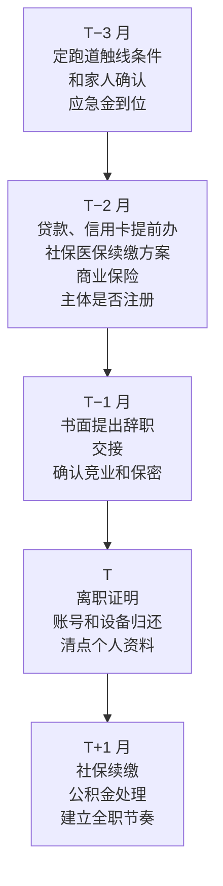

# 阶段 4：辞职决策与过渡

到了阶段 4，产品有了付费客户和一个能出客户的渠道，副业时间开始明显不够用。这时会自然地冒出一个问题：要不要辞职全职做？

[《一人公司方法论》第 4 章](../opc-playbook/04-side-to-fulltime.md)已经把这个问题从情绪变成了一道计算题：三条路径、跑道和收支交叉点、辞职的信号、副业边界和事务清单。本章不重复那些框架，而是把它们落到一个具体的评估流程和一份按时间排的过渡清单上，并用 hatch-counter 的数字算一遍。结论可能不太舒服，但比在辞职后才发现要好。

## 进入条件与周期

- **进入条件**：M3 达成。有一个主渠道连续 3 个月稳定出客户，三个数（新增、获客时间、流失）有至少一个季度的记录
- **周期**：1–3 个月。评估用 2–4 周；决定辞职后，准备和提出辞职、交接再用 1–2 个月
- **这个阶段不是必经的**。评估的结果完全可以是「现在不辞」，回到阶段 3 继续，定下次评估的日期

## 第一步：用自己的数字跑交叉点

《一人公司方法论》第 4 章给了一个跑道模拟脚本，输入四个数：可动用储蓄、每月开支、辞职时的产品月净收入、每月净收入的增量。阶段 4 的不同之处是，这四个数**现在都有真实数据了**：

| 输入 | 从哪来 |
|---|---|
| 可动用储蓄 | 阶段 0 的 `plan/numbers.md`，更新到当前 |
| 每月开支 | 最低可行收入 M，加上辞职后新增的自缴社保医保 |
| 辞职时的净收入 | 最近 3 个月的平均月净收入（收入减去服务器、模型调用等可变成本和固定成本） |
| 每月净收入增量 | 最近 6 个月净收入的平均月增量。**全职后会快一些，但不要假设快一倍** |

用开支为单位，把交叉点的计算结果列成一张表。月份从 0 开始计，和《一人公司方法论》第 4 章的图与脚本一致：

| 辞职时净收入占开支 | 每月增量占开支 | 收支持平的月份 | 期间累计消耗（以月开支计） |
|---|---|---|---|
| 10% | 2.5% | 第 36 个月 | 约 16.7 个月 |
| 10% | 5% | 第 18 个月 | 约 8.6 个月 |
| 25% | 2.5% | 第 30 个月 | 约 11.6 个月 |
| 25% | 5% | 第 15 个月 | 约 6.0 个月 |
| 50% | 2.5% | 第 20 个月 | 约 5.3 个月 |
| 50% | 5% | 第 10 个月 | 约 2.8 个月 |

这张表有两个读法：

- **起点比增速更省钱**。从 10% 起步、每月涨 5%，要消耗约 8.6 个月开支的储蓄；从 50% 起步、每月只涨 2.5%，消耗约 5.3 个月。辞职时收入已经覆盖得越多，后面越从容
- **保守场景决定能不能辞**。按第 4 章的原则，要拿保守增速（上表 2.5% 那几行）跑，储蓄还要有余量，才算过关

### 换成 hatch-counter 的门店数

沿用[《定价与商业模式》第 8 章](../pricing-monetization/08-case-hatch-counter.md)的推演假设（每店月付 99 元、可变成本 15 元、固定成本 1500 元），并把最低可行收入假设为每月 2 万元，那么净收入达到 M 的不同比例，分别需要：


再把增速换成门店数：每月增量 5% 的开支是 1000 元净收入，大约每月**净增** 12 家店；2.5% 大约每月净增 6 家。

对照阶段 3 的退出条件（40 家以上付费门店），可以看到一个现实：**M3 刚达成时，hatch-counter 的净收入大约只覆盖 M 的一成左右**（40 × 84 − 1500 = 1860 元）。如果这时辞职，即使全职后每月净增 12 家，也要消耗 8 个多月开支的储蓄、到第 18 个月左右才持平；保守场景下要三年。

这不是说不能辞，而是说清楚了几个选项：

1. **继续副业，把门店数推到 78 家以上（覆盖约 25%）再评估**。代价是副业期更长，而且第 5 章算过，几十家店的服务量会挤压副业时间，增长可能会慢下来
2. **提高单店收入再评估**。做多店档位、年付优惠拿到预收现金、把识别量大的店单独计价，见《定价与商业模式》第 8 章。单店净收入从 84 元提到 120 元，同样覆盖 25% 只需要约 55 家
3. **辞职，但用过渡期收入垫一段**。接外包、做咨询或培训，把每月净消耗压下来；代价是这些收入会抢产品的时间。怎么设上限、怎么选，见[《过渡期收入与个人保障》](../opc-transition/)
4. **储蓄足够厚就直接辞**。保守场景跑完还有余量，家人支持，可以接受

这里的金额都是推演假设，换成你的真实数字重新算。但这个结构对低客单价的 To B SaaS 普遍成立：**辞职门槛往往比直觉高得多**。

## 第二步：过一遍辞职评分表

把计算和定性信号放在一起，逐条打勾。这张表在《一人公司方法论》第 4 章「什么时候可以辞职」的基础上，补上了量化的建议值：

| 条件 | 建议值 | 满足？ |
|---|---|---|
| 净收入占最低可行收入的比例 | 不低于 25%，最好 50% | |
| 净收入的趋势 | 连续 3 个月以上增长，不靠单笔大单 | |
| 主渠道 | 连续 3 个月稳定出客户，不依赖你本人的人脉 | |
| 增长瓶颈是时间 | 能说出全职后每周多出的时间具体用在哪，以及预计带来多少增长 | |
| 保守场景 | 用最近 6 个月平均增速的一半跑，储蓄仍有至少 6 个月开支的余量 | |
| 应急金 | 单独留存，不计入跑道 | |
| 家人 | 知道跑道多长、最坏情况是什么，同意 | |
| 社保医保 | 知道离职后怎么续缴、每月多少 | |
| 竞业与保密 | 确认副业不在竞业限制范围内，离职不带走任何公司资料 | |
| 接下来 3 个月的计划 | 写得出每个月的目标 | |
| 回退方案 | 写下跑道降到多少时启动回职场或半职 | |

前五条是硬条件，有一条不满足，就不急着辞。后六条是准备工作，可以在决定之后、提出辞职之前补齐。

「增长瓶颈是时间」这一条要写具体。不是「全职就能做得更好」，而是像这样：

```text
全职后每周多出约 30 小时，计划用在：
- 每周两个工作日下午跑供应商渠道和地推（现在只有周六上午）：预计新签从每月 6 家到 10 家
- 每周一天做自助开户和在线续费，把单店服务时间从 10 分钟降到 5 分钟
- 其余时间交付、服务和内容
依据：阶段 3 的渠道实验里，周六上午走访平均 4 小时签 1 家；供应商渠道每月稳定 3–5 家，受限于我只能晚上回复
```

如果写不出来，或者写出来的主要是「做新功能」，说明增长的瓶颈不在你的时间，辞职解决不了它。

## 第三步：写下决策记录

无论结论是辞还是不辞，都写一份决策记录，放进公司仓库：

```text
# 辞职评估 2027-09

结论：暂不辞职 / 决定在 ____ 提出辞职
关键数字：
  付费门店 __ 家，近 3 个月月均净收入 ____ 元，占 M 的 __%
  近 6 个月月均净增 __ 家，月流失 __%
  可动用储蓄 ____ 元，保守场景持平月份 ____，期末余量 __ 个月开支
评分表：硬条件满足 __ / 5，未满足的是 ____
如果不辞：下次评估日期 ____，届时要达到 ____
如果辞：
  跑道触线条件：可动用储蓄低于 __ 个月开支时，启动回退方案
  回退方案：____（回职场 / 半职接外包 / 产品降级维护）
  家人已沟通：日期 ____
```

「跑道触线条件」要在辞职前写好，而且要具体到数字。辞职后每个月看一次，碰线就执行，不在那时候重新讨论。这是[《一人公司方法论》第 6 章](../opc-playbook/06-when-to-quit.md)止损线的思路，用在了个人财务上。

## 决定辞职之后：过渡清单

按时间倒排。T 是最后工作日：



### 提出辞职

> [!WARNING]
> 本节引用的《劳动合同法》第三十七条按 2025 年前后的现行文本整理，可能已修订，以国家法律法规数据库的现行文本为准。

《劳动合同法》第三十七条规定，劳动者提前三十日以书面形式通知用人单位，可以解除劳动合同；试用期内提前三日通知即可（条文见 [ecoi.net 收录的《劳动合同法》中文本](https://www.ecoi.net/en/document/270393)）。你的劳动合同如果约定了更长的通知期或者服务期，按合同和法律规定处理，拿不准时问律师。

几件要留意的事：

- **用书面形式**，留存送达的记录
- **交接要完整**，这是职业声誉，也减少日后的纠纷
- **确认竞业限制是否启动**。如果合同里有竞业条款，离职时确认公司是否要求履行、是否支付补偿；要求履行的，副业是否在限制范围内要有明确判断。阶段 0 已经核对过一次，这里再确认
- **离职前不带走任何公司资料**，包括代码片段、文档、客户名单。个人设备上如果误存了公司文件，删掉
- **对外公开的时机**：正式离职之前，不在社交媒体上宣布「全职做自己的产品」

### 社保、医保、公积金和保险

> [!WARNING]
> 灵活就业参保、失业保险金领取条件和缴费基数按 2025 年前后的规定整理，各地每年调整，以当地社保经办机构、医保局和住房公积金管理中心的最新规定为准。

离职后单位停缴，社保和医保要以灵活就业人员身份或通过自己的主体续缴；断缴可能影响医保待遇和部分城市的落户、购房资格，具体规则各地不同。主动辞职一般不符合失业保险金的领取条件，不要计入跑道。这些在《一人公司方法论》第 4 章「辞职前后的事务清单」里列过，详细的办理方式、公积金和个税的处理、商业保险怎么配，见《过渡期收入与个人保障》。

本书只强调一个顺序：**这些事在提出辞职之前就要问清楚、算进开支**，而不是离职后再去查。社保的缴费基数和比例各地每年调整。

### 主体和收款

如果到这个阶段还在用个人身份收款，辞职前后是注册主体的合适时机：客户量已经到了需要规范开票和记账的程度，也可能需要通过主体缴纳社保。个体户还是有限公司、注册流程、记账和报税，分别见[《国内合规实务》](../opc-compliance-cn/)第 1、2 章和[《财务与税务》](../opc-finance/)第 1、2 章。注册本身不急在辞职前一天，但要在 T−2 月左右定下方案。

## 退出条件与常见的坑

**退出条件（M4）**：

- 决策记录写好，硬条件全部满足
- 已书面提出辞职并完成交接
- 社保医保续缴方案、应急金、跑道触线条件、回退方案都已落实

如果评估结论是暂不辞职，这个阶段就以「下次评估日期」结束，回到阶段 3。这不是失败。很多一人公司的产品在副业状态下运转了很久，在条件真正成熟时才转全职。

**常见的坑**：

| 坑 | 表现 | 怎么办 |
|---|---|---|
| 因为累而辞职 | 「上班太累了，想全职试试」 | 辞职的理由要是「时间成了增长瓶颈」，见《一人公司方法论》第 4 章 |
| 用乐观增速算跑道 | 「全职后增速翻倍」 | 用最近 6 个月平均增速的一半跑保守场景 |
| 没有回退方案 | 跑道快见底时才开始想 | 辞职前写好触线条件和回退方案 |
| 漏算新增开支 | 社保、医保、补充医疗、电脑 | 按阶段 0 的清单逐项补进 M |
| 辞职前公开宣布 | 和雇主关系变僵 | 正式离职后再公开 |
| 离职时带走资料 | 埋下知识产权纠纷 | 不带走任何公司资料 |
| 辞职后才办贷款 | 没有工资流水，审批困难 | 有计划的贷款和信用卡在辞职前办完 |

## 这一阶段要读的

| 书 | 章 | 用来做什么 |
|---|---|---|
| [《一人公司方法论》](../opc-playbook/) | 第 4 章 | 三条路径、跑道脚本、辞职信号、事务清单 |
| 《一人公司方法论》 | 第 6 章 | 跑道触线条件的写法 |
| [《定价与商业模式》](../pricing-monetization/) | 第 8 章 | 门店数推演、提高单店收入的办法 |
| 《财务与税务》 | 第 4、5 章 | 现金流、个人与公司的钱分开 |
| 《国内合规实务》 | 第 1、2 章 | 主体选择和注册流程 |
| 《过渡期收入与个人保障》 | 全书 | 过渡期收入、社保医保、公积金、保险、家人预期 |
| [《合同与法律文书》](../contracts-legal/) | 什么时候找律师相关章节 | 竞业和服务期条款拿不准时 |

## 本章要点

- 阶段 4 是一次评估，结论可以是「现在不辞」；不辞就回到阶段 3，定下次评估日
- 用真实数据跑收支交叉点；辞职时收入覆盖得越多，后面消耗的储蓄越少，起点比增速更省钱
- 按推演假设，hatch-counter 在 40 家店时净收入只覆盖最低可行收入的一成左右；覆盖 25% 要约 78 家，提高单店收入能显著降低门槛
- 辞职评分表有五条硬条件：收入占比、趋势、主渠道、时间是瓶颈、保守场景有余量
- 辞职前写好决策记录、跑道触线条件和回退方案，触线就执行
- 书面提前三十日通知（试用期三日），完整交接，确认竞业，不带走公司资料
- 社保、医保、公积金、保险、贷款在提出辞职前问清并算进开支
