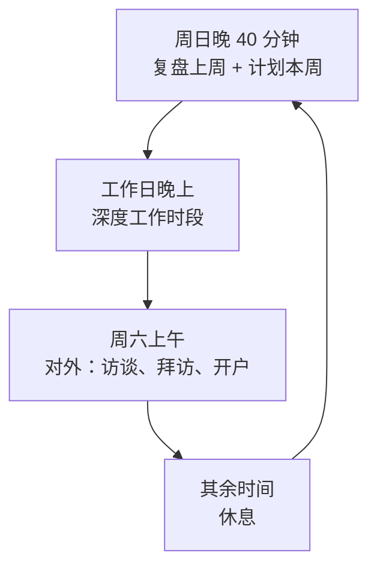

# 周循环：计划、复盘与仪表盘

前面六章是一条按月、按季度展开的路线。真正推动这条路线的，是每一周的计划和复盘：周初决定这周做哪几件事，周末看做到了没有、学到了什么、离当前阶段的退出条件又近了多少。

[《一人公司方法论》第 5 章](../opc-playbook/05-energy-rhythm.md)讲了周节奏的原则和一个简单的复盘模板，[《用 AI 撑起一人公司》第 8 章](../ai-native-opc/08-org-design.md)讲了全职后按日、周、月、季的运营节奏。这一章补的是**副业期**的版本：每周只有 10–15 小时时，计划怎么定、复盘看什么、仪表盘上放哪几个数，以及怎么把它们和阶段的退出条件、止损线连起来。

## 为什么按周，不按天

副业期按天计划，几乎注定会失败：今天加班、明天孩子发烧、后天有个饭局，每天都在「没完成」。按周计划有更大的缓冲：这周的三件事，周二晚上做不了，周四和周六还有机会。

更重要的是，按周衡量的是结果，不是投入。一周花了几个小时不重要，三件事做完了几件才重要。这也是本书不建议记录「连续多少天」「每周多少小时」的原因：这些数字只衡量投入，而且会在你不得不休息时制造不必要的愧疚。

## 一周的循环



复盘和计划放在一起做，前 20 分钟复盘上周，后 20 分钟计划本周。分开做容易只做一半。时间放在周日晚上还是周一早上都可以，关键是固定。

## 周计划模板

```text
# 2027-W03 计划（阶段 2：前十个付费客户，第 6 周 / 共 12 周）

本阶段退出条件进度
- 付费门店（非熟人）：4 / 10
- 已付第二期：1 / 7
- 平均开户耗时：3.2h（目标 ≤ 2h）

本周最多三件事（写成能判断完成与否的结果）
1. 王记卤味、川味小厨两家完成首次付费
2. 配方模板补上面馆常见的 15 道菜，下一家开户用上
3. 周六上午走访东街 8 家店，约到至少 2 家试用

可用时段
- 周二 20:30–22:30：第 2 件
- 周四 20:30–22:30：第 2 件收尾 + 回访两家试用店
- 周六 09:00–13:00：第 3 件
- 本周不可用：周三（公司上线），周五（家庭）

本周不做（写下来，防止被临时冒出来的事拖走）
- 工资单导出 Excel（一家店提的，进 later.md）
- 改官网
```

几条规则：

- **最多三件事**。副业期每周的整块时段只有三四个，一件事一到两个时段，三件已经是上限。写了五件，结果通常是每件都做了一半
- **写成结果，不写成动作**。「研究配方模板」不是结果，「补上 15 道菜，下一家开户用上」是
- **至少一件是对外的**。阶段 1–3 的瓶颈不在代码，每周没有一件和客户、渠道相关的事，就是在偏离阶段的重心
- **把时段和事对应起来**。哪件事放在哪个时段，周日就排好，避免周二晚上打开电脑才想做什么
- **写「本周不做」**。这一栏的作用和季度的「明确不做」一样，给拒绝一个依据

## 周复盘模板

```text
# 2027-W03 复盘

三件事
- [x] 王记卤味付费（季付）；川味小厨没付，报表还是导不进来
- [x] 配方模板 15 道菜完成
- [ ] 走访东街：去了 5 家，约到 1 家试用（下雨，提前回了）

阶段进度变化
- 付费门店 4 → 5；开户耗时 3.2h → 未变（本周没有新开户）

时间实际花在哪（按半天粗估）
- 构建 1 个时段 / 找客户 1.5 个时段 / 交付服务 0.5 个时段 / 复盘 0.5 个时段
- 和计划比：基本符合

学到了什么（原话或事实，不写感想）
- 川味小厨的收银机是 XX 型号，导出的是 PDF 不是表格。附近还有几家用同款？
- 走访时说「帮您算清楚每道菜赚多少」比说「进销存」更容易让人停下来听

止损线检查
- 本阶段止损线：3 个月付费少于 5 家 → 目前 5 家，第 6 周，未触发
- 是否有连续 3 周没推进的事：没有

精力
- 正常 / 偏累 / 透支：偏累（公司上线周）
- 下周是否需要减量：是，只定两件事

下周最重要的一件事
- 查清 XX 收银机 PDF 能否导入，决定是做适配还是跟店主要别的导出方式
```

和《一人公司方法论》第 5 章的模板相比，这份多了三栏：**阶段进度变化**（每周都看一次离退出条件还有多远）、**止损线检查**（防止到了评审日才发现早就该停）、**精力**（用来决定下周是否减量，而不是记录工作时长）。

「精力」一栏只写三档，不打分、不画曲线。它的作用是给自己一个正式的理由减量：公司忙的那周、家里有事的那周，下周就只定一两件事，甚至一件都不定。这不算掉队，计划里提前给它留了位置。

## 仪表盘：每个阶段只看几个数

仪表盘不是一个系统，就是一个每周更新的 Markdown 文件。关键在于**每个阶段看的数不同**，而且要少：

| 阶段 | 看什么（每周更新） | 为什么是这几个 |
|---|---|---|
| 0 | 阶段 0 四样东西完成了几样 | 本阶段没有外部数据 |
| 1 | 约访次数 / 约到的访谈数；完成的访谈数（非熟人占比）；确认问题的门店数；同意试用的门店数 | 直接对应 M1 |
| 2 | 试用中、付费、已付第二期的门店数；平均开户耗时；激活率 | 直接对应 M2 |
| 3 | 按渠道的月新增付费门店；单店获客时间；月流失率（分可控和闭店）；每店每周服务时间 | 三个数加服务负担 |
| 4 | 近 3 个月净收入及占 M 的比例；保守场景持平月份；辞职评分表满足几条 | 直接对应辞职评估 |
| 5 | 月净收入 vs 预测；可动用储蓄折合月数；距触线的月数；新增和流失 | 跑道和增长 |

```text
# 仪表盘（更新于 2027-01-19，阶段 2 第 6 周）

| 指标 | 本周 | 上周 | 4 周前 | 退出条件 |
|---|---|---|---|---|
| 试用中 | 3 | 4 | 2 | — |
| 付费门店（非熟人） | 5 | 4 | 1 | 10 |
| 已付第二期 | 1 | 1 | 0 | 7 |
| 平均开户耗时 | 3.2h | 3.2h | 4.0h | ≤ 2h |
| 激活率（7 天内） | 4/6 | 3/5 | 1/2 | — |

距评审日：6 周
```

几条原则：

- **只放和退出条件有关的数**。注册数、页面访问量、社交媒体粉丝这些，和阶段的主问题无关时不放
- **保留 4 周前的数**。只和上周比，看不出趋势；和 4 周前比，才知道这一个月有没有往前走
- **数的来源要固定**。hatch-counter 管理后台的运营分析已经有收入、续费率、试用转正率，钱的部分以后台为准；来源、耗时、激活这些后台没有的，以阶段 2 的客户台账为准。同一个数不要有两个来源
- **小样本时写分子分母**。「激活率 67%」和「激活率 4/6」给人的感觉完全不同，后者更诚实

指标怎么定义、留存和激活怎么算，见[《数据分析与埋点》](../product-analytics/)第 1、4 章。

## 让 agent 整理，你来判断

周复盘里最耗时的是收集数字和整理流水账。这部分可以交给 agent，按[《用 AI 撑起一人公司》第 1 章](../ai-native-opc/01-ai-native-opc.md)的做法放在公司仓库里跑。一个只读的周报工作流可以这样写：

```text
读以下文件，生成本周复盘的草稿，写到 plan/weekly/2027-W03-draft.md：
- plan/weekly/2027-W03.md（本周计划）
- plan/stages.md（当前阶段、退出条件、止损线）
- plan/customers.md（客户台账）
- plan/dashboard.md（上周的仪表盘）
- interviews/ 和 experiments/ 下本周修改过的文件

草稿包含：
1. 计划里三件事各自的完成情况，只根据文件里的记录判断，判断不了的写「待确认」
2. 更新后的仪表盘表格，标出和上周相比变化的数
3. 止损线逐条检查，写出每条的当前值
4. 本周新增的访谈和客户反馈里出现的原话，原样摘录

不要写「学到了什么」和「下周最重要的一件事」，这两栏留给我。
不要推测文件里没有的数字。
```

最后两栏留给自己，是故意的：**判断和决定不交出去**。这和《用 AI 撑起一人公司》第 8 章「老板只做四件事」是一个道理。

客户台账和访谈笔记里有真实的店名和联系方式时，要么用化名，要么不进仓库，理由见同书第 1 章。

## 月度和季度

周循环之上，还有两个更长的节奏：

| 节奏 | 用多久 | 做什么 |
|---|---|---|
| 每月第一个周末 | 30–60 分钟 | 看 4 个周复盘连起来的趋势；更新 `plan/numbers.md` 里的储蓄和开支；阶段 5 做跑道检查；整理 `later.md`，删掉不再相关的 |
| 每季度末 | 半天 | 对照阶段的退出条件和止损线做正式评审；定下季度目标和「明确不做」清单；修订总止损线 |

季度评审的问题沿用《一人公司方法论》第 5 章：目标达成了吗？没达成是执行问题还是方向问题？方向问题进入第 6 章的流程。这里补一个副业期特有的问题：**这个季度的节奏，我能不能再维持一个季度？** 如果答案是否定的，下个季度先降低目标，而不是硬撑。

阶段的评审日如果和季度评审撞在一起，合并成一次。

## 一周什么都没做成

总会有这样的周：三件事一件没做，或者干脆没打开过电脑。处理方法：

- **不要把三件事挪到下周再加三件**。下周还是最多三件，从里面挑最重要的
- **在复盘里写原因，只写事实**：加班、生病、家里有事、或者「不想做」。前三种是外部原因，第四种值得注意
- **连续三周「不想做」**，看第 9 章「不想做了」那一节。这是一个信号，不是一个道德问题
- **允许空一周不写复盘**。比如年假出去玩了一周，回来直接写下一周的计划，在仪表盘上标一句「W05 休息」

## 常见的坑

| 坑 | 表现 | 怎么办 |
|---|---|---|
| 计划太满 | 每周五件以上，完成率常年一半 | 最多三件，偏累的周只定一两件 |
| 只写动作 | 「研究」「优化」「看看」 | 写成能判断完成与否的结果 |
| 仪表盘越来越长 | 二十个指标，每周更新要一小时 | 每个阶段只看和退出条件相关的几个 |
| 只和上周比 | 每周都觉得差不多 | 保留 4 周前的数 |
| 复盘变成流水账 | 列了一堆做过的事，没有结论 | 必须写「学到了什么」和「下周最重要的一件事」 |
| 把复盘交给 agent | agent 写了「下周重点」，你照抄 | 判断和决定留给自己 |
| 用时长衡量自己 | 「这周只做了 6 小时」而自责 | 看结果；精力不够就减量 |

## 本章要点

- 副业期按周计划，不按天；衡量结果，不衡量时长，不记录连续天数
- 周日晚 40 分钟：前半复盘上周，后半计划本周
- 周计划最多三件事，写成结果，至少一件对外，时段和事对应好，写「本周不做」
- 周复盘在基本模板之外，加上阶段进度、止损线检查和精力三栏；偏累就减量
- 仪表盘是一个每周更新的文件，每个阶段只看和退出条件有关的几个数，保留 4 周前的值
- 让 agent 整理数字和流水账，「学到了什么」和「下周最重要的一件事」留给自己
- 每月看趋势和储蓄，每季度做正式评审；一周没做成不加码
