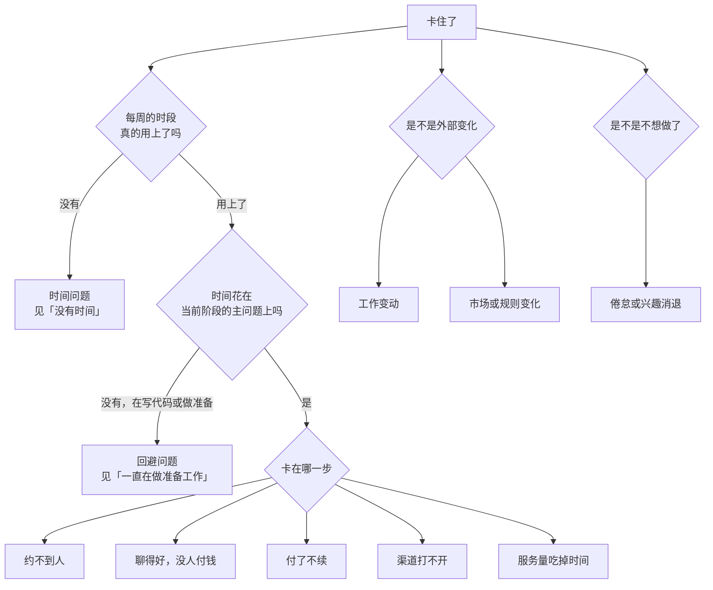

# 卡住了怎么办

照着前面的阶段走，迟早会卡住：某个阶段超出了预计周期，周复盘连续几周没进展，或者心里清楚「这样下去不行」但说不出哪里不行。

卡住本身很正常。问题在于卡住之后的反应：大多数人会本能地做两件事之一，要么更用力地重复同样的做法，要么换一件更舒服的事去做（通常是写代码）。这一章给一套排查顺序和十种常见的卡法，每种写清症状、先查什么、常见原因、接下来两到四周做什么。

判断要不要放弃一个产品，不是本章的主题，那是[《一人公司方法论》第 6 章](../opc-playbook/06-when-to-quit.md)的事。本章处理的是更早、更常见的情况：方向未必错，只是推不动了。

## 先判断：算不算卡住

满足下面任一条，就按本章排查：

- 当前阶段已经超过预计周期上限的 1.5 倍（比如阶段 1 预计 4–8 周，到了第 12 周还没达到退出条件）
- 仪表盘上的核心数字连续 4 周没有变化
- 周复盘连续 3 周「三件事一件没完成」，且原因不是加班、生病这类外部事件
- 你已经开始回避打开复盘文件

没满足的话，进展慢可能只是正常波动，继续按计划走。

## 排查顺序



顺序很重要：**先查时间，再查时间花在哪，最后才查方法**。很多「方法不对」的问题，追下去其实是根本没有时间，或者时间都花在了别的事上。

## 一、没有时间

**症状**：计划的时段经常被占掉；周复盘里「时间实际花在哪」一栏常年远低于计划。

**先查**：把最近 4 周每个计划时段的实际情况列出来，被什么占掉了？

**常见原因**：

| 原因 | 动作 |
|---|---|
| 工作加班变多 | 和阶段 0 一样重新盘点可用时段；如果只剩每周 5 小时以下，把阶段周期上限按比例拉长，或者暂停，写明重启条件 |
| 家庭事务增加 | 和家人重新对一遍时段；必要时明确暂停一段，不要半推半就 |
| 时段太碎 | 把两个晚上合并成一个周末半天；碎片时间只用来回消息 |
| 没有保护时段 | 时段开始时关掉工作和社交软件的通知 |

**原则**：暂停比半推半就好。明确写下「暂停到 2027-03-01，届时重新评估」，比每周愧疚地做一小时更可持续，也更容易重启。

## 二、一直在做准备工作

**症状**：时间用上了，但都花在重构、换框架、改设计稿、研究注册公司、看书上；当前阶段的主问题没有推进。

**先查**：最近 4 周的「构建」时间占比，和第 1 章那张时间分配图里当前阶段的建议值比。

**常见原因**：当前阶段的主问题让你不舒服。阶段 1、2 要和陌生人说话、被拒绝、开口要钱，这些对很多开发者来说比写代码难得多。准备工作给人一种「在推进」的感觉，又不用面对拒绝。[《一人公司方法论》第 5 章](../opc-playbook/05-energy-rhythm.md)把「一直在做准备工作」列为倦怠信号之一，原因相同。

**动作**：

- **把对外的事放在每周第一个时段**。先做最难的，剩下的时间再写代码
- **把对外的事拆到足够小**。「找客户」太大；「周六上午去东街 5 家店，每家只问一句『您现在怎么记进货』」足够小
- **找一个人一起做**。约朋友陪你走访第一次，或者和另一个做副业的朋友互相监督对外的目标
- **冻结代码库两周**。这两周只允许修线上故障，别的提交一律不做

hatch-counter 在 2026 年 9–10 月的大量设计探索，就是这种情况的典型样子：产品层面的工作做得很扎实，但对应的验证证据在仓库里看不到。第 2 章的建议是冻结新功能、带着产品进入阶段 1，道理在这里。

## 三、约不到人

**症状**（阶段 1、2）：走访和约访的成功率很低，几周下来访谈数远低于计划。

**先查**：约访的漏斗：接触了多少家 → 有多少家愿意聊 → 有多少家真的见到了。卡在哪一步？

| 卡在 | 常见原因 | 动作 |
|---|---|---|
| 接触少 | 名单太短，只在熟人圈 | 扩大名单：步行可达的商圈、供应商、收银服务商、行业群 |
| 愿意聊的少 | 开场像推销；时间不对 | 改话术，强调「请教 20 分钟、不卖东西」；避开饭点；先消费再开口 |
| 约了没见到 | 约得太远；对方忘了 | 尽量当场聊，或约在两三天内；前一天提醒 |

**如果话术和时间都调过了还是不行**：可能是人群本身难触达。这是[《一人公司方法论》第 2 章](../opc-playbook/02-choosing-direction.md)四象限里「痛但够不着」的位置。动作是找一个能接触这群人的中间人：一家供应商、一个收银系统的代理商、一个做餐饮培训的人。阶段 1 就开始试中间人，也是在为阶段 3 的伙伴渠道做验证。

## 四、聊得好，没人付钱

**症状**（阶段 2）：试用的店不少，都说好用，到期就不了了之。

**先查**：试用店的激活情况。用第 4 章的激活定义逐家看。

| 情况 | 更可能的原因 | 动作 |
|---|---|---|
| 大多没激活 | 上手太难，没走到价值时刻 | 开户时你替他完成最费劲的部分；第一天让他看到赚了多少 |
| 激活了但不付 | 价值不够，或价格不对，或不知道怎么付 | 逐家问「如果不用，您会怎么办」；测一个更低或更高的价格；让付款变简单 |
| 说好但拖着 | 礼貌性认可 | 试用到期前一天当面或电话问一句「续不续」，让对方给明确答复 |

付费意愿的诊断方法见《一人公司方法论》第 6 章「看哪些信号」；价格实验见[《定价与商业模式》第 4 章](../pricing-monetization/04-price-experiments.md)。有一条要单独说：**不要通过延长免费试用来解决这个问题**。延长试用只是推迟了答案。

## 五、付了不续

**症状**（阶段 2、3）：首期付费还行，第二期续费率低。

**先查**：没续的店逐家问原因，分成闭店和可控流失两类。

**常见原因与动作**：

- **数据录入坚持不下去**：每天导报表、拍单据太累。查哪一步最耗时，做简化；考虑每月的经营小结，让店主持续感受到价值
- **用的人和付钱的人不一样**：店员在用，老板看不到价值。把「赚了多少」推到老板手机上
- **一开始就不是目标客户**：比如生意太小、老板自己心算就够了。收窄目标人群
- **闭店比例高**：调整获客对象，往开店时间更长的店倾斜

可控流失是 LTV 公式分母上的数，见[《一人公司方法论》第 7 章](../opc-playbook/07-case-studies.md)。它高的时候，**先停下获客**，把精力放在留住已有客户上；否则就是在往漏桶里倒水。

## 六、渠道打不开

**症状**（阶段 3）：试了几个渠道，都没有能连续出客户的。

**先查**：每个渠道实验是否跑满了时间盒、是否有明确的成功标准、结果是否记录了。很多「渠道不行」的结论，其实是实验只做了两周就放弃了。

**动作**：

- **回到转介绍**。如果老客户都不愿意介绍，问题在产品或服务，不在渠道
- **试伙伴渠道**。一个人做 To B，伙伴（供应商、收银服务商、行业培训）往往是唯一能突破个人时间上限的路
- **换人群**：多店老板、特定菜系、特定商圈，往往比「所有中小餐饮」更容易找到集中的渠道
- **接受慢增长**：所有渠道都只能每月出一两家，说明这可能是一个只适合长期副业的产品。按第 5 章止损线评审，「降级为长期副业」是一个正当的结论

渠道评估的方法见[《获客与增长》第 8 章](../growth-marketing/08-channel-evaluation.md)。

## 七、服务量吃掉了时间

**症状**（阶段 2 后期到阶段 3）：每周大部分副业时间在回消息、处理问题，没有时间获客。

**先查**：过去 4 周的客户消息，按问题类型归类，前三类各占多少。

**动作**：

- 前三类问题各写一篇 FAQ 或一段教程视频
- 问题集中在某个功能，修那个功能
- 让 agent 起草回复，见[《用 AI 撑起一人公司》第 3 章](../ai-native-opc/03-customer-support.md)
- 开户时的说明和培训做好，很多问题出在第一周
- 如果做完这些，服务量仍超过每周副业时间的三成，这是第 6 章辞职评估里「时间是瓶颈」的信号之一，进入阶段 4 的评估

## 八、工作变动

**加班变多、升职、换工作**：按「没有时间」处理。换工作时，重新做一次阶段 0 的边界核对，新的劳动合同条款可能不同。

**被裁员**：这会把你被动推到阶段 4。不要因为「反正没工作了」就直接全职，先按第 6 章跑一遍交叉点：

- 补偿金、储蓄算进可动用资金，但应急金照旧单独留
- 如果当前阶段在 2 或更早，副业收入几乎为零，全职等于用储蓄去做验证，这正是[《一人公司方法论》第 4 章](../opc-playbook/04-side-to-fulltime.md)提醒的「把验证和生存压在一起」
- 可以设一个短期限（比如三个月）全力推进当前阶段，同时准备求职或接外包；期限到了按结果决定

离职相关的手续、社保衔接、过渡期收入，见[《过渡期收入与个人保障》](../opc-transition/)。被裁员时的补偿和权利以《劳动合同法》和当地规定为准，拿不准时咨询律师或劳动仲裁部门。

## 九、市场或规则变化

**症状**：竞品降价或免费、平台规则调整、合规要求变化、主要的伙伴渠道断了。

**动作**：

- **先评估影响有多大**，用数据而不是情绪：多少客户会受影响、多少收入
- **竞品免费**：问清自己的客户为什么还在用你；留存好的话，竞品免费的影响可能比想象的小
- **合规要求变化**：查官方原文，评估改造成本，必要时咨询专业人士；各项规定见[《国内合规实务》](../opc-compliance-cn/)
- **依赖的伙伴或平台出问题**：这是阶段 3 建议保留第二渠道的原因

## 十、不想做了

**症状**：连续几周复盘写「不想做」；想到客户消息就烦；开始频繁想新的产品点子。

**先查**：是累了，还是对这件事失去了兴趣？

- **累了**：最近的工作和副业是不是都很满？先停两周，什么都不做，只处理必须响应的客户问题。回来再看
- **失去兴趣**：休息之后仍然不想做，这本身是一条止损线。《一人公司方法论》第 6 章的止损线模板里有一条「连续 2 个季度复盘都不想继续做这件事」，按那里的流程评审：降级维护、出售、开源、关停都是选项
- **被新点子吸引**：把新点子写进 `later.md`，加一个日期，三个月后再看。新点子总是比手上的项目看起来更好，因为它还没遇到现实

倦怠的信号和应对见《一人公司方法论》第 5 章。

## 卡住时不要做的事

| 不要 | 为什么 |
|---|---|
| 换技术栈、重构 | 几乎从不是卡住的原因，却会吃掉好几周 |
| 重做设计、改版官网 | 同上，而且让你感觉在推进 |
| 同时开一个新项目 | 两个都推不动 |
| 改退出条件 | 评审日之前不改；评审时先承认没达到，再讨论 |
| 加大投入硬撑 | 先查原因；方法不对时，更多时间只是更多浪费 |
| 一个人闷着 | 找同行者聊一次，往往比自己想一周有用 |

## 找第二意见

卡住时，外部视角很有用：

- **同行者**：一两个同样做一人公司的朋友，把仪表盘和最近 4 周复盘给他看
- **客户**：直接问一个关系好的客户「如果你是我，下一步会做什么」
- **付费咨询**：特定问题（定价、合同、税务）找专业人士，花小钱省大坑
- **agent**：可以当一个不会客气的第二意见，但要给它足够的事实，并要求它反驳你

```text
我在做一个给中小餐饮门店用的经营管理 SaaS，副业，每周 10–15 小时。
下面是我的当前阶段、退出条件、止损线、最近 4 周的仪表盘和复盘。
请做三件事：
1. 指出我的复盘里自相矛盾或证据不足的结论
2. 按「时间是否够 → 时间是否花在主问题上 → 具体卡在哪一步」的顺序，
   给出你认为最可能的卡住原因，每条都要引用我给的具体数字或原话
3. 给一个两到四周能做完的实验，写清成功标准
不要鼓励我，也不要给泛泛的建议。没有依据的地方直接说不知道。

<粘贴 plan/stages.md、plan/dashboard.md、最近 4 周的复盘>
```

agent 的回答当线索，不当结论。决定仍然是你的。

## 本章要点

- 阶段超出周期上限 1.5 倍、核心数字 4 周不动、连续 3 周没完成、开始回避复盘，任一出现就按本章排查
- 排查顺序：先查时间，再查时间花在哪，最后查方法
- 没有时间时，明确暂停比半推半就好
- 一直在做准备工作，往往是在回避对外的难事；把对外的事放在每周第一个时段、拆小、冻结代码
- 约不到人查约访漏斗；聊得好不付钱查激活；付了不续先停获客、查可控流失
- 渠道打不开先回转介绍、试伙伴渠道、收窄人群；都不行可以接受长期副业
- 被裁员会把你被动推到阶段 4，先跑交叉点再决定
- 卡住时不换技术栈、不重做设计、不开新项目、不改退出条件；找第二意见
