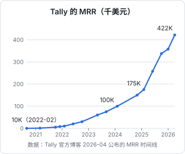

# 海外独立开发 SaaS

这一章收 5 个海外独立开发的软件订阅生意。挑选时故意让它们的获客方式各不相同：个人影响力、内容与 Hacker News、文档和免费工具、产品自传播。它们的共同点是都没有拿风投起步（Carrd 后来在盈利状态下融过资），都靠用户付的钱活下来。

其中两个（Plausible、Tally）已经不是一人公司，收进来是作为对照：看一两个人起步的产品，长到几百万美元 ARR 时团队是多大，以及前两年有多慢。

## 案例 1：Pieter Levels 的产品组合

《一人公司方法论》第 7 章「模式一：多产品组合 + 公开构建」用他做过例子，但没有给数字。这里补上数字。

- **是什么**：一组面向在线人群的产品。Nomad List（现名 Nomads.com）是数字游民社区和城市数据库，Remote OK 是远程工作招聘板，Photo AI 生成 AI 人像照片，Interior AI 生成室内设计效果图
- **谁在做**：一人。他在博客里说自己创业是一个人、在笔记本上写所有代码，不融资
- **怎么起步**：Nomad List 的起始年份各来源说法不一，有 2014 年和 2015 年两种；2026 年 9 月他自己说这个站已经运营约 12 年。他最早以「12 个月做 12 个产品」的挑战出名。2022–2023 年转向 AI 图像产品
- **怎么获客**：几乎全部靠他本人的 X 账号和公开构建：做什么、赚多少、遇到什么问题都发出来，关注者就是新产品的第一批用户
- **怎么收费**：各产品不同。Nomads.com 长期收一次性会员费，2026 年 9 月改为免费注册（只收 1 美元防垃圾注册），改靠赞助商；Photo AI 是订阅
- **公开的数字**：
  - 据他于 2023 年 7 月发布的文章标题，Photo AI 当时「约 1.4 万行 PHP，每月 61,808 美元」
  - 据他于 2026 年 3 月披露，Photo AI 月营收 10.5 万美元、月利润 8 万美元，代码是一个 40,870 行的 `index.php`
  - 据他于 2026 年 9 月披露，Nomads.com 历史累计付费会员 43,252 人
  - 据他于 2026 年 9 月披露，全部业务收入稳定在每月 20 万到 25 万美元；同一篇文章的标题数字「每年超过 1000 万美元」包含尚未兑现的投资收益，不是营收
  - Remote OK、Interior AI 近期的单品数字：未公开（网上流传的数字没有找到他本人的原帖）
- **关键转折**：从社区和招聘板转向 AI 图像产品，Photo AI 成为主力。2026 年把运营了十多年的 Nomads.com 改为免费，说明老产品的付费模式也会走到头
- **可借鉴**：技术选型极度服务于速度，一个 PHP 文件撑起月入 10 万美元，说明「架构好看」不是收入的前提；每个产品都是实验，留下有起色的
- **不可复制**：十多年积累的几十万关注者。没有受众时，同样的打法只是「发十个产品没人看见」。他的项目页上有 19 个项目标为 Failed，这才是这条路的另一半

## 案例 2：Plausible Analytics（小团队对照）

- **是什么**：开源、注重隐私的网站分析工具，定位是 Google Analytics 的替代品
- **谁在做**：小团队。Uku Täht 于 2018 年 12 月一个人创办，Marko Saric 于 2020 年加入负责市场。2021 年 10 月是两名全职联合创始人加一名兼职；2022 年 6 月 4 人；官方 About 页现在写团队 10 人。没有外部投资
- **怎么起步**：一个人写出第一版，2019 年 5 月 14 日拿到第一个付费用户。起步很慢：用了 324 天才到 400 美元 MRR。据官方博客，2020 年两位创始人合计亏掉超过 5 万美元存款，有几个月没给自己发工资
- **怎么获客**：付费广告预算为零。Marko 加入后系统地写内容，主题是隐私、Google Analytics 的问题、独立运营的理念。2020 年 4 月 8 日发布的《Why you should stop using Google Analytics on your website》上了 Hacker News，第一周带来 166 个新试用，比之前四个月加起来还多。开源本身也是获客渠道：开发者先看到代码，再看到产品
- **怎么收费**：按网站流量分档的月付订阅，官网现价 Starter 9 美元、Growth 14 美元、Business 19 美元起
- **公开的数字**（均据 Plausible 官方博客）：
  - 2021 年 10 月：ARR 50 万美元，付费用户 4,802（同文另一处写「近 5,000」）；团队是两名全职联合创始人加一名主要做客服的兼职
  - 2022 年 6 月：ARR 100 万美元，当时 MRR 83,637 美元，付费用户超过 7,000，团队 4 人
  - 现在：About 页写付费用户超过 22,000，没有更新 ARR
- **关键转折**：两个。一是第二个人加入，专门做内容和市场，让「写代码的人」不用再分心获客；二是那篇上了 HN 的文章，让增长曲线拐了弯
- **可借鉴**：用内容替代广告，内容的主题就是产品的立场（隐私、反追踪）；起步慢不代表做不成，324 天到 400 美元 MRR 之后才是爆发
- **不可复制**：「隐私替代 Google Analytics」在 2019–2020 年欧洲 GDPR 收紧的背景下恰好踩中了一个情绪；开发者受众天然会读 HN

## 案例 3：Bannerbear（Jon Yongfook）

- **是什么**：自动生成社交媒体图片和视频的 API，开发者用模板加数据批量出图
- **谁在做**：一人。Jon Yongfook 是独立创始人；他本人近年对团队规模没有明确表述，第三方资料称仍是一个人
- **怎么起步**：2019 年 1 月辞职，花了近一年烧存款。2019 年 9 月先做了一个叫 Previewmojo 的 Shopify 应用，2020 年初改名 Bannerbear，并从 Shopify 应用转向面向开发者的 API
- **怎么获客**：一周写代码、一周做营销交替进行。渠道有 Product Hunt、X、Indie Hackers 和邮件简报。他特别强调文档：文档写得越多，转化越高。他还用自己的 API 做了一批免费小工具，免费工具带来搜索流量，再导向付费产品
- **怎么收费**：月付订阅，官网现价 Automate 49 美元、Scale 149 美元、Enterprise 299 美元。他在 2019 年写过一篇题为「Don't Charge $9 a Month for Your SaaS」的文章，同期的阶段总结里反复出现「Charge More」：独立开发者普遍把价格定得太低
- **公开的数字**：
  - 据他在 Bannerbear 博客《Journey to $10k MRR》中按阶段披露：2019 年 1–8 月为 0；2019 年 9–12 月 400 美元 MRR；2020 年 1–4 月仍不到 500 美元；2020 年 5–10 月这一阶段到 6,109 美元；2020 年 11 月到 2021 年 1 月这一阶段到 10,455 美元。转向 API 之后的半年，MRR 涨了十几倍
  - 一篇 2023 年 11 月的第三方文章引用他当时的公开收入页，称 ARR 约 63 万美元
  - 2024 年以后：未公开。他的公开页现在写「只分享部分指标」
- **关键转折**：从 Shopify 应用转为 API。Shopify 应用的客户是小商家，客单价低、要求多；API 的客户是开发者和企业，能接受更高的价格，用起来也更「自助」
- **可借鉴**：交替的节奏（一周开发一周营销）解决了开发者最常见的问题：只写代码不卖货；把文档当作销售材料；免费工具引流
- **不可复制**：英文开发者市场的规模和付费习惯。在国内，同样的 API 产品要面对更多「能不能便宜点」「能不能私有化部署」

## 案例 4：Carrd（AJ）

- **是什么**：单页网站搭建工具，主要用于个人主页、作品集、落地页
- **谁在做**：一人（存疑）。AJ 以匿名身份运营，长期被称为 solo founder，Indie Hackers 播客的节目标题也这么写；有低可信度的说法称他有一名联合创始人，未核实
- **怎么起步**：2016 年上线
- **怎么获客**：几乎不做营销。免费版可以直接做出能用的网站，每个免费网站都是一次展示；用户之间口耳相传
- **怎么收费**：低价年费。官网现价 Pro Lite 9 美元/年、Pro Standard 19 美元/年、Pro Plus 49 美元/年，按网站数量和功能分档。注意是「每年」，不是每月
- **公开的数字**：据 Indie Hackers 播客第 228 期（2021 年 9 月），Carrd 年收入超过 100 万美元，两年内从约 3 万美元 MRR 增长而来。2022 年以后：未公开
- **关键转折**：2021 年在已经盈利的情况下接受了融资。金额和投资人没有查到一手来源
- **可借鉴**：极低的价格配合极大的用户量，同样能做到百万美元级别；产品本身就是广告位
- **不可复制**：这个模式要求海量用户。年费 19 美元，要到 100 万美元年收入需要约 5 万个付费用户。一个面向小众行业的 To B 产品，客户总数可能都没有这么多

## 案例 5：Tally（两人起步的对照）

- **是什么**：表单工具，免费版功能非常宽松，用来对标 Typeform
- **谁在做**：小团队。Marie Martens 和 Filip Minev 两人创办，2023 年 5 月团队 4 人，2026 年 4 月 11 人。官方说法是「customer-funded」，没有外部融资
- **怎么起步**：2020 年 9 月上线，前半年几乎没有收入
- **怎么获客**：
  - 产品自传播：免费表单上带「Made with Tally」徽章，每个填表的人都看得到
  - 口碑和社区：Reddit 上的推荐、创作者、newsletter、播客
  - 2026 年起，AI 搜索（ChatGPT、Claude、Gemini 和搜索引擎的 AI 摘要）成为第一大渠道
- **怎么收费**：免费加 Pro 订阅，免费版几乎不限制表单数和提交数，付费买的是品牌去除、高级逻辑和团队功能
- **公开的数字**（均据 Tally 官方博客 2026 年 4 月发布的 MRR 时间线）：

| 时间 | MRR（美元） |
|---|---|
| 2021 年 3 月 | 1K |
| 2022 年 2 月 | 10K |
| 2023 年 5 月 | 60K |
| 2024 年 2 月 | 100K |
| 2025 年 2 月 | 175K（越过 200 万美元 ARR） |
| 2025 年 10 月 | 338K |
| 2026 年 4 月 | 422K（越过 500 万美元 ARR） |

  用户数超过 100 万。

- **关键转折**：选择「免费版极其慷慨」。这让它在一个已经有大玩家的市场里获得了足够多的免费用户，免费用户带来徽章曝光，曝光带来新的免费用户，其中一小部分转化为付费
- **可借鉴**：从 0 到 1 万美元 MRR 用了一年半，这段平台期是常态；产品内的自传播环路是一个人也能做的获客方式，不需要每天发内容
- **不可复制**：表单是一个天然会被「外人」看到的产品，每个表单都有填写者。大部分 To B 工具（比如门店后台）用户之外的人看不到，徽章就没有用武之地

## 五个案例放在一起

| 案例 | 规模 | 主要获客 | 收费 | 最近公开的数字 |
|---|---|---|---|---|
| 1 Pieter Levels | 一人 | 个人影响力 | 订阅、会员、赞助 | 业务收入每月 20–25 万美元（2026-09） |
| 2 Plausible | 小团队（现 10 人） | 内容、HN、开源 | 订阅，9 美元起 | ARR 100 万美元（2022-06） |
| 3 Bannerbear | 一人 | 文档、免费工具、社区 | 订阅，49 美元起 | 10,455 美元 MRR（2021 初）；之后只公开部分指标 |
| 4 Carrd | 一人（存疑） | 产品自传播 | 年费，9 美元/年起 | 年收入超过 100 万美元（2021-09） |
| 5 Tally | 小团队（现 11 人） | 产品自传播、AI 搜索 | 免费 + 订阅 | 422K 美元 MRR（2026-04） |

能从这一章读出的几件事：

1. **前一两年都很慢**。Plausible 324 天到 400 美元 MRR，Tally 一年半到 1 万美元 MRR，Bannerbear 两年左右到 1 万美元 MRR。没有个人影响力的人，起步阶段用一两年验证是正常的
2. **获客方式决定了能不能一个人做下去**。Levels 靠自己发帖，一个人够了；Plausible 的增长来自第二个人专职做内容；Tally 的徽章环路不需要额外的人。获客越依赖持续的人工投入，越早需要第二个人
3. **价格和客户类型是一起选的**。Carrd 选了「极低价 × 海量个人用户」，Bannerbear 选了「较高价 × 开发者和企业」。两条路都通，但需要的用户量差了几十倍

## 本章要点

- 海外独立 SaaS 的成功案例里，起步一两年慢是常态：Plausible 324 天到 400 美元 MRR，Tally 一年半到 1 万美元 MRR
- Pieter Levels 证明了技术可以极简，但他的核心资产是十多年积累的受众，项目页上的失败数量同样惊人
- Bannerbear 的经验：开发与营销交替、文档即销售、免费工具引流、不要把价格定得太低
- Carrd 和 Tally 靠产品自传播，但这要求产品天然会被用户以外的人看到
- 一两个人起步的产品长到百万美元 ARR 时，团队通常已经是 4 到 10 人，「一人公司」常常只是一个阶段

## 资料来源

- Pieter Levels，Photo AI 月营收 10.5 万美元、月利润 8 万美元（2026-03-06）：https://levels.io/photoai-40870-line-index-php-105k-mo-revenue
- Pieter Levels，业务收入每月 20–25 万美元与投资收益（2026-09）：https://levels.io/passed-10m-revenue-investment-gains
- Pieter Levels，Nomads.com 改为免费，累计付费会员 43,252（2026-09）：https://levels.io/nomads-com-free-after-a-decade
- Pieter Levels 项目页：https://levels.io/projects/
- Plausible About 页，团队与付费用户数：https://plausible.io/about
- Plausible 博客，从 400 美元 MRR 到 50 万美元 ARR（2021-10）：https://plausible.io/blog/bootstrapping-saas
- Plausible 博客，100 万美元 ARR 与开源路线（2022-06）：https://plausible.io/blog/open-source-saas
- Bannerbear，《Journey to $10k MRR》：https://www.bannerbear.com/journey-to-10k-mrr/
- Bannerbear 公开页：https://www.bannerbear.com/open/
- 第三方文章引用 Bannerbear 公开页 ARR（2023-11）：https://superframeworks.com/blog/bannerbear
- Indie Hackers 播客第 228 期，Carrd（2021-09-29）：https://dev.to/theindiehackerspodcast/228-making-1m-yr-then-raising-money-as-a-solo-indie-hacker-with-aj-from-carrd
- Fathom 播客，Carrd 创立年份：https://usefathom.com/podcast/carrd
- Carrd 价格页：https://carrd.co/pro
- Tally 官方博客，MRR 时间线与团队规模（2026-04-15）：https://blog.tally.so/the-road-from-4m-to-5m-arr/
