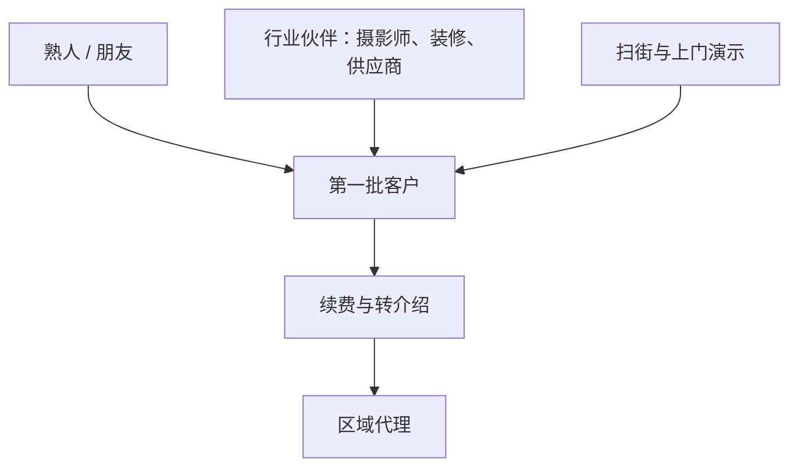

# 国内垂直 To B 与门店软件

这是和 hatch-counter 最近的一章，也是数字最小的一章。

找案例时的目标是：国内个人或一两个人做的门店、餐饮、零售、行业管理软件，当事人公开过客户数、价格、获客过程。结果是：

- 能找到的几乎全是 V2EX 上的匿名自述，用 ID 不用真名，无法交叉验证
- 没有找到一个「起步时一两个人、后来长大、并且公开过早期数字」的国内门店 SaaS 可靠案例。有几家后来做大的公司，媒体报道里没写起步时几个人，就没有收
- 找到的 5 个案例，最好的是「约 10 家店在用，有的已经第二年续费」，最差的是两年两个客户

这个结果本身就是这一章最重要的信息。第 2 章那种「两年做到 1 万美元 MRR」的故事，在国内门店软件里几乎没有人公开讲过。可能有人做成了但不说，也可能做成的人很少。无论哪种，都不应该用海外 SaaS 的曲线来规划一个国内门店软件。

## 先看行业：哗啦啦和餐饮 SaaS 的价格

在看个人案例之前，先看一个行业层面的背景。哗啦啦是国内较大的餐饮 SaaS 公司之一，不是一人公司，收在这里作为行业参照，不计入 44 个案例。

据钛媒体 2023 年 3 月的报道（澎湃新闻转载）：

- **价格**：2015 年前后，大厂之间的价格战让餐饮 SaaS 的单店年订阅费降到约 600 元，报道发稿时约为 2,000 元
- **盈利**：报道称，成立以来，哗啦啦等餐饮 SaaS 企业基本没有盈利
- **资金**：哗啦啦 2020 年完成 16.5 亿元融资，2022 年预期的 2 亿美元新一轮没有落地；账上现金长期约 2,000 万元，每月现金支出约 3,000 万元
- **事件**：2022 年 11 月起，部分商户提现到账延迟；12 月 26 日官方统计 3,705 户受影响；到 2023 年 3 月 3 日仍有 400 余户没有解决

对一个人做门店软件，这条背景至少说明三件事：

1. **行业价格锚点**：店主心里的「一套餐饮软件一年多少钱」，大约在几百到两千元之间。收银、点餐这类核心系统尚且如此，辅助性的管理工具很难定得更高
2. **大公司也不容易**：拿了十几亿融资的公司，单靠软件订阅也难以盈利。这门生意的难点不在技术，而在获客和服务成本
3. **店主最在意的是钱**。哗啦啦出事的核心是「商户的钱提不出来」。任何碰到店主资金的产品，信任一旦受损就很难恢复

## 案例 19：汽车洗美门店小程序（V2EX：noconfuse）

- **是什么**：两个产品。一是给汽车洗美门店用的多门店小程序模板，有下单、预约、线下核销、会员和积分、经营数据统计；二是小程序服务商系统，帮商户代注册、管理和发布小程序与公众号。都基于腾讯云开发
- **谁在做**：一人。从喜马拉雅离职后独立开发约两年
- **怎么起步**：此前自研了几个产品，都没做成，后来转向做门店小程序
- **怎么获客**：没有线上流量，两个客户都来自线下朋友介绍
- **怎么收费**：小程序模板一次性卖断，他说按市场行情只能拿到每单 2,000 到 3,000 元
- **公开的数字**：据他 2024 年 8 月在 V2EX 披露，目前 2 个客户，云开发每月花 100 多元
- **关键转折**：他自己判断收入覆盖不了成本，还要持续维护和开发新功能，决定放弃独立开发，回去找工作
- **可借鉴**：这是一个反面样本，教训很清楚：一次性收费加上长期维护和持续的云费用，是一个结构性亏损的组合。卖出去的每一单都在给未来增加负担
- **不可复制**：无
- **回访（2026-11）**：他在 V2EX 的主题列表里，2024 年 10 月发过一条求职帖，之后的帖子是别的项目（视觉标注训练平台、给命理师搭 AI 智能体的网站等），没有再提洗美小程序。和帖子里「放弃独立开发、回去找工作」的说法一致

## 案例 20：宏图电子菜单（V2EX：pbk）

- **是什么**：餐厅用的平板点餐 App，支持 iPad 和安卓平板，作者拿海底捞的平板点餐作比；接口开放给餐厅，可以和他们自己的收银或会员系统对接
- **谁在做**：一人。作者自称只是全栈程序员，客户端用 React Native 开发；发帖时在找一到两名运营或产品合伙人
- **怎么起步**：未公开
- **怎么获客**：主要靠一位做餐厅摄影的朋友给单子。帖子里也在招区域代理，推荐成交有「薄礼答谢」
- **怎么收费**：未公开
- **公开的数字**：据他 2024 年 7 月在 V2EX 披露，大概有十家店在用，有的店已经是第二年续费
- **关键转折**：「第二年续费」。对门店软件来说，续费比新签更能说明产品有价值
- **可借鉴**：他的渠道很有启发性：餐厅摄影师天然要接触大量正在装修、开业、换菜单的餐厅，而这正是需要电子菜单的时刻。找到一个「在对的时间接触到对的店」的合作方，比自己扫街高效得多
- **不可复制**：渠道依赖于一个具体的朋友，作者自己也意识到需要更多代理，说明这条路还不可规模化
- **回访（2026-11）**：他在 V2EX 关于点餐软件的帖子只有 2024 年 7 月的两条（原帖和一次「重新发布」），之后的帖子都是别的技术话题，没有公开新的店数或续费情况。产品是否还在做、合伙人是否找到，都不知道

## 案例 21：云店管（V2EX：Eyon）

- **是什么**：给个体户和小微批发商用的店铺管理系统，管销售记录、库存、客户应收应付和商品信息。卖点是不用建期初账套、能上传进货凭证、首页能快速查到某客户某商品的最近成交价
- **谁在做**：一人，开发了约五个月。前端用 Element UI，后端用 uniCloud 的云函数和云数据库，用户管理接了 Authing
- **怎么起步**：上线后直接去线下推销
- **怎么获客**：连续三天，每天花两三个小时走访本地路边的实体店。多数店家说「没需求」，很少有机会演示。在 V2EX 发帖后有 30 多人注册试用，作者说没有一个付费
- **怎么收费**：14 天免费试用；注册当天或 24 小时内付款，额外送 1 个月零 14 天。正式价格在正文里没有写，回帖中有人提到 300 元/年，作者没有确认
- **公开的数字**：据他 2021 年 7 月在 V2EX 披露，3 天拿到 7 个付费客户：2 个是本来就打算用的朋友，约 5 个是扫街得来
- **关键转折**：帖子里的回帖比正文更有信息量。网友指出的缺口：没有打印和涉税功能（作者承认）、不支持按重量计价、没有加工模块（前店后厂的商户用不了）、很多小店没有电脑。有人提到同类老牌软件管家婆一年约 600 元。2022 年有人反映链接已经打不开，后续情况未公开
- **可借鉴**：线下扫街的转化率其实不低：三天约 5 个付费客户，比 V2EX 上 30 多个注册零付费强得多。To B 的客户在线下，不在开发者社区
- **不可复制**：小微批发、个体零售的需求极度分散。称重、加工、打印、开票，每多一个细分需求就多一个模块，一个人很难都做完
- **回访（2026-11）**：他在 V2EX 的近期帖子（2024–2025 年）讲的是小程序、iOS App 和 AI 工具，其中有一条是想出售一个「累计用户 21 万、每天三五块钱收入」的工具类小程序；主题列表第一页没有再提云店管

## 案例 22：开单宝（V2EX：fingal）

- **是什么**：给批发门店用的开单和进销存软件，有销售、采购、库存、对账、统计，支持多门店、多仓库
- **谁在做**：一人。作者自述「没有团队没有客服」
- **怎么起步**：2017 年，做批发的熟人抱怨找不到合适的开单软件，他辞职用约半年时间独自开发
- **怎么获客**：来自熟人圈子，没有描述其他渠道
- **怎么收费**：未公开。网友问「288 是一年还是一次性」，作者没有回答
- **公开的数字**：据他 2020 年 8 月在 V2EX 披露，13 个用户，软件年收入「4 位数」，够维持服务器开销
- **关键转折**：发帖时已停止更新一年多，关闭了新用户注册，在劝老用户迁走；作者已经找到工作，域名、短信、HTTPS 证书也都不再续费。他说做下来最麻烦的是客服，很多问题不是技术能解决的，而自己不擅长沟通、时间也有限
- **可借鉴**：门店软件的真实成本里，客服占的比例比开发者想象的大得多。一个人做 To B，要在一开始就设计「怎么让客服量最小」
- **不可复制**：无。这是一个完整的「从需求出发、做出产品、找到少量用户、因服务负担和收入不足而停止」的周期，第 8 章会再提到它

## 案例 23：智存（V2EX：MioMioOs）

- **是什么**：给小店店主用的进销存应用，有 iPhone App 和网页端。功能包括：用语音、文字或粘贴的订货内容生成录单草稿，核对后入账；客户专属价和「再来一单」；欠款、押金、储值、借出物品（水桶、周转箱）分开记；进货、退货、盘点、报损；收摊快速录营业额、导入微信账单原始表格并查重；收支日历和利润报表；「问生意」，对已录入的数据提问；店员子账号看不到利润和资金流水
- **谁在做**：未公开
- **怎么起步**：未公开
- **怎么获客**：发帖时在 V2EX 推广，其他渠道未公开
- **怎么收费**：核心的开单、进货、库存、对账、报表、导出全部免费；专业版主要是提高 AI 的每日额度（AI 记账从每天 8 次提到 40 次）。据作者 2026 年 10 月的帖子，中国区 App Store 列出的价格是月付 18 元、年付 198 元
- **公开的数字**：用户数、收入：未公开。回帖有人问「有收益了没」，帖子里没有回答
- **关键转折**：尚早，2026 年 10 月才公开推广
- **可借鉴**：两个设计值得注意。一是「免费的是记账，付费的是 AI」：把有边际成本的部分单独收费，没有边际成本的部分免费，降低了试用门槛；二是用大模型把录单变成「说一句话」，直接针对小店店主不愿意打字的问题
- **不可复制**：收进这一章主要是作为竞品参照，它和 hatch-counter 的功能重合度很高（录单、导入账单、利润报表），第 10 章会再讨论

## 五个案例放在一起

| 案例 | 行业 | 公开的数字 | 状态 |
|---|---|---|---|
| [19 洗美小程序](#案例-19汽车洗美门店小程序v2exnoconfuse) | 汽车洗美 | 2 个客户（2024-08） | 放弃，2024-10 发求职帖 |
| [20 宏图电子菜单](#案例-20宏图电子菜单v2expbk) | 餐饮 | 约 10 家店，有第二年续费（2024-07） | 2024-07 后无公开更新 |
| [21 云店管](#案例-21云店管v2exeyon) | 小微批发零售 | 3 天 7 个付费客户（2021-07） | 后续未知 |
| [22 开单宝](#案例-22开单宝v2exfingal) | 批发 | 13 个用户，年收入 4 位数（2020-08） | 停止 |
| [23 智存](#案例-23智存v2exmiomioos) | 小店进销存 | 未公开（2026-10） | 刚推广 |

获客和收费方式：

| 案例 | 规模 | 获客 | 收费 |
|---|---|---|---|
| 19 洗美小程序 | 一人 | 朋友介绍 | 一次性 2–3 千元 |
| 20 宏图电子菜单 | 一人 | 朋友渠道、代理 | 未公开 |
| 21 云店管 | 一人 | 线下扫街 | 试用后付费 |
| 22 开单宝 | 一人 | 熟人 | 未公开 |
| 23 智存 | 未公开 | 社区推广 | 免费 + AI 专业版 198 元/年 |

## 门店软件的共同难点

把这五个案例和行业背景放在一起，能看到几个反复出现的问题。

### 获客在线下，而且很慢

五个案例里，有明确获客方式的四个全部来自线下：朋友介绍、朋友的渠道、扫街、熟人。开发者熟悉的线上渠道（V2EX、技术博客、Product Hunt）在这里几乎无效，云店管的 30 多个 V2EX 注册零付费就是证据。店主不在这些地方。

### 一次性收费是陷阱

洗美小程序一次性卖 2,000 到 3,000 元，开单宝的价格不明但年收入只有四位数。门店软件要持续维护、持续付服务器和云费用、持续回答问题。一次性收费意味着成本是持续的、收入是一次的，客户越多负担越重。宏图电子菜单「第二年续费」之所以值得注意，就是因为它走通了持续收费。

### 需求长尾会拖垮一个人

云店管的回帖里列了打印、开票、称重、加工、移动端；开单宝的作者说客服最难。门店的业务细节千差万别，每家店都觉得自己的情况是「最基本的需求」。一个人做门店软件，必须在一开始就划清「只服务哪一类店」，不然会被无穷的定制拖住。

### 价格锚点很低

行业单店年费在几百到两千元之间，网友提到的老牌进销存软件一年约 600 元，新一代的智存年付 198 元。一个人做的辅助管理工具，很难突破这个区间。这直接决定了需要多少家店才能养活一个人，[《定价与商业模式》第 8 章](../pricing-monetization/08-case-hatch-counter.md)「案例：给门店 SaaS 定价」做过这笔账。

## 本章要点

- 国内门店软件几乎没有公开的个人成功案例，能找到的数字都很小：2 个客户、约 10 家店、7 个付费客户、13 个用户
- 行业层面，餐饮 SaaS 单店年费约几百到两千元，较大的公司也基本没有盈利
- 获客全部在线下：熟人、朋友的渠道、扫街；开发者社区里的注册几乎不转化
- 一次性收费加持续维护是结构性亏损；续费才是门店软件成立的信号
- 需求长尾和客服负担是一个人做门店软件最大的风险，要在一开始就划定服务哪一类店
- 智存把「记账免费、AI 收费」分开，是一种值得参考的定价思路

## 资料来源

- 钛媒体，哗啦啦事件与餐饮 SaaS 行业（澎湃新闻 2023-03-07 转载）：https://www.thepaper.cn/newsDetail_forward_22166333
- noconfuse，《2 年独立开发，我要去吃土了》（V2EX，2024-08-26）：https://www.v2ex.com/t/1067769
- pbk，平板点餐软件（V2EX，2024-07-10）：https://www.v2ex.com/t/1056124
- Eyon，云店管（V2EX，2021-07-01）：https://www.v2ex.com/t/786829
- fingal，开单宝（V2EX，2020-08-11）：https://global.v2ex.com/t/697319
- MioMioOs，智存（V2EX，2026-10-19）：https://www.v2ex.com/t/1250132
- 回访：2026 年 11 月查看 noconfuse、pbk、Eyon 在 V2EX 的主题列表（https://www.v2ex.com/member/<ID>/topics），只看了第一页，列表里部分日期不带年份
