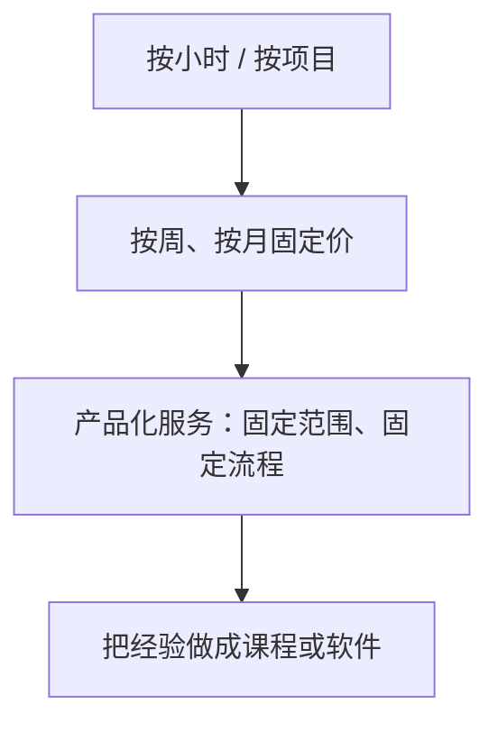

# 服务型一人公司

服务是大多数一人公司真正的起点：外包、咨询、设计、培训。它不需要先做出产品，有一个客户就有收入，第一笔钱来得最快。它的问题也很明显：收入和工时绑定，一个人的时间就是天花板。

这一章的 7 个案例，按「离卖时间有多远」排列：从订阅制设计服务，到「产品 + 咨询」组合，到价值定价的顾问，再到国内的课程讲师和自由职业开发。它们回答的是同一个问题：**服务能不能突破工时的上限，怎么突破**。

另外两个找到但没有收进来的国内案例，说明一下原因：一个在淘宝接建站外包的帖子，分年数字加起来和总额对不上，作者也拒绝证明；一个在闲鱼、小红书接毕业设计的帖子，涉及学术诚信问题。两者都不适合作为参照。

## 案例 24：DesignJoy（Brett Williams）

- **是什么**：订阅制设计服务。客户按月付固定费用，可以提交任意多个设计需求，但一次只处理一个，平均 48 小时交付；大项目拆成小块，每 24–48 小时交一部分。随时可以暂停，没用完的天数保留
- **谁在做**：一人。官网 FAQ 的原话是：DesignJoy 是由创始人 Brett 一个人经营的代理公司，不雇其他设计师，也不外包给任何人
- **怎么起步**：据 Starter Story 2024 年 6 月的采访，2017 年作为副业开始，一个周末搭好网站
- **怎么获客**：同一来源称，上线约一周后在 Product Hunt 发布，之后在 Indie Hackers 持续更新进展，再在 X 上积累关注者。他在 X 上公开收入、定价策略和工作方式
- **怎么收费**：月费订阅。官网 2026 年 11 月显示 4,995 美元/月，旁边列着 5,995 美元。他多次提价，提价只针对新客户，老客户保持原价
- **公开的数字**：
  - 据 Noah Kagan 播客 2023 年 1 月的节目介绍，他一个人每月约 8 万美元的纯利润
  - 据他本人 2023 年 5 月在 X 上披露，第一个 20 万美元的月份：DesignJoy 服务 94,100 美元，课程 93,700 美元，其他数字产品约 1.1 万美元
  - 据他本人 2023 年 12 月在 X 上披露，「零受众，从 0 做到 150 万美元」
  - 据他本人 2025 年 9 月在 X 上披露，累计营收突破 500 万美元
- **关键转折**：两个。一是**把服务做成产品**：固定价格、固定流程、一次一个需求、可暂停，客户买的是一个清晰的「套餐」而不是一个个报价单；二是**卖「怎么做」**：他的课程收入一度和服务收入相当
- **可借鉴**：
  - 「一次只做一个需求」是产能控制的关键，它把无限需求变成了一条队列，让一个人可以同时服务多个客户而不崩溃
  - 用价格控制客户数量，忙不过来就涨价，而不是招人
  - 老客户保价，新客户涨价
- **不可复制**：设计的需求在海外创业公司里大而稳定，客单价能到每月几千美元。国内同类服务的客单价低得多

## 案例 25：Patrick McKenzie（patio11）

- **是什么**：两部分。一是 Bingo Card Creator，给老师生成宾果卡的小软件；二是软件营销咨询，以及把咨询经验做成的邮件营销课程
- **谁在做**：一人 + 外包。据他 2012 年的年度回顾，没有员工、没有投资人；视频剪辑、记账和设计外包
- **怎么起步**：2006 年在日本上班时做 Bingo Card Creator 作为副业，第一年销售额不到 6,500 美元
- **怎么获客**：软件靠 SEO 和反复的 A/B 测试；咨询客户主要来自他的博客 kalzumeus.com 和 Hacker News 上的影响力，博客本身就是在公开讲他怎么做软件营销
- **怎么收费**：软件一次买断；咨询按周收固定费用，他说一般在五位数美元区间，具体费率因保密协议未公开
- **公开的数字**（均据他的年度回顾）：
  - 2011 年：Bingo Card Creator 净销售 45,479.93 美元、利润 22,919.93 美元；咨询约 5.5 万美元（约 10 周）
  - 2012 年：Bingo Card Creator 净销售 64,791.81 美元、利润 38,598 美元；咨询约 14 万美元；邮件课程约 6 万美元；总利润约 20 万美元
- **关键转折**：2012 年的数字已经说明了问题：咨询收入约 14 万美元，是软件净销售的两倍多；同一年他把咨询里反复讲的内容做成了邮件营销课程，收入约 6 万美元。2015 年通过交易平台把 Bingo Card Creator 卖掉，价格未公开（他说「不是七位数」），之后加入 Stripe
- **可借鉴**：
  - 小软件提供稳定的基本盘和可信度，咨询提供大额现金流，课程把咨询的知识复用
  - 按周收费而不是按小时，客户买的是一个周期的结果
  - 年度回顾公开写，本身就是最好的咨询广告
- **不可复制**：他的博客在海外开发者圈影响力极大，咨询客户主动找上门

## 案例 26：Jonathan Stark

- **是什么**：独立软件顾问，后来转型为教独立顾问怎么定价的教练，出书、做播客、写每日邮件
- **谁在做**：团队情况未公开
- **怎么起步**：据 2020 年 10 月 Being Freelance 播客的访谈，他在一家软件开发公司做到副总裁，2006 年出来单干；2016 年夏出版《Hourly Billing Is Nuts》，开始做定价教练
- **怎么获客**：早期靠写技术书和会议演讲，一次演讲带来过一单六位数美元的生意；2016 年后靠每日邮件和播客
- **怎么收费**：按价值定价，不按小时。同一访谈里提到一对一教练 1 万美元且逐年上调；官网不列价格
- **公开的数字**：
  - 据同一访谈，一个电信项目 12 个月收入六位数美元，他投入约 20 小时
  - 他本人官网说单干第一年收入翻倍，没有给出具体金额
  - 年收入：未公开
- **关键转折**：访谈里他提到，有一段时间停止写作和演讲，线索就断了。从此意识到持续输出是顾问的生命线
- **可借鉴**：
  - 价值定价的核心是先问清楚「这件事对客户值多少钱」，再报价，而不是「我要花多少小时」
  - 20 小时换六位数的项目说明，顾问的价值在判断，不在工时
  - 持续输出（写作、演讲）是顾问的获客渠道，停了就断
- **不可复制**：价值定价需要客户相信你的判断，这建立在多年的资历和公开作品之上

## 案例 27：Brennan Dunn（小团队对照）

- **是什么**：从自由职业做到代理公司，再转向面向自由职业者的课程、会议和 newsletter（Double Your Freelancing），后来又做了营销 SaaS
- **谁在做**：严格说不算一人公司，收在这里作为「服务做大之后」的对照。据他在播客中所说，此前的代理公司年营收 200 万美元、员工 11 人；Double Your Freelancing 阶段有虚拟助理和社区管理，他 2016 年的博文里提到组建的团队
- **怎么起步**：2012 年为自己的项目管理工具 Planscope 的用户写了电子书《Double Your Freelancing Rate》，预售价 29 美元，预售收入 2,213 美元
- **怎么获客**：用 Planscope 的用户邮件列表冷启动，之后做免费邮件课程，自称有 5 万多人参加
- **怎么收费**：电子书、课程、会议
- **公开的数字**：
  - 据他 2016 年前后的博文，Double Your Freelancing 累计销售额七位数以上
  - 据 Mixergy 2018 年 4 月的访谈，过去 12 个月约 60 万美元，原话没有说明是营收还是利润
- **关键转折**：2016 年卖掉 Planscope，专注教育业务；之后又创办了营销 SaaS RightMessage
- **可借鉴**：他的路径说明了服务型生意的两个出口。一是扩张成代理公司，收入上去了，但变成了管理者；二是把经验做成教育产品，回到一个人可控的规模。他选了后者
- **不可复制**：代理公司阶段积累的经验和客户名单

## 案例 28：自建渠道卖技术课（V2EX：huiwang520）

- **是什么**：两门数据库方向的技术课程：《从零实现 KV 存储》（2023 年 3 月初上线）和《从零实现分布式 KV》（2023 年 11 月上线）。课程用飞书文档交付，不走第三方课程平台；完成约 30% 时就开卖，之后每周更新
- **谁在做**：第一门课一人；第二门和一位合作者一起做，他说两个人可以互相督促进度。他是开源 KV 存储项目 rosedb 的作者
- **怎么起步**：读者多次要求出课程，他在开源项目和公众号文章的基础上整理成课
- **怎么获客**：主要是自己的公众号（6 千多关注）和知乎（约 3 千关注），加上开源项目带来的知名度
- **怎么收费**：价格未公开
- **公开的数字**：据他 2023 年 11 月在 V2EX 披露，首日 1 万多元，首月约 4.5 万元，到 7 月前后平均每月约 2 万元，之后逐月下降；两门课累计纯收入超过 20 万元
- **关键转折**：「先卖再做」。完成 30% 就开卖，用收入验证需求，也用读者的催更给自己压力
- **可借鉴**：
  - 粉丝量并不大（公众号 6 千多），也能做出 20 万元的课程收入，关键是受众精准：读者就是想学数据库内核的开发者
  - 开源项目是技术人最好的「作品集」，课程是开源项目的变现出口
  - 自建交付（飞书文档）省掉平台抽成，代价是要自己防盗版，他的做法是加水印和权限控制
- **不可复制**：一个热门的开源项目。课程收入也在衰减，首月之后逐月下降，和第 3 章的规律一致

## 案例 29：慕课网讲师与简历工具（V2EX：vikingmute）

- **是什么**：2019 年 7 月 1 日开始自由职业，原计划是「间隔年」，结果做了约 1,000 天。主要收入是在慕课网上卖前端视频课程，三年出了 7 门；另外做了一个给程序员用的简历生成工具
- **谁在做**：一人
- **怎么起步**：从上班转为自由职业，靠课程平台起步
- **怎么获客**：课程靠平台流量；同时经营个人品牌
- **怎么收费**：课程由平台定价和分成，具体价格和收入未公开；简历工具收费方式未公开
- **公开的数字**：据他 2022 年 12 月在 V2EX 披露，课程是三年来的主要收入，金额未公开；简历工具约 900 人注册、生成 954 份简历，盈利约 2,500 元
- **关键转折**：他明确倾向大平台：自建平台要面对推广、视频存储成本和可持续性问题，他见过很多自建课程站停更；大平台曝光和收入都来得更快。他会定期更新课程（比如 Vue 3 那门改过几版）来维持收入
- **可借鉴**：他给后来者的建议很实在：经济压力大就不要开始；先拿到快速稳定的收入，再追求自己的产品梦想；给自己定一个期限，比如两年，不行就回去上班
- **不可复制**：课程平台的流量红利有时间窗口

## 案例 30：自由职业开发的第一年（V2EX：Yunior）

- **是什么**：在上海做自由职业的软件开发，服务「愿意持之以恒做产品」的客户；另外自己运营 3 个小程序和一个视频号
- **谁在做**：一人
- **怎么起步**：从全职转为自由职业，第一年
- **怎么获客**：原文没有说明
- **怎么收费**：原文没有说明
- **公开的数字**：据他 2020 年 12 月在 V2EX 披露，一年合作 4 个项目，仍在合作的客户 2 位，客户项目报酬共计 16.5 万元。他在回帖中说，扣除上海的房租、社保和生活费后，能剩下 5 万元左右就不错了；没有社保，没有年终奖
- **关键转折**：他的结论是收入「远远不如」全职上班，但时间自由，能积累人脉和资源。第二年计划做减法，深耕可持续的方向
- **可借鉴**：这是一个诚实的基准：国内自由职业开发的第一年，收入通常低于上班。对在职做副业的人来说，这说明不要轻易辞职去「先接外包养活自己」，除非已经有稳定的客户
- **不可复制**：无

## 七个案例放在一起

| 案例 | 规模 | 收费方式 | 离「卖时间」多远 | 公开的数字 |
|---|---|---|---|---|
| 24 DesignJoy | 一人 | 月费订阅，一次一个需求 | 远：产品化服务 + 课程 | 累计 500 万美元（2025-09） |
| 25 patio11 | 一人 + 外包 | 按周咨询 + 软件 + 课程 | 中：咨询按周，课程复用 | 2012 年总利润约 20 万美元 |
| 26 Jonathan Stark | 未公开 | 价值定价 | 远：按价值不按工时 | 年收入未公开 |
| 27 Brennan Dunn | 小团队 | 课程、会议 | 远：转向教育产品 | 累计七位数（约 2016） |
| 28 huiwang520 | 一人，后两人 | 课程 | 远：一次制作多次销售 | 累计 20 万元以上（2023-11） |
| 29 vikingmute | 一人 | 平台课程 | 中：依赖平台 | 简历工具盈利约 2,500 元 |
| 30 Yunior | 一人 | 项目制 | 近：按项目卖时间 | 一年 16.5 万元（2020） |

能读出的规律：

1. **服务的天花板是工时，突破它的方法是「产品化」**：固定价格、固定范围、固定流程（DesignJoy），或者把知识做成可以重复卖的课程（patio11、huiwang520、Dunn）
2. **定价单位决定了收入上限**。按小时最低，按周、按月、按价值依次更高。Jonathan Stark 20 小时换六位数，DesignJoy 一个人月入数万美元，都不是靠多干活
3. **服务是产品的前置**。patio11 的咨询来自他做软件的经验，huiwang520 的课程来自他的开源项目。服务和产品互相喂养
4. **国内的服务型数字低得多**。自由职业第一年 16.5 万元，扣完开销剩 5 万元。这一点和第 4 章的发现一致

对 hatch-counter 的直接启示：门店软件早期本身就带有大量服务成分（上门演示、导入数据、培训、答疑）。这部分不应该被当作「额外负担」，而可以学 DesignJoy 那样产品化：固定的开店建档服务、固定的价格、固定的交付清单。第 10 章会展开。过渡期接外包和咨询的具体做法，见[《过渡期收入与个人保障》](../opc-transition/)。

## 本章要点

- 服务是一人公司最快拿到第一笔钱的方式，天花板是工时
- DesignJoy 把服务产品化：月费订阅、一次一个需求、可暂停、用涨价控制客户数，一个人累计做到 500 万美元
- patio11 用「小软件 + 按周咨询 + 课程」组合，咨询收入远超软件收入
- 价值定价的核心是先问清楚这件事对客户值多少钱，Jonathan Stark 的例子是 20 小时换六位数
- 国内技术课程靠精准受众也能做到 20 万元，但收入会逐月衰减；自由职业第一年通常低于上班
- 门店软件的上门、建档、培训可以产品化，而不是当作额外负担

## 资料来源

- DesignJoy 官网，价格与「一人代理公司」原话（2026-11 访问）：https://www.designjoy.co/
- Starter Story，DesignJoy 起步与获客（2024-06）：https://www.starterstory.com/stories/design-joy-breakdown
- Noah Kagan 播客，DesignJoy 月纯利润（2023-01）：https://okdork.com/podcast/283
- Brett Williams，第一个 20 万美元月份（X，2023-05）：https://x.com/BrettFromDJ/status/1661037505347751937
- Brett Williams，从 0 到 150 万美元（X，2023-12）：https://x.com/BrettFromDJ/status/1734593543744659486
- Brett Williams，累计 500 万美元（X，2025-09）：https://x.com/BrettFromDJ/status/1965127177374183679
- patio11，2011 年度回顾：https://kalzumeus.com/2011/12/21/bingo-card-creator-etc-year-in-review-2011
- patio11，2012 年度回顾：https://kalzumeus.com/2012/12/29/bingo-card-creator-and-other-stuff-year-in-review-2012
- patio11，出售 Bingo Card Creator 的经过：https://training.kalzumeus.com/newsletters/archive/selling_software_business
- Being Freelance 播客，Jonathan Stark 访谈（2020-10）：https://beingfreelance.com/season-12/freelance-business-coach-jonathan-stark
- Jonathan Stark 官网：https://jonathanstark.com/
- Mixergy，Brennan Dunn 访谈（2018-04）：https://mixergy.com/interviews/right-message-with-brennan-dunn/
- Brennan Dunn，出售 Planscope、专注 Double Your Freelancing（约 2016）：https://doubleyourfreelancing.com/doubling-down-on-doubleyourfreelancing/
- Brennan Dunn，代理公司规模（播客）：https://doubleyourfreelancing.com/s04-episode-1-scaling-a-bespoke-agency-transitioning-into-products-with-brennan-dunn/
- huiwang520，技术课程收入复盘（V2EX，2023-11-25）：https://www.v2ex.com/t/995051
- vikingmute，自由职业 1000 天（V2EX，2022-12-23）：https://global.v2ex.com/t/904355
- Yunior，自由职业第一年（V2EX，2020-12-31）：https://www.v2ex.com/t/740592
