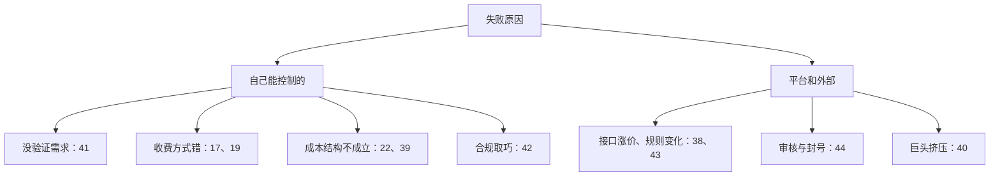

# 失败与关停

第 1 章说过，成功案例经过了「活下来」和「愿意公开」两次筛选。这一章收的是没通过第一次筛选、但当事人留下了记录的案例。它们比成功案例更值得读：成功的原因往往说不清，失败的原因通常很具体。

7 个案例覆盖了六类常见的失败原因：

| 原因 | 案例 |
|---|---|
| 依赖单一平台，平台改规则 | 38 Apollo、43 Server酱、44 冰箱 IceBox |
| 合规与审核 | 42 扫描带师 |
| 单位经济不成立：成本高于收入 | 39 searchcode |
| 被大公司的免费产品挤压，叠加精力透支 | 40 Placemark |
| 没有验证需求、没有获客 | 41 落地页平台 |

前几章里也有几个停下来的案例，这里不重复写卡片，只在最后的汇总里一起分析：案例 17 打工人小组件（作者自评商业失败，停止全职）、案例 19 洗美小程序（两年两个客户，放弃）、案例 22 开单宝（停止更新，劝用户迁走）。

## 案例 38：Apollo（Christian Selig）

- **是什么**：iOS 上的 Reddit 第三方客户端，以体验好著称
- **谁在做**：一人。据加拿大科技媒体 BetaKit 2023 年 6 月的报道，Christian Selig 是 Apollo 唯一的开发者
- **怎么起步**：2015 年开始公开测试，2017 年正式上架
- **怎么获客**：公开资料没有系统说明；从现有信息看主要来自 Reddit 社区本身，这是推断
- **怎么收费**：免费、不放广告；Pro 是一次性内购，Ultra 是订阅，用于覆盖推送通知等功能的服务器成本
- **公开的数字**：
  - 据 MacRumors 2023 年 5 月 31 日转述 Selig 的说法：Reddit 的新报价是每 5,000 万次接口请求 1.2 万美元；Apollo 上个月约 70 亿次请求，按新价每月约 170 万美元、每年约 2,000 万美元
  - 同一来源：一个普通用户每天约 344 次请求，按新价每人每月约 2.5 美元，比当时的订阅价还高；作为对比，Imgur 对同样 5,000 万次调用只收他 166 美元
  - BetaKit 2023 年 6 月的报道写的是每月约 200 万美元、约 150 万用户，与 MacRumors 的数字略有出入，两者并列
  - 据 9to5Mac 2023 年 6 月转述，关停后按比例给订阅用户退款约需 25 万美元，由他自己承担
- **经过**：2023 年 4 月 Reddit 宣布接口收费；5 月 31 日 Selig 公布费用测算；6 月 8 日前后宣布关停；6 月 30 日停止服务。最后一个版本加了「放弃退款」的选项
- **当事人总结**：据 MacRumors 转述，他认为新定价既不现实也不合理；BetaKit 把他的理由归纳为两条：费用太高，Reddit 给的过渡期太短
- **同类旁证**：2023 年 1 月，Twitter 未经通知切断第三方客户端的接口，The Iconfactory（一家小公司，不是一人）于 1 月 19 日宣布 Twitterrific 停止开发，并请用户不要申请退款，因为退款要由小公司自己承担
- **教训**：
  - 核心价值建立在别人的接口上，等于把定价权交给了对方。对方一次调价，就能让你的成本涨几个数量级
  - 订阅制在关停时会变成一笔现金负债：用户预付的钱要退回去

## 案例 39：searchcode（Ben Boyter）

- **是什么**：大规模代码搜索网站，带一个被很多人使用的免费接口
- **谁在做**：一人。作者自述这是一个「小到一个人就能做」的长期副业项目
- **怎么起步**：长期的个人项目，服务器放在德国的 Hetzner
- **怎么获客**：搜索流量（推断，因为它靠广告变现）
- **怎么收费**：广告。作者尝试过让接口收费，没有成功，他的原话大意是人们并不愿意为它付钱
- **公开的数字**（均据作者 2025 年 8 月的博文）：
  - 索引约 6.4 TB，需要约 100 GB 内存，还有配套的 CPU
  - 广告收入跌了大约 10 倍
  - 托管费用以欧元计价，而他在澳大利亚，澳元走弱让账单更难承受
  - 绝对收入和成本金额：未公开
- **经过**：2025 年 8 月宣布关闭当时的版本，域名指向占位页，之后以新的形式重启，新版的目标是覆盖成本
- **当事人总结**：他给这个项目设定的维持条件是「运行便宜，或者能自己覆盖成本」，这两条都已经很久不成立了。广告收入的崩塌，他归因于广告市场下滑、大模型，以及搜索结果页直接给答案、用户不再点进网站
- **教训**：
  - 在开始时就写清楚「什么条件下停」，他做到了，所以决定并不痛苦
  - 免费接口再受欢迎，也不代表有人愿意付钱
  - 只靠广告的收入结构，在 AI 搜索时代格外脆弱。这和第 3 章 Tailwind 文档站的遭遇是同一个原因

## 案例 40：Placemark（Tom MacWright）

- **是什么**：浏览器里的地图和地理数据编辑工具，订阅制
- **谁在做**：一人。作者自述 Placemark 完全自筹资金，由他一个人构建
- **怎么起步**：起步年份和获客方式，复盘里没有写，未公开
- **怎么获客**：未公开
- **怎么收费**：订阅，价格未公开。2023 年 11 月的关停公告说有付费客户
- **公开的数字**：收入和客户数未公开，他只说收入不够
- **经过**：2023 年 11 月宣布停止新用户注册，老客户可用到 2024 年 1 月；2024 年 1 月以 MIT 协议开源；2024 年 3 月发布复盘
- **当事人总结**（据他 2024 年 3 月的复盘）：
  - 收入不足以让这件事值得继续
  - 市场两头被占：高端是行业巨头 Esri，客户虽然被锁定、不满意，但不会走；低端是大公司补贴的免费工具和 QGIS 这类开源工具，让用户习惯了地图软件「应该很便宜」，拿了风投的对手也可以多年低价
  - 用户的期望差异太大，从专业 GIS 的复杂度到 Google 地图的简单度都有，一个居中的通用产品很难做。他说如果重来，会只瞄准一个行业的一类客户
  - 精力消耗：在生活成本高、本地缺少同行的城市独自运营，用户退订、程序错误、度假时服务宕机，这些对情绪的消耗特别大
- **教训**：
  - 通用工具夹在「巨头付费产品」和「巨头免费产品」中间，很难定出能养活自己的价格
  - 一个人运营在线服务没有人轮班，精神压力本身就是成本
  - 只做一个行业的一类客户

## 案例 41：落地页搭建平台（V2EX 用户，未写产品名）

- **是什么**：快速搭建营销落地页的平台，卖点是用户可以自定义模板和组件，开发自己的业务组件发布到平台上
- **谁在做**：一人，业余时间。前端、后端、设计都是作者自己。2020 年离开大厂后开始
- **怎么起步**：2020 年花约一年研究自定义组件的技术方案，年底注册公司、买服务器；2021 年做到约 80%，只是粗糙可运行；2022 年大部分时间在重构，因为对技术设计和视觉方案不满意；2023 年 6 月前后发布。前后约三年
- **怎么获客**：几乎没有。作者承认忽视了营销，也没有公开构建
- **怎么收费**：最初设想 SaaS，后来考虑面向企业做私有化部署，也想过开源
- **公开的数字**：据作者 2023 年 10 月在 V2EX 的复盘，发布后用户很少，只有零星使用。用户数和收入未公开
- **当事人总结**（概括原意）：
  - 不要默认自己觉得有价值的东西就一定有市场，要先验证
  - 一个没有验证的项目，投入超过半年就不值得
  - 尽早营销，半成品也要先拿出去看有没有人用
  - 失败是常态，不要把所有时间押在一个项目上；副业项目要当作随时可以放弃的
- **教训**：三年时间里，真正接触用户的时间几乎为零。技术上的追求（研究方案、重构）消耗了全部精力。这是开发者做产品最常见的失败模式，[《一人公司方法论》第 3 章](../opc-playbook/03-fast-validation.md)「快速验证」专门讲怎么避免

## 案例 42：扫描带师 pro（V2EX：Tarek911）

- **是什么**：两款工具类 App，基本免费，带可选内购
- **谁在做**：作者自述独立开发，发帖时处于失业状态
- **怎么起步**：未公开
- **怎么获客**：未公开。作者提到巴西每天稳定新增约 500 个用户，持续了几个月，他自己也觉得奇怪
- **怎么收费**：AdMob 广告加内购
- **公开的数字**：据作者 2026 年 6 月在 V2EX 的复盘，AdMob 稳定每月 150 到 200 美元；内购收入约 70 美元，因为没到提现门槛，一直没提出来，封号后就提不出来了
- **经过**：
  1. 国内 App 备案要求落地，苹果要求在中国区上架的 App 提供备案号
  2. 商店里的 App 名称和备案名称对不上，作者反复修改名称和备案申请，最后改成「扫描带师 pro」过审
  3. 几周后苹果来信，指出违反审核指南 3.2 条，给 30 天整改
  4. 作者解释巴西的用户增长是真实的，苹果回复会持续监控
  5. 到期后开发者账号被终止，申诉没有回应
- **当事人总结**：他后来认为，问题出在为了避开重名而给名称加后缀；同时他也认为苹果没有公开「备案名称和商店名称要完全一致」这类规则、沟通效率低，有一部分责任在苹果
- **教训**：
  - 合规要求要按字面严格满足，不要为了过审取巧
  - 一个开发者账号就是全部收入的单点故障。账号被封，正在跑的收入和没提现的钱一起没了
  - 国内 App 备案的具体要求，见[《国内合规实务》第 4 章](../opc-compliance-cn/04-app-filing.md)「App 备案」

## 案例 43：Server酱（方糖，easychen）

- **是什么**：给程序员用的推送服务：发一个 HTTP 请求，就把服务器报警、脚本结果推送到微信
- **谁在做**：easychen（Easy），团队人数未公开
- **怎么起步**：2015 年 9 月在 V2EX 发布。用 GitHub 登录拿到一个密钥、绑定微信就能用，底层是微信服务号的模板消息
- **怎么获客**：开发者社区口碑。大量开源脚本内置了它的接口，每个使用这些脚本的人都会接触到它（推断，依据是 GitHub 上大量脚本调用它）
- **怎么收费**：早期基本免费，作者在 2021 年 2 月的帖子里说靠用户领红包让平台囤了一些资金。后来推出 Turbo 版，有免费额度，超出部分按会员收费，具体价格未核实
- **公开的数字**：用户数和收入未公开。2021 年 2 月有用户建议付费支持，作者回复说这些钱还不够买一个数据库实例
- **经过**：
  - 2021 年 1 月下旬，据当时的二手报道，微信公告服务号模板消息将于 4 月底下线；随后改为灰度测试，4 月底又宣布延期，模板消息最终没有下线
  - 2021 年 2 月 5 日，作者在 V2EX 发帖说服务会继续运营，「除非没钱了」，并开始测试支持多个通道的新版本 sct.ftqq.com
  - 2021 年 2 月 8 日，上线企业微信通道，作者说体验和原来的模板消息基本一致
  - 之后又推出了有自己 App 的 Server酱³，官方文档说旧入口的转发是临时的，最长保留三年
- **当事人总结**：作者没有写正式复盘。从他 2021 年 2 月的帖子看，他的应对是：底层通道随时可能被关，所以提前准备多个通道，最终要有自己的终端
- **教训**：
  - 建在超级 App 接口上的产品，要准备好备用通道
  - 免费服务要尽早找到能覆盖成本的收费方式，「靠红包囤的资金」撑不了多久
  - 严格说这是被迫改版，不是关停。它活下来了，代价是几乎重做了一遍
- **同类旁证**：国内小程序开发者被封的帖子很多。一个 V2EX 用户 2022 年 8 月发帖说，名下 5 个小程序在同一分钟被永久封禁，理由是「对抗平台监管」，申诉秒拒；另一位开发者 2025 年 8 月发帖说，4 个抖音小程序被下架后账号以「同质化、低质」为由被永久封禁。两者都没有公开收入，只说明平台规则的不透明

## 案例 44：冰箱 IceBox（V2EX：little_cup）

- **是什么**：安卓上「冻结」不常用 App 的工具，需要较高的系统权限
- **谁在做**：独立开发者
- **怎么起步**：发帖时已上线 5 年多
- **怎么获客**：各安卓应用市场和 Google Play
- **怎么收费**：未在帖子中说明
- **公开的数字**：据作者 2020 年 6 月在 V2EX 披露，各市场累计下载超过 400 万，月活超过 20 万
- **经过**：半个月内被 Google Play 下架 4 次。前 3 次理由是「无法卸载」，作者说 App 内有卸载选项、至少在三个地方说明过，申诉后恢复；第 4 次理由是「促成不诚实行为」，并从暂停升级为下架。到 6 月 20 日开发者后台已解锁，但作者在等申诉回复，暂不提交更新。最终是否恢复，未查到
- **当事人总结**：他怀疑是 Google 的安全扫描把这类需要 root 权限的工具误判为恶意，审核团队随后不断找其他理由下架；他认为这源于对这类工具和国内用户习惯的不理解
- **教训**：越依赖系统权限的工具，越受平台政策左右；规模越大，越容易进入审核的视野

## 十个停下来的案例放在一起

把本章 7 个和前几章 3 个停下来的案例放在一起：

| 案例 | 规模 | 停下来时的状态 | 主要原因 | 能否提前预见 |
|---|---|---|---|---|
| 17 打工人小组件 | 三人 | 月收入三千多元 | 付费转化低、推广成本没算 | 部分能：先收费、先算推广成本 |
| 19 洗美小程序 | 一人 | 2 个客户 | 一次性收费 + 持续成本 + 无渠道 | 能 |
| 22 开单宝 | 一人 | 13 个用户 | 收入不足 + 客服负担 | 部分能 |
| 38 Apollo | 一人 | 约 150 万用户 | 平台接口涨价 | 风险能预见，时间不能 |
| 39 searchcode | 一人 | 长期运营 | 成本高于广告收入 | 能，作者早写好了停止条件 |
| 40 Placemark | 一人 | 有付费客户 | 市场两头被占 + 精力透支 | 部分能 |
| 41 落地页平台 | 一人 | 零星用户 | 没验证需求、没获客 | 能 |
| 42 扫描带师 | 一人 | 每月 150–200 美元 | 合规取巧被封号 | 能 |
| 43 Server酱 | 未公开 | 存活，被迫改版 | 平台政策变化 | 风险能预见 |
| 44 冰箱 IceBox | 一人 | 400 万下载 | 平台审核 | 风险能预见 |

几条规律：

1. **大部分失败是可以提前预见的**。10 个里有 6 个的主要原因在自己能控制的范围内：没验证、收费方式错、成本没算、合规取巧。这些都可以在开始前或早期发现
2. **平台风险不能消除，只能分散**。Apollo 和 Server酱的平台风险在第一天就存在，区别是 Server酱 提前准备了替代通道，所以活了下来
3. **规模不能保护你**。Apollo 有上百万用户，IceBox 有 400 万下载，规模大反而更显眼、成本涨得更快
4. **事先写好停止条件的人，停得最体面**。searchcode 的作者给项目设了两个维持条件，条件不满足就停，没有拖延，也没有自我折磨。[《一人公司方法论》第 6 章](../opc-playbook/06-when-to-quit.md)「什么时候该放弃」讲了怎么写止损线
5. **门店软件的失败最安静**。洗美小程序和开单宝都没有平台事件、没有戏剧性，只是客户太少、服务太累，慢慢停下。这种失败最常见，也最不容易被注意到

## 本章要点

- 7 个失败与关停案例覆盖平台依赖、合规、单位经济、巨头挤压、精力透支、没有需求六类原因
- Apollo 的接口账单从几乎为零变成每年约 2,000 万美元，关停时还要自掏约 25 万美元退款
- searchcode 写好了「便宜或自负盈亏」两个维持条件，广告收入跌十倍后果断关闭
- Placemark 夹在巨头付费和巨头免费之间，作者的结论是只做一个行业的一类客户
- 落地页平台三年闭门开发、几乎零用户；扫描带师为过审改名被苹果终止账号
- 10 个停下来的案例里有 6 个的主因在自己能控制的范围内；平台风险只能分散，不能消除

## 资料来源

- MacRumors，Apollo 的接口费用测算（2023-05-31）：https://www.macrumors.com/2023/05/31/reddit-api-changes-pricing-apollo/
- BetaKit，Apollo 关停与唯一开发者（2023-06-12）：https://betakit.com/reddits-new-api-pricing-kills-canadian-app-apollo/
- Wikipedia，Apollo 时间线：https://en.wikipedia.org/wiki/Apollo_(app)
- 9to5Mac，Apollo 退款成本（2023-06-29）：https://9to5mac.com/2023/06/29/apollo-reddit-refund-rejection/
- The Iconfactory，Twitterrific 停止开发（2023-01-19）：https://blog.iconfactory.com/2023/01/twitterrific-end-of-an-era/
- Ben Boyter，searchcode 关闭与重启（2025-08-28）：https://boyter.org/posts/searchcode-is-being-rebooted/
- Tom MacWright，Placemark 关停公告（2023-11-13）：https://macwright.com/2023/11/13/placemark
- Tom MacWright，Placemark 开源（2024-01-19）：https://macwright.com/2024/01/19/placemark-oss
- Tom MacWright，Placemark 复盘（2024-03-25）：https://macwright.com/2024/03/25/about-placemark-io
- 落地页平台三年复盘（V2EX，2023-10-09）：https://v2ex.com/t/980242
- Tarek911，扫描带师封号复盘（V2EX，2026-06）：https://v2ex.com/t/1222595
- easychen，Server酱 发布帖（V2EX，2015-09）：https://v2ex.com/t/219200
- easychen，模板消息下线的回应与多通道方案（V2EX，2021-02-05）：https://v2ex.com/t/751550
- 微信模板消息下线、灰度与延期时间线（二手，人人都是产品经理）：https://www.woshipm.com/operate/4586700.html
- Server酱³ 文档，旧入口临时转发：https://doc.ft07.com/serverchan3/compatibility/sct-forward
- 5 个小程序被封（V2EX，2022-08）：https://v2ex.com/t/874209
- 抖音小程序开发者被封号（V2EX，2025-08）：https://v2ex.com/t/1153916
- little_cup，冰箱 IceBox 被 Google Play 下架（V2EX，2020-06-05）：https://v2ex.com/t/678987
