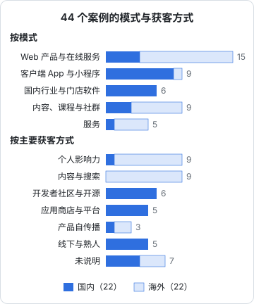

# 横向对比与规律

前面七章一个一个地看案例，这一章把 44 个放在一起看。先给出全部案例一览和分类口径，再看分布，最后归纳规律。

需要先强调：44 个案例不是随机样本，它们是「公开过可查证信息」的案例，经过了第 1 章说的两次筛选。所以下面的统计只描述这本书的样本，不能推广成「一人公司里有百分之多少靠个人影响力」。它的用处是对比：在同一批有记录的案例里，国内和海外、成功和失败，差别落在哪里。

## 全部案例一览

分类口径：

- **模式**按「卖的是什么」分五类：Web 产品与在线服务（含 API、网页工具）、客户端 App 与小程序、国内行业与门店软件、内容课程与社群、服务
- **主要获客**按卡片里当事人说的「第一批用户和主要用户从哪来」归类，一个案例只取最主要的一种；卡片里写「未公开」或说法不足以判断的，归为「未说明」
- **状态**是截至 2026 年 11 月能查到的最近状态

按模式分成五组，每条依次是：地区 · 规模 · 主要获客 · 状态。点案例名跳到对应的案例卡片。

**Web 产品与在线服务**（15 个）

- [1 Pieter Levels](02-overseas-saas.md#案例-1pieter-levels-的产品组合)：海外 · 一人 · 个人影响力 · 运营中
- [2 Plausible](02-overseas-saas.md#案例-2plausible-analytics小团队对照)：海外 · 小团队 · 内容与搜索 · 运营中
- [3 Bannerbear](02-overseas-saas.md#案例-3bannerbearjon-yongfook)：海外 · 一人 · 内容与搜索 · 运营中
- [4 Carrd](02-overseas-saas.md#案例-4carrdaj)：海外 · 一人（存疑） · 产品自传播 · 运营中
- [5 Tally](02-overseas-saas.md#案例-5tally两人起步的对照)：海外 · 小团队 · 产品自传播 · 运营中
- [13 flomo](04-china-indie.md#案例-13flomo-浮墨笔记)：国内 · 小团队 · 个人影响力 · 运营中
- [31 TypingMind](07-ai-native.md#案例-31typingmindtony-dinh)：海外 · 一人 + 外包（存疑） · 个人影响力 · 运营中
- [32 HeadshotPro](07-ai-native.md#案例-32headshotprodanny-postma)：海外 · 一人 · 内容与搜索 · 运营中
- [33 Chatbase](07-ai-native.md#案例-33chatbaseyasser-elsaid)：海外 · 小团队 · 个人影响力 · 运营中
- [34 PDF.ai](07-ai-native.md#案例-34pdfaidamon-chen)：海外 · 未公开 · 内容与搜索 · 未知
- [35 沉浸式翻译](07-ai-native.md#案例-35沉浸式翻译owen-young-起步)：国内 · 小团队 · 开发者社区 · 已被收购
- [36 刘小排](07-ai-native.md#案例-36刘小排)：国内 · 小团队 · 未说明 · 运营中
- [39 searchcode](08-failures.md#案例-39searchcodeben-boyter)：海外 · 一人 · 未说明 · 关闭后重启
- [40 Placemark](08-failures.md#案例-40placemarktom-macwright)：海外 · 一人 · 未说明 · 关停，开源
- [43 Server酱](08-failures.md#案例-43server酱方糖easychen)：国内 · 未公开 · 开发者社区 · 被迫改版

**客户端 App 与小程序**（9 个）

- [12 Bob](04-china-indie.md#案例-12bobripperhe)：国内 · 一人 · 开发者社区 · 运营中
- [15 Mole](04-china-indie.md#案例-15moletw93)：国内 · 一人 · 开发者社区 · 运营中
- [16 极简时钟](04-china-indie.md#案例-16极简时钟vulgur)：国内 · 一人 · 应用商店与平台 · 运营中
- [17 打工人小组件](04-china-indie.md#案例-17打工人小组件三人对照)：国内 · 小团队（三人） · 应用商店与平台 · 停止全职
- [18 貔貅记账](04-china-indie.md#案例-18貔貅记账王维东)：国内 · 一人 · 未说明 · 2022 年后未知
- [37 木鱼 AI 助手](07-ai-native.md#案例-37木鱼-ai-助手v2exstephen7zz)（App（小程序））：国内 · 一人 · 线下与熟人 · 运营中（2025）
- [38 Apollo](08-failures.md#案例-38apollochristian-selig)：海外 · 一人 · 未说明 · 关停
- [42 扫描带师](08-failures.md#案例-42扫描带师-prov2extarek911)：国内 · 一人 · 应用商店与平台 · 账号被终止
- [44 冰箱 IceBox](08-failures.md#案例-44冰箱-iceboxv2exlittlecup)：国内 · 一人 · 应用商店与平台 · 被下架，后续未知

**国内行业与门店软件**（6 个）

- [19 洗美小程序](05-china-vertical-b2b.md#案例-19汽车洗美门店小程序v2exnoconfuse)：国内 · 一人 · 线下与熟人 · 放弃
- [20 宏图电子菜单](05-china-vertical-b2b.md#案例-20宏图电子菜单v2expbk)：国内 · 一人 · 线下与熟人 · 2024-07 后无公开更新
- [21 云店管](05-china-vertical-b2b.md#案例-21云店管v2exeyon)：国内 · 一人 · 线下与熟人 · 后续未知
- [22 开单宝](05-china-vertical-b2b.md#案例-22开单宝v2exfingal)：国内 · 一人 · 线下与熟人 · 停止
- [23 智存](05-china-vertical-b2b.md#案例-23智存v2exmiomioos)：国内 · 未公开 · 开发者社区 · 刚推广
- [41 落地页平台](08-failures.md#案例-41落地页搭建平台v2ex-用户未写产品名)（行业软件）：国内 · 一人 · 未说明 · 放弃

**内容、课程与社群**（9 个）

- [6 Small Bets](03-overseas-content.md#案例-6daniel-vassallo-与-small-bets)：海外 · 一人 · 个人影响力 · 已出售
- [7 Justin Welsh](03-overseas-content.md#案例-7justin-welsh)：海外 · 一人 + 外包 · 个人影响力 · 运营中
- [8 Marc Lou](03-overseas-content.md#案例-8marc-lou-与-shipfast)：海外 · 一人 · 个人影响力 · 运营中
- [9 Josh Comeau](03-overseas-content.md#案例-9josh-w-comeau-与-css-for-javascript-developers)：海外 · 一人 + 外包 · 内容与搜索 · 运营中
- [10 Refactoring UI](03-overseas-content.md#案例-10refactoring-ui两人)：海外 · 两人 · 个人影响力 · 已发展为公司
- [11 Nathan Barry](03-overseas-content.md#案例-11nathan-barry-的电子书阶段)：海外 · 一人 · 内容与搜索 · 已转做 SaaS
- [14 小报童](04-china-indie.md#案例-14小报童)（内容平台）：国内 · 小团队 · 产品自传播 · 运营中
- [28 huiwang520 课程](06-service-opc.md#案例-28自建渠道卖技术课v2exhuiwang520)：国内 · 一人，后两人 · 开发者社区 · 收入衰减
- [29 vikingmute](06-service-opc.md#案例-29慕课网讲师与简历工具v2exvikingmute)：国内 · 一人 · 应用商店与平台 · 2022 年后未知

**服务**（5 个）

- [24 DesignJoy](06-service-opc.md#案例-24designjoybrett-williams)：海外 · 一人 · 个人影响力 · 运营中
- [25 patio11](06-service-opc.md#案例-25patrick-mckenziepatio11)：海外 · 一人 + 外包 · 内容与搜索 · 软件已出售
- [26 Jonathan Stark](06-service-opc.md#案例-26jonathan-stark)：海外 · 未公开 · 内容与搜索 · 运营中
- [27 Brennan Dunn](06-service-opc.md#案例-27brennan-dunn小团队对照)：海外 · 小团队 · 内容与搜索 · 已转型
- [30 Yunior](06-service-opc.md#案例-30自由职业开发的第一年v2exyunior)：国内 · 一人 · 未说明 · 2020 年后未知

小报童在模式图里归入「内容、课程与社群」，落地页平台归入「国内行业与门店软件」（它是面向企业的工具），木鱼 AI 助手归入「客户端 App 与小程序」。

### 规模分布

| 规模 | 案例数 | 案例 |
|---|---|---|
| 一人 | 26 | 1、3、4、6、8、11、12、15、16、18、19、20、21、22、24、28、29、30、32、37、38、39、40、41、42、44 |
| 一人 + 外包 | 4 | 7、9、25、31 |
| 两人 | 1 | 10 |
| 小团队 | 9 | 2、5、13、14、17、27、33、35、36 |
| 未公开 | 4 | 23、26、34、43 |

9 个小团队里，Plausible、Tally、Chatbase、沉浸式翻译、Brennan Dunn 都是从一两个人长起来的。增长到一定程度，一人公司通常会变成小团队，或者被收购。保持一个人的，多半是主动选择：Justin Welsh 关掉占时间的社群，DesignJoy 用涨价代替招人。

## 分布：国内和海外走的是两条路

这张图最显眼的是获客方式的地区差异：

| 主要获客 | 国内 | 海外 |
|---|---|---|
| 个人影响力 | 1 | 8 |
| 内容与搜索 | 0 | 9 |
| 开发者社区与开源 | 6 | 0 |
| 应用商店与平台 | 5 | 0 |
| 产品自传播 | 1 | 2 |
| 线下与熟人 | 5 | 0 |
| 未说明 | 4 | 3 |

海外的 22 个案例里，17 个靠个人影响力或内容与搜索；国内的 22 个里，16 个靠开发者社区、应用商店和线下熟人。这不全是市场差异，也有样本的原因：海外公开收入的人本身就是做内容的人。但至少说明两件事：

1. **海外案例的获客经验很难直接搬到国内**。在 X 上公开构建、写英文博客做搜索，在国内没有对应的同等规模的渠道。国内开发者能稳定借力的公共渠道是 V2EX、GitHub 这类开发者社区，以及应用商店
2. **国内面向非开发者的生意，获客几乎都在线下**。5 个「线下与熟人」全是国内案例，其中 4 个是门店和行业软件，1 个是面向小商家的 AI 工具

## 时间：从开始到第一个里程碑

能查到时间线的案例里，从开始到第一个明确里程碑花了多久：

| 案例 | 起点 | 里程碑 | 用时 |
|---|---|---|---|
| 2 Plausible | 2019-05 第一个付费用户 | 400 美元 MRR | 324 天 |
| 3 Bannerbear | 2019-01 辞职 | 10,455 美元 MRR | 约 22 个月 |
| 5 Tally | 2020-09 上线 | 1 万美元 MRR | 约 17 个月 |
| 7 Justin Welsh | 2020-04 第一个产品 | 首月 10,482 美元 | 1 个月（此前已有 2 万多粉丝） |
| 8 Marc Lou | 约 30 个失败项目之后 | ShipFast 上线 | 未公开 |
| 31 TypingMind | 2023-03 上线 | 12 个月收入 100 万美元 | 20 个月 |
| 33 Chatbase | 2023 年初上线 | ARR 约 900 万美元 | 约 3 年 |
| 36 刘小排 | 2022-06 开始做 AI 副业 | 辞职全职 | 约 2.5 年 |
| 20 宏图电子菜单 | 未公开 | 约 10 家店，部分第二年续费 | 至少 1 年以上 |
| 19 洗美小程序 | 离职独立开发 | 2 个客户，放弃 | 约 2 年 |
| 41 落地页平台 | 2020 年 | 发布 | 约 3 年，几乎零用户 |

没有受众的人（Plausible、Bannerbear、Tally），到第一个能说明问题的收入水平，用了一年到两年。有受众或赶上时机的人快得多，但这两样都不是想有就有。

## 规律

### 一、受众是最大的不可复制项

第 2、3 章最成功的案例，几乎都在产品之前就有了受众：Pieter Levels、Justin Welsh、Marc Lou、Josh Comeau、Refactoring UI。没有受众的案例要么慢（Plausible、Bannerbear），要么依赖产品自传播（Carrd、Tally）。

国内案例里，受众的形态不一样：Mole 的受众是 GitHub 上的开源用户，huiwang520 的受众是公众号和开源项目的读者，木鱼 AI 助手的受众是作者多年工作积累的老板人脉。**对做 To B 的人来说，「受众」就是行业里认识你、信任你的人**，它可能不在任何社交平台上。

### 二、收费方式比价格本身更重要

- 买断适合个人工具的起步，但收入随新用户增长而停滞：ShipFast 从主力降到每月一千多美元，极简时钟的买断收入一年下降近一半，打工人小组件的永久会员撑不起两个人
- 成功案例里出现了「买断起步、订阅接力」：TypingMind 从个人买断转到企业订阅，订阅收入超过一半后才稳定
- **To B 场景下一次性收费基本是陷阱**：洗美小程序一次卖两三千元却要长期维护；宏图电子菜单的亮点恰恰是「第二年续费」
- 价格普遍定低了：Bannerbear 专门写文章劝人别收 9 美元，DesignJoy 用一次次涨价控制客户数

### 三、一人阶段常常是暂时的

增长快的产品很快就不是一个人了：Chatbase 三个月招人，沉浸式翻译五个月被收购，Plausible 和 Tally 现在都是十人左右。保持一个人的是少数，而且是有意为之。对读者的含义是：「一人公司」应该被当作一种**运营约束**（让一个人能扛得住），而不是一个规模目标。

### 四、平台是杠杆也是悬崖

应用商店、微信、Reddit、Google Play 给了国内外很多案例第一批用户，也是 Apollo、Server酱、扫描带师、IceBox 的主要风险来源。第 8 章的结论是：平台风险不能消除，只能分散。Server酱 提前准备了多个通道，所以活了下来。

### 五、组合收入比单一产品更稳

Justin Welsh 的 1,000 万美元由产品、咨询、赞助、订阅、社群五块组成；patio11 是软件加咨询加课程；DesignJoy 是服务加课程；Small Bets 2024 年有约三分之一来自一对一咨询。组合的好处是一块下滑时另一块能顶上，比如 Marc Lou 的 ShipFast 衰退时，DataFast 和 TrustMRR 接上了。

### 六、AI 在改写获客链条

两个独立的案例指向同一个方向：Tailwind Labs 因 AI 工具让文档站流量下降，收入下降近 80%；searchcode 的广告收入跌了十倍，作者归因于大模型和「零点击」搜索。同时 Tally 说 AI 搜索已经是它的第一大渠道。靠「内容带流量」的模式在变，被 AI 推荐的产品会得到更多，被 AI 摘要替代的内容会失去更多。

### 七、国内的数字整体小一到两个数量级

国内案例里，当事人直接披露的收入多数在月入几千到几万元：貔貅记账 2022 年约每月 4 万元已经算高的，极简时钟一年到手约 21 万元，huiwang520 两门课累计 20 多万元。Mole 的付费客户数（支付商口径）和沉浸式翻译的用户数更大，但收入都未公开。海外成功案例常以百万美元计。差距来自付费习惯、客单价、渠道结构，也来自样本：国内做大的人更少公开。无论原因是哪个，规划国内产品时都应该用国内案例做基准。

## 本章要点

- 44 个案例里，一人 26 个、一人 + 外包 4 个、两人 1 个、小团队 9 个、未公开 4 个
- 获客方式的地区差异最明显：海外 22 个里 17 个靠个人影响力或内容与搜索，国内 22 个里 16 个靠开发者社区、应用商店和线下熟人
- 没有受众的海外 SaaS 到第一个像样的收入水平用了一到两年
- 买断起步、订阅接力；To B 一次性收费基本是陷阱；价格普遍定低了
- 一人阶段常常是暂时的，应该被当作运营约束而不是规模目标
- 平台风险只能分散；组合收入更稳；AI 正在改写「内容带流量」的获客链条
- 国内数字整体小一到两个数量级，规划国内产品要用国内案例做基准

## 资料来源

本章的数字全部来自第 2 到第 8 章的案例卡片，出处见各章末尾。分布图和各统计表按本章「全部案例一览」逐条计数得出。
