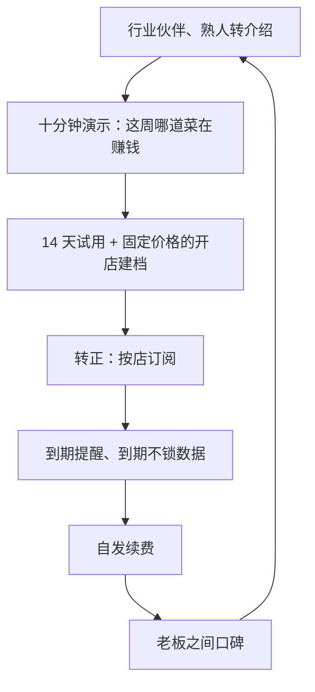

# 对 hatch-counter 的启示

最后一章把前面的规律落到 hatch-counter 上：在 44 个案例里，它最像谁，哪些路径适合它、哪些不适合，具体该学谁的哪一招，以及用什么数字来判断进展。

先说结论：**hatch-counter 最该对照的是第 5 章的国内门店软件案例，而不是第 2 章的海外 SaaS**。前者给出了现实的基准（一个人做，第一年能有十来家付费店已经不错），后者的增长曲线建立在一个完全不同的获客结构上。

## hatch-counter 在案例坐标里的位置

按第 9 章的口径给它归类：

| 维度 | hatch-counter（产品名「掌柜眼」） |
|---|---|
| 地区 | 国内，先做国内市场 |
| 规模 | 一人，在职副业 |
| 模式 | 国内行业与门店软件：给中小餐饮门店用，导入收银报表算销量，拍进货单识别后补库存，记开支算盈亏 |
| 付费方 | 店主，同时也是主要使用者 |
| 现在的收费 | 按门店开户，管理后台开 14 天 0 元试用，转正开收费订单，线下转账、后台确认收款后顺延到期日 |
| 可能的获客 | 线下与熟人、行业伙伴，这是第 9 章里国内门店软件唯一出现过的获客方式 |

和它最近的案例：

| 案例 | 像在哪 | 不像在哪 |
|---|---|---|
| 20 宏图电子菜单 | 餐饮、一个人、靠朋友的渠道、有续费 | 它是点餐前台，hatch-counter 是后台管理 |
| 21 云店管 | 一个人做进销存、扫街获客、14 天试用 | 客户是批发零售，不是餐饮 |
| 23 智存 | 功能重合度最高：录单、导入账单、利润报表、AI 识别 | 面向泛小店，没有菜品、配方、按配方扣库存 |
| 22 开单宝 | 一个人、熟人需求出发、客服是最大负担 | 停在 13 个用户 |
| 19 洗美小程序 | 一个人、门店、朋友介绍 | 一次性收费，两年两个客户 |
| 37 木鱼 AI 助手 | 面向不会用复杂工具的小老板，靠老板之间口碑 | 是图片工具，不碰经营数据 |

## 哪些路径适合，哪些不适合

把 44 个案例里出现过的路径逐一过一遍：

| 路径 | 代表案例 | 对 hatch-counter | 理由 |
|---|---|---|---|
| 公开构建、个人影响力 | 1、7、8 | 不适合作为获客 | 关注你的人是开发者，不是餐饮店主。可以写，但别指望它带来客户 |
| 内容与英文搜索 | 2、3、32 | 不适合 | 先做国内；店主很少搜索「库存管理软件」，更多是听同行说 |
| 产品自传播（徽章） | 4、5 | 基本不适合 | 门店后台外人看不到。唯一的例外是店主把报表发给合伙人、会计的那一刻 |
| 应用商店自然流量 | 16、17 | 不适合 | 它不是个人 App；手机端只是辅助，店主不会在商店里搜到它再决定上一套系统 |
| 开发者社区 | 12、15、21 | 不适合获客，适合找合作者 | 云店管在 V2EX 有 30 多人注册、零付费 |
| 线下扫街、上门演示 | 21 | 适合，但要算时间成本 | 三天约 5 个付费，转化不低；问题是每家都要你亲自去 |
| 行业伙伴转介绍 | 20 | 最适合 | 摄影师、装修、供应商、收银系统代理，在「对的时间」接触到「对的店」 |
| 熟人和老板之间的口碑 | 37 | 适合，作为放大器 | 店主之间互相问「你用什么软件」，前提是第一批店真的用得好 |
| 一次性收费 | 19 | 不适合 | 门店软件要持续维护、持续付服务器和识别费用 |
| 免费换规模 | 4 | 不适合 | 极低价要靠海量用户；餐饮门店的总量和付费意愿都撑不起 |
| 产品化服务 | 24 | 适合 | 开店建档、导入历史报表、配方录入可以做成固定价格的服务包 |
| 服务和软件组合 | 25 | 适合，尤其在过渡期 | 软件收入起来前，按店收的建档服务和经营咨询能补现金流 |

适合的路径几乎全部和「人」有关：行业伙伴、熟人、上门、服务。这和第 9 章的发现一致：国内面向非开发者的生意，获客在线下。

## 具体该学谁的哪一招

### 获客：学宏图电子菜单的渠道

宏图电子菜单的单子来自一位做餐厅摄影的朋友。这个渠道好在「时机」：餐厅拍菜品照的时候，正是开业、换菜单、上新的时候，也是最愿意尝试新工具的时候。

对 hatch-counter，同样「在对的时间接触对的店」的伙伴有：

- **收银系统的代理和实施人员**：新店装收银机时，收银报表就是 hatch-counter 的数据来源。它现在内置识别美团收银的「品项销售明细」，其他收银系统的报表第一次导入时指一次列就能存成格式
- **食材供应商**：他们每天给很多店送货、开单，进货单正是 hatch-counter 拍照识别的对象
- **餐饮培训、代账会计**：代账会计要店里的开支和进货，他们是「看报表的人」

这些人凭什么推荐你？宏图电子菜单给的是「薄礼答谢」。更可持续的是让推荐对他们自己的工作有用，比如会计能直接拿到整理好的开支。具体的渠道打法见[《销售与 To B 成交》](../b2b-sales/)和[《国内私域与内容平台》](../private-domain-cn/)。

### 获客的时间成本：学云店管，也要警惕它

云店管三天扫街拿到约 5 个付费客户，说明店主当面看过演示后愿意付钱。但在职做副业的人没有每天两三个小时可以扫街。可以借的是它的结论，而不是它的做法：**一次当面演示的转化远高于任何线上渠道**。所以要做的是让每一次演示更高效：准备一家虚构川菜馆的演示数据（hatch-counter 的 `mock-data/` 已经有），十分钟内让店主看到「这周哪道菜在赚钱」。

### 收费：学智存把成本拆开，学 DesignJoy 把服务产品化

智存的做法是记账免费、AI 收费：没有边际成本的部分免费，有边际成本的部分（模型调用）单独收。hatch-counter 的路线图里已经有「识别的费用按店算」，方向一致。具体的价格推演见[《定价与商业模式》第 8 章](../pricing-monetization/08-case-hatch-counter.md)「案例：给门店 SaaS 定价」。

门店软件最大的隐性成本是开店建档：把菜品、食材、配方录进去，导入第一批报表。这件事今天是「顺便帮店主做」，可以学 DesignJoy 把它做成一个有边界的服务：

| 服务包 | 内容 | 边界 |
|---|---|---|
| 开店建档 | 导入菜单、食材，录入主要菜品的配方，导入近一个月报表 | 只做主营菜品的配方，酒水和套餐另算 |
| 月度复盘 | 每月一次，看一遍利润和料钱，指出三件该做的事 | 一次一小时，远程 |

固定价格、固定范围，让「上门」从额外负担变成一份收入。

### 收费方式：学宏图的续费，避开洗美小程序的一次性

一次性收费在门店软件里是陷阱，案例 19 是直接的反例。hatch-counter 现在按门店、按时长开订单，到期前 7 天、1 天、当天发短信，到期后仍能登录、只拦记账操作，这些设计都是在为续费服务。早期最该看的信号不是新签了多少家，而是**有多少家店到期后自己续费**。宏图电子菜单最值得注意的一句话就是「有的店已经是第二年续费了」。

### 运营：学开单宝的教训，学 Placemark 的结论

开单宝的作者说最麻烦的是客服，很多问题不是技术能解决的。hatch-counter 已经在为此做设计：报错文案由服务端统一写，到期不做成登录失败，对不上的数据交给人拍板而不是自动猜。这些在[《一人公司方法论》第 7 章](../opc-playbook/07-case-studies.md)有分析。

Placemark 的作者在复盘里说，如果重来，会只瞄准一个行业的一类客户。hatch-counter 已经选了「中小餐饮」，下一步是更窄：先服务一种店，比如一到三家店的正餐馆。云店管的回帖列出了称重、加工、打印、开票，每一项都是一类店的「基本需求」。先说清楚不服务谁，比多做一个功能更能保护一个人的时间。

### 节奏：学 Plausible 和刘小排的耐心

Plausible 用了 324 天才到 400 美元 MRR，Tally 一年半到 1 万美元 MRR，刘小排做了两年半副业才辞职。没有受众的产品，一到两年的验证期是正常的。对在职做副业的人，这意味着两件事：

- 不要用海外案例的曲线给自己定目标，用第 5 章的数字
- 辞职前，产品要能证明续费，最好有一笔不依赖你本人上门的新增来源

从在职到全职的分阶段条件、退出线和止损线，见[《一人公司行动手册》](../opc-action-plan/)。

### 风险：学 Server酱 的多通道

hatch-counter 也有自己的平台依赖：

| 依赖 | 风险 | 现在的缓冲 |
|---|---|---|
| 收银系统的导出格式 | 收银系统改了报表格式，导入就失败 | 内置格式只有一份，别家报表指一次列存成店里自己的格式，格式变了可以重新指 |
| 识别服务商 | 服务商涨价、停服、效果变差 | 服务端有一条识别降级链，可以接多家；供货商发来的 Excel 和 CSV 直接读格子，不经过第三方 |
| 外卖和收银平台本身 | 平台自己推出同类的经营分析 | 暂无。这是第 8 章 Placemark 遇到的情况：巨头的免费功能拉低用户对价格的预期 |

第三条是最大的长期风险，没有技术上的解法。能做的是在大平台不愿意做的地方做深：按配方扣库存、拍手写进货单、开支摊销、这些细碎但每家店都不一样的口径。

## 用国内案例设基准

用第 5 章的数字给 hatch-counter 设一个现实的参照：

| 阶段 | 参照案例 | 现实的基准 |
|---|---|---|
| 第一批付费店 | 21 云店管：3 天 7 个付费；19 洗美小程序：两年 2 个 | 能拿到第一批付费店说明需求存在，拿不到要先回头看问题 |
| 能续费 | 20 宏图电子菜单：约 10 家店，部分第二年续费 | 十来家店、有自发续费，是一个人做门店软件能公开查到的较好状态 |
| 能养活一个人 | 无国内公开案例 | 按《定价与商业模式》第 8 章的假设（每店每月 99 元），每月 2 万元需要约 256 家付费店。本书没有找到任何一个公开过达到这个量级的个人门店软件案例 |

最后一行要正视：**没有找到公开的先例，不代表做不到，但说明这是一件少有人公开走通的事**。可能有人做到了但不说，也可能真的很少。无论哪种，都应该把「256 家」当作一个需要多条渠道、多年积累才可能接近的目标，而不是第一年的计划。

价格锚点也要放进来看：钛媒体 2023 年的报道称，餐饮 SaaS 单店年订阅费在几百到约 2,000 元之间；智存年付 198 元；云店管的回帖里有网友说老牌进销存软件一年约 600 元（网友说法，未核实）。hatch-counter 如果按每月 99 元、每年 990 元定价，落在这个区间的中段，需要让店主看到它比收银系统自带的报表多出了什么。

## 和智存的差异

智存是本书找到的功能最接近的产品，值得单独看一眼差异：

| 方面 | 智存（据其 2026-10 推广帖） | hatch-counter |
|---|---|---|
| 面向 | 泛小店，含批发零售 | 中小餐饮 |
| 销量来源 | 店主开单、录营业额、导入微信账单 | 导入收银系统的报表 |
| 库存怎么扣 | 开单直接扣商品 | 按配方把卖掉的菜折算成用掉的料 |
| AI 用在哪 | 一句话录单、问生意 | 拍进货单识别 |
| 收费 | 记账免费，AI 额度专业版 198 元/年 | 按门店订阅 |

差异点很清楚：**菜和料是两本账，靠配方连起来**，这是餐饮独有的口径，泛小店的进销存不处理。这也是 hatch-counter 在面对店主时最该讲清楚的一句话。

## 本章要点

- hatch-counter 最该对照的是第 5 章的国内门店软件，不是海外 SaaS 的增长曲线
- 适合它的路径几乎都和人有关：行业伙伴转介绍、熟人口碑、当面演示、产品化的建档服务；公开构建、英文搜索、应用商店、徽章自传播都不适合作为获客
- 学宏图电子菜单找「在对的时间接触对的店」的伙伴：收银系统代理、食材供应商、代账会计
- 学智存把有边际成本的识别单独计价，学 DesignJoy 把开店建档做成固定价格、固定范围的服务包
- 早期最重要的信号是自发续费，而不是新签数量；一次性收费是陷阱
- 先只服务一类店；为收银格式和识别服务商留好替代通道，正视平台自带分析功能的长期风险
- 现实基准：十来家店、有自发续费；每月 2 万元约需 256 家付费店，本书没有找到公开走通的个人先例

## 资料来源

- hatch-counter 仓库 README 与 `docs/` 下的现行页、路线图（本地文档，未公开）
- 本章引用的案例数字均见第 2 到第 8 章各卡片的资料来源
- 钛媒体，餐饮 SaaS 单店年费（澎湃新闻 2023-03-07 转载）：https://www.thepaper.cn/newsDetail_forward_22166333
- MioMioOs，智存功能与价格（V2EX，2026-10-19）：https://www.v2ex.com/t/1250132
- pbk，宏图电子菜单（V2EX，2024-07-10）：https://www.v2ex.com/t/1056124
- Eyon，云店管及回帖中的需求意见（V2EX，2021-07-01）：https://www.v2ex.com/t/786829
