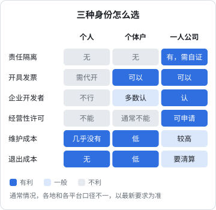
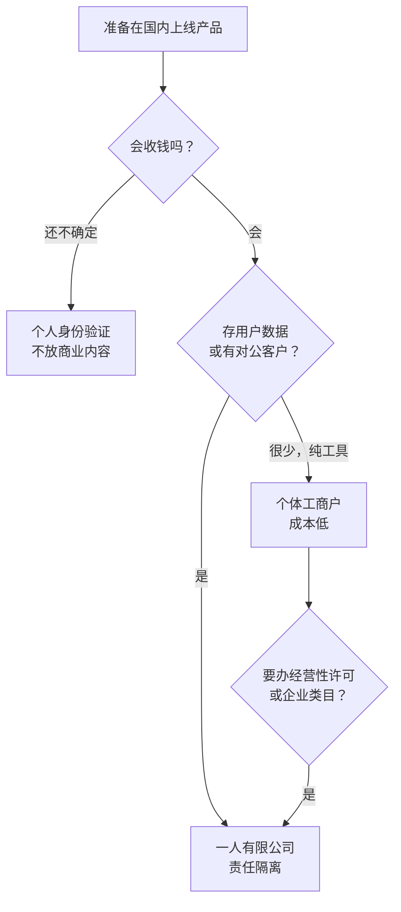

# 主体选择：个体户还是一人有限公司

写代码的人第一次碰合规，常见的反应有两种：一种是「先不管，等做大了再说」，另一种是被一堆法规名词吓住，迟迟不敢上线。两种都不对。国内做互联网产品，有几道手续是**上线的前提**：没有主体办不了 ICP 备案，没有备案域名解析不到国内服务器，App 上不了架；也有几道是**做了更安全**的事：软件著作权、隐私政策、数据处理记录。

这一章先回答最上游的问题：用什么身份来做这件事。

> **先说清楚**：本书讲的是框架、流程和常见的坑，不是法律意见。法规、门槛、费用、办理渠道都会变，各地执行口径也不完全一样。**一切以主管部门的最新要求为准，重大事项（股权、融资、数据出境、涉及大量个人信息的业务）请咨询律师、会计师等专业人士。**

## 这本书讲什么、适合谁、怎么读

**讲什么**：一个人在国内做软件产品，从「我是谁」到「产品能合法上架」之间要走的手续。按顺序是：

| 章 | 解决的问题 |
|---|---|
| 1 主体选择 | 用个人、个体户还是公司的身份 |
| 2 注册流程 | 把主体办下来，以及之后每年要做的事 |
| 3 ICP 备案 | 网站和服务端能在国内对外提供服务 |
| 4 App 备案 | App、小程序能上架、能分发 |
| 5 软件著作权 | 证明这个软件是你的，应用市场要材料 |
| 6 个人信息保护法 | 处理用户数据的底线规则 |
| 7 生成式 AI 相关规定 | 产品里用了大模型要多做什么 |
| 8 上架资质 | 各个应用市场到底要哪些材料 |

**适合谁**：已经能独立把产品做出来、准备在国内收钱或上架的独立开发者。不需要法律背景，但默认你知道域名、服务器、App 签名这些技术概念。

**怎么读**：第 1、2 章是一次性的事，第 3、4 章是上线前必须做的，第 5 章可选但通常值得做，第 6、7 章是持续性的义务，要融进产品设计里。第 8 章把前面的东西按应用市场汇总成一张清单。

## 贯穿全书的案例：hatch-counter

全书用作者自己的项目 hatch-counter（品牌名「掌柜眼」）做例子。它是一个给中小餐饮门店用的经营管理工具，合规上的特征很典型：

- **有服务端**：NestJS + PostgreSQL，部署在一台云服务器上，网页端、桌面端（Electron）、安卓 App 都连它，账只在服务端存一份
- **处理门店经营数据**：销量、库存、进货、开支、员工档案和工资；店主和店员用**手机号 + 短信验证码**登录
- **用了大模型**：店主拍一张手写进货单，服务端把图片发给第三方的视觉模型识别成结构化数据
- **商业模式**：开户由运营方在管理后台代办，按门店收费

这些特征分别对应主体、ICP 备案、App 备案、个人信息保护、生成式 AI 几条线。后面每一章都会回到它身上，看它具体要做什么。

## 三种身份

国内做产品，常见的身份就三种：

| | 个人 | 个体工商户 | 一人有限责任公司 |
|---|---|---|---|
| 是不是独立的「主体」 | 就是你自己 | 有营业执照，但责任上仍是你个人 | 独立法人 |
| 债务责任 | 个人无限责任 | 以个人财产或家庭财产承担 | 以公司财产为限（前提是公司财产和个人财产分得清） |
| 能不能开发票 | 一般只能去税务机关代开 | 可以 | 可以 |
| 能不能办经营性 ICP 许可证 | 不能 | 通常不能 | 可以申请 |
| 应用市场「企业开发者」 | 不行 | 多数平台认，部分类目不认 | 认 |
| 设立和维护成本 | 几乎没有 | 低 | 较高：记账报税、年报、银行账户维护 |
| 退出成本 | 无 | 低 | 较高：注销要清算 |

表里「通常」「多数」这类说法是故意的：各地登记机关、通信管理局、各家应用市场的口径不完全一致，而且在变。决定之前，针对你要上的平台、要办的许可，去查一次最新要求。

### 个人：适合验证期

只用个人身份能做的事其实不少：个人 ICP 备案一个博客或作品集，以个人开发者身份注册苹果开发者账号上架 App Store，在海外平台卖东西。

但个人身份有几个硬限制：

- **个人 ICP 备案的网站不能用于经营**，不能放商业内容和收费服务（第 3 章细讲）
- **国内安卓应用市场**越来越多地只接受企业开发者，个人能上的类目很少
- **收钱**：个人收款可以用，但 B 端客户要发票、要对公转账时你给不了
- **出事兜底**：所有风险都直接落在你个人身上

所以个人身份适合**验证期**：产品还在找方向、没有稳定收入、没有存大量用户数据。一旦决定认真做，就该升级。

### 个体工商户：便宜，但责任没隔离

个体户的法律依据是《促进个体工商户发展条例》（2022 年起施行，替代了原来的《个体工商户条例》）和《市场主体登记管理条例》。

优点：

- 登记简单，很多地方全程网上办，可以用住所登记
- 税务上通常比公司简单，具体征收方式（查账征收还是核定征收）各地不同，《财务与税务》一书会细讲
- 有营业执照，能开发票，能以单位身份办 ICP 备案，多数应用市场认可

缺点集中在两点：

1. **责任不隔离**。个体户的债务以个人财产承担，家庭经营的以家庭财产承担。做 SaaS、处理客户数据的业务，一旦发生数据泄露被索赔，个体户这层壳挡不住任何东西
2. **天花板**。经营性 ICP 许可证这类增值电信业务许可，申请主体要求是公司；部分应用市场的特定类目要求企业资质；对公客户和投资人也更认公司

### 一人有限公司：隔离风险，但要真的隔离

一人有限公司是只有一个股东的有限责任公司。2024 年 7 月 1 日起施行的新《公司法》不再单设「一人有限责任公司」一节，但保留了最关键的一条规则：

> 只有一个股东的公司，股东不能证明公司财产独立于股东自己的财产的，应当对公司债务承担连带责任。

这句话的意思是：**举证责任在你**。打官司时，不是对方要证明你混同了财产，而是你要证明没有混同。做不到，有限责任这层保护就没了。

怎么才算「分得清」，实务上大致是这些：

- 公司有独立的银行对公账户，经营收支都走对公
- 不用个人账户收公司的款，不用公司账户付个人的消费
- 股东从公司拿钱有名目：工资（代扣个税）、分红（先完税）、借款（有借条、有归还）
- 每年有财务报表；有条件的做年度审计，审计报告是最有力的证据
- 公司的合同、发票、资产登记都在公司名下

这些在《财务与税务》里会展开。这里只强调一点：**选一人公司是为了隔离风险，但如果日常账务是一锅粥，那它和个体户在责任上没有区别，成本却更高**。

### 注册资本：认缴不等于不用缴

新《公司法》改了出资规则：有限责任公司全体股东认缴的出资额，要在公司成立之日起**五年内缴足**。以前那种「注册资本写一千万、五十年后缴」的做法不行了。

对一人公司来说：

- 注册资本**写够用就行**，不要为了「显得有实力」写大数
- 认缴了就是你对公司的负债，公司欠债还不上时，债权人可以要求你在未缴范围内补足
- 某些许可（比如增值电信业务经营许可）对注册资本有要求，如果打算办，先查清楚门槛再定数字

## hatch-counter 怎么选

把 hatch-counter 的特征逐条对一下：

| 特征 | 对主体的要求 |
|---|---|
| 服务端在国内云服务器上对外服务 | 需要 ICP 备案；网站有商业内容，不能用个人备案 |
| 安卓 App | App 备案；上架国内应用市场多数要企业开发者 |
| 按门店收费、客户是餐饮店 | 客户会要发票，可能要对公转账 |
| 存门店经营数据、员工工资 | 一旦泄露，可能面临赔偿，需要责任隔离 |
| 未来可能做在线支付续费 | 网站上直接收费可能涉及经营性 ICP，申请主体要求公司 |

结论很直接：**一人有限公司**。个体户在验证阶段能用，但随着门店数增加、数据量变大，迟早要换，而换主体意味着 ICP 备案、App 备案、软著、开发者账号全部要跟着迁，成本比一开始就选对要高得多。

## 常见的坑

- **用别人的主体**：找朋友公司挂靠备案、挂靠上架，省事但隐患巨大。备案主体、开发者账号、软著都不在你名下，关系一变产品就没了；而且出了事，责任仍然可能追到实际运营者
- **主体名称和产品名对不上**：后面的 ICP 备案、App 备案、应用市场审核都会核对名称一致性。起公司名时就想好，主体名称不必和产品名一样，但备案时的网站名称、App 名称要和你上架的一致
- **注册在不能用的地址**：有些地方住宅不能登记为经营场所，有些园区提供地址托管但要求一定的纳税额。事先问清楚
- **以为执照办完就结束了**：公司每年有年报，每月或每季要报税（零申报也要报），不报会进经营异常名录。下一章细讲

## 本章要点

- 规定会变，以主管部门最新要求为准；重大事项咨询专业人士
- **个人**适合验证期：能做个人备案、个人开发者账号，但不能放商业内容
- **个体户**成本低、能开票，但债务以个人或家庭财产承担，部分许可和类目不认
- **一人有限公司**能隔离风险，但股东要**自证**公司财产独立，账务必须分开
- 新《公司法》要求有限公司认缴出资五年内缴足，注册资本写够用即可
- 有服务端、存用户数据、要收费的产品（如 hatch-counter），直接选公司，避免日后迁移所有备案和账号
