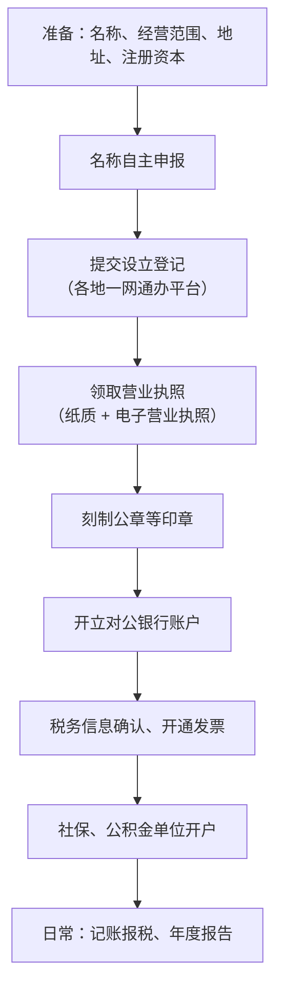
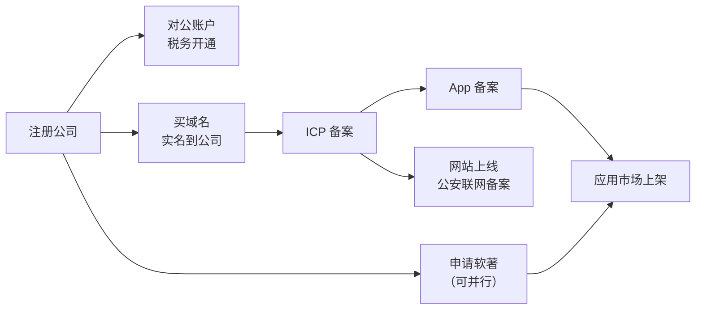

# 注册流程：从核名到第一次报税

上一章决定了用一人有限公司。这一章把它办下来，并讲清楚办下来之后每年、每月要持续做的事。很多人把注册当成终点，其实执照只是起点：之后的银行账户、税务报到、记账报税、年度报告，任何一环断掉都会让公司进入「经营异常」，进而影响 ICP 备案、开发者账号和应用上架。

> [!WARNING]
> 本章按 2025 年前后的办理流程整理，各地的办理平台、所需材料、是否需要现场核验差别很大且经常调整，以所在地市场监管部门、税务部门和国家企业信用信息公示系统的最新要求为准。

不确定的地方，直接打 12345 或去政务服务大厅问，比搜网上的攻略可靠。

## 全流程概览

现在多数城市把 B 到 E（有的到 G）合并成「一网通办」，一次填报、多部门并联审批，顺利的话几个工作日就能拿到执照。下面按步骤说要提前想清楚的东西。

## 动手前要定的四件事

### 名称

公司名称的标准结构是：**行政区划 + 字号 + 行业 + 组织形式**，比如「某市某某科技有限公司」。要点：

- **字号**是你真正能选的部分，不能和同地区同行业已有的重复或过于近似，不能用禁用词
- 现在大多实行**名称自主申报**：在系统里自己查重、自己承诺，系统给出风险提示
- 名称和产品名不需要一样，但建议**字号好记、和产品有关联**，后面 ICP 备案、App 备案、应用市场开发者信息都会展示主体名称
- 想同时注册商标的话，字号和产品名都可以先在商标局的查询系统里搜一下，避免日后撞车

### 经营范围

> [!WARNING]
> 经营范围条目和许可项目的划分按 2025 年前后的登记规范整理，可能已调整，以当地登记系统的实际条目和国家市场监督管理总局的最新规定为准。

经营范围决定你**能合法做什么**，也会影响后面办许可。现在登记机关有规范化的经营范围条目库，从里面选，不要自己写。

做软件产品的独立开发者，常见的条目是这类（以登记系统里的实际条目名称为准）：

| 业务 | 可能对应的条目方向 |
|---|---|
| 写软件、做 App | 软件开发 |
| SaaS、在线服务 | 信息技术咨询服务、信息系统集成服务、数据处理服务等 |
| 用到 AI | 人工智能应用软件开发、人工智能基础软件开发等 |
| 卖课、写书 | 可能涉及出版、培训类条目，部分需要前置或后置许可 |
| 经营性网站、在线收费 | 第一类 / 第二类增值电信业务（属于**许可项目**，登记后还要去通信管理局取得许可才能实际经营） |

注意经营范围分**一般项目**和**许可项目**。一般项目登记后就能做；许可项目要在拿到相应许可证之后才能开展。把许可项目写进经营范围不等于你已经有了许可。

经营范围以后可以变更，但每变一次都要走登记流程，所以第一次尽量想周全，把未来一两年可能做的业务都覆盖到。

### 地址

注册地址是登记机关、税务机关寄送文书和实地核查的地方，必须真实可联系。常见选择：

- **自有或租赁的商业办公地址**：最稳妥
- **住宅**：一些地方允许「住所」登记，另一些地方对住宅商用有限制，要看当地政策和小区物业，部分地方需要业主同意或其他证明材料
- **园区地址托管 / 集群注册**：一些地方政府或园区提供，适合居家办公的独立开发者；问清楚收费、是否有纳税要求、是否代收信件

地址登记了却联系不上，会被列入经营异常名录。

### 注册资本和股东

一人公司只有你一个股东。上一章讲过，认缴出资要在五年内缴足，所以**写一个你确实能在五年内缴进去、又满足将来可能要申请的许可门槛的数**。不打算办许可的，写小一点没坏处。

同时要定**法定代表人、执行董事（或董事）、监事、财务负责人**这些角色。一人公司里法定代表人和执行董事通常是你自己。新《公司法》对规模较小的公司在设董事会、监事会方面有简化安排，具体怎么设，登记系统会给出可选项。注意部分角色之间不能兼任（比如监事一般不能由董事或高管兼任），登记系统会校验。

## 设立登记

各省市都有自己的企业开办平台，统称「一网通办」。流程大同小异：

1. 实名认证：法定代表人、股东等相关人员用手机 App 刷脸
2. 填报：名称、地址、经营范围、注册资本、人员信息
3. 上传材料：公司章程（多数平台提供范本，一人公司直接选模板）、住所证明等
4. 相关人员电子签名
5. 审核通过后领取**营业执照**，同时可以下载**电子营业执照**

电子营业执照现在用处很多：登录税务系统、办理银行业务、在部分政务平台做身份认证，都可能用到。下载后妥善保管，它的效力和纸质执照一样。

## 拿到执照之后

### 刻章

一般需要：公章、财务专用章、法定代表人名章，有的还要发票专用章、合同专用章。很多地方开办企业时免费刻章，或者在一网通办里一并申请。印章要到公安备案过的刻章单位刻制。

### 对公银行账户

对公账户是**财产独立的第一道证据**，必须开。开户时银行会做尽职调查，可能要求：

- 营业执照、公章、法人身份证
- 实际经营地址的证明，有的银行会上门核实
- 介绍你的业务：做什么、客户是谁、钱从哪来

如实说即可。银行对「刚成立、注册在托管地址、一个人」的公司审核会严一些，提前准备一份简单的业务说明（产品截图、官网、合同）能顺利很多。

### 税务

> [!WARNING]
> 纳税人身份、数电发票和申报周期按 2025 年前后的规定整理，可能已调整，以国家税务总局和当地电子税务局的最新规定为准。

拿到执照后，税务信息通常已经由登记系统同步过去，你需要登录电子税务局**确认信息**、选择**纳税人身份**（新公司一般默认小规模纳税人）、**开通发票**（现在普遍是数电发票，也就是全面数字化的电子发票）、和银行签**三方协议**用于扣税。

从这时起，就算没有一分钱收入，也要**按期申报**（零申报也是申报）。纳税期限是按月还是按季、有哪些税种，以税务机关核定的为准。税种和优惠政策的细节放在[《财务与税务》](../opc-finance/)一书。

### 社保和公积金

公司要为员工缴纳社保。只有你自己时，是否必须给自己在公司缴社保、怎么缴最合适，涉及当地政策和你的个人情况（比如是否已在别处缴纳），咨询当地社保经办机构或代账会计。

## 每年和每月要做的事

> [!WARNING]
> 年报时间、申报周期和经营异常名录规则按 2025 年前后的规定整理，可能已调整，以国家企业信用信息公示系统、国家市场监督管理总局和国家税务总局的最新规定为准。

公司办下来之后，有一组周期性义务：

| 频率 | 事项 | 不做的后果 |
|---|---|---|
| 每月或每季 | 纳税申报（含零申报） | 逾期罚款、影响纳税信用 |
| 每月 | 记账（通常委托代账公司） | 无法准确申报、财产独立无从证明 |
| 每年 | 企业所得税汇算清缴 | 罚款、纳税信用受损 |
| 每年 1 月 1 日至 6 月 30 日 | 在国家企业信用信息公示系统报送**上一年度的年度报告** | 列入经营异常名录 |
| 信息变更时 | 地址、经营范围、人员变更登记 | 登记信息与实际不符，也可能被列入异常 |

**经营异常名录**不是罚款那么简单，它会在公示系统里公开，银行、客户、应用市场审核都能查到。部分平台在审核开发者资质时会看主体状态，异常状态可能导致审核不过。

把这些事放进日历，最好的办法是：**找一家代账公司处理记账和报税，自己负责年报和变更**。代账费用不高，换来的是不漏报。

## hatch-counter 的时间线

把注册和后面几章的手续串起来，一个有服务端的产品从零到上架，大致顺序如下：

几个关键的依赖关系：

- **域名实名要等主体下来**：如果先用个人身份买了域名，备案前要把域名持有者过户到公司，否则「备案主体」和「域名持有者」对不上
- **ICP 备案在前，App 备案在后**：App 有服务端时，App 备案通常通过服务器的接入服务商办理，和网站备案在同一个系统里
- **软著可以早办**：它不依赖备案，审查周期又比较长，产品能跑起来就可以开始准备材料

hatch-counter 的做法是：注册完立刻把域名实名过户到公司，同时提交软著申请；域名一过户就提交 ICP 备案；ICP 备案通过后再办 App 备案。这样软著证书下来的时候，备案也差不多都齐了，可以一次性提交应用市场。

## 注销：最好一开始就知道

> [!WARNING]
> 注销流程和简易注销的适用条件按 2025 年前后的规定整理，可能已调整，以当地市场监管部门、税务部门和工信部备案系统的最新要求为准。

公司不想做了，要**注销**，不是放着不管。放着不管的公司会因为不报税、不年报进入异常名录，严重的会被吊销执照，法定代表人的个人信用也可能受影响。

注销的一般流程是：清算 → 税务注销 → 登记注销，各地也在推行**简易注销**（适用于没有债权债务、符合条件的企业）。还要记得同时处理：ICP 备案注销、App 备案注销、开发者账号、对公账户销户。

## 本章要点

- 注册的骨架：核名 → 设立登记 → 执照 → 刻章 → 对公账户 → 税务 → 社保；各地细节以当地最新要求为准
- 经营范围从规范条目里选，分一般项目和许可项目；**写进范围不等于拿到许可**
- 注册地址必须能联系上，住宅能否登记看当地政策
- 拿到执照后**零收入也要按期申报**，每年 1 月 1 日至 6 月 30 日报送上一年度年报
- 漏报会进经营异常名录，影响银行、客户和应用市场审核
- 有服务端的产品，顺序是：主体 → 域名过户 → ICP 备案 → App 备案 → 上架，软著并行
